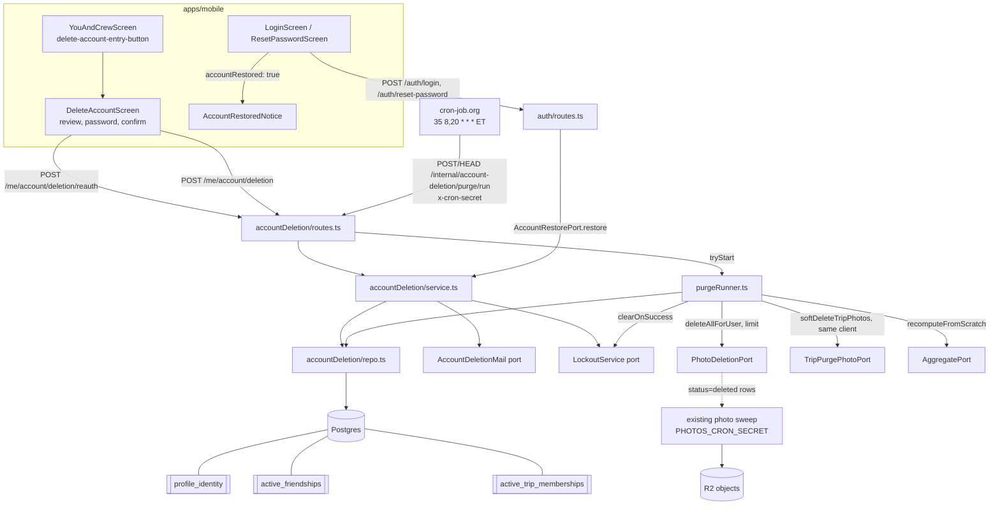
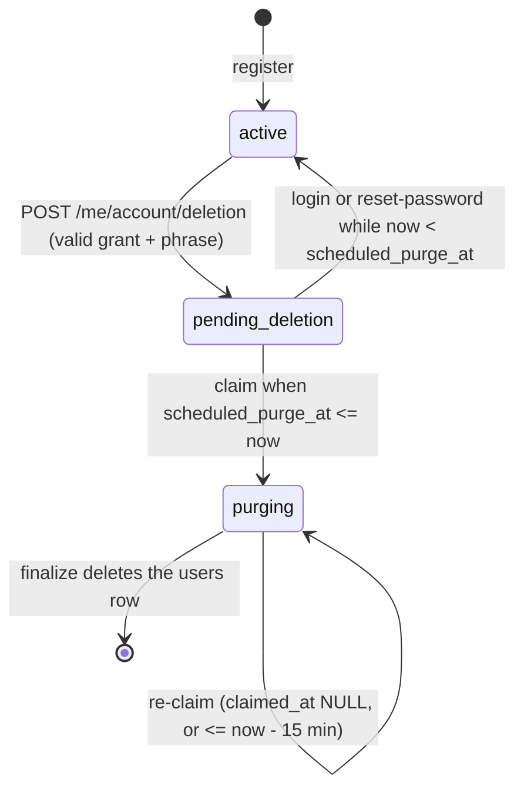

# Design Document

## Overview

Self-service account deletion for Disney World Tracker. A signed-in user re-enters their password, types `DELETE`, and the account moves to `pending_deletion`: every session is revoked, push registrations are removed, and the person disappears from everyone else's screens. Signing in (or completing a password reset) inside the grace period (`ACCOUNT_DELETION_GRACE_DAYS`, default 30) restores the account losslessly. After the grace period a dedicated, secret-gated cron endpoint (`202` fast, work async in-process, no worker) purges it: photos are soft-deleted for the existing sweep, owned trips are transferred or deleted, content other people rely on is kept under a per-account **tombstone** identity, and everything else is removed.

The design rests on six decisions. Each is explained in the sections that follow, and the alternatives are listed under "Key decisions".

1. **A new `accountDeletion` service** (`apps/api/src/services/accountDeletion/`) owns the whole feature: pure modules, `repo.ts`, `service.ts`, `routes.ts`, and the purge runner. It is wired in `composeServices.ts` through structural ports. Auth, trips, photos, push, aggregate and mail are consumed through ports, never imported as concrete modules.
2. **Account state lives on `users`** (`deletion_state`, `scheduled_purge_at`, and a few purge-progress columns). The state machine is `active -> pending_deletion -> purging -> (row deleted)`, plus `pending_deletion -> active` on restore. A fourth value, `tombstone`, marks the anonymous stand-in rows described below.
3. **Identity for "Deleted user" is a per-account tombstone row** in `users` (random id with a fixed, recognisable prefix, no credentials, a profile named `Deleted user`). Retained content is re-pointed at it at purge. During the grace period the same id is shown to others as a read-time alias, so the id other clients see does not change at purge time.
4. **Hiding a pending user is done in the database, not in every handler.** Three SQL views are the choke points: `profile_identity` (name, avatar and public id projection), `active_friendships` (friend edges between two active users) and `active_trip_memberships` (trip rosters of active users). A structural guard test fails the suite if a service reads the raw `profiles`, `users` or `friendships` tables outside an allowlist.
5. **Purge is staged, fenced and idempotent.** Five stages, a monotonic `purge_stage` counter, a fencing claim timestamp, and a final "no remaining reference" check before the `users` row is deleted. A durable queue carries the aggregate-rating recompute across crashes.
6. **The deletion route lives in the new service, not in `photos` or `auth`.** The existing `photos.guards.test.ts` guard keeps passing with no change to its assertions (see Notes).

### What the code looks like today (verified by reading it)

- `users` is `(id, email CITEXT UNIQUE, password_hash, created_at)`. There is no state column, no provider column. Sign-in is email and password only (`auth/routes.ts`). No Sign in with Apple exists, so there is no provider token to revoke (Requirement 13).
- Sessions are opaque bearer tokens hashed in `sessions` and resolved by `createSessionMiddleware` (`sessionMiddleware.ts`) through a `SessionDbAdapter`. The adapter's SQL lives in `composeServices.ts` (`makeSessionDbAdapter`). There are no separate refresh tokens. Revocation is `UPDATE sessions SET revoked_at = now()` (used by logout, change-password and reset-password today).
- `POST /auth/login` looks the user up by email, consults the Redis `LockoutService`, verifies Argon2id, then inserts a session with a 24 h absolute TTL. `POST /auth/reset-password` completes through `PasswordResetRepo.completeReset`, which already revokes every session.
- The cron pattern is `x-cron-secret` gated, `secretMatches` (constant time; two separate exported copies, in `photos/sweepCronRoute.ts` and `tripBooking/passGate.ts`), `tryStart()` returning `{started:true}` or `{started:false, reason:'in_flight'}`, `202` on `POST` and `HEAD`. `tripBooking/routes.ts` registers its cron routes inside the service's own route plugin and reads the secret from `app.config`; `photos` registers `sweepCronRoute` from `server.ts`. Each job has its own cron-job.org entry and secret (`docs/hosting.md`).
- Trip authorization reads the caller's persisted role through three readers: `trips/authz.ts` `assertTripMember`, `trips/repo.ts` `lockMembership` (FOR UPDATE), and `composeServices.ts` `roleOf` (photos port). `trips.creator_id` carries **no authority** anywhere in the code: it is recorded at create time and shown in admin only. Authority is the `organizer` role.
- `departMember` (leave/remove) deletes the membership, cancels pending rode-with tags, and deletes the trip when the last member leaves. It does **not** call `softDeleteForTarget`. `DELETE /trips/:id` does (`photoLifecycle.softDeleteForTarget('trip', id)` before `repo.deleteTrip(id)`, pinned by `tripDeletePhotos.test.ts`), because `photos` has deliberately no foreign key to trips.
- `photos.owner_id` is `ON DELETE SET NULL`. `softDeleteByOwner(ownerId, now)` sets every non-deleted photo of the owner to `deleted`. The sweep (`photos/sweep.ts`) lists `deleted` rows, deletes storage objects by keys derived from the **photo id**, then hard-deletes the row. The user id plays no part in storage paths.

## Architecture



### Request flow

1. `POST /me/account/deletion/reauth` (session required). Lockout check, Argon2id verify, issue a one-use grant bound to `(user, session)`.
2. `POST /me/account/deletion` (session required). Validate the phrase, then in one transaction: consume the grant, flip `active -> pending_deletion` with a conditional update, revoke every session, expire reset tokens, delete push registrations. After commit: best-effort email.
3. From then on the user has no session. Other users' reads go through the three views and do not see them.

### Restore flow

`POST /auth/login` and `POST /auth/reset-password` (and the web fallback) classify the account with the pure `classifyLoginEligibility`. A restorable account (state `pending_deletion`, `now < scheduled_purge_at`) is restored by one conditional `UPDATE` before the session is minted. Losing the race with the purge claim yields `invalid_credentials`.

### Purge flow

The cron calls the endpoint. The runner drains the recompute queue, claims up to `ACCOUNT_DELETION_PURGE_BATCH` due accounts with one `UPDATE ... FOR UPDATE SKIP LOCKED ... RETURNING` statement, runs five stages per account within a time budget checked before every chunk and stage (releasing any claim it cannot finish), and finishes each account by deleting the `users` row and writing a non-identifying ledger row in one transaction.

## Components and Interfaces

### Where the code lives

New service folder `apps/api/src/services/accountDeletion/`:

| File | Kind | Responsibility |
|---|---|---|
| `deletionState.ts` | pure | `DeletionState` type, `canTransition`, `computeScheduledPurgeAt`, `isRestorable`, `classifyLoginEligibility`, `isClaimable`, `PURGE_STALE_CLAIM_MS`, `PURGE_ATTEMPTS_ALERT` |
| `ownerSelection.ts` | pure | `selectNewOwner`, `planTripResolution` |
| `dispositions.ts` | pure data | The disposition registry (every `table.column` that references `users(id)` by foreign key), the separate `SOFT_REFERENCES` list (non-FK references: `users.placeholder_id`, JSONB, Redis), plus `columnsBy(disposition)`, `buildChunkedStatement`, and `CASCADE_AUDIT_EXEMPT` (the four accepted cascade pairs with reasons, Property 28) |
| `placeholderId.ts` | pure | `generatePlaceholderId(rng)`; the prefix check `isDeletedUserId` lives in `@dwt/shared` so mobile uses the same code |
| `scrub.ts` | pure | `scrubSharePayload(payload, replacementId)`, used both by the purge's JSONB stage and by the read-time projection in `sharing/repo.ts` |
| `reauthGrant.ts` | pure | `generateGrant()`, `hashGrant`, `isGrantUsable` |
| `purgePlan.ts` | pure | The ordered stage list and `nextStage` |
| `logId.ts` | pure | `accountLogId(userId, sessionSecret)`: `HMAC-SHA256(key = SESSION_SECRET, msg = 'account-deletion-log-v1:' + userId)`, first 12 lowercase hex chars |
| `visibility.ts` | SQL constants | View names and the `ACTIVE_USER_SQL(alias)` fragment. The only place the visibility rule is written in SQL (views are defined once, in migration `0064`) |
| `ports.ts` | types | Structural ports (below) |
| `repo.ts` | DB | State transitions, grant store, claim, stage executors, ledger, recompute queue |
| `service.ts` | logic | `createAccountDeletionService(deps)`: `reauth`, `requestDeletion`, and the `AccountRestorePort` methods; takes mail and lockout as ports (deps in "Factories and dependencies") |
| `purgeRunner.ts` | logic | `createPurgeRunner(deps)`: single-flight, bounded, per-account isolation (deps in "Factories and dependencies") |
| `cronGate.ts` | pure | `secretMatches(provided: unknown, expected: string): boolean`: false for a non-string, empty provided, or empty expected value; else `timingSafeEqual` over the SHA-256 digests of both. A local copy on purpose (see Cron-auth mechanism); `cronGate.test.ts` covers match, mismatch, empty, non-string and a different-length secret |
| `webPages.ts` | pure | Self-contained HTML renderers and input validation for Google Play's web account-deletion resource and public privacy policy (`escapeHtml`, `validateWebDeletionInput`, `renderWebAccountDeletionFormHtml`, `renderWebAccountDeletionSuccessHtml`, `renderPrivacyPolicyHtml`) |
| `routes.ts` | Fastify | The routes (`POST /me/account/deletion/reauth`, `POST /me/account/deletion`, `POST`/`HEAD /internal/account-deletion/purge/run`, `GET`/`POST /account-deletion`, `GET /privacy`), cron gate (imports `secretMatches` from `./cronGate.js`, `reauthRateLimitConfig` and `loginRateLimitConfig` from `plugins/rateLimit.ts` and `@dwt/shared`; it imports no module from another service folder such as `photos/`, `auth/` or `tripBooking/`; a structural assertion in the accountDeletion tests scans its import lines) |

Routes live in this service. `/me/account/deletion/reauth` and `/me/account/deletion` sit under `/me` like the other self-service routes (`/me/shares`, `/me/pin-showcase`), but they are registered by `accountDeletionRoutes`, not by `auth` or `photos`. The cron route is registered by the same plugin, as `tripBooking/routes.ts` does, reading the secret from `app.config.accountDeletion.cronSecret` (single source, no second plumbing path), and comparing it with the local `secretMatches` of `cronGate.ts`.

### Ports (structural, in `ports.ts`)

```ts
export interface PhotoDeletionPort {
  /** Satisfied by PhotoService.deleteAllForUser (gains an optional `{ limit }`, additive) and, when photos are
   *  disabled, by photosRepo.softDeleteByOwner(userId, now, undefined, limit). Marks at most `limit` non-deleted
   *  photos `deleted` and returns their ids; the runner repeats until fewer than `limit` come back. */
  deleteAllForUser(userId: string, opts?: { limit?: number }): Promise<readonly string[]>;
}
export interface TripPurgePhotoPort {
  /** Satisfied in composeServices.ts by `(tripId, now, client) => createPhotosRepo(pool).softDeleteByTarget('trip', tripId, now, client)`.
   *  It takes the purge transaction's client so the photo soft-delete commits or rolls back with `DELETE FROM trips`.
   *  `PhotoLifecyclePort.softDeleteForTarget` is NOT used here: it has no client parameter. */
  softDeleteTripPhotos(tripId: string, now: Date, client: PoolClient): Promise<readonly string[]>;
}
export interface AggregatePort {
  recomputeFromScratch(experienceId: string): Promise<unknown>;   // AggregateRepo
}
export interface LockoutPort {                                      // LockoutService, structurally
  isLocked(userId: string): Promise<boolean>;
  recordFailure(userId: string, now?: number): Promise<boolean>;
  clearOnSuccess(userId: string): Promise<void>;
}
export interface AccountDeletionMail {                              // extends createMailService's return
  sendDeletionScheduled(input: { to: string; scheduledPurgeAt: Date; graceDays: number }): Promise<void>;
  sendDeletionCancelled(input: { to: string }): Promise<void>;
}
export interface AccountRestorePort {                               // consumed by auth/routes.ts
  /** Login path: one conditional UPDATE (its own statement), then the best-effort "deletion cancelled" email. */
  restore(userId: string, now: Date): Promise<'restored' | 'not_restorable'>;
  /** Reset path (R4.11): the same conditional UPDATE on the RESET transaction's client, so the restore, the password
   *  change and the code consumption commit or roll back together. Sends no mail. */
  restoreInTx(client: PoolClient, userId: string, now: Date): Promise<'restored' | 'not_needed' | 'not_restorable'>;
  /** Reset path, called by the handler AFTER the reset transaction committed with 'restored': the best-effort email. */
  notifyRestored(userId: string): Promise<void>;
}
export interface PasswordVerifier { verify(hash: string, plain: string): Promise<boolean>; }
export interface Clock { now(): Date; }
```

`MailService` itself is left unchanged, so existing test fakes keep compiling. `createMailService` returns `MailService & AccountDeletionMail`. `AuthRoutesOptions` gains an **optional** `accountRestore?: AccountRestorePort`. When it is absent and the account is restorable, auth fails closed with `invalid_credentials`.

### Pure modules, exact contracts

**`deletionState.ts`**

```ts
export type DeletionState = 'active' | 'pending_deletion' | 'purging' | 'tombstone';
export const PURGE_STALE_CLAIM_MS = 15 * 60 * 1000;

/** Allowed edges only: active->pending_deletion, pending_deletion->active, pending_deletion->purging, purging->purging (re-claim or release). Everything else false. */
export function canTransition(from: DeletionState, to: DeletionState): boolean;

/** requestedAt + graceDays * 86_400_000 ms, UTC. graceDays must be an integer 1..365 or it throws RangeError. */
export function computeScheduledPurgeAt(requestedAt: Date, graceDays: number): Date;

/** true iff state === 'pending_deletion' && scheduledPurgeAt != null && now < scheduledPurgeAt (strict). */
export function isRestorable(s: { state: DeletionState; scheduledPurgeAt: Date | null }, now: Date): boolean;

/** 'active' | 'restorable' | 'ineligible'. ineligible = unknown email handling: purging, tombstone, or pending with now >= scheduledPurgeAt. */
export function classifyLoginEligibility(s: { state: DeletionState; scheduledPurgeAt: Date | null }, now: Date): 'active' | 'restorable' | 'ineligible';

/** true iff (pending_deletion && scheduledPurgeAt != null && scheduledPurgeAt <= now) || (purging && (claimedAt == null || claimedAt <= now - PURGE_STALE_CLAIM_MS)).
 *  Mirrors the claim SQL's WHERE exactly; the claim's ORDER BY (purge_attempts, scheduled_purge_at, id) is the pure `orderForClaim` below. */
export function isClaimable(s: { state: DeletionState; scheduledPurgeAt: Date | null; claimedAt: Date | null }, now: Date): boolean;

export const PURGE_ATTEMPTS_ALERT = 5;
/** Comparator for the claim order: purge_attempts ascending, then scheduledPurgeAt ascending, then id ascending (string compare).
 *  Pure twin of the SQL ORDER BY, so Property 31 can be property-tested without a database and the SQL test can compare against it. */
export function orderForClaim(a: { attempts: number; scheduledPurgeAt: Date; id: string },
                              b: { attempts: number; scheduledPurgeAt: Date; id: string }): number;
```

**`ownerSelection.ts`**

```ts
export interface TripMemberFact {
  userId: string;
  role: 'organizer' | 'member';
  joinedAt: Date;
  state: DeletionState;          // from users.deletion_state
}

/** Candidates: members not equal to `excludeUserId`, state !== 'purging' && state !== 'tombstone'.
 *  Prefer state 'active'; only if none is active, use 'pending_deletion'.
 *  Order: role organizer before member, then joinedAt ascending, then userId ascending (plain string compare).
 *  Returns null when there is no candidate. Pure; invariant under input order. */
export function selectNewOwner(members: readonly TripMemberFact[], excludeUserId: string): TripMemberFact | null;

export type TripResolution =
  | { kind: 'delete_trip' }
  | { kind: 'keep_trip';
      newCreatorId: string | null;      // non-null iff the purged user is trips.creator_id
      promoteUserId: string | null;     // non-null iff the selected owner holds 'member' and a promotion is required
      removeMembership: boolean };      // true iff the purged user currently has a membership row

export function planTripResolution(input: {
  purgedUserId: string;
  creatorId: string;
  members: readonly TripMemberFact[];   // every membership row, including the purged user's
}): TripResolution;
```

`planTripResolution` rules, exactly:

1. `others = members \ {purgedUserId}`; `owner = selectNewOwner(members, purgedUserId)`.
2. If `owner === null`, return `delete_trip`. This covers "the user is the only member" and "every other member is already `purging`", so a trip can never survive with nobody who can use it.
3. Otherwise `keep_trip`. `newCreatorId = owner.userId` if `creatorId === purgedUserId`, else `null`.
4. A promotion is required when `owner.role === 'member'` and either (a) the purged user is the creator (the new owner must hold `organizer`, R10.4) or (b) after removing the purged user no non-`purging` organizer remains in `others`. In both cases `promoteUserId = owner.userId`.
5. `removeMembership = members.some(m => m.userId === purgedUserId)`.

Postcondition (the Last_Organizer_Rule over the persisted rows, evaluated by `violatesLastOrganizer`, plus the non-`purging` clause): after applying the plan, every surviving trip has at least one non-`purging` organizer.

**`placeholderId.ts` and `@dwt/shared`**

`DELETED_USER_ID_PREFIX = 'deadc0de-'` and `isDeletedUserId(id: string): boolean` live in `@dwt/shared/constants/deletedUser.ts`, next to `DELETED_USER_DISPLAY_NAME = 'Deleted user'` and `DELETE_ACCOUNT_CONFIRMATION_PHRASE = 'DELETE'`.

`generatePlaceholderId(rng: () => Uint8Array)` returns a valid RFC 4122 v4-shaped UUID whose first 32 bits are the prefix: `deadc0de-` + 4 hex + `-4` + 3 hex + `-` + one of `8 9 a b` + 3 hex + `-` + 12 hex. That keeps `uuidSchema` happy everywhere (the Zod UUID check accepts it), keeps 90 random bits, and lets the mobile client recognise a placeholder from the id alone, with no new DTO field on the dozens of DTOs that carry a person id.

**`scrub.ts`**

```ts
/** Pure. The embedded-name inventory of shares.payload_snapshot is exactly two kinds (checked against
 *  packages/shared/src/dto/Share.ts and sharing/routes.ts):
 *    pinShowcase  { ownerId, ownerDisplayName }  -> ownerId := replacementId, ownerDisplayName := DELETED_USER_DISPLAY_NAME
 *    tripSummary  { sharerDisplayName }          -> sharerDisplayName := DELETED_USER_DISPLAY_NAME
 *  `experience` (optional free-text note, no id or name) and `progress` (percentages and a facet label) embed nothing and
 *  are returned unchanged (same reference), as is any unknown or malformed shape. Idempotent. The caller decides WHICH
 *  rows to scrub (by sender), so this function never compares ids. */
export function scrubSharePayload(payload: unknown, replacementId: string): unknown;
```

pg-mem has no `jsonb_set`/`to_jsonb`, and `->>` on jsonb is unverified there, so the scrub is read-modify-write in TypeScript. **Candidate selection is by sender, not by JSON path:**

```sql
SELECT id, payload_snapshot FROM shares
 WHERE sender_id IN ($userId, $tombstoneId) AND payload_kind IN ('pinShowcase','tripSummary')
 ORDER BY id LIMIT $chunk;          -- repeated; each pass scrubs then UPDATE ... SET payload_snapshot = $2::jsonb WHERE id = $1
```

Including the tombstone id keeps the stage idempotent after `shares.sender_id` has been re-pointed (a crash between the re-point and the scrub is repaired by the next run). Because a scrubbed payload is returned `===` unchanged by a second `scrubSharePayload` call, a pass that finds nothing to change writes nothing; to guarantee termination the loop keysets on `id > $lastId` rather than relying on the rows dropping out of the `WHERE`.

**Read-time projection while pending.** `sharing/repo.ts` has three reads that return `payload_snapshot` (inbox ~line 416, Sent ~line 529, single-share lookup ~line 584, which feeds `tripRecapGate`). Each joins `profile_identity` instead of `profiles`; when `is_visible` is false it returns `scrubSharePayload(payload, p.public_id)` (the alias id) instead of the stored payload. The stored row is never changed, so a restore shows the real name again. A `sharing` pg-mem test covers each of the four payload kinds while pending (Requirement 5.11).

**`reauthGrant.ts`**: `generateGrant(): { grant: string; hash: string }` (32 random bytes, base64url; `hash` is sha256 hex). `isGrantUsable(row, now)` is `row.usedAt == null && now < row.expiresAt`. In practice use is enforced by deleting the row on consumption (below).

**`purgePlan.ts`**

```ts
export const PURGE_STAGES = ['photos', 'trips', 'anonymize', 'personal_data', 'finalize'] as const;
/** purge_stage = number of completed stages (0..4). nextStage(4) is 'finalize'; finalize has no successor. */
export function nextStage(completed: number): (typeof PURGE_STAGES)[number] | null;
```

### Repo (`repo.ts`) surface

```ts
export interface AccountDeletionRepo {
  // request / restore
  consumeGrantAndRequestDeletion(args: { userId: string; sessionId: string; grantHash: string;
      now: Date; scheduledPurgeAt: Date; placeholderId: string }):
      Promise<{ outcome: 'ok'; email: string } | { outcome: 'reauth_required' } | { outcome: 'not_active' }>;
  /** One transaction: BEGIN; DELETE FROM account_deletion_reauth_grants WHERE expires_at < $now (prune, R2.12);
   *  INSERT ... ON CONFLICT (session_id) DO UPDATE (replace-on-issue); COMMIT. The only pruner: no idle write anywhere. */
  issueGrant(args: { userId: string; sessionId: string; grantHash: string; expiresAt: Date; now: Date }): Promise<void>;
  // There is deliberately NO "find session id by token hash" method (design review round 2, finding 9).
  // `createSessionMiddleware` already loads the session row (`session.id`, sessionMiddleware.ts ~line 289) and now also
  // sets `request.sessionId = session.id` next to `request.userId`; the routes read that.
  restore(userId: string, now: Date): Promise<{ restored: boolean; email: string | null }>;
  /** The same conditional UPDATE, run on a caller-supplied transaction client (the reset flow, R4.11). Never sends mail.
   *  `restored`: the UPDATE matched. `not_needed`: no match and the account is already `active`. `not_restorable`: no
   *  match and the account is pending past its date, `purging` or `tombstone` (the purge claim won). */
  restoreInTx(client: PoolClient, userId: string, now: Date): Promise<'restored' | 'not_needed' | 'not_restorable'>;
  getPasswordHash(userId: string): Promise<string | null>;
  /** `SELECT email FROM users WHERE id = $1`; used only by `notifyRestored` (see "Factories and dependencies"). Never logged. */
  getEmail(userId: string): Promise<string | null>;

  // purge
  /** The single claim statement (R8.11a). Returns the claimed accounts with their fencing token and resume stage.
   *  See "Purge claim SQL" below. */
  claimDue(now: Date, limit: number): Promise<readonly ClaimedAccount[]>;
  /** UPDATE users SET purge_claimed_at = NULL WHERE id = $1 AND deletion_state = 'purging' AND purge_claimed_at = $claim.
   *  Used on budget stop and for accounts claimed but never started. false = fenced out (harmless). */
  releaseClaim(c: ClaimedAccount): Promise<boolean>;
  /** Fenced (`WHERE id = $1 AND deletion_state = 'purging' AND purge_claimed_at = $claim`). Sets `purge_stage = completed`,
   *  adds `deltas` to the `purge_*` counters, and resets `purge_attempts = 0` (a completed stage is progress). false = fenced out.
   *  Its counter SET fragment is the SAME SQL fragment `addCounters` uses (one private helper `counterAssignments(deltas)`). */
  advanceStage(c: ClaimedAccount, completed: number, deltas?: Partial<PurgeCounters>): Promise<boolean>;
  /** Fenced, same predicate. Adds `deltas` to the `purge_*` counters and changes NOTHING else: not `purge_stage`, not
   *  `purge_attempts`. The photo stage calls it once per loop iteration so `purge_photos_deleted` is correct even if the
   *  budget stops the stage midway; calling `advanceStage` per iteration would advance `purge_stage` early (review round 3,
   *  finding 7). false = fenced out. */
  addCounters(c: ClaimedAccount, deltas: Partial<PurgeCounters>): Promise<boolean>;
  /** Fenced. `UPDATE users SET purge_stage = $stage ...`. The ONLY code that moves `purge_stage` backwards; called by the
   *  runner with `0` after `finalize` returns `'refs_remain'` (R8.12). false = fenced out. */
  rewindStage(c: ClaimedAccount, stage: 0): Promise<boolean>;
  /** Fenced. One statement that sets `purge_last_attempt_at = $now`, `purge_claimed_at = NULL` (the claim is released so the
   *  account is re-claimable, but behind every account with fewer attempts, see the claim ordering) and the attempts as follows
   *  (review round 3, finding 1; R8.13):
   *    - `absoluteAttempts` OMITTED (a stage THREW): `purge_attempts = LEAST(purge_attempts + 1, 32767)`, relative to the
   *      stored value.
   *    - `absoluteAttempts` GIVEN (`finalize` returned `refs_remain`): `purge_attempts = LEAST($absoluteAttempts, 32767)`,
   *      an ABSOLUTE write. The runner passes `c.attempts + 1`, where `c.attempts` is the value `claimDue` returned BEFORE this
   *      run's `advanceStage` calls reset the column to 0. Without it a `refs_remain` loop oscillates 0 -> 1 -> 0 -> 1 (each
   *      re-run of stages 1 to 4 resets the counter) and can never reach `PURGE_ATTEMPTS_ALERT`.
   *  Returns the new attempt count, or null when fenced out. NOT called on a budget stop (that is not a failure). */
  recordFailedAttempt(c: ClaimedAccount, now: Date, absoluteAttempts?: number): Promise<number | null>;
  /** Fenced. `purge_warnings = purge_warnings + 1`; called when the best-effort Redis lockout cleanup throws (R9.11). */
  recordWarning(c: ClaimedAccount): Promise<boolean>;
  listTripsOf(userId: string): Promise<readonly string[]>;                // memberships UNION creator_id
  resolveTrip(c: ClaimedAccount, tripId: string, deps: TripResolveDeps): Promise<'deleted' | 'transferred' | 'unchanged' | 'fenced'>;
  ensureTombstone(c: ClaimedAccount): Promise<string>;                    // INSERT users+profiles ON CONFLICT DO NOTHING; returns placeholder id
  /** One chunk (<= ACCOUNT_DELETION_CHUNK_ROWS rows) of one registry entry's anonymize statement. For
   *  `anonymize_then_delete` entries only rows matching the entry's `retainWhere` are re-pointed (and `blank` columns nulled). */
  anonymizeChunk(c: ClaimedAccount, entry: DispositionEntry, tombstoneId: string): Promise<number>;
  scrubShares(c: ClaimedAccount, tombstoneId: string): Promise<number>;  // one chunk, keyset on id
  /** ONE chunk of the keyset-chunked enqueue (review round 3, finding 2; R9.12). Statement 1 reads a page:
   *  `SELECT experience_id FROM ratings WHERE user_id = $1 [AND experience_id > $2] ORDER BY experience_id LIMIT $3`
   *  (at most CHUNK_ROWS rows; two statement texts, the cursor condition present only when `afterExperienceId` is non-null,
   *  so no `IS NULL OR` parameter trick is needed). Statement 2 inserts that page: `INSERT INTO account_deletion_recompute_queue (experience_id)
   *  VALUES ($1::uuid), ($2::uuid), ... ON CONFLICT (experience_id) DO NOTHING` (one placeholder per page row, at most
   *  CHUNK_ROWS rows, so at most 5000 parameters, far below Postgres's 65535). Returns `{ lastId, count }`; `lastId` is the
   *  last id of the PAGE READ, never of the insert result: `INSERT ... ON CONFLICT DO NOTHING ... RETURNING` omits the
   *  conflicting rows, so a page whose ids were all queued already would return zero rows and a RETURNING-driven cursor would
   *  stop early with ratings still unqueued. `lastId = null` means the page was empty (done). The runner calls it in a loop
   *  (budget checked before each call), passing the previous `lastId`, and starts stage 4's registry loop only after it returned
   *  `null`. A resumed stage 4 restarts the loop from `null`: ids already queued conflict harmlessly, and ratings already
   *  deleted were queued by the earlier run (the loop always finishes before the first `ratings` delete). */
  enqueueRatedChunk(userId: string, afterExperienceId: string | null): Promise<{ lastId: string | null; count: number }>;
  /** One chunk of one `delete` / `nullify` / `anonymize_then_delete` (remaining rows) statement. */
  applyDeleteOrNullChunk(c: ClaimedAccount, entry: DispositionEntry): Promise<number>;
  /** Counts, per `anonymize`, `nullify`, `trip` entry (and the `retainWhere` rows of `anonymize_then_delete`), rows still naming the user. */
  countRemainingReferences(userId: string): Promise<readonly { table: string; column: string; count: number }[]>;
  /** Guard + DELETE users + ledger, one transaction. The ledger `outcome` is `completed_with_warnings` iff the locked user
   *  row's `purge_warnings > 0`, else `completed` (R9.11). `refs_remain` changes nothing; the RUNNER then calls
   *  `rewindStage(c, 0)` and `recordFailedAttempt(c, now, c.attempts + 1)` (absolute, R8.13). */
  finalize(c: ClaimedAccount, now: Date): Promise<'purged' | 'fenced' | 'refs_remain'>;
  drainRecomputeQueue(limit: number, recompute: (experienceId: string) => Promise<unknown>): Promise<number>;
}
```

`pruneExpiredGrants` from the first draft is removed: nothing would have called it, and an idle-pass write is forbidden by R8.11d. Grants are pruned inside `issueGrant` instead.

#### Purge claim SQL (R8.11a)

One statement claims up to `$batch` accounts, holds the row locks until the update commits, skips rows another instance has locked, and re-claims stale or released ones while keeping their `purge_stage`:

```sql
UPDATE users
   SET deletion_state   = 'purging',
       purge_claimed_at = $1,
       purge_stage      = CASE WHEN deletion_state = 'purging' THEN purge_stage ELSE 0 END
 WHERE id = ANY(ARRAY(
         SELECT id FROM users
          WHERE (deletion_state = 'pending_deletion' AND scheduled_purge_at <= $1)
             OR (deletion_state = 'purging'
                 AND (purge_claimed_at IS NULL OR purge_claimed_at <= $2))
          ORDER BY purge_attempts ASC, scheduled_purge_at ASC, id ASC
          LIMIT $3
          FOR UPDATE SKIP LOCKED))
RETURNING id, placeholder_id, deletion_requested_at, purge_claimed_at, purge_stage, purge_attempts;
-- $1 = now, $2 = now - PURGE_STALE_CLAIM_MS (computed in TypeScript, so the 15 minutes is written once), $3 = batch
```

Three details, each from review round 2 (finding 13 and finding 6):

- The threshold is a **parameter** (`$2 = new Date(now.getTime() - PURGE_STALE_CLAIM_MS)`), not a literal `interval '15 minutes'`, so the SQL and the constant cannot drift. A JS `Date` parameter compared with a `TIMESTAMPTZ` column is ordinary `pg` usage; `claim.test.ts` exercises it on pg-mem and, if pg-mem rejects it, the fallback is to pass the ISO string with an explicit `::timestamptz` cast (the test is where that is learned).
- `id = ANY(ARRAY(SELECT ... LIMIT $3 FOR UPDATE SKIP LOCKED))` evaluates the subselect exactly once into an array, so the planner cannot re-run it and claim more than `$3` rows. If pg-mem cannot plan `ARRAY(subselect)` (not probed), the repo falls back to the equivalent `id IN (SELECT ...)` form, which is the widely used Postgres idiom; the statement-text test accepts either, and the fallback is recorded in the task.
- `ORDER BY purge_attempts ASC, scheduled_purge_at ASC, id ASC`: an account that keeps failing (its `purge_attempts` grows on every failed run, see "Stuck accounts") sorts behind every account with fewer attempts, so ten permanently failing accounts can never occupy the whole batch and starve newer ones. Among equal attempts the oldest request goes first, with `id` as the deterministic tie-break. The partial index is `(purge_attempts, scheduled_purge_at)` to serve this order.

`SKIP LOCKED` inside the `UPDATE`'s subselect is valid and the lock persists for the update, so two instances can never claim one account (R8.3). It is also race-safe against Restoration: restore is `UPDATE ... WHERE deletion_state = 'pending_deletion' AND scheduled_purge_at > $now`; whichever commits first wins and the other re-evaluates its `WHERE` and matches nothing (R4.5). pg-mem parsing of `FOR UPDATE SKIP LOCKED` was probed and works, but pg-mem is single-connection, so the mutual exclusion itself is asserted by the sequential-claim test and by a statement-text assertion that the SQL contains `FOR UPDATE SKIP LOCKED`; the concurrent behaviour is Postgres's and is not exercised here (stated in Testing Strategy).

#### Stuck accounts: attempts, rewind, backoff (R8.12; review round 2, finding 6)

`purge_stage` counts **completed** stages (`0..4`). "Rewind" therefore means **`purge_stage = 0`**, so every stage (photos, trips, anonymize, personal data) runs again; every stage is idempotent, so re-running them is safe and is the cheapest way to repair a `refs_remain`. The code that writes the rewind is `rewindStage(c, 0)`, called by the **runner** (never by `finalize`, which only reports). The complete failure table:

| Event in the runner, for one claimed account | Repo calls, in order | Claim after | Counts as an attempt? | Log |
|---|---|---|---|---|
| a stage or chunk throws (any error, including a deadlock `40P01`) | `recordFailedAttempt(c, now)` (**relative**: `LEAST(purge_attempts + 1, 32767)` on the stored value) | released (`purge_claimed_at = NULL`) | yes | `warn` with `accountLogId`, stage, error name, `attempts`; **`error`** exactly once when the returned count equals `PURGE_ATTEMPTS_ALERT` |
| `finalize` returns `refs_remain` | `rewindStage(c, 0)`, then `recordFailedAttempt(c, now, c.attempts + 1)` (**absolute** from the claim-time value, R8.13) | released | yes | `error` with table and column names and counts (no ids) every time: it is a data-integrity signal; the alert `error` for the attempt count fires on the same rule as the row above |
| `finalize` or any fenced call returns fenced / `false` / `null` | none | not ours | no | `info`; the run stops work on this account |
| the time budget expires | `releaseClaim(c)` | released | no (not a failure) | `info` |
| a stage completes | `advanceStage(c, n)` (also sets `purge_attempts = 0`) | held | resets the count | none |

**Why the `refs_remain` write is absolute (review round 3, finding 1).** R8.12 resets `purge_attempts` to `0` whenever a stage completes, and a `refs_remain` rewind sends the account back through stages 1 to 4, each of which completes and resets the column. A relative `+ 1` after `finalize` would therefore write `0 + 1 = 1` every time and the counter would oscillate 0, 1, 0, 1 forever: the alert would never fire, the admin lookup would show at most `1`, and the claim order would have only two tiers for these accounts. `ClaimedAccount.attempts` was read by `claimDue` **before** this run's `advanceStage` calls, so `c.attempts + 1` is the true number of consecutive failed runs. R8.12's reset-on-stage rule is kept (it is what makes a thrown-stage account that later makes progress sort fairly); R8.13 records the clarification. The alert fires when the **returned** count equals `PURGE_ATTEMPTS_ALERT` exactly (not `>=`), so a saturated or later attempt does not log it again. A thrown stage that follows completed stages in the same run writes `0 + 1 = 1` (progress was made, so it is a fresh failure streak), which is intended.

`purge_attempts` is `SMALLINT` and saturates at 32767 (`LEAST(...)` in the statement) so it can never overflow. `PURGE_ATTEMPTS_ALERT = 5` (a constant in `deletionState.ts`, no env var: the cron runs twice a day, so five attempts is about two and a half days of failing). A released-with-attempts account stays eligible: it is re-claimed on the next run, but the claim order puts it **behind** every account with fewer attempts, so a failing account is retried every run while it is alone or when capacity remains, and never blocks anyone else. There is no give-up state: an account that can never be purged stays `purging` with a growing `purge_attempts` and an `error` log, and the operator sees it in the admin user lookup (`purgeAttempts`, shown when above zero). Giving up automatically would leave a deactivated, undeletable account in limbo; surfacing it is the honest design. A thrown stage releases the claim (it does not hold it for 15 minutes) so the retry is not delayed by the stale-claim threshold.

#### Supporting types and helpers (review round 2, finding 10)

Every type and helper the sections above refer to, defined once (all in `accountDeletion/`, signatures are the contract):

```ts
// ports.ts
/** Returned by claimDue. `claimedAt` is the fencing token: it is the exact JS Date passed as $1 to the claim, and
 *  Postgres TIMESTAMPTZ keeps microseconds while a JS Date has milliseconds, so the value round-trips exactly because
 *  the application chose it. Every fenced statement compares `purge_claimed_at = $claimedAt`. */
export interface ClaimedAccount {
  readonly id: string;                  // users.id. Never logged; log accountLogId(id, secret).
  readonly placeholderId: string;       // users.placeholder_id; becomes the tombstone id in ensureTombstone (the claim RETURNING includes it)
  readonly deletionRequestedAt: Date;   // becomes account_deletion_ledger.requested_at
  readonly claimedAt: Date;             // fencing token
  readonly stage: number;               // purge_stage at claim time, 0..4 (completed stages)
  readonly attempts: number;            // purge_attempts at claim time
}
export interface PurgeCounters { tripsTransferred: number; tripsDeleted: number; photosDeleted: number; }  // -> purge_trips_transferred, purge_trips_deleted, purge_photos_deleted
export interface TripResolveDeps {
  readonly photoPort: TripPurgePhotoPort;
  readonly now: Date;
  /** Test seam only: awaited right after the trips row is locked (step 1). Never set by composeServices.ts. */
  readonly afterTripLocked?: (client: PoolClient) => Promise<void>;
}
export interface Budget { expired(): boolean; }                                   // purgeRunner.ts: createBudget(timeBudgetMs, clock)
export interface PurgeRunSummary {
  readonly claimed: number; readonly purged: number; readonly released: number;
  readonly failed: number;              // accounts with a thrown stage or refs_remain this run
  readonly fenced: number; readonly recomputed: number; readonly budgetExpired: boolean;
}

// routes.ts: mirrors TripBookingRoutesOptions (tripBooking/routes.ts:46)
export interface AccountDeletionRoutesOptions {
  readonly service: AccountDeletionService;          // signatures, results and thrown AppError codes: "Factories and dependencies"
  readonly purgeRunner: PurgeRunner;
  readonly requireSession: preHandlerHookHandler;    // the same hook server.ts passes to every other plugin
  readonly now?: () => Date;
}

// visibility.ts
/** SQL fragment: `<alias>.deletion_state = 'active'`. The only place the predicate is written for a hand-written query. */
export function ACTIVE_USER_SQL(alias: string): string;
/** One query over profile_identity: id (real or public) -> { publicId, displayName, avatarPreset, isVisible }.
 *  Accepts real user ids AND placeholder/tombstone ids (a tombstone has a profile row of its own, so it resolves to itself
 *  with 'Deleted user'). Ids it cannot resolve are returned as { publicId: id, displayName: DELETED_USER_DISPLAY_NAME, avatarPreset: null, isVisible: false }. */
export function resolvePublicIds(db: DbPool | PoolClient, ids: readonly string[]):
  Promise<ReadonlyMap<string, { publicId: string; displayName: string; avatarPreset: string | null; isVisible: boolean }>>;

// dispositions.ts
/** All registry entries whose disposition is in `d`, in registry order. */
export function columnsBy(d: Disposition | readonly Disposition[]): readonly DispositionEntry[];

export type ChunkOp = 'delete' | 'nullify' | 'anonymize' | 'anonymize_retained';
export type ChunkedStatement =
  | { readonly kind: 'single';     // chunkColumns.length === 1: ONE statement per chunk
      readonly sql: string; readonly params: readonly unknown[] }
  | { readonly kind: 'per_key';    // chunkColumns.length >= 2: a bounded SELECT of key tuples, then one single-row statement per tuple
      readonly selectSql: string; readonly selectParams: readonly unknown[];
      readonly perKeySql: string;                         // takes the user id, the tombstone id (if any) and one value per key column
      readonly keyColumns: readonly string[] };
/** Pure. Emits `LIMIT` in every `sql` / `selectSql` (asserted by dispositions.test.ts). */
export function buildChunkedStatement(entry: DispositionEntry, op: ChunkOp,
  ctx: { userId: string; tombstoneId?: string; chunkRows: number }): ChunkedStatement;
```

**What `buildChunkedStatement` emits** (the decision the review asked for; no row-value `IN`, so nothing depends on a pg-mem probe):

- `kind: 'single'` (exactly one chunk column `k`): `DELETE FROM t WHERE col = $1 AND k IN (SELECT k FROM t WHERE col = $1 ORDER BY k LIMIT $2)`; `nullify` and `anonymize` are the same with `UPDATE t SET col = NULL` or `SET col = $3`. Repeated until it affects zero rows.
- `kind: 'per_key'` (two or more chunk columns): `selectSql` = `SELECT k1, k2[, k3] FROM t WHERE col = $1 ORDER BY k1, k2[, k3] LIMIT $2`; `perKeySql` = `DELETE FROM t WHERE col = $1 AND k1 = $2 AND k2 = $3[ AND k3 = $4]` (or the `UPDATE` forms). The runner runs the select, then one `perKeySql` per returned tuple inside one transaction, so a chunk is at most `CHUNK_ROWS` single-row statements and each statement touches at most one row. It repeats until the select returns no tuple. This path is used by **every** entry with two or more chunk columns, with no per-table special case.

**Chunk keys must be unique keys.** An entry's chunk columns together with its own user column must contain a `PRIMARY KEY` (or a `UNIQUE` constraint) of the table, so "one tuple = one row" holds. Property 11 parses the migrations and asserts this for every entry; a wrong key fails CI instead of failing the purge at stage 3 or 4 with `column "id" does not exist`.

### Factories and dependencies (review round 4, finding 2)

The two factories take one `deps` object each. Every field is a structural port or a plain value, so a test substitutes a fake for each and nothing reaches for `process.env`, `Date.now()` or a global logger. All of this is in `ports.ts` except the two factories themselves.

```ts
// ports.ts, added to the ports above
/** The only logging seam. A pino Logger (createLogger()), a Fastify logger and a recording fake all satisfy it
 *  structurally. First argument is always an object; callers put only `account` (the accountLogId), `stage`, `attempts`,
 *  error names and counts in it, never an id, email, password or grant (Property 22). */
export interface LoggerPort {
  info(obj: object, msg?: string): void;
  warn(obj: object, msg?: string): void;
  error(obj: object, msg?: string): void;
}
export interface Scheduler { run(job: () => Promise<void>): void; }   // mirrors photos/ports.ts; not imported (port rule)

// service.ts
export interface AccountDeletionServiceDeps {
  readonly repo: AccountDeletionRepo;
  readonly lockout: LockoutPort;
  readonly mail: AccountDeletionMail;
  readonly verify: PasswordVerifier['verify'];                    // auth/password.ts `verify`
  readonly clock: Clock;
  readonly logger: LoggerPort;
  readonly config: { readonly graceDays: number; readonly reauthWindowSeconds: number };   // config.accountDeletion
  readonly logSecret: string;                                     // config.session.secret, the HMAC key of accountLogId
  readonly newPlaceholderId?: () => string;                       // test seam; default generatePlaceholderId(() => randomBytes(16))
}
export interface ReauthResult { readonly reauthGrant: string; readonly expiresAt: Date; readonly graceDays: number }
export interface DeletionRequestResult { readonly status: 'pending_deletion'; readonly scheduledPurgeAt: Date; readonly graceDays: number }
export interface AccountDeletionService extends AccountRestorePort {
  /** Throws AppError `account_locked` (423, before any password work) or `reauth_failed` (403, after recordFailure).
   *  Never calls clearOnSuccess (R2.13). A lockout or Redis error propagates and answers `internal_error` (fails closed). */
  reauth(userId: string, sessionId: string, password: string): Promise<ReauthResult>;
  /** Throws AppError `account_deletion_confirmation_invalid` (400; checked first, before the repo, so the grant is not consumed)
   *  or `reauth_required` (403; the repo outcome is `reauth_required` or `not_active`). A repo failure propagates and answers
   *  `internal_error` (the transaction rolled back). A mail failure is caught and logged at `warn` without the recipient. */
  requestDeletion(userId: string, sessionId: string, grant: string, confirmation: string): Promise<DeletionRequestResult>;
}
export function createAccountDeletionService(deps: AccountDeletionServiceDeps): AccountDeletionService;

// purgeRunner.ts
export interface PurgeRunnerDeps {
  readonly repo: AccountDeletionRepo;
  readonly photos: PhotoDeletionPort;
  readonly tripPhotos: TripPurgePhotoPort;                        // becomes TripResolveDeps.photoPort
  readonly aggregate: AggregatePort;
  readonly lockout: LockoutPort;                                  // end-of-stage-4 clearOnSuccess cleanup (R9.11); best-effort: a Redis failure is logged at warn and never fails the account
  readonly clock: Clock;                                          // the budget (createBudget) and every `now` the runner passes
  readonly logger: LoggerPort;
  readonly logSecret: string;                                     // accountLogId key
  readonly config: { readonly batch: number; readonly timeBudgetMs: number; readonly chunkRows: number };
  readonly scheduler?: Scheduler;                                 // default { run: (job) => { void job(); } }, as createSweepRunner
  readonly afterTripLocked?: (client: PoolClient) => Promise<void>;   // test seam only, forwarded into TripResolveDeps; never set by composeServices.ts
}
export function createPurgeRunner(deps: PurgeRunnerDeps): PurgeRunner;
```

Decisions the signatures encode:

- **One object implements `AccountRestorePort`: the service.** The same `accountDeletionService` value is `AccountDeletionRoutesOptions.service` and `AuthRoutesOptions.accountRestore`. `restore` calls `repo.restore` and, when it restored and an address came back, sends `sendDeletionCancelled` in a `try/catch` (`warn`, no recipient). `restoreInTx` delegates to `repo.restoreInTx` and sends nothing. `notifyRestored(userId)` reads the address with a new `AccountDeletionRepo.getEmail(userId): Promise<string | null>` (one `SELECT email FROM users WHERE id = $1`, never logged) and sends `sendDeletionCancelled` the same best-effort way. `getEmail` is the one repo method this subsection adds; the port has no email parameter because the reset handlers do not all hold one.
- **`unauthorized` is not the service's error.** The routes throw it when `request.sessionId` is `undefined` (see Routes); the service always receives a session id.
- **The clock is injected, not read.** The service computes `scheduledPurgeAt` once with `computeScheduledPurgeAt(clock.now(), config.graceDays)` and passes that same `Date` to the repo and back in the result, so the response and the stored value cannot differ. The runner's `Budget` is `createBudget(config.timeBudgetMs, clock)`, which is what lets the budget tests expire it at a chosen statement.
- **The recording logger** used by the tests (`createRecordingLogger()` in `accountDeletion/__tests__/helpers.ts`) returns `{ logger: LoggerPort, calls: { level: 'info' | 'warn' | 'error'; obj: object; msg?: string }[] }`. "A captured logger shows the alert `error` exactly once" means `calls.filter(c => c.level === 'error' && ...)` has length 1.

### Routes (`routes.ts`)

| Method and path | Gate | Body (Zod in `@dwt/shared`) | Success |
|---|---|---|---|
| `POST /me/account/deletion/reauth` | `requireSession`, `reauthRateLimitConfig()` | `{ password }` (non-empty, max 128) | `200 { reauthGrant, expiresAt, graceDays }` |
| `POST /me/account/deletion` | `requireSession` | `{ reauthGrant, confirmation }` | `200 { status: 'pending_deletion', scheduledPurgeAt, graceDays }` |
| `POST /internal/account-deletion/purge/run` | `x-cron-secret` | none | `202 { status: 'accepted' }` or `202 { status: 'skipped', reason: 'in_flight' }` |
| `HEAD /internal/account-deletion/purge/run` | `x-cron-secret` | none | `202`, no body |

`reauthRateLimitConfig()` is added to `plugins/rateLimit.ts` (R2.11). It uses the login budget (`DEFAULT_LOGIN_ACCOUNT`) but keys on the hashed bearer token (`reauth:<sha256 of token>`). `loginRateLimitConfig()` keys on `body.email`, which the reauth body does not have, so it would fall back to a per-IP bucket shared with every login on the same Wi-Fi.

**Session binding (review round 2, finding 9).** The grant is bound to the caller's session through `request.sessionId`. `createSessionMiddleware` already loads the session row and does `request.user = { id: session.user_id }; request.userId = session.user_id;` (`sessionMiddleware.ts` ~line 289); it now also does `request.sessionId = session.id`, with `sessionId?: string` added to the `FastifyRequest` module augmentation next to `userId`. The middleware has already rejected revoked, expired and non-active sessions by that point, so the id is always a live session. Both `/me/account/...` handlers read `request.sessionId`; if it is `undefined` (a test double, or a code path that bypassed the middleware) they throw `unauthorized` (401). The private, non-exported `extractBearerToken` in `auth/routes.ts` is **not** reused or re-implemented. (`reauthRateLimitConfig()` does need the raw bearer token for its key; it reads the `Authorization` header in its key generator, exactly as `defaultRateLimitKey` in `plugins/rateLimit.ts` already does at `onRequest` time, hashes it, and never persists it.) A route test asserts a request with no session gets `401`, and a repo/route test asserts the grant stored on the reauth call carries the middleware's `session.id`.

**Reauth and the lockout counter (review round 3, finding 12; R2.13).** The `reauth` handler's order is: `isLocked(userId)` (refuse with `account_locked` before any password work), `verify(hash, password)`, then on failure `recordFailure(userId)` and `reauth_failed`, and on success **only** `issueGrant`. It does **not** call `clearOnSuccess`, which `handleLogin` does call: a holder of a stolen session must not be able to reset, through a route that exists to confirm a deletion, the counter that protects the account's password. The user's own next login clears it as before. The reauth route test asserts `clearOnSuccess` was **not** called on a successful reauth (the `LockoutPort` fake records every call), and that `recordFailure` was called exactly once on a wrong password.

### Wiring (`composeServices.ts`, `server.ts`)

- `composeServices.ts` builds `accountDeletionRepo(pool)`, the service, and the runner after the photos block, because it needs `photoService`. When `config.photos.enabled` is false there is no `photoService` (the photos repo is only created inside the `if (config.photos.enabled)` block); the photo port is then `{ deleteAllForUser: (id, o) => createPhotosRepo(pool).softDeleteByOwner(id, new Date(), undefined, o?.limit) }`, so purge still marks any existing rows `deleted` (the objects wait for the sweep to be enabled; noted in the runbook). The `TripPurgePhotoPort` always builds its own `createPhotosRepo(pool)` (a stateless factory over the pool), independent of the flag.
- **Logger, mail and the deps objects (review round 4, finding 2).** Verified in the code: `composeServices.ts` does **not** call `createMailService` today; the only call is inside `authRoutes` (`auth/routes.ts` ~line 191, `options.mailService ?? createMailService({ logger: app.log })`), which uses `app.log`, a Fastify logger that does not exist at compose time. `composeServices.ts` does have `createLogger()` (`./logger.js`, already used for `notificationLogger` ~line 399). So, in the account-deletion block after the photos block:
  1. `const accountDeletionLogger = createLogger();` (one dedicated compose-time instance, a `pino.Logger`, which satisfies `LoggerPort` structurally). The **same** instance is passed to the mail service, the service and the runner, so all three write through one redacting logger.
  2. `const accountDeletionMail = createMailService({ logger: accountDeletionLogger });` a **second** `createMailService` instance, separate from the one `authRoutes` creates. The two instances are independent but equivalent: provider selection (Resend key, else SMTP, else the log-only mock) is inside the factory and reads the same `RESEND_API_KEY`, `SMTP_*` and `MAIL_FROM` variables, so that logic exists once. The two new templates (`sendDeletionScheduled`, `sendDeletionCancelled`) are added to **that same factory** in `mailService.ts` and go through its existing `transport` (`options.sendFn ?? defaultSend`). The `sendFn` payload type is password-reset shaped (`code?`, `resetUrl?`), but both fields are optional, so the new templates call `transport({ from, to, subject, html, text })` and neither the payload type nor `MailServiceOptions` changes; a test injects `sendFn` to capture subject and text. The instance `authRoutes` creates also gains the two methods (the factory's return type is the superset) and never calls them. Type note: `MailServiceOptions.logger` is declared `FastifyBaseLogger` and `createLogger()` returns `pino.Logger`; I did not run `tsc` on that assignment. If the compiler rejects it, narrow the option to `Pick<FastifyBaseLogger, 'info' | 'error'>` (the factory calls only `.info` and `.error`), which accepts every current caller.
  3. `const accountDeletionService = createAccountDeletionService({ repo, lockout, mail: accountDeletionMail, verify, clock, logger: accountDeletionLogger, config: { graceDays, reauthWindowSeconds } from config.accountDeletion, logSecret: config.session.secret })`, where `repo = accountDeletionRepo(pool)`, `lockout` is the existing `createLockoutService(redis as never)` constant (~line 771, defined before the photos block), `verify` is imported from `./services/auth/password.js`, and `clock = { now: () => new Date() }`.
  4. `const purgeRunner = createPurgeRunner({ repo, photos, tripPhotos, aggregate, lockout, clock, logger: accountDeletionLogger, logSecret: config.session.secret, config: { batch: purgeBatch, timeBudgetMs: purgeTimeBudgetMs, chunkRows } from config.accountDeletion })`, with `photos` and `tripPhotos` as described in the bullet above, `aggregate` the existing `AggregateRepo`, and no `scheduler` (the default runs the job in-process).
  5. The service is passed to `authRoutes({ pool, lockout, requireSession: sessionMiddleware, accountRestore: accountDeletionService })` at its registration (~line 1220, after the photos block, so the service exists by then) and, with the runner, to `services.accountDeletion` for `server.ts`.
- `softDeleteByOwner` gains an optional 4th parameter `limit?: number` (additive, default behaviour unchanged): with a limit the SQL becomes `UPDATE photos SET status='deleted', deleted_at=COALESCE($2, now()) WHERE id IN (SELECT id FROM photos WHERE owner_id=$1 AND status<>'deleted' ORDER BY id LIMIT $3) RETURNING id`. `PhotoService.deleteAllForUser(userId, opts?)` forwards it. A pg-mem repo test in `photos` pins the limit.
- The trip delete is done by the purge itself inside `resolveTrip` (see Trip resolution), using `TripPurgePhotoPort` with the transaction's client; `TripRepo.deleteTrip` is not called (R10.10).
- `makeSessionDbAdapter` (`composeServices.ts`) joins `users` and returns `deletion_state` (Requirement 4.8). **A second copy exists** at `apps/api/test/smoke/harness.ts:669` (`function makeSessionDbAdapter(pool: DbPoolLike)`); it must gain the same join, and the smoke harness user fixtures rely on the column default (`'active'`) so they need no edit.
- `server.ts` gets `services.accountDeletion?: AccountDeletionRoutesOptions` and `app.register(accountDeletionRoutes(...))` next to `tripBookingRoutes`.
- `AuthRoutesOptions.accountRestore` is passed `accountDeletionService`. It must be threaded to **every** handler that restores: `handleLogin` (has `options`), `handleResetPassword(options, resetRepo, now, request, reply)` (has `options`), and `handlePostResetPasswordWeb(resetRepo, request, reply)`, which currently receives only the repo; its signature gains the port (and the route registration at `auth/routes.ts` ~line 233 passes it).

## Data Models

Migration: **`apps/api/migrations/0064_account_deletion.sql`** (highest existing is `0063_trip_photos.sql`). Test: **`apps/api/src/db/__tests__/migration0064.test.ts`**. Additive and idempotent on reapply (`IF NOT EXISTS`, `DROP ... IF EXISTS` before `ADD CONSTRAINT`). All timestamps `TIMESTAMPTZ` (UTC). No money columns are introduced.

```sql
BEGIN;

-- 1. Lifecycle columns on users --------------------------------------------------------------
ALTER TABLE users ADD COLUMN IF NOT EXISTS deletion_state            TEXT        NOT NULL DEFAULT 'active';
ALTER TABLE users ADD COLUMN IF NOT EXISTS deletion_requested_at     TIMESTAMPTZ;
ALTER TABLE users ADD COLUMN IF NOT EXISTS scheduled_purge_at        TIMESTAMPTZ;   -- persisted at request time (R3.1)
ALTER TABLE users ADD COLUMN IF NOT EXISTS placeholder_id            UUID;          -- alias id shown to others; becomes the tombstone id
ALTER TABLE users ADD COLUMN IF NOT EXISTS purge_claimed_at          TIMESTAMPTZ;   -- fencing token
ALTER TABLE users ADD COLUMN IF NOT EXISTS purge_stage               SMALLINT    NOT NULL DEFAULT 0;
ALTER TABLE users ADD COLUMN IF NOT EXISTS purge_trips_transferred   INTEGER     NOT NULL DEFAULT 0;
ALTER TABLE users ADD COLUMN IF NOT EXISTS purge_trips_deleted       INTEGER     NOT NULL DEFAULT 0;
ALTER TABLE users ADD COLUMN IF NOT EXISTS purge_photos_deleted      INTEGER     NOT NULL DEFAULT 0;
ALTER TABLE users ADD COLUMN IF NOT EXISTS purge_attempts            SMALLINT    NOT NULL DEFAULT 0;   -- R8.12: failed runs; claim order key
ALTER TABLE users ADD COLUMN IF NOT EXISTS purge_last_attempt_at     TIMESTAMPTZ;                      -- R8.12: when the last failed attempt happened
ALTER TABLE users ADD COLUMN IF NOT EXISTS purge_warnings            SMALLINT    NOT NULL DEFAULT 0;   -- R9.11: best-effort cleanup failures, read by finalize

ALTER TABLE users DROP CONSTRAINT IF EXISTS users_deletion_state_chk;
ALTER TABLE users ADD  CONSTRAINT users_deletion_state_chk
  CHECK (deletion_state IN ('active','pending_deletion','purging','tombstone'));
ALTER TABLE users DROP CONSTRAINT IF EXISTS users_deletion_schedule_chk;
ALTER TABLE users ADD  CONSTRAINT users_deletion_schedule_chk
  CHECK (deletion_state NOT IN ('pending_deletion','purging')
         OR (scheduled_purge_at IS NOT NULL AND deletion_requested_at IS NOT NULL AND placeholder_id IS NOT NULL));
ALTER TABLE users DROP CONSTRAINT IF EXISTS users_purge_stage_chk;
ALTER TABLE users ADD  CONSTRAINT users_purge_stage_chk CHECK (purge_stage BETWEEN 0 AND 4);
ALTER TABLE users DROP CONSTRAINT IF EXISTS users_purge_counters_chk;
ALTER TABLE users ADD  CONSTRAINT users_purge_counters_chk
  CHECK (purge_attempts >= 0 AND purge_warnings >= 0 AND purge_trips_transferred >= 0
         AND purge_trips_deleted >= 0 AND purge_photos_deleted >= 0);
ALTER TABLE users DROP CONSTRAINT IF EXISTS users_tombstone_prefix_chk;
ALTER TABLE users ADD  CONSTRAINT users_tombstone_prefix_chk
  CHECK ((deletion_state = 'tombstone') = (id::text LIKE 'deadc0de-%'));

CREATE UNIQUE INDEX IF NOT EXISTS users_placeholder_id_uidx ON users (placeholder_id) WHERE placeholder_id IS NOT NULL;
CREATE INDEX        IF NOT EXISTS users_deletion_due_idx    ON users (purge_attempts, scheduled_purge_at)
  WHERE deletion_state IN ('pending_deletion','purging');   -- serves the claim's ORDER BY purge_attempts, scheduled_purge_at, id

-- 2. Reauth grants: at most one per session; expired rows are pruned by issueGrant itself (R2.12) --
CREATE TABLE IF NOT EXISTS account_deletion_reauth_grants (
  session_id UUID        PRIMARY KEY REFERENCES sessions(id) ON DELETE CASCADE,
  user_id    UUID        NOT NULL    REFERENCES users(id)    ON DELETE CASCADE,
  grant_hash TEXT        NOT NULL,
  expires_at TIMESTAMPTZ NOT NULL,
  created_at TIMESTAMPTZ NOT NULL DEFAULT now()
);
CREATE INDEX IF NOT EXISTS account_deletion_reauth_grants_expires_idx ON account_deletion_reauth_grants (expires_at);

-- 3. Durable aggregate-recompute queue: ids only, no user reference ---------------------------
CREATE TABLE IF NOT EXISTS account_deletion_recompute_queue (
  experience_id UUID        PRIMARY KEY REFERENCES experiences(id) ON DELETE CASCADE,
  enqueued_at   TIMESTAMPTZ NOT NULL DEFAULT now()
);

-- 4. Non-identifying purge ledger: no user id, email or name (R9.6) ---------------------------
CREATE TABLE IF NOT EXISTS account_deletion_ledger (
  id                UUID        PRIMARY KEY DEFAULT gen_random_uuid(),
  requested_at      TIMESTAMPTZ NOT NULL,
  purged_at         TIMESTAMPTZ NOT NULL DEFAULT now(),
  trips_transferred INTEGER     NOT NULL DEFAULT 0 CHECK (trips_transferred >= 0),
  trips_deleted     INTEGER     NOT NULL DEFAULT 0 CHECK (trips_deleted >= 0),
  photos_deleted    INTEGER     NOT NULL DEFAULT 0 CHECK (photos_deleted >= 0),
  outcome           TEXT        NOT NULL DEFAULT 'completed' CHECK (outcome IN ('completed','completed_with_warnings'))
  -- `outcome` is written by finalize from users.purge_warnings (> 0 -> 'completed_with_warnings'), in the same
  -- transaction that deletes the user row (R9.11). No later step ever needs to update this row.
);
CREATE INDEX IF NOT EXISTS account_deletion_ledger_purged_idx ON account_deletion_ledger (purged_at DESC, id DESC);

-- 5. Visibility views (the database-side choke points, R5.1) -----------------------------------
DROP VIEW IF EXISTS profile_identity;
CREATE VIEW profile_identity AS
SELECT p.user_id,
       CASE WHEN u.deletion_state = 'active' THEN p.user_id
            ELSE COALESCE(u.placeholder_id, p.user_id) END                 AS public_id,
       CASE WHEN u.deletion_state = 'active' THEN p.display_name
            ELSE 'Deleted user' END                                         AS display_name,
       CASE WHEN u.deletion_state = 'active' THEN p.avatar_preset
            ELSE NULL END                                                   AS avatar_preset,
       (u.deletion_state = 'active')                                        AS is_visible
  FROM profiles p
  JOIN users u ON u.id = p.user_id;

DROP VIEW IF EXISTS active_friendships;
CREATE VIEW active_friendships AS
SELECT f.user_lo_id, f.user_hi_id, f.established_at
  FROM friendships f
  JOIN users ul ON ul.id = f.user_lo_id AND ul.deletion_state = 'active'
  JOIN users uh ON uh.id = f.user_hi_id AND uh.deletion_state = 'active';

DROP VIEW IF EXISTS active_trip_memberships;
CREATE VIEW active_trip_memberships AS
SELECT tm.trip_id, tm.user_id, tm.role, tm.joined_at
  FROM trip_memberships tm
  JOIN users u ON u.id = tm.user_id AND u.deletion_state = 'active';

COMMIT;
```

Notes on the DDL:

- The literal `'Deleted user'` in `profile_identity` cannot import the TypeScript constant. `migration0064.test.ts` reads the view and asserts it equals `DELETED_USER_DISPLAY_NAME` from `@dwt/shared`, so the two cannot drift (Requirement 16.4).
- `placeholder_id` has **no foreign key** on purpose. It names a row (the tombstone) that is created at purge time, and a self-reference would add one more entry to the disposition registry for no benefit. It is a soft reference to `users(id)` and is in the inventory below.
- The `users_tombstone_prefix_chk` constraint makes the id prefix and the `tombstone` state equivalent, so a real account can never be mistaken for a placeholder and a placeholder can never be mistaken for a real one. **Accepted risk:** `gen_random_uuid()` could in principle produce an id starting `deadc0de-` (probability 2^-32 per registration, about 1 in 4.3 billion); that registration would violate the CHECK and return a 500, and the user would simply retry. Not worth a mitigation. If pg-mem rejects `id::text LIKE` in a CHECK, the migration test is the place that finds out; the fallback is a unique-index-free application check in `ensureTombstone` plus a repo test, and this DDL line is dropped with a note in the task.
- *(Implementation note, task 3.)* The three views are created with `CREATE OR REPLACE VIEW`, not `DROP VIEW IF EXISTS` + `CREATE VIEW` as drafted above: pg-mem has no `DROP VIEW` at all, and `CREATE OR REPLACE VIEW` is the only form it can apply (on first apply). On Postgres it is idempotent for an unchanged column list. pg-mem cannot replay a view, so `migration0064.test.ts` reapplies the file without the view statements and asserts the `CREATE OR REPLACE VIEW` text instead. The `id::text LIKE` CHECK **is** accepted and enforced by pg-mem, so no fallback was needed there. pg-mem also does not backfill a `NOT NULL DEFAULT` column onto rows that existed before the `ALTER`, so "existing rows default to `active`" is asserted from the DDL text (Postgres backfills), and a new row's defaults are asserted by query.
- Existing rows get `deletion_state = 'active'` from the default; nothing else changes. Registration, login and every existing insert are unaffected.
- No change is made to any existing foreign key. See "Columns that block a hard delete" for why.

### Data inventory: every reference to `users(id)` and its fate

Derived by reading every `apps/api/migrations/*.sql` (`REFERENCES users`), then searching all migrations for `*_id`, `created_by`, `owner`, `author`, `sender`, `recipient`, `actor`, `member` UUID columns without an inline reference, and JSONB columns. There are **69 foreign-key columns** today, all counted from the migration text (the disposition-completeness test is the authority and pins the number), plus **one added by this migration** (`account_deletion_reauth_grants.user_id`), which makes **70**. `cascade` means `ON DELETE CASCADE`. `SN` means `ON DELETE SET NULL`. `NA` means no `ON DELETE` clause (`NO ACTION`).

Fates: **delete** (row removed), **anonymize** (row kept, column re-pointed at the tombstone), **anonymize_then_delete** (rows a surviving row depends on are re-pointed and scrubbed; the rest are deleted), **nullify** (column set `NULL`), **trip** (governed by Trip resolution; includes ownership transfer), **session** (revoked at request, removed at purge).

| Table.column | Today | Fate | Stage | Notes |
|---|---|---|---|---|
| `profiles.user_id` | cascade | delete | 4 | Name and avatar. The tombstone gets its own profile row. |
| `sessions.user_id` | cascade | session | request, 4 | `revoked_at` set at request (R3.2); rows go with the user. |
| `password_reset_tokens.user_id` | cascade | delete | request, 4 | Unused tokens expired at request. |
| `account_deletion_reauth_grants.user_id` (new) | cascade | delete | 4 | Consumed on use; also cascades from `sessions`. |
| `completions.user_id` | cascade | delete | 4 | Composite PK; per-user rows bounded by catalog size. |
| `ratings.user_id` | cascade | delete | 4 | Experience ids are queued for aggregate recompute first. |
| `notes.user_id` | cascade | delete | 4 | |
| `experience_logs.user_id` | cascade | **anonymize_then_delete** | 3, 4 | **Cascade hazard (R12.9).** `trip_log_entries.log_id` is `NOT NULL REFERENCES experience_logs(id) ON DELETE CASCADE` (`0034_experience_logs.sql` lines 100-101), so deleting a log row deletes the trip log entry other members rely on, and from it `rode_with_tags`. Stage 3 re-points only the rows with `id IN (SELECT log_id FROM trip_log_entries)` to the tombstone and blanks `note` (private free text, unrelated to the trip). Kept: `experience_id`, `visited_on`, `user_tz`, `logged_at`, `rating`. Stage 4 deletes the remaining (private) rows. No unique key spans `user_id`, so the re-point cannot collide. |
| `food_item_logs.user_id` | cascade | delete | 4 | Chunked by `id`. Their photos are handled in stage 1. |
| `experience_favorites.user_id` | cascade | delete | 4 | |
| `user_pins.user_id` | cascade | delete | 4 | Pins and Vault. |
| `pin_showcase_placements.user_id` | cascade | delete | 4 | |
| `push_registrations.user_id` | cascade | delete | request | Deleted in the request transaction so no token remains active. |
| `notification_preferences.user_id` | cascade | delete | 4 | |
| `push_delivery_log.user_id` | cascade | delete | 4 | Unbounded over time; chunked by `id`. |
| `friend_requests.sender_id`, `.recipient_id` | cascade | delete | 4 | Both directions. |
| `friendships.user_lo_id`, `.user_hi_id` | cascade | delete | 4 | Both columns. |
| `user_blocks.blocker_id`, `.blocked_id` | cascade | delete | 4 | Both directions. |
| `photos.owner_id` | **SN** | delete (soft) in stage 1, then **nullify** (registry disposition `nullify`) | 1, 4 | `softDeleteByOwner` **before** the user row goes, or the photos can no longer be found by owner (R9.2). The sweep removes objects. Stage 4 then nulls `owner_id` on the (already `deleted`) rows in `CHUNK_ROWS` chunks, so the final `DELETE FROM users` fires **no** unbounded `ON DELETE SET NULL` over the user's photo rows (review round 2, finding 13). Safe for the sweep: `listDeleted` selects by `status = 'deleted'` with no owner condition, and `findOwnerNullOrphanIds` (`photos/repo.ts` ~1156) is restricted to `status <> 'deleted'`, so a deleted row with a null owner is still swept and is not re-reaped. |
| `photo_upload_bans.user_id`, `photo_upload_strikes.user_id`, `photo_upload_counters.user_id` | cascade | delete | 4 | Known limit: deleting and re-registering escapes a ban, as registering a new email already does. |
| `photo_reports.reporter_id` | cascade | anonymize | 3 | `UNIQUE(photo_id, reporter_id)` cannot collide: the tombstone is per account, so the mapping is injective. Must not change any photo state or open-report count (R11.7). |
| `shares.sender_id` | cascade | anonymize | 3 | Recipients keep the share. The JSONB payload is scrubbed too (below). |
| `share_recipients.recipient_id` | cascade | delete | 4 | The user's own inbox rows. |
| `share_reactions.recipient_id` | cascade | delete | 4 | |
| `food_lists.owner_id`, `experience_lists.owner_id` | cascade | delete | 4 | Takes items, shares, likes, saves, trip attachments with it (A3). |
| `food_list_shares.shared_by_user_id`, `.shared_with_user_id`, `experience_list_shares.*` | cascade | delete | 4 | |
| `food_list_likes.user_id`, `experience_list_likes.user_id` | cascade | delete | 4 | |
| `food_list_saves.saved_by_user_id`, `experience_list_saves.saved_by_user_id` | cascade | delete | 4 | |
| `food_lists_items.added_by_user_id`, `experience_lists_items.added_by_user_id` | **SN** | nullify | 4 | Entries in other people's lists stay. |
| `food_items.created_by_user_id` | **NA** | nullify | 4 | **Blocks `DELETE FROM users` today.** |
| `user_submitted_locations.created_by_user_id` | **NA** | nullify | 4 | **Blocks `DELETE FROM users` today.** |
| `trips.creator_id` | cascade | **trip / transfer** | 2 | Executed by `resolveTrip`, not by the registry loop. A bare delete would delete the trip for everyone. |
| `trip_memberships.user_id` | cascade | delete | 4 | `resolveTrip` (stage 2) already removes the membership of every trip it visits, in that trip's transaction; the stage-4 registry statement is the safety net for anything left. |
| `trip_invites.inviter_id`, `.invitee_id` | cascade | delete | 4 | `resolveTrip` removes the ones on visited trips; **invites addressed to the user on trips they are not a member of** are only reachable by this registry statement (they are not in `listTripsOf`). |
| `rode_with_tags.tagged_member_id` | cascade | delete | 4 | Pending tags on visited trips are cancelled first by `resolveTrip` (R10.6); the registry statement removes the rest. |
| `planned_items.added_by` | cascade | anonymize | 3 | |
| `trip_log_entries.member_id` | cascade | anonymize | 3 | Trip history others see (`trips` R8.5). |
| `trip_feed_items.actor_id` | cascade | anonymize | 3 | Includes `member_post`; the photo slots render `removed` (R11.4). |
| `trip_comments.author_id` | cascade | anonymize | 3 | Body kept (A2). |
| `trip_reactions.member_id` | cascade | delete | 4 | A personal reaction, not shared content. |
| `trip_food_lists.added_by`, `trip_experience_lists.added_by` | cascade | anonymize | 3 | The attachment of someone else's list stays. |
| `trip_guests.sponsor_member_id` | cascade | anonymize | 3 | Guest and its shares stay; balances preserved. |
| `expenses.payer_id`, `expenses.created_by` | cascade | anonymize | 3 | |
| `expense_shares.member_id`, `expense_tier_counts.member_id`, `expense_item_assignees.member_id` | cascade (nullable) | anonymize | 3 | Rows with `guest_id` set have `member_id IS NULL` and are untouched. |
| `expense_refunds.created_by` | cascade | anonymize | 3 | |
| `settlements.payer_id`, `.recipient_id`, `.created_by` | cascade | anonymize | 3 | |
| `trip_booking_window_done.marked_by` | cascade | anonymize | 3 | |
| `trip_booking_reminder_mutes.user_id` | cascade | delete | 4 | |
| `trip_packing_items.added_by` | cascade | anonymize | 3 | |
| `trip_packing_items.assignee_id`, `.packed_by` | **SN** | nullify | 4 | |

**Stage numbers in this table are the five purge stages** (1 photos, 2 trips, 3 anonymize, 4 personal data, 5 finalize). "request" means done in the deletion-request transaction. Every `delete`, `nullify` and `session` row runs in stage 4; every `anonymize` row in stage 3; only `trips.creator_id` is stage 2. `DispositionEntry.stage` is therefore typed `2 | 3 | 4`. Nothing the registry runs happens at request time: the request path is explicit SQL in `consumeGrantAndRequestDeletion`, and the "request" annotations in the table are documentation of what that SQL already did.

**Chunk keys (R9.10).** Every registry row is processed `ACCOUNT_DELETION_CHUNK_ROWS` rows at a time. `chunkColumns` is the row's key once `column = userId` is fixed:

- **Closed list.** Default `['id']` applies **only** to a table whose `CREATE TABLE` declares `id ... PRIMARY KEY`. The tables **without** such a column are exactly these 25 (found by parsing every `CREATE TABLE` in migrations `0001..0063`, plus the one new table): `profiles`, `completions`, `ratings`, `notes`, `friendships`, `share_recipients`, `share_reactions`, `notification_preferences`, `trip_memberships`, `trip_reactions`, `food_list_shares`, `food_list_likes`, `food_list_saves`, `trip_food_lists`, `experience_list_shares`, `experience_list_likes`, `experience_list_saves`, `trip_experience_lists`, `experience_favorites`, `trip_booking_window_done`, `trip_booking_reminder_mutes`, `photo_upload_bans`, `photo_upload_strikes`, `photo_upload_counters`, and the new `account_deletion_reauth_grants`. Each of them has an explicit entry in the bullets below. Every other registry table has the surrogate `id` and gets `['id']`. Property 11 verifies this per entry against the parsed primary keys (see below), so a table that is wrongly assumed to have `id` fails CI, not the purge.
- Composite-primary-key tables where the user column is one key part: the **other** part. `completions`, `ratings`, `notes`, `experience_favorites`: `['experience_id']`. `friendships.user_lo_id`: `['user_hi_id']`; `friendships.user_hi_id`: `['user_lo_id']`. `share_recipients`, `share_reactions`: `['share_id']`. `food_list_likes`, `food_list_saves`, `food_list_shares.shared_with_user_id`: `['food_list_id']`; the `experience_list_*` equivalents: `['experience_list_id']`. `trip_memberships`, `trip_booking_reminder_mutes`: `['trip_id']`. `photo_upload_counters`: `['day']`.
- **Tables whose user column is NOT part of the primary key** (a plain attribute, so the chunk key is the whole primary key; review round 2, finding 1):
  - `trip_food_lists.added_by` -> `['trip_id','food_list_id']`
  - `trip_experience_lists.added_by` -> `['trip_id','experience_list_id']`
  - `trip_booking_window_done.marked_by` -> `['trip_id','window_kind','drop_on']`
  - `account_deletion_reauth_grants.user_id` -> `['session_id']` (primary key `session_id`; a user can hold one grant per session, so this is not a single-row-per-user table)
- Two-part exceptions where the user column is a key part but the rest of the key has two or more columns: `food_list_shares.shared_by_user_id`, `experience_list_shares.shared_by_user_id` (`['food_list_id','shared_with_user_id']` and `['experience_list_id','shared_with_user_id']`), `trip_reactions.member_id` (`['target_type','target_id','reaction']`).
- **Every entry with two or more chunk columns (exactly six: `trip_food_lists.added_by`, `trip_experience_lists.added_by`, `trip_booking_window_done.marked_by`, the two `*_list_shares.shared_by_user_id`, and `trip_reactions.member_id`) uses the `per_key` path of `buildChunkedStatement`** (a bounded `SELECT` of key tuples, then one single-row statement per tuple, see "What `buildChunkedStatement` emits"); a statement still touches at most one row. No row-value `IN` is used anywhere.
- Single-row-per-user tables (`profiles`, `notification_preferences`, `photo_upload_bans`, `photo_upload_strikes`): `chunkColumns = [column]`; the primary key is the user column, so one statement touches at most one row. They are bounded by their key, which is the numeric bound R9.10 allows.
- `trip_packing_items.assignee_id`/`.packed_by`, `food_lists_items.added_by_user_id`, `experience_lists_items.added_by_user_id`, `food_items.created_by_user_id`, `user_submitted_locations.created_by_user_id`: `['id']`.

The completeness test (Property 11) asserts every entry has non-empty `chunkColumns`, that each named column exists in the migrations' `CREATE TABLE`, that **the entry's `chunkColumns` plus its own user column contain the table's whole `PRIMARY KEY` (or a `UNIQUE` constraint)** so one key tuple names one row, that exactly the six entries above have two or more chunk columns, and that the statement text produced by `buildChunkedStatement` contains `LIMIT`. The bounded-run test (Property 17) then drives every entry with 3 × `CHUNK_ROWS` seeded rows and counts rows per statement.

**Soft references and embedded values (no FK, so no cascade would find them).** These live in `SOFT_REFERENCES` in `dispositions.ts`, a separate list that Property 11 does not compare against the parsed `REFERENCES` set:

| Where | What it holds | Fate |
|---|---|---|
| `users.placeholder_id` (not an FK, by design) | The alias id of this person | Destroyed with the `users` row at finalize (R6.6). |
| `shares.payload_snapshot` when `payload_kind = 'pinShowcase'` | `ownerId` (the sender's user id) and `ownerDisplayName` | Scrubbed in stage 3 by `scrubSharePayload`: `ownerId` becomes the tombstone id, `ownerDisplayName` becomes `Deleted user`. |
| `shares.payload_snapshot` when `payload_kind = 'tripSummary'` | `sharerDisplayName`, the sender's real display name, written by `sharing/routes.ts` ~line 357-372 (`tripId`, `tripName` and `includePhotos` are not person data) | Scrubbed in stage 3: `sharerDisplayName` becomes `Deleted user`. Also substituted at read time while pending (R5.11). |
| `shares.payload_snapshot` when `payload_kind = 'progress'` | Percentages and a facet label | No id or name. Kept. |
| `shares.payload_snapshot` when `payload_kind = 'experience'` | Optional `note` text the sender wrote | Kept (A2). No id or name is embedded. |
| `trip_feed_items.metadata` | `experienceId`, `logEntryId`, `photoIds`, `caption` | No user id or name; caption kept (A2). Inspected by the residual test. |
| `trip_reactions.target_id`, `trip_comments.target_id` | Feed item or log entry ids | Not user references. |
| `photos.target_id`, `scope_id`, `feed_item_id` | Trip, food-log, feed item ids | Not user references. |
| Redis `locked:{userId}` and failure counter keys | The user id as a key | Deleted through `LockoutService.clearOnSuccess(userId)` at finalize, best-effort (R12.5). |
| Redis rate-limit keys | A hash of the bearer token | Expire on their own; not deleted. |
| `highest-rated:v1` cache | Anonymous aggregates | Expires on its 5 minute TTL after the recompute. |
| Object storage (R2) | Keys derived from **photo id**, never user id | Nothing keyed by user id exists to delete. The sweep removes the objects. |
| Logs | The account hash from `accountLogId` only | Never email, name, id, password, grant or phrase. |

### Columns that block a hard delete, and the decision

Two foreign keys have no `ON DELETE` action (`food_items.created_by_user_id`, `user_submitted_locations.created_by_user_id`). `DELETE FROM users` would fail on either. `photos.owner_id` is `SET NULL`, so the photos would survive ownerless and unfindable. Most other columns are `CASCADE`, which is the more dangerous failure: `trips.creator_id`, `trip_comments.author_id`, `trip_feed_items.actor_id`, `expenses.payer_id`, `settlements.*` and similar would silently delete other people's data.

The two `NO ACTION` columns are **nullified by the purge before the user delete** (Requirement 12.3's second option). The migration does not alter them. Reasons: the default constraint names differ between Postgres (`food_items_created_by_user_id_fkey`) and pg-mem, so a drop-and-recreate cannot be tested the same way in both; an `ALTER` takes a heavy lock on a live table for no gain; and the purge already needs the nulling step for the `SET NULL` columns so that the final reference check is uniform.

The final `DELETE FROM users` is **never** the thing that resolves a reference. Every `anonymize`, `nullify` and `trip` column is cleaned by an explicit earlier stage, and `finalize` re-checks them (Property 15). The cascade is only trusted for `delete` columns.

### The disposition registry (`dispositions.ts`)

```ts
export type Disposition = 'delete' | 'anonymize' | 'anonymize_then_delete' | 'nullify' | 'trip' | 'session';
export interface DispositionEntry {
  table: string;
  column: string;                       // one entry per `table.column` that has a FOREIGN KEY to users(id); soft refs live in SOFT_REFERENCES
  disposition: Disposition;
  stage: 2 | 3 | 4;                     // 2 = resolveTrip (trips.creator_id only), 3 = anonymize, 4 = delete / nullify / session
  chunkColumns: readonly string[];      // MANDATORY. Key of a row once `column = userId` is fixed (see "Chunk keys"). Never empty.
  today: 'cascade' | 'set_null' | 'no_action';
  nullable: boolean;
  /** anonymize_then_delete only: SQL predicate (over the entry's own table) selecting rows a surviving row depends on. */
  retainWhere?: string;                 // experience_logs: "id IN (SELECT log_id FROM trip_log_entries)"
  /** anonymize_then_delete only: columns set to NULL on the retained rows (private free text). */
  blank?: readonly string[];            // experience_logs: ['note']
  note?: string;
}
export const DISPOSITIONS: readonly DispositionEntry[];
export const SOFT_REFERENCES: readonly { where: string; holds: string; fate: string }[];

/** Cascade pairs the audit (Property 28) accepts although they reach an anonymize / nullify / trip target. `from` and `to`
 *  are table names that exist in the migrations; `reason` is non-empty. Exactly these four ship (review round 3, finding 3). */
export const CASCADE_AUDIT_EXEMPT: readonly { readonly from: string; readonly to: string; readonly reason: string }[] = [
  { from: 'food_lists',        to: 'trip_food_lists',          reason: "A3: the purged user's own list takes its attachments and items with it" },
  { from: 'food_lists',        to: 'food_lists_items',         reason: "A3: the purged user's own list takes its attachments and items with it" },
  { from: 'experience_lists',  to: 'trip_experience_lists',    reason: "A3: the purged user's own list takes its attachments and items with it" },
  { from: 'experience_lists',  to: 'experience_lists_items',   reason: "A3: the purged user's own list takes its attachments and items with it" },
];
```

**Every** entry is processed `ACCOUNT_DELETION_CHUNK_ROWS` rows at a time (R9.10). With a single chunk column the statement is `DELETE/UPDATE ... WHERE col = $1 AND <key> IN (SELECT <key> FROM t WHERE col = $1 ORDER BY <key> LIMIT $2)`, repeated until it affects zero rows (rows already handled no longer match `col = $1`, so no offset or keyset cursor is needed for `delete`, `anonymize` and `nullify`). That form works in pg-mem (no `ctid`). The six entries with two or more chunk columns use the `per_key` path of `buildChunkedStatement` (a bounded `SELECT` of the key tuples followed by one single-row statement per tuple). There is no "bounded by the schema, one statement" exemption left: `completions`, `ratings`, `notes`, `experience_favorites` and `user_pins` can each exceed 500 rows for an active user, so they chunk by `experience_id` or `id` like the rest.

For `anonymize_then_delete` the anonymize statement is `UPDATE experience_logs SET user_id = $tombstone, note = NULL WHERE user_id = $1 AND <retainWhere> AND id IN (SELECT id FROM experience_logs WHERE user_id = $1 AND <retainWhere> ORDER BY id LIMIT $2)`; after stage 3 no retained row names the user, and stage 4's plain `delete` statement removes whatever is left. `ensureTombstone` fires when **any** `anonymize` row or any `retainWhere` row still references the user, and `countRemainingReferences` counts the `retainWhere` rows of that entry (they must be zero after stage 3 and zero at finalize).

### Cascade audit (every `delete` row checked for cascades into a row we keep)

The blind cascade is only trusted when it can destroy nothing a surviving row depends on. For every `delete`, `anonymize_then_delete` (stage-4 part) and `session` row, the tables that reference the deleted table with `ON DELETE CASCADE` (derived from all `REFERENCES <table>(...)` clauses in the migrations):

| Deleted table (by `delete` row) | Tables that cascade from it | Safe? |
|---|---|---|
| `experience_logs` | `trip_log_entries` (via `log_id`) and through it `rode_with_tags` | **Was unsafe.** Fixed by `anonymize_then_delete`; the residual test asserts the survivors. |
| `food_lists`, `experience_lists` | their items, shares, likes, saves, `trip_food_lists`, `trip_experience_lists` | Safe and intended (A3): these belong to the purged user's own list. |
| `sessions` | `account_deletion_reauth_grants` | Safe: also a `delete` row. |
| `share_recipients`, `share_reactions` | none | Safe. |
| `trip_memberships`, `trip_invites`, `rode_with_tags`, `trip_reactions` | none | Safe. |
| `food_item_logs`, `completions`, `ratings`, `notes`, `experience_favorites`, `user_pins`, `pin_showcase_placements`, `push_*`, `notification_preferences`, `friend*`, `user_blocks`, `photo_upload_*`, `profiles`, `password_reset_tokens`, `trip_booking_reminder_mutes` | none | Safe. |
| `trips` (only via `delete_trip`, i.e. no remaining candidate) | everything under the trip | Intended: a trip with nobody left is removed through its normal path. |

Audit result: only `experience_logs -> trip_log_entries` failed. The four list cascades (`food_lists -> trip_food_lists`, `food_lists -> food_lists_items`, `experience_lists -> trip_experience_lists`, `experience_lists -> experience_lists_items`) are the intended A3 behaviour and are recorded in `CASCADE_AUDIT_EXEMPT` (see `dispositions.ts`), so the mechanical test is green on day one without an ad-hoc list. The audit is repeated mechanically by a test (Property 28): for every registry `delete` / `anonymize_then_delete` entry the test parses the migrations for tables referencing it with `ON DELETE CASCADE` (transitively) and fails if any reachable table is an `anonymize`, `nullify` or `trip` target without being covered by an `anonymize_then_delete` entry or listed in `CASCADE_AUDIT_EXEMPT` with a non-empty reason, so a future migration cannot reintroduce the hazard.

### The state machine



| From | To | Trigger | Guard (the conditional `UPDATE`'s `WHERE`) | Side effects in the same transaction |
|---|---|---|---|---|
| `active` | `pending_deletion` | accepted request | `deletion_state = 'active'` | set `deletion_requested_at`, `scheduled_purge_at`, `placeholder_id`; consume grant; revoke sessions; expire reset tokens; delete push registrations |
| `pending_deletion` | `active` | restore | `deletion_state = 'pending_deletion' AND scheduled_purge_at > $now` | clear `deletion_requested_at`, `scheduled_purge_at`, `placeholder_id` |
| `pending_deletion` | `purging` | claim (`claimDue`, with `FOR UPDATE SKIP LOCKED`, see Purge claim SQL) | `deletion_state = 'pending_deletion' AND scheduled_purge_at <= $now` | set `purge_claimed_at = $now`, `purge_stage = 0` |
| `purging` | `purging` | stale or released re-claim | `deletion_state = 'purging' AND (purge_claimed_at IS NULL OR purge_claimed_at <= $now - 15 min)` | set `purge_claimed_at = $now`; keep `purge_stage` |
| `purging` | `purging` | release (budget stop, or claimed but not started) | `deletion_state = 'purging' AND purge_claimed_at = $myClaim` | set `purge_claimed_at = NULL`; keep `purge_stage` |
| `purging` | `purging` | failed attempt (a stage threw, or `finalize` returned `refs_remain`) | `deletion_state = 'purging' AND purge_claimed_at = $myClaim` | thrown stage: `purge_attempts + 1`; `refs_remain`: `purge_attempts = claim-time attempts + 1` (absolute, R8.13) and `purge_stage = 0` (the runner's `rewindStage`); both set `purge_last_attempt_at = $now`, `purge_claimed_at = NULL` |
| `purging` | (deleted) | finalize | `deletion_state = 'purging' AND purge_claimed_at = $myClaim` | the guard, `DELETE FROM users`, ledger |

Restore and claim are both conditional updates on the same row. Postgres serialises them on the row lock and re-evaluates the `WHERE` after the first commits, so exactly one succeeds (Requirement 4.5). The loser behaves as the guard column says: a restore that loses gets `invalid_credentials`; a claim that loses simply skips the account.

### The anonymization projection

There are two moments at which a person is shown as "Deleted user", and they use the same identity.

| | While `pending_deletion` or `purging` | After purge |
|---|---|---|
| Source of truth | The real rows, unchanged (lossless restore, R3.6) | Rows re-pointed at the tombstone |
| Display name | `profile_identity.display_name` returns `Deleted user` | The tombstone's profile row is `Deleted user` |
| Avatar | `NULL` (generic avatar) | `NULL` |
| Id other clients see | `profile_identity.public_id` = `users.placeholder_id` | the tombstone `users.id` = the same value |
| Email, profile link, original id | never present | never present |

Representation of the id (Requirement 6.3). `placeholder_id` is generated at request time and kept on the user row. It is the alias in every response while the account is pending, and it becomes the tombstone's primary key at purge. Two different deleted people therefore always have two different ids, in any record set, before and after purge, so unique keys never collide and per-person money is never merged. The alias has the fixed prefix `deadc0de-`, so `isDeletedUserId(id)` tells the mobile client "do not link, do not offer actions" with no extra DTO field.

Why a per-account tombstone and not a single shared "Deleted user" row: a shared row would collapse two deleted people in one trip into one payer or sharer, merging their balances and colliding on `uq_expense_shares_recipient`, `photo_reports_unique` and `rode_with_tags_one_per_member`. Making the columns nullable would lose the "who paid" structure that Net_Balance needs and would need a change to 12 tables.

**Money with a placeholder party (R12.10; amends `trip-expenses` R15).** The tombstone is never a `trip_memberships` row, and several existing money paths treat membership as a precondition (`tripExpenses/repo.ts`: `getNetBalances` ~1681 reads only `trip_memberships`; expense create/edit validate payer and recipients as members ~311-315, ~367-371; settlement create/edit validate both parties ~1369, ~1424; the name map ~1749-1752 filters by membership). The design decides each, so nothing is left to the implementer:

| Concern | Decision |
|---|---|
| `getNetBalances` zero-sum | The party list becomes `raw trip_memberships (pending members included) UNION every payer/share/settlement party id present in the trip's data`. A tombstone party therefore gets a row and the returned Net_Balances sum to exactly zero. Pending members are listed by their **alias** id with name `Deleted user`. This is a deliberate exception to "rosters use `active_trip_memberships`": money must count everyone. |
| Names and ids | Every party id in the response is mapped through `resolvePublicIds(db, ids)` over the ids **in the data** (not over current membership). A pending person's real id becomes `public_id`; a tombstone id maps to itself with `Deleted user`. |
| Create expense or settlement naming a non-Visible party | Rejected with `trip_party_deleted` (409), checked **before** the membership check: `isDeletedUserId(id)` in the body, or a real id whose `users.deletion_state <> 'active'` (a pending member's real id is still a membership row, so without this check it would pass). **Guests count too (R12.11; review round 2, finding 12):** for every `guestId` the body names (as payer-side share, recipient, tier count or item assignee), the check also resolves `trip_guests.sponsor_member_id` and rejects when that sponsor is non-Visible, because the guest's balance is carried by the sponsor and naming the guest would change a gone person's balance without the 409. One helper, `findNonVisibleParties(db, tripId, { userIds, guestIds })` in `tripExpenses/repo.ts`, does both lookups in two queries (`profile_identity.is_visible` over the user ids; `trip_guests JOIN users` over the guest ids) and is the only caller of the rule. |
| Edit an expense or settlement whose stored parties include a non-Visible user (or a guest whose sponsor is non-Visible) | Rejected with `trip_party_deleted`. Reason: the client only holds alias ids for these people and cannot resubmit the real ones, and validating a tombstone as a "member" would make a deleted person look like one. Trade-off, stated plainly: for up to the grace period (or permanently, once purged) the remaining members cannot edit that record. |
| Delete an expense or settlement involving a non-Visible user | Allowed under the existing authorization (adder or organizer). This is how a group clears a debt to a person who is gone. A "write-off" feature is out of scope. |
| Pairwise balances against a placeholder | Visible, labelled `Deleted user`, with no settle control (mobile uses `isDeletedUserId`); settlement creation would fail with `trip_party_deleted` anyway. |
| CSV export, balance events | Names resolved through `resolvePublicIds` over ids in the data, so a tombstone prints `Deleted user`, not a raw id. |

The tombstone is created lazily, only if the account has at least one `anonymize` row or at least one `anonymize_then_delete` row matching its `retainWhere` predicate. **Each parameter has exactly one type, with explicit casts, and the email is built in TypeScript** (review round 3, finding 4): `VALUES ($1, $1 || '@deleted.invalid', ...)` would make Postgres deduce `$1` as `text` from the concatenation and then fail to assign it to the `uuid` column (`column "id" is of type uuid but expression is of type text`, or `inconsistent types deduced for parameter $1`), while pg-mem accepts it, so a pg-mem repo test would pass and the first real purge that needed a tombstone would throw at stage 3 and never complete.

```sql
-- $1 = placeholderId (uuid string), $2 = placeholderId + '@deleted.invalid' (computed in TypeScript, never in SQL)
INSERT INTO users (id, email, password_hash, deletion_state, created_at)
VALUES ($1::uuid, $2::text, '!', 'tombstone', '1970-01-01T00:00:00Z'::timestamptz)
ON CONFLICT (id) DO NOTHING;
-- $1 = placeholderId
INSERT INTO profiles (user_id, display_name) VALUES ($1::uuid, 'Deleted user') ON CONFLICT (user_id) DO NOTHING;
```

Two tests pin this: a **statement-text** test on the SQL the repo sends (through the recording pool) asserts the `users` insert has exactly two parameters, each used once, `$1::uuid` and `$2::text`, with no `||` in the statement and the `profiles` insert uses `$1::uuid`; and `repo.tombstone.test.ts` asserts the `.invalid` address equals `placeholderId + '@deleted.invalid'`. Because pg-mem is lenient about parameter typing, the statement is also on the **real-Postgres smoke list** (Testing Strategy, "What cannot be tested here"): the operator's first purge of an account that has a trip comment must be watched in the `warn`/`error` log for a stage-3 failure before the feature is announced.

`'!'` is not an Argon2 hash, so no password verifies against it. Every sign-in path also classifies `tombstone` as `ineligible` first (Property 7). The email is an RFC 6761 `.invalid` address built from a random id, so it cannot be registered or guessed. A tombstone is excluded from the visibility views (they test `deletion_state = 'active'`), from admin counts, and from owner selection (`state === 'tombstone'` is never a candidate). Cost: one ~300 byte `users` row and one `profiles` row per purged account that had retained content; this is bounded by the number of deletions and is not reaped (noted for the 1 GB Neon budget).

### Visibility: how a pending user is hidden (Requirement 5, Appendix B)

Rule: **OMIT** surfaces filter on `is_visible` (or join the views); **PLACEHOLDER** surfaces read `profile_identity` and emit `public_id` instead of the raw id.

The mechanical change per query:

- `JOIN profiles p ON p.user_id = x` becomes `JOIN profile_identity p ON p.user_id = x`. Column names `display_name` and `avatar_preset` are the same, so the projection changes with no other edit.
- PLACEHOLDER selects that return a person id add `p.public_id AS <same output name>` instead of the raw id.
- OMIT selects add `AND p.is_visible`.
- `FROM friendships` in a read path becomes `FROM active_friendships`. Writes (`INSERT`, `DELETE`) stay on the table. This one change hides the pending user from `assertOwnerOrFriend` (so profile, stats, friend completions, Pin Showcase, friend food ratings all return their existing `profile_forbidden` or `stats_target_not_found`), from the friends list, from share recipient pickers, from food and experience list sharing, from trip invitee selection, and from the photo friend filter.
- Trip rosters, member counts and pickers use `active_trip_memberships`. The caller's own membership check (`assertTripMember`) keeps reading the raw table: the caller always has a session, so is always active. **One deliberate exception: money.** `getNetBalances` counts every member, pending included, plus placeholder parties found in the data, because dropping a pending member would break the zero-sum invariant (see "Money with a placeholder party").
- TypeScript-assembled DTOs (for example `tripExpenses/repo.ts` `buildBalanceEvents`, `exportLedgerCsv`) call `resolvePublicIds(db, ids)`, one query on `profile_identity`, and map names and ids through it. Name maps that today filter by trip membership (`WHERE user_id IN (SELECT user_id FROM trip_memberships ...)`) must widen to the ids that appear in the data, or a tombstone party would print as a raw id.

Surface assignment (confirmed against `apps/api/src/services`; the guard in Requirement 5.8 keeps it current). Mode is from Appendix B; "Mechanism" is how this design implements it.

| Surface (file) | Mode | Mechanism |
|---|---|---|
| Friend search and email lookup (`friends/repo.ts` `searchUsers`) | OMIT | `AND u.deletion_state = 'active'`; email never selected |
| Friends list, requests, send/accept/decline, `friend_recipient_unknown` (`friends/repo.ts`) | OMIT | `active_friendships` for reads; `ACTIVE_USER_SQL('u')` in the recipient lookup so a pending recipient looks unknown |
| Owner-or-friend gate (`friends/ownerOrFriend.ts`) | OMIT | read `active_friendships` |
| `GET /users/:id/profile` (`auth/profileRoutes.ts`) | OMIT | via the gate; `loadProfileRow` joins `profile_identity` with `is_visible` |
| Stats, comparison (`stats/routes.ts`), friend completions, friend food ratings (`friendFoodRatings/repo.ts`), Pin Showcase read (`pins/showcaseRoutes.ts`) | OMIT | via the gate; the friend-id CTE in `friendFoodRatings/repo.ts` reads `active_friendships` |
| Share recipient picker and send (`sharing`) | OMIT | recipient validity uses `active_friendships` |
| Share inbox sender and Sent list (`sharing/repo.ts`) | PLACEHOLDER | `profile_identity`, `public_id` for `sender_id`; recipient rows of pending users omitted |
| Notification sender name (`notifications/directory.ts`) | PLACEHOLDER | `profile_identity` |
| Trip roster, member count, assignee and tag pickers (`trips/repo.ts`, `tripBooking/repo.ts`) | OMIT | `active_trip_memberships` |
| Pending invites both ways (`trips/repo.ts`) | OMIT | invitee/inviter joined through `profile_identity` with `is_visible` |
| Feed, log entries, rode-with, comments, planned-item adder (`trips/repo.ts`) | PLACEHOLDER | `profile_identity`; `public_id` for `actor_id`, `member_id`, `author_id`, `added_by` |
| Trip reactions on feed items and log entries: counts and who-reacted lists (`trips/repo.ts`, reads of `trip_reactions`) | OMIT | join `profile_identity` on `member_id` and add `AND p.is_visible`; a pending member's reaction is neither listed nor counted, and a restore brings it back with no action (review round 3, finding 14). OMIT rather than PLACEHOLDER because the registry deletes `trip_reactions.member_id` at purge (Appendix A: a personal reaction, not retained shared content), so the end state is "gone"; showing it under "Deleted user" for the grace period would display content that later vanishes. A reaction's `member_id` is therefore never emitted as `public_id` |
| Trip summary and recap attribution (`sharing/tripRecap*.ts`, `trips/summary.ts`) | PLACEHOLDER | same |
| Expenses, settlements, balances, guests (`tripExpenses/repo.ts`) | PLACEHOLDER | `resolvePublicIds` over the ids in the data; amounts untouched; `getNetBalances` lists **raw** memberships plus placeholder parties (zero-sum, see "Money with a placeholder party"); writes naming a non-Visible party fail with `trip_party_deleted` |
| Share-reaction names shown to the sender (`reactions/repo.ts` ~line 237, `JOIN profiles p ON p.user_id = r.recipient_id`) | OMIT | join `profile_identity`, add `AND p.is_visible`; a pending recipient's reaction is not shown (the row is deleted at purge anyway) |
| Share inbox, Sent, single-share lookup, including embedded payload names (`sharing/repo.ts` ~416-445, ~529-540, ~584-597) | PLACEHOLDER | `profile_identity`; `public_id` for `sender_id`; `scrubSharePayload(payload, public_id)` when `is_visible` is false (R5.11) |
| Shared trip recap friend gate (`sharing/tripRecapGate.ts` ~line 67, raw `friendships`) | OMIT | read `active_friendships`, so a pending sender's recap is unavailable to recipients exactly as if the friendship were gone (after purge the friendship rows are deleted, same result) |
| Stats existence check on the deny path (`stats/routes.ts` `targetExists` ~line 433, raw `users`) | OMIT | `SELECT EXISTS (SELECT 1 FROM users WHERE id = $1 AND deletion_state = 'active')`. Without it a pending friend yields `profile_forbidden` (403: the gate denies via `active_friendships`, then the raw existence check says "exists") while a never-existing id yields `stats_target_not_found` (404), which breaks R5.6. With it both yield `stats_target_not_found`. Active non-friends are unchanged (`profile_forbidden`). |
| Pin reconcile (`pins/repo.ts` `reconcileAll` ~line 505, `SELECT id FROM users`) | n/a (batch job) | `WHERE deletion_state = 'active'`, so the cron neither awards pins to, nor spends Neon time on, pending, purging or tombstone accounts |
| Booking window done, packing assignee and adder (`tripBooking/repo.ts`) | PLACEHOLDER | `profile_identity` |
| Food and experience lists: owner, collaborators (`foodLists/repo.ts`, `experienceLists/repo.ts`, and the two `composeServices.ts` list queries) | OMIT | owner lists of a pending user not served; shared-with and shared-by entries filtered with `is_visible`; `COALESCE(p.display_name, 'User')` remains for missing profiles |
| Photo galleries, Album, recap, feed post slots (`photos/repo.ts`, `reportsRepo.ts`) | OMIT | `AND EXISTS (SELECT 1 FROM users ou WHERE ou.id = p.owner_id AND ou.deletion_state = 'active')`; no status change |
| Blocked-users list (`photos/reportsRepo.ts`) | OMIT | `is_visible` |
| Push delivery (`notifications/service.ts`, `push/repo.ts`) | OMIT | the request transaction deletes the registrations, so `listActiveTokensForUser` returns none; no code change on the delivery path |
| Notification_Center: friend requests and trip invites (`GET /me/friends`, `GET /me/trip-invites`; `useAttention` reads) | OMIT | no new mechanism: these two reads are the "Friends list, requests" and "Pending invites both ways" rows above (`active_friendships`; invitee/inviter through `profile_identity` with `is_visible`) |
| Notification_Center: unread-share badge count (`GET /me/inbox/unread-count`, `sharing/repo.ts` `countUnreadInbox`) | OMIT (the count only; the inbox list stays PLACEHOLDER, row above) | the count joins the share and requires an active sender: `FROM share_recipients sr JOIN shares s ON s.id = sr.share_id JOIN users su ON su.id = s.sender_id AND ${ACTIVE_USER_SQL('su')} WHERE sr.recipient_id = $1 AND sr.opened_at IS NULL AND sr.recipient_deleted_at IS NULL`. Excludes `pending_deletion`, `purging` **and** `tombstone` senders (see "Notification_Center: the pending-versus-purged rule"). The literal contains `ACTIVE_USER_SQL(`, so it passes the visibility guard by rule 3 |
| Notification_Center: pending rode-with tags (`GET /me/rode-with-tags?state=pending`, `trips/repo.ts` `listPendingRodeWithTags`) | OMIT | `JOIN profiles p ON p.user_id = tle.member_id` (the tagging member, the log entry's `member_id`) becomes `JOIN profile_identity p ON p.user_id = tle.member_id` with `AND p.is_visible`. The select list is unchanged (`p.display_name` is the real name only for a visible member). This literal is one of the `trips/repo.ts` identity joins already counted in that file's conversion row; it needs no new pin |
| Notification_Center: unread-share attention items (`useAttention.ts` `selectUnreadShares`, client) | OMIT | the `select` also drops any share whose `senderId` satisfies `isDeletedUserId` (from `@dwt/shared`). `GET /me/inbox` stays PLACEHOLDER and still returns the item (browse and history), so the attention hook is the filter. A pending sender is projected to the alias id (`public_id`) and a purged sender is the tombstone id, both prefixed `deadc0de-`, so one client predicate covers both and equals the server's "sender is not active" rule |
| Notification_Center items (summary) | OMIT | composed of the four rows above; nothing else feeds the attention feed or its badge |
| Highest-rated leaderboard (`aggregate`) | n/a | anonymous; unchanged until purge (A4) |
| Admin (`admin/repo.ts`) | n/a | sees the account with status; excludes tombstones; see "Admin" |
| Self reads (`GET /me`) | n/a | no session exists for a non-active account |

#### Notification_Center: the pending-versus-purged rule (review round 4, finding 1; R5.4, R5.14, `notification-center` R14)

The earlier draft said the Notification_Center rows were "derived from the surfaces above". That was wrong for two of the four feeds. The attention feed reads `GET /me/friends`, `GET /me/trip-invites`, `GET /me/rode-with-tags?state=pending` and `GET /me/inbox`, and the share badge reads `GET /me/inbox/unread-count`. The first two inherit OMIT. The share inbox is PLACEHOLDER (the share stays readable as "Deleted user"), so without a filter a pending sender's unread share would still be returned, counted and turned into an attention item; and `listPendingRodeWithTags` joined the raw `profiles` table and was in no row at all, so a pending tagger would have appeared as a named tag. The rows above close both.

**The rule, stated once:** the attention feed and its badge never include an item whose counterparty is **not an active account** (`pending_deletion`, `purging` or `tombstone`). The server expresses it as `ACTIVE_USER_SQL` on the sender (shares) or `profile_identity.is_visible` on the tagger (rode-with tags); the client expresses it as `isDeletedUserId(senderId)`. The two are equivalent for shares because every non-active sender is projected to a prefixed id (the alias while pending or purging, the tombstone id after) and an active sender never is (the `users_tombstone_prefix_chk` CHECK ties the prefix to the `tombstone` state, and `profile_identity.public_id` equals the real id exactly when the account is `active`, otherwise `COALESCE(placeholder_id, user_id)`).

**Why not "pending only", which the review offered as the alternative.** The client cannot tell a pending alias from a tombstone: both carry `deadc0de-`. A "pending only" server count would make the badge and the feed disagree after purge, or force a new DTO field. It would also re-surface, as a fresh unread item, a share from a person who has just been deleted. So the rule is the same before and after purge:

| Counterparty state | Share inbox list (`GET /me/inbox`) | Unread-share badge and attention feed | Pending rode-with tag in the attention feed |
|---|---|---|---|
| `active` | shown, real name | counted and listed | listed |
| `pending_deletion` or `purging` | shown, "Deleted user", alias id | **not** counted, **not** listed (R14.1) | not listed (R14.1) |
| restored to `active` | shown, real name | counted and listed again on the next read (R14.2) | listed again (R14.2) |
| `tombstone` (purged) | shown, "Deleted user" (R14.3) | **not** counted, **not** listed (R5.14) | none exist: the purge cancels the pending tags the member created (R10.6, `trips` R8.6), so there is nothing to read |

R14.3 says only that the share "SHALL remain in the Share Inbox"; it does not say the share must alert. R5.14 (added additively to `requirements.md`) records the choice, and `notification-center` R14 is not edited. Friend requests, trip invites and tags addressed to or created by a purged account are deleted or cancelled by the purge (R14.3), so those three feeds need no post-purge rule.

**Unread-count endpoint and the app badge (design review round 5, NIT 1).** `GET /me/inbox/unread-count` is retained for API consumers and tests; it has no non-test mobile consumer. The app's badge is derived from the `['inbox']` feed through `selectUnreadShares` in `useAttention.ts`, which drops senders that satisfy `isDeletedUserId`. The server count and the client feed therefore agree by the equivalence above (both exclude every non-active sender), not by the badge calling the endpoint. No behaviour change.

**Consequence accepted.** `GET /me/inbox` still computes its own `unread` field over the rows it lists (a browse surface, PLACEHOLDER), so the inbox screen's header can show a larger unread number than the app-wide indicator by exactly the number of unread shares from non-active senders. The existing comment on `countUnreadInbox` ("the badge count and the inbox screen can never disagree") stays true for active senders; the implementer updates that comment to say so. Opening such a share marks it read as today. `markAllInboxRead` is unchanged and still marks every row.

The guard test (Requirement 5.8) is extended with two patterns beyond the four in the requirement: `FROM friendships` and `JOIN friendships` (reads must use `active_friendships`; the allowlist names `friends/repo.ts` write paths and the purge). That guard cannot see raw `trip_memberships` reads, because most services legitimately read that table for the caller's own membership. **A second guard covers it** (review round 2, finding 14; R5.12): `trip_memberships.guard.test.ts` scans non-test sources under `apps/api/src/**` for `(FROM|JOIN)\s+trip_memberships` and compares the per-file hit count with a **pinned allowlist**. A file not in the list fails; a file whose hit count differs from its pin also fails (so a new roster read added inside an already-allowlisted file is caught, which a file-level allowlist alone would miss). Changing a pin needs a one-line reason in the same change. The scan on the current tree (hits per file, with the reason each entry carries):

| File (hits today) | Reason the raw table is read |
|---|---|
| `trips/authz.ts` (1) | `assertTripMember`: the caller's own role and membership (the caller always has a session, so is active) |
| `trips/repo.ts` (8) | caller membership and role checks (`lockMembership`, ~1970, ~4976/4995), the membership `DELETE` in `departMember` (~2552), and the roster reads (~1644, ~2611, ~3401, ~4785) that the retrofit converts to `active_trip_memberships`; the pin drops by the number converted |
| `composeServices.ts` (2) | photos port `roleOf` (via `resolveEffectiveRole`) and the membership existence check for the caller |
| `tripBooking/repo.ts` (6) | caller membership checks (~555, ~652); the reminder roster (~427), packing assignee join (~475) and `assignee_is_member` (~699, ~811) are converted to `active_trip_memberships` by the retrofit, so a pending member is neither listed nor assignable |
| `tripExpenses/repo.ts` (8), `tripExpenses/routes.ts` (2) | caller membership checks; `getNetBalances` (~1681) is the **deliberate raw read** (money must count pending members, see "Money with a placeholder party"); the member validation (~312, ~368, ~1370, ~1424) stays raw and is preceded by the `trip_party_deleted` check; the name map (~1750) is widened to ids in the data |
| `foodLists/repo.ts` (5), `experienceLists/repo.ts` (2) | caller-scoped joins deciding whether the caller shares a trip with an attached list; they return no other member's identity |
| `photos/reportsRepo.ts` (1) | the member-scoped open-report count (`countOpenDistinct`, R11.10) |
| `pins/repo.ts` (1) | the caller's own trip count for pin progress |
| `tracking/logs/repo.ts` (1) | caller membership check for trip logging |
| `admin/repo.ts` (1) | admin is not "another user" (R5.7) |
| `accountDeletion/repo.ts` (new) | the feature itself: `listTripsOf`, `resolveTrip`, membership removal |

The line numbers are from the scan on the current tree and are orientation only; the executor confirms each conversion by reading the query. Roster coverage of the **current** surfaces remains the per-surface pg-mem tests of Requirement 5.9, listed in the task plan one per row above; the second guard stops the **next** one.

#### The visibility guard: one rule, one allowlist (review round 3, finding 6; R5.13)

`visibility.guard.test.ts` (in `apps/api/src/__tests__/`, next to `photos.docs.guard.test.ts`) implements **exactly one rule**, with no "uses the helper" exemption at file level:

1. **Scan root.** Every non-test `.ts` file under `apps/api/src/**` (a path containing `__tests__` or ending `.test.ts` is skipped). This includes `composeServices.ts` and `server.ts`, which the earlier `services/**` root missed.
2. **What is scanned.** The test parses each file with the TypeScript compiler API (`ts.createSourceFile`, `typescript` is already an `apps/api` devDependency) and visits every `StringLiteral`, `NoSubstitutionTemplateLiteral` and `TemplateExpression`. Comments are never visited, so prose in a comment cannot trip it. A **hit** is a literal whose full source text (`node.getText()`, which for a template includes the source of its `${...}` interpolations) matches `/\b(FROM|JOIN)\s+(profiles|users|friendships)\b/i`. The views (`profile_identity`, `active_friendships`, `active_trip_memberships`) never match, which is the point of them.
3. **A hit passes** if the **same literal's** `getText()` contains the substring `ACTIVE_USER_SQL(` or the substring `deletion_state = 'active'`. (A literal that interpolates `${ACTIVE_USER_SQL('u')}` passes because the call is part of its source text; one that has the predicate in a different literal does not.)
4. **Every other hit** must be covered by a per-file allowlist entry `{ file, reason, hits }`: `reason` is a non-empty one-line string, and `hits` is the **pinned count of non-passing hits in that file**. A file not in the list with any non-passing hit fails; a listed file whose non-passing count differs from its pin fails (so a new raw query inside an allowlisted file is caught, which a file-level exemption would miss); a pin changes only together with its reason in the same change; no entry may name a test file. The pins start at the numbers the guard itself reports on the finished, fully converted tree (the roster guard works the same way); the implementer copies them in and each must be explained by its reason.

**Allowlist, from a scan of the current tree** (design-time line-level count of the same pattern on non-test sources, before any conversion, so the executor can see exactly which files are in scope; "converted" means the retrofit moves every hit in that file onto a view or the helper and the file needs **no** allowlist entry; "allowlisted" files keep their pinned residual):

| File (raw hits today) | After the retrofit | Reason for the allowlist entry |
|---|---|---|
| `auth/profileRoutes.ts` (1), `friends/ownerOrFriend.ts` (1), `notifications/directory.ts` (1), `reactions/repo.ts` (1), `sharing/tripRecapGate.ts` (1), `sharing/repo.ts` (4), `friendFoodRatings/repo.ts` (2) | converted | none: `profile_identity` / `active_friendships` |
| `pins/repo.ts` (1), `stats/routes.ts` (1) | passes by rule 3 | none: `reconcileAll` and `targetExists` contain `deletion_state = 'active'` in the same literal |
| `auth/passwordResetRepo.ts` (3) | passes by rule 3 | none: each lookup literal carries `(u.deletion_state = 'active' OR (u.deletion_state = 'pending_deletion' AND u.scheduled_purge_at > $n))` (the application clock as a parameter, not `now()`). The one literal that does not (if any) is allowlisted with the reason "reset completion by user id after eligibility was established" |
| `photos/repo.ts` (9) | the eight gallery queries (`LEFT JOIN profiles pr ON pr.user_id = p.owner_id`, lines ~161-271) pass by rule 3 because each query is one literal that gains `AND EXISTS (SELECT 1 FROM users ou WHERE ou.id = p.owner_id AND ou.deletion_state = 'active')` (so the profile join only ever sees an active owner); the friend filter (`FROM friendships`, ~line 1055) is converted to `active_friendships` | none expected |
| `photos/reportsRepo.ts` (2) | the Blocked-users list (`LEFT JOIN profiles pr ON pr.user_id = b.blocked_id`, ~line 188) is converted to `profile_identity` with `is_visible`; `getProfile(userId)` (`SELECT display_name, avatar_preset FROM profiles WHERE user_id = $1`, ~line 308) is allowlisted (1) if the executor confirms by reading its callers that it is only ever called with the session owner's own id, and converted to `profile_identity` otherwise | `getProfile`: reads the caller's own profile (confirm at implementation time) |
| `tripExpenses/repo.ts` (1) | allowlisted (1) | `findNonVisibleParties` must find the **non**-active parties, so its literal necessarily says `deletion_state <> 'active'`, the negation of the predicate; it is the single place that rule is written |
| `trips/repo.ts` (15), `trips/authz.ts` (0 today, the count query is added) | roster and identity joins converted; the active-organizer count (`JOIN users ou ... ou.deletion_state = 'active'`) passes by rule 3; residual allowlisted | `trips/repo.ts`: the caller's own identity lookups and the purge-adjacent `departMember` reads |
| `tripBooking/repo.ts` (15), `foodLists/repo.ts` (15), `experienceLists/repo.ts` (14) | converted (`profile_identity`, `active_friendships`, `active_trip_memberships`) | none expected; any residual raw read of the caller's **own** row is allowlisted with that reason |
| `composeServices.ts` (2 today) | the two list-owner queries (~line 314 `LEFT JOIN profiles p ON p.user_id = fl.owner_id`, ~line 362 for experience lists) are **converted** to `profile_identity` with `is_visible`; the session adapter's new `JOIN users u ON u.id = s.user_id` stays raw | allowlisted (1): the session adapter reads the session owner's own state by design, which is how R4.8 gets `deletion_state` |
| `auth/routes.ts` (5), `auth/repo.ts` | allowlisted | sign-in, registration, change-password, reset and `GET /me` read the caller's own row; the eligibility check is `classifyLoginEligibility` over `deletion_state` selected in the same query |
| `friends/repo.ts` (9) | recipient lookup passes by rule 3 (`ACTIVE_USER_SQL('u')`); reads converted; the write paths (`INSERT`/`DELETE` on friend tables) allowlisted | writes must target the base table |
| `admin/repo.ts` (9) | allowlisted | admin is not "another user" (R5.7); it sees pending accounts with their status and excludes tombstones explicitly |
| `accountDeletion/repo.ts` (new) | allowlisted | the feature itself: state transitions, claim, `DELETE FROM users`, tombstone insert; views are defined in migration `0064` |

An allowlist entry without a reason, a non-passing hit outside the allowlist, or a pin that does not match fails the guard. The line-level counts above come from the design-time scan and are orientation only; the **pinned** numbers are the guard's own literal-level counts on the finished tree.

**As built (task 12, additive note).** (a) The photo gallery, Trip Album, highlights, recap and feed-slot queries hide a pending owner with `LEFT JOIN users ou ON ou.id = p.owner_id ... AND (p.owner_id IS NULL OR ou.deletion_state = 'active')` rather than the correlated `EXISTS (SELECT 1 FROM users ou ...)` written above: same meaning (an orphaned `owner_id IS NULL` photo is still served exactly as before, a primary-key join like the `EXISTS`), but pg-mem cannot plan a correlated `EXISTS` and every existing photo repo test would have needed a new shim. The literal still carries `deletion_state = 'active'`, so it passes guard rule 3. (b) `resolvePublicIds` is exported from `accountDeletion/visibility.ts` as designed; it reads `profile_identity` by `user_id` OR `public_id` and returns the placeholder for an id with no profile. (c) `trips/repo.ts` `listLogEntries` reads each entry's Rode_With_Tags in a second query (`WHERE log_entry_id = ANY($1::uuid[])`) and maps tagged ids through `resolvePublicIds`, instead of a `json_agg` subquery, so the tagged member is the placeholder id (PLACEHOLDER) and the read can be tested on pg-mem. (d) The two list-owner queries moved from `composeServices.ts` to `trips/listResolvers.ts` unchanged except for the `profile_identity` join and `COALESCE(p.is_visible, TRUE)`, so they can be tested; `getListAccess` in `foodLists/repo.ts` and `experienceLists/repo.ts` joins `users` through `ACTIVE_USER_SQL('ou')` so a list of a non-active owner is `*_list_not_found` for everyone else. (e) The design's "who-reacted list" for Trip reactions does not exist in the code: the only read of `trip_reactions` is the per-item count (`getFeed`), which joins `profile_identity` with `is_visible`. (f) Pending Rode_With_Tag tagged ids and comment authors are emitted as `public_id`; reaction rows are OMITTED. (g) Guard pins taken from the guards' own reports on the finished tree: visibility guard `composeServices.ts` 1, `accountDeletion/repo.ts` 7, `admin/repo.ts` 5, `auth/routes.ts` 4, `friends/repo.ts` 1, `tripExpenses/repo.ts` 1 (the three prose notes in `accountDeletion/dispositions.ts` were reworded rather than allowlisted); roster guard 13 files (`trips/repo.ts` 5, `tripExpenses/repo.ts` 7, `foodLists/repo.ts` 5, and the rest as listed in `trip_memberships.guard.test.ts`). The `tripBooking/repo.ts` assignee membership checks the table above calls "caller membership" are assignee pickers, so they read `active_trip_memberships` and `tripBooking/repo.ts` has no roster allowlist entry.

### Admin (`admin/repo.ts`)

Admin is not "another user" (Requirement 5.7); it sees a pending account with its status and never sees a tombstone. This section is the implementation of `admin-panel` Requirement 17 (R17.1 to R17.3) and of account-deletion R8.12 (stuck-account signal), stated as a contract (review round 3, finding 5). **Where the types live:** the admin DTOs (`AdminUserSummary`, `GrowthTotals`, `DailyGrowthRow`) are exported from `apps/api/src/services/admin/repo.ts` and consumed only by `admin/routes.ts` (server-rendered HTML; no mobile or shared consumer), so the new types stay there too, not in `@dwt/shared`, matching the existing pattern. **Render files:** all HTML is in `apps/api/src/services/admin/routes.ts`: the user lookup card block (`GET /admin/users`, ~lines 1534-1600, next to the "Active Sessions" metric card) and the growth page (`GET /admin/growth`, ~lines 1737-1810).

**Repo contract (`admin/repo.ts`):**

```ts
export type AdminDeletionState = 'active' | 'pending_deletion' | 'purging';          // 'tombstone' is never returned

// AdminUserSummary gains (all readonly):
//   deletionState: AdminDeletionState;
//   deletionRequestedAt: string | null;   // ISO-8601 UTC, same to_char format as createdAt; non-null iff state <> 'active'
//   scheduledPurgeAt: string | null;      // ISO-8601 UTC; non-null iff state <> 'active'
//   purgeStage: number;                   // users.purge_stage, 0..4
//   purgeAttempts: number;                // users.purge_attempts

// GrowthTotals gains:
//   pendingDeletionCount: number;         // accounts with deletion_state = 'pending_deletion' (purging excluded: already past restore)
//   lastPurgeAt: string | null;           // MAX(account_deletion_ledger.purged_at), ISO-8601 UTC, null when the ledger is empty

export interface PurgeLedgerDay { readonly dayUtc: string; readonly count: number; }   // dayUtc = 'YYYY-MM-DD'
// AdminRepo gains:
//   getPurgeLedgerDaily(days?: number): Promise<readonly PurgeLedgerDay[]>;   // default 7; one entry per day, zero-filled, oldest first
```

**SQL.**

- `findUserByEmail` selects `u.deletion_state, u.deletion_requested_at, u.scheduled_purge_at, u.purge_stage, u.purge_attempts` (timestamps through the same `to_char(<col>, 'YYYY-MM-DD"T"HH24:MI:SS.MS"Z"')` form as the existing `created_at` column in that query, so the DTO format is uniform) and adds `AND u.deletion_state <> 'tombstone'` to its `WHERE`, so a lookup of a tombstone's `@deleted.invalid` address answers "not found". It still returns real values (email, display name) for a pending account: admin is not another user.
- `userExists` becomes `SELECT EXISTS(SELECT 1 FROM users WHERE id = $1 AND deletion_state <> 'tombstone') AS exists`, so the per-user admin routes (`/admin/users/:userId/pins`, the pins and sessions actions) answer `admin_user_not_found` for a tombstone and still work for a pending account.
- `getGrowthTotals`: `total_users` becomes `(SELECT COUNT(*)::int FROM users WHERE deletion_state = 'active')` (R17.2: only active accounts; this excludes pending, purging and tombstone rows); a new `(SELECT COUNT(*)::int FROM users WHERE deletion_state = 'pending_deletion') AS pending_deletion_count`; a new `(SELECT to_char(MAX(purged_at), 'YYYY-MM-DD"T"HH24:MI:SS.MS"Z"') FROM account_deletion_ledger) AS last_purge_at` (same `to_char` form as the existing queries). All three are inside the existing single `SELECT`, so the page still makes one totals query.
- `getDailyGrowth`'s signup query adds `AND deletion_state <> 'tombstone'` (a tombstone's `created_at` is 1970 and would not fall in the window, but the filter makes the intent explicit and keeps a future change safe). Pending accounts' signups remain counted on the day they signed up.
- `getPurgeLedgerDaily(days = 7)`: `SELECT purged_at FROM account_deletion_ledger WHERE purged_at >= $1::timestamptz`, where `$1` is 00:00 UTC of the day `days - 1` days ago (computed in TypeScript with `Date.UTC`, like `getDailyGrowth` builds its date keys). The ledger is pruned to 1000 rows (R9.6), so this read is bounded, and bucketing the rows by `purged_at.toISOString().slice(0, 10)` in TypeScript makes the UTC grouping correct by construction and avoids SQL time-zone and `GROUP BY` ordinal features that pg-mem may not support. The method fills missing days with `count: 0` so the result always has `days` entries, oldest first. The ledger has no user column, so the query cannot return an id, email or name (R9.6).
- `listAccountDeletionLedger(limit)` from the first draft is **dropped**: no requirement backs a per-row ledger table (R17.3 asks for per-day counts and the last purge time only), and a row-level table would be scope beyond the amendment.

**Rendering (`admin/routes.ts`).**

- Lookup: when `user.deletionState !== 'active'`, a "Deletion" card shows the state, `deletionRequestedAt` and `scheduledPurgeAt` (both through `localTime(...)` from `admin/html.ts`, which renders a `<time>` element with the exact UTC instant in its `datetime` and `title`, so the viewer-time-zone note of `admin-panel` R16.6 applies; `lastPurgeAt` on the growth page uses it too, while the per-day table's "Date (UTC)" column is a calendar bucket and uses the plain `mono` span exactly like the existing `dailyTable`, as `html.ts` instructs), `purgeStage` as "stage n of 5" and, only when `purgeAttempts > 0`, the attempts with the text "purge is failing; see the server log" (R8.12). For an active account the card is absent. The admin page offers no control that requests, cancels or accelerates a deletion (R17.4); a test asserts the rendered HTML contains no form or button targeting an account-deletion path.
- Growth: two new `metric-card`s next to "Users": "Pending deletion" (`pendingDeletionCount`) and "Last purge (UTC)" (`lastPurgeAt`, or "never" when null); the "Users" card label becomes "Active users". A new card "Account purges, trailing 7 days (UTC)" renders `getPurgeLedgerDaily(7)` through the existing `table(...)` helper with columns "Date (UTC)" and "Purges". Nothing on the page names a purged account.

**Tests (all added to the admin test files; none exist yet for these fields):** pg-mem repo tests: `findUserByEmail` for an active, a pending (state, request time, scheduled date, stage, attempts all returned) and a tombstone user (returns `null`); `userExists` true for active and pending, false for a tombstone; `getGrowthTotals` with one active, one pending, one purging and one tombstone user returns `totalUsers = 1`, `pendingDeletionCount = 1`, and `lastPurgeAt` equal to the newest ledger row (and `null` on an empty ledger); `getPurgeLedgerDaily(7)` with ledger rows on three different UTC days, including two rows straddling UTC midnight, returns seven entries, zero-filled, with the right counts and an ISO `dayUtc`; `getDailyGrowth` ignores a tombstone. Route tests (`server.inject` with basic auth): the lookup page for a pending user shows "pending_deletion", the scheduled date and no deletion card for an active one; the growth page shows the three new elements and the 7-day table; neither page contains a purged account's id or email; and the HTML contains no control that targets an account-deletion route. The admin password-hash and session SQL never selects a tombstone's email because tombstones are excluded by state. The photo moderation queue's `LEFT JOIN profiles pr ON pr.user_id = p.owner_id` already tolerates `owner_id IS NULL`.

### Authorization for trips with a deactivated owner (Requirement 7)

`trips/permissions.ts` gains a pure function. **No new `TripAction`** is needed (Requirement 7.6): the matrix `can(role, action)` stays the only source of truth, and the Interim_Organizer is just a different input role.

```ts
export interface RosterMember { userId: string; role: TripRole; joinedAt: Date; active: boolean; }

/** Persisted role, except: a persisted 'member' who is active, when the roster has no active organizer,
 *  and who is the active member with the earliest joinedAt (ties: lowest userId), is 'organizer'.
 *  Returns null if userId is not in the roster. Never persisted. */
export function effectiveRole(members: readonly RosterMember[], userId: string): TripRole | null;
```

`violatesLastOrganizer` is untouched and keeps running over the persisted set (Requirement 7.3). A DB wrapper `trips/effectiveRole.ts` (`resolveEffectiveRole(db, tripId, userId)`) is the only code that calls it. The three role readers use it:

- `authz.ts` `assertTripMember`: the membership query gains `(SELECT count(*)::int FROM trip_memberships o JOIN users ou ON ou.id = o.user_id WHERE o.trip_id = tm.trip_id AND o.role = 'organizer' AND ou.deletion_state = 'active') AS active_organizers`. In the common case (`active_organizers > 0`, or the caller is an organizer) there is no second query. Only when the caller is a persisted `member` and the count is `0` does it fetch the roster and call `effectiveRole`. A fake pool that returns only `{ role }` yields `active_organizers = undefined`, treated as "has one", so existing fakes keep working.
- `trips/repo.ts` `lockMembership` (FOR UPDATE, used by planned-item and packing-item deletion checks) does the same inside its transaction.
- **As built (task 10, additive note).** (a) In the code the `FOR UPDATE` role read is named `lockMemberRole` and its only caller is `promote`, so promoting the interim organizer answers `trip_role_invalid` ("already an organizer") and promoting any other member still persists the role. (b) The select-list fragment is an `EXISTS (...) AS has_active_organizer` over the statement's own first parameter (the trip id), not `(SELECT count(*)::int ... WHERE o.trip_id = tm.trip_id) AS active_organizers`. It means the same thing ("no active organizer" is a count of zero) and is what `ACTIVE_ORGANIZER_COUNT_SQL` in `trips/effectiveRole.ts` holds. pg-mem cannot run the count form: a correlated outer reference in a select-list subquery fails, and an uncorrelated `count(*)` subquery returns a phantom row for a non-member (probed while building task 10); `EXISTS` behaves as on Postgres. A row without the flag (an old test double) still means "has one". (c) `composeServices.ts` has no `role FROM trip_memberships` SQL any more: the trip-share port's `roleOf` calls `resolveEffectiveRole`.
- `composeServices.ts` `roleOf` (photos port) calls `resolveEffectiveRole`.

`assertTripOrganizer` is unchanged: it checks the role `assertTripMember` returns, so the Interim_Organizer passes it. A guard test asserts that no file outside these three reads `role FROM trip_memberships`.

### Trip resolution at purge (Requirement 10)

`resolveTrip(c, tripId)` is one transaction per trip:

Everything below happens on **one** `PoolClient` inside **one** transaction, in this order (R10.10). The order matters and is the answer to a race, not a style choice.

1. **Lock the trip row first:** `SELECT id, creator_id FROM trips WHERE id = $1 FOR UPDATE`. No row means it is already gone: commit and return `'unchanged'`.
2. **Then read the memberships in a separate statement:** **two plain statements, no join under the lock** (review round 3, finding 13): (2a) `SELECT user_id, role, joined_at FROM trip_memberships WHERE trip_id = $1 FOR UPDATE` (the same plain `FOR UPDATE` form the existing `lockMemberships` uses, so nothing new for pg-mem), then (2b) `SELECT id, deletion_state FROM users WHERE id = ANY($1::uuid[])` over the user ids from (2a) (the `= ANY($1::uuid[])` form already runs in the repo's pg-mem-backed admin code, `admin/repo.ts`), and the two result sets are merged in TypeScript into `TripMemberFact[]`. The originally drafted single statement, `... FROM trip_memberships tm JOIN users u ON u.id = tm.user_id WHERE tm.trip_id = $1 FOR UPDATE OF tm`, was rejected because `FOR UPDATE OF <alias>` on a join is not among the features probed on pg-mem; the users rows need no lock (a state change between (2a) and (2b) is harmless: a `pending_deletion` member who is restored in between is simply an active candidate, and nobody can become `purging` except through this runner's own claim). Under READ COMMITTED statement (2a) takes a fresh snapshot after the trip lock, so it sees every membership committed before the lock was granted. Reading the roster before locking the trip row, or in the same statement, would not give that guarantee.
3. `plan = planTripResolution({ purgedUserId, creatorId, members })`, computed from the rows just read.
4. `delete_trip`: `photoPort.softDeleteTripPhotos(tripId, now, client)` (that is `photosRepo.softDeleteByTarget('trip', tripId, now, client)` on **this transaction's client**), then `DELETE FROM trips WHERE id = $1`. If either throws, the transaction rolls back and the photos are not marked `deleted`. The photo call must not be skipped: `departMember`'s sole-member path does not make it today, and relying on the sweep's orphan reaper is a fallback, not the plan. This is the same *effect* as `DELETE /trips/:id` (`softDeleteForTarget` then `deleteTrip`, pinned by `tripDeletePhotos.test.ts`), made atomic; it deviates from R10.2's wording (R10.10 records that).
5. `keep_trip`: apply `promoteUserId` (`UPDATE trip_memberships SET role = 'organizer'`), `newCreatorId` (`UPDATE trips SET creator_id = ...`), cancel pending rode-with tags the purged user created or is named in (the same statement as `departMember`), delete the purged user's `trip_invites` on this trip, delete the membership if `removeMembership`.
6. Commit. A retry finds the user neither a member nor the creator, so the trip is not listed again (`listTripsOf` is `trip_memberships UNION trips.creator_id`).

**The race with a joining member (R10.11), answered.** `acceptInvite` (`trips/repo.ts` ~2112) locks the *invite* row, not the trip, then runs `INSERT INTO trip_memberships`. That insert takes `FOR KEY SHARE` on the referenced `trips` row through the foreign key, which conflicts with the purge's `FOR UPDATE` in step 1. So either the join commits first (the purge's step 2 then sees the new member and keeps the trip), or the purge holds the lock first (the join blocks, then fails its foreign-key check once the trip is deleted, and the user gets the existing error for a missing trip). `acceptInvite` needs **no change**, and no trip is ever deleted from a stale roster. Locking the memberships `FOR UPDATE` alone would not have protected against a new `INSERT`.

**Deadlock note.** `departMember` locks memberships (and, for its sole-member path, the trip row) in the opposite order. Postgres detects the deadlock, aborts one transaction (`40P01`), and the purge logs it at `warn` and retries the account on the next run from the same `purge_stage`. It needs a leave and a purge of the same trip in the same few milliseconds, so it is accepted rather than engineered away.

**Test (the roster change between lock and plan).** `resolveTrip` takes an optional test seam `deps.afterTripLocked?: (client) => Promise<void>`; the pg-mem test uses it to insert a second member through another connection *after* step 1 and asserts the trip is kept, the photos are **not** `deleted`, and the new member remains. A second case asserts that when the seam throws, the photos stay un-deleted and the trip row remains (atomicity). pg-mem is single-connection, so the Postgres lock interaction is argued here, not executed.

`creator_id` can name a user who is no longer a member (a creator who left). `listTripsOf` includes those trips so no `creator_id` is left pointing at the purged user; with no remaining non-`purging` member the trip is deleted, otherwise `newCreatorId` is set.

Counters (`purge_trips_transferred`, `purge_trips_deleted`) advance in the same transaction as the trip change, with the fencing predicate: `UPDATE users SET purge_trips_deleted = purge_trips_deleted + 1 WHERE id = $1 AND deletion_state = 'purging' AND purge_claimed_at = $claimedAt`. **If that update matches no row, the claim was lost: `resolveTrip` rolls the whole trip transaction back and returns `'fenced'`** (the new owner would otherwise be set by a run that no longer owns the account). The run that now holds the claim (or the next run) redoes the trip, because the trip is still listed by `listTripsOf`. A resumed run therefore never double counts and a stale run never changes a trip.

### Purge procedure (Requirement 9)

Stages, mapped to `purge_stage` (the number of stages completed):

| Stage | Name | Work | Idempotent because |
|---|---|---|---|
| 1 | `photos` | loop `photoPort.deleteAllForUser(userId, { limit: CHUNK_ROWS })` until it returns fewer than `limit` ids; after each iteration call `addCounters(c, { photosDeleted: ids.length })` (fenced, counter-only; it does not touch `purge_stage`), and `advanceStage(c, 1)` once when the loop ends | the update only touches `status <> 'deleted'`; a repeat returns `[]` |
| 2 | `trips` | for each id in `listTripsOf(userId)`: `resolveTrip` (one transaction per trip) | resolved trips are no longer listed |
| 3 | `anonymize` | `ensureTombstone` (if any `anonymize` column, or any `retainWhere` row of an `anonymize_then_delete` entry, still references the user); every `anonymize` entry, and the `retainWhere` part of `experience_logs`, via chunked `UPDATE col = tombstone`; `scrubShares` (chunked, by sender) | `ON CONFLICT DO NOTHING`; chunks stop when no row matches |
| 4 | `personal_data` | **first** the keyset-chunked enqueue: loop `enqueueRatedChunk(userId, lastId)` (budget checked before each call) until it returns `lastId = null`; **then, and only then**, every `delete`, `nullify` (including `photos.owner_id`, so the final `DELETE FROM users` has no unbounded `SET NULL` to fire) and the remaining part of `anonymize_then_delete` entry in registry order, chunked; **last**, the best-effort `lockout.clearOnSuccess(userId)` (try/catch; a throw calls `recordWarning(c)` and nothing else) | `INSERT ... ON CONFLICT DO NOTHING`; deleting or nulling zero rows is a no-op; `clearOnSuccess` deletes Redis keys and is idempotent |
| 5 | `finalize` | in one transaction: lock the user row, confirm `purge_claimed_at` still equals the claim, `countRemainingReferences` over all `anonymize`/`nullify`/`trip` entries and the `retainWhere` rows, read `purge_warnings`, `DELETE FROM users`, insert the ledger row with `outcome = CASE WHEN purge_warnings > 0 THEN 'completed_with_warnings' ELSE 'completed' END`, prune the ledger to 1000 | atomic |

**The lockout cleanup is inside stage 4, before `finalize`** (review round 2, finding 5; R9.11). The first draft ran it after `finalize`, by which time the ledger row (written inside `finalize`) was already committed and carried no user id, so `completed_with_warnings` could never have been produced. Running the idempotent cleanup first and recording its result in `users.purge_warnings` lets `finalize` write the final outcome from the same locked row it deletes. The only thing that runs after `finalize` is the recompute-queue drain, which has no bearing on the ledger. A Redis outage therefore never fails or delays the purge: it increments `purge_warnings` and the account still finishes as `completed_with_warnings`.

Between stages, `advanceStage(c, n)` is `UPDATE users SET purge_stage = $n ... WHERE id = $1 AND deletion_state = 'purging' AND purge_claimed_at = $claim`. If it returns no row, another instance has taken the account over (re-claim), and this run stops without error (the fencing check, Requirement 9.1 step 1). **Every write to a `purge_*` counter or to `purge_stage` carries this same claim predicate** (`AND deletion_state = 'purging' AND purge_claimed_at = $claimedAt`): the photo-stage counter increments are issued as fenced `addCounters` updates per loop iteration (counter-only: no `purge_stage` change), and the trip counters are fenced inside `resolveTrip` (below), so a stale run can never double-count a counter. The chunk statements themselves are **not** fenced (they are keyed by the user id and idempotent, so a stale run repeating one does no harm).

The order is forced by the schema: photos first (the owner link is lost when the user row goes, R9.2); trips before personal data (`trips.creator_id` cascades, R9.3); anonymization (including the trip-referenced `experience_logs`) before deletion, so the cascade from `experience_logs` to `trip_log_entries` has nothing left to destroy; `finalize` last (R9.5).

**Time budget and bounded work (R8.11c, R9.10).** The runner threads a `Budget` object (`{ expired(): boolean }`, `Date.now() - start >= timeBudgetMs`) into every loop. `expired()` is checked **before every chunk statement and before every stage**, not only between accounts. When it turns true mid-account the runner (1) leaves `purge_stage` at the number of stages fully completed (already persisted by `advanceStage`; a half-finished stage is simply re-run, because every stage is idempotent), (2) calls `releaseClaim(c)` so the account is immediately re-claimable (`purge_claimed_at = NULL`), (3) releases every account it claimed but never started, and (4) returns. The next cron run continues from the persisted stage. Because `claimDue` claims up to `BATCH` accounts at once, step (3) is what keeps an unstarted claim from sitting `purging` for 15 minutes.

**Aggregate recompute and its deviation (recorded as R9.9).** Requirement 9.1 puts the recompute before the user delete and Requirement 12.4 puts it after the ratings are gone. Doing it inline loses the experience ids if the process dies between deleting the ratings and recomputing. So stage 4 first copies the rated experience ids into `account_deletion_recompute_queue` **in keyset chunks of at most `ACCOUNT_DELETION_CHUNK_ROWS` rows** (`enqueueRatedChunk`, R9.12: a page `SELECT ... WHERE user_id = $1 [AND experience_id > $2] ORDER BY experience_id LIMIT $3`, then a page `INSERT ... VALUES (...), (...) ON CONFLICT (experience_id) DO NOTHING`; the cursor is the last id of the page read, because `RETURNING` omits conflicting rows and would stop the loop early when a page was already queued). The chunked loop completes for **all** the user's ratings before the registry loop reaches the `ratings` entry, so the ids are durable before the first rating row is deleted. A single `INSERT ... SELECT` over all ratings was rejected: a user can rate every experience in the catalog (well above 500 rows) and it would break R9.10 and Property 17. The alternative of a data-modifying CTE on each `ratings` delete chunk (`WITH d AS (DELETE ... RETURNING experience_id) INSERT ... SELECT FROM d`) was rejected because pg-mem support for data-modifying CTEs is unprobed, and the two-step form needs nothing beyond plain `SELECT` and `INSERT`. Then stage 4 deletes the ratings. After `finalize`, and at the start of every run, the runner drains up to `ACCOUNT_DELETION_CHUNK_ROWS` queue rows by calling `AggregatePort.recomputeFromScratch(id)` and deleting each queue row on success. A crash loses nothing, and the queue holds experience ids only (no user reference). The consequence is that a rating can briefly outlive the purge in the aggregate; this is allowed by Assumption A4 and bounded by one cron interval.

**Run shape (`purgeRunner.ts`).**

```ts
export interface PurgeRunner {
  tryStart(): { started: true } | { started: false; reason: 'in_flight' };   // same shape as SweepRunner
  runOnce(now?: Date): Promise<PurgeRunSummary>;                              // for tests
}
```

`runOnce`: `drainRecomputeQueue(CHUNK_ROWS)` (one indexed read; this is the second statement of an idle pass), `claimDue(now, ACCOUNT_DELETION_PURGE_BATCH)` (the single claim statement), then for each claimed account, in order: if `budget.expired()` release it and continue; otherwise run the remaining stages from `purge_stage` in a `try` (Requirement 8.6), checking the budget before each stage and chunk as above. On a **thrown stage** the `catch` calls `recordFailedAttempt(c, now)`, logs per the "Stuck accounts" table (`warn`, and `error` once at `PURGE_ATTEMPTS_ALERT`) and moves on to the next account. When `finalize` returns **`refs_remain`** the runner calls `rewindStage(c, 0)` and then `recordFailedAttempt(c, now, c.attempts + 1)` (absolute from the claim-time value, R8.13) and logs `error`. When any fenced call reports it was fenced out, the runner stops work on that account silently. After the last account, **only if at least one account was claimed**, drain the queue again (cheap, bounded), so the idle pass stays at two statements. **An idle pass is exactly two statements and no write:** an empty queue read and a claim that returns no rows (R8.11d). The drain precedes the claim so a crashed earlier run's recompute is repaired even when no account is due.

### Authentication and sessions

- **Login (`handleLogin`).** `fetchUserForLogin` selects `deletion_state, scheduled_purge_at` as well. After lookup: `classifyLoginEligibility`. `ineligible` is treated exactly like an unknown email (no lockout call, no password work, `invalid_credentials`), matching the existing anti-enumeration shape. `restorable`: run the normal lockout check and password verification (failures count toward lockout, Requirement 4.10), then `accountRestore.restore(userId, now)` before inserting the session. `'not_restorable'` (lost the race) gives `invalid_credentials`. On success the response carries `accountRestored: true`; the key is **absent** for active accounts.
- **Reset password (restore first, atomically; review round 2, finding 15 / R4.11).** `PasswordResetRepo.findUserByEmail` and `findActiveByEmail`/`findActiveByToken` gain the eligibility predicate in SQL: `(u.deletion_state = 'active' OR (u.deletion_state = 'pending_deletion' AND u.scheduled_purge_at > $n))`, so a pending account in grace gets a reset email and expired, purging and tombstone accounts look non-existent. **One clock for the boundary (review round 4, finding 6).** `$n` is the **application** `now`, the same value the handler later passes to `restoreInTx(c, userId, now)` (whose predicate is `scheduled_purge_at > $now`), not the database `now()`; with the database clock, skew between the Render host and Neon, or an injected test clock, could issue and verify a reset code for an account that `restoreInTx` then rejects as `not_restorable`, producing `invalid_code` after a correct code, on the very boundary Property 2 defines as strict. So the three `PasswordResetRepo` lookups (`findUserByEmail`, `findActiveByEmail`, `findActiveByToken`) each gain a trailing optional parameter `now?: Date` (default `new Date()`, so existing fakes and callers compile), and the handlers pass the clock value they already hold: `handleForgotPassword` and `handleResetPassword` call `now()` (both already receive `now: () => Date`), and `handleGetResetPasswordWeb` / `handlePostResetPasswordWeb`, which receive no clock today, gain a `now: () => Date` parameter next to the `AccountRestorePort` they are already gaining (the registrations at `auth/routes.ts` pass the route plugin's `now`). A pg-mem test with an injected clock one millisecond either side of `scheduled_purge_at` asserts the lookup and `restoreInTx` agree on both sides. The restore happens **inside** `completeReset`'s own transaction, as its first step, so losing the race to the purge claim changes nothing:
  ```ts
  // PasswordResetRepo (auth/passwordResetRepo.ts), the only signature change; existing fakes compile because of `void`
  type CompleteResetResult = void | 'restored' | 'restore_lost';
  completeReset(resetId: string, userId: string, newPasswordHash: string,
                opts?: { restoreInTx?: (client: PoolClient) => Promise<'restored' | 'not_needed' | 'not_restorable'> }
               ): Promise<CompleteResetResult>;
  ```
  Inside `completeReset`, after `BEGIN`: if `opts.restoreInTx` is given, call it first; `'not_restorable'` -> `ROLLBACK` and return `'restore_lost'` (the password is unchanged and the code is **not** consumed); `'restored'` is remembered; `'not_needed'` continues. Then the existing steps (mark code used, update password, revoke sessions) and `COMMIT`; return `'restored'` if it was restored, else `undefined`. The handlers pass `restoreInTx: (c) => options.accountRestore.restoreInTx(c, record.userId, now)`; `'restore_lost'` yields `invalid_code` (web page: the existing invalid-link page); `'restored'` sets `accountRestored: true` in the response and then calls `accountRestore.notifyRestored(userId)` best-effort after the commit. When `options.accountRestore` is absent the hook is simply not passed and the eligibility predicate in SQL still keeps a non-active account from reaching this point. The web fallback `handlePostResetPasswordWeb` does the same and its success page says the account was restored. **Plumbing:** `handleResetPassword(options, resetRepo, ...)` already receives `options`, so it reads `options.accountRestore`; `handlePostResetPasswordWeb(resetRepo, request, reply)` receives only the repo today and its signature (and its registration at `auth/routes.ts` ~line 233) gains the `AccountRestorePort`.
- **Session middleware defence (Requirement 4.8).** `SessionRow` gains an optional `deletion_state?: DeletionState`. `makeSessionDbAdapter`'s query becomes `SELECT s.id, s.user_id, s.absolute_expires_at, s.last_seen_at, s.revoked_at, u.deletion_state FROM sessions s JOIN users u ON u.id = s.user_id WHERE s.token_hash = $1`. The middleware throws `unauthorized` when `deletion_state` is present and not `'active'`. The field is optional only so that existing fake adapters still compile; a route-level regression test inserts an unrevoked session for a pending user through the real adapter SQL and expects `401`.
- **Request-time revocation.** `UPDATE sessions SET revoked_at = $now WHERE user_id = $1 AND revoked_at IS NULL` runs in the request transaction, including the caller's session. The mobile client then signs out locally (set the deletion notice, clear token, clear query cache; see Mobile) and calls neither `/auth/logout` nor `invalidatePushRegistration()` (R1.13).
- **No `401` for a wrong password.** `apiRequest` signs the user out on any `401`. `reauth_failed` is `403`. This avoids the trap in the existing `ChangePasswordControl`, which is left alone (Out of Scope).

### Mobile (`apps/mobile`)

- `YouAndCrewScreen.tsx`: in "Preferences & Security", below Blocked Users and above `you-and-crew-logout`, a row with `testID="delete-account-entry-button"`, `accessibilityRole="button"`, a trash icon, the words "Delete account", and danger styling that is not colour-only. It navigates to `DeleteAccount`.
- `YouAndCrewStack.tsx`: `YouAndCrewStackParamList` gains `DeleteAccount: undefined`; the screen is registered.
- `screens/youAndCrew/DeleteAccountScreen.tsx`: three steps held in component state (review, password, confirm). Styles via `makeStyles`; any one-off colour goes in `DeleteAccountScreen.palette.ts` with `definePalette` (the theme guard stays green). Password and grant live in `useState` only and are cleared on success, cancel and unmount. `graceDays` is shown from the reauth response, never hard-coded. Calls go through `apiRequest` and TanStack `useMutation`. Submit controls are disabled while pending.
- **Final state (R1.13).** Verified in the code: no post-logout message mechanism exists in `apps/mobile`. `sessionStore` (`state/sessionStore.ts`) holds only `token` and `hydrated`; `RootNavigator` renders `<AuthStackNavigator />` the instant `token === null`, which unmounts `DeleteAccountScreen`, so nothing rendered by that screen can outlive sign-out. So the design adds the mechanism:
  - `sessionStore` gains a **non-persisted** `accountDeletionNotice: { scheduledPurgeAt: string; graceDays: number } | null`, `setAccountDeletionNotice(n)` and `dismissAccountDeletionNotice()`. `clearToken()` is **not** changed and does not clear it (so the notice survives the transition); it is never written to secure storage, so it cannot survive an app restart.
  - The `DeleteAccountScreen` mutation `onSuccess` runs, in this order: `queryClient.cancelQueries()`; `setAccountDeletionNotice({ scheduledPurgeAt, graceDays })`; `await clearToken()`; `queryClient.clear()`. It does **not** call `invalidatePushRegistration()` (the server already deleted the registrations and revoked the session, so that authenticated `DELETE` would return `401` and fire `setOnUnauthorizedCallback`'s `clearToken()` + `queryClient.clear()` mid-transition) and does not call `/auth/logout`. A late `401` from any in-flight request is harmless because the handler only repeats `clearToken()`.
  - `LoginScreen` (the first screen of `AuthStack`, `RootNavigator.tsx` ~line 112) renders `AccountDeletionNotice` (new file `apps/mobile/src/components/AccountDeletionNotice.tsx`, review round 4, finding 8; it reads `accountDeletionNotice` from `sessionStore` and takes no props, so `LoginScreen` mounts it as `<AccountDeletionNotice />` above the form) when the notice is non-null: a dismissible banner with `accessibilityRole="alert"` that **also** calls `AccessibilityInfo.announceForAccessibility(message)` once from a mount effect (`accessibilityLiveRegion` is Android-only in React Native, so on its own it would not announce on iOS, the App Store platform; the repo already uses `announceForAccessibility` in `screens/catalog/catalogFocus.ts:184` and uses `accessibilityLiveRegion` nowhere; review round 2, finding 7; R1.14) reading "Your account is scheduled for deletion on <date>. Sign in before then to cancel." (date formatted from `scheduledPurgeAt` in the device locale). `RegisterScreen` is not given it.
  - Jest test: after a mocked `POST /me/account/deletion` success the real `LoginScreen` shows the date, `useSessionStore.getState().token` is `null`, no `DELETE` push-registration call was made (R17.10), and a spy on `AccessibilityInfo.announceForAccessibility` was called exactly once with a string containing the formatted date (R1.14).
  - **Lost response (R1.15; review round 2, finding 16).** If the response to `POST /me/account/deletion` never arrives but the server committed, every session is already revoked; any later authenticated call returns `401` and the global handler signs the user out with no notice (there is no `scheduledPurgeAt` to show). The "deletion scheduled" email is the record. This is documented and accepted rather than worked around: guessing "a 401 on this endpoint means it was accepted" would show a deletion notice to a user whose request actually failed on an expired session. The client does not retry this request automatically.
- Restored notice: `sessionStore` gains a non-persisted `accountRestoredNotice: boolean` and `dismissAccountRestoredNotice()`. `LoginScreen` and `ResetPasswordScreen` set it when the response has `accountRestored === true`. `AccountRestoredNotice` (new file `apps/mobile/src/components/AccountRestoredNotice.tsx`, review round 4, finding 8; no props, reads `accountRestoredNotice` from `sessionStore`) renders once over the main tabs. **Mount site:** `MainTabsNavigator` in `apps/mobile/src/navigation/RootNavigator.tsx` (~line 134), which is the component of the root stack's `MainTabs` screen: its `return` now wraps `MainTabs.Navigator` in a flex container (`makeStyles` style, no raw colour) with `<AccountRestoredNotice />` as the first child, so the banner sits above the tab content. It is not `LoginScreen` or `ResetPasswordScreen`: both unmount the moment the token is set, so a banner mounted there would never be seen. The component returns `null` while the flag is false; when it is true it renders with `accessibilityRole="alert"`, a dismiss button, and the same single `AccessibilityInfo.announceForAccessibility(message)` mount-effect call as the deletion notice (R1.14). Both notices share one small hook, `useAnnounceOnMount(message)`, in `apps/mobile/src/hooks/useAnnounceOnMount.ts` (`apps/mobile/src` has `hooks/` and no `lib/` directory; review round 3, finding 8), so the announcement logic exists once; it calls `announceForAccessibility` exactly once per mounted message. Because the flag is in memory only, it cannot reappear on the next launch.
- Placeholder rendering: a small helper `presentPerson(id, displayName)` in `apps/mobile/src/components/presentPerson.ts` (next to the person-rendering components; no new `lib/` directory is created) returns `{ tappable: !isDeletedUserId(id), accessibilityLabel }`. Every list that links a person to a profile, comparison or friend action (trip members, feed, comments, inbox senders, expense parties) uses it. The server already sends the name `Deleted user` and a `null` avatar preset, so the client does not decide the text.

### Shared contracts (`packages/shared`)

- `constants/deletedUser.ts`: `DELETE_ACCOUNT_CONFIRMATION_PHRASE`, `DELETED_USER_DISPLAY_NAME`, `DELETED_USER_ID_PREFIX`, `isDeletedUserId`.
- `schemas/accountDeletion.ts` and DTOs: `reauthRequestSchema`, `reauthResponseSchema`, `deleteAccountRequestSchema`, `deleteAccountResponseSchema`. **There is no shared login response type today** (review round 2, finding 3; `auth/routes.ts:242` has a private `AuthSuccessBody`, `LoginScreen.tsx` a private `LoginResponse`, `RegisterScreen.tsx` a private `RegisterResponse`; only `ResetPasswordSuccessDTO` is in `packages/shared/src/dto/User.ts`). So this change creates one (R16.6):
  - `dto/User.ts` adds `export interface AuthSessionResponseDTO { readonly user: { readonly id: string; readonly email: string }; readonly profile: { readonly displayName: string }; readonly token: string; readonly accountRestored?: true }` (optional, absent rather than `false`), re-exported from `dto/index.ts` and `src/index.ts`. `ResetPasswordSuccessDTO` becomes `export type ResetPasswordSuccessDTO = AuthSessionResponseDTO;` so its export name and its existing importers (`auth/routes.ts`, `ResetPasswordScreen.tsx`) are unchanged.
  - `schemas/accountDeletion.ts` also exports `authSessionResponseSchema` (Zod: `user.id` uuid, `user.email` string, `profile.displayName` string, `token` non-empty string, `accountRestored: z.literal(true).optional()`), with a schema test (valid with and without `accountRestored`; invalid with `accountRestored: false`).
  - `auth/routes.ts` imports `AuthSessionResponseDTO` and **deletes** `AuthSuccessBody`; `handleRegister` and `handleLogin` return it (register never sets `accountRestored`, and a test asserts the key is absent on a register response). `LoginScreen.tsx` and `RegisterScreen.tsx` import the DTO and **delete** their private `LoginResponse` / `RegisterResponse` interfaces (and the RegisterScreen comment that says it mirrors `AuthSuccessBody`), which satisfies R16.4 ("SHALL NOT redeclare"). `ResetPasswordScreen.tsx` already imports `ResetPasswordSuccessDTO` and reads `accountRestored` from it.
- `errors.ts`: `reauth_failed` (403), `reauth_required` (403), `account_deletion_confirmation_invalid` (400), `trip_party_deleted` (409) added to `ERROR_CODES` and `errorCodeToHttpStatus` (the file already maps 409s, for example `email_in_use: 409`).
- Mobile expense and settlement screens map `trip_party_deleted` to "This entry involves someone who deleted their account, so it can't be changed. You can still delete it." and hide the settle control on pairwise rows whose id satisfies `isDeletedUserId`.

## Correctness Properties

Each property is checked by the test named under Testing Strategy. Property tests use `fast-check`, at least 100 runs, tagged `// Feature: account-deletion, Property N: <text>`.

### Property 1: Only the specified state transitions exist

For any pair of `DeletionState` values, `canTransition(from, to)` is true exactly for `active->pending_deletion`, `pending_deletion->active`, `pending_deletion->purging` and `purging->purging`, and false for every other pair, including every transition out of or into `tombstone` and every skip such as `active->purging`.

**Validates: Requirements 3.1, 4.1, 8.3, 17.2(b)**

### Property 2: Restoration is possible exactly while now is before the scheduled purge

For any state, any `scheduledPurgeAt` (including null) and any `now`, `isRestorable` is true if and only if the state is `pending_deletion`, `scheduledPurgeAt` is non-null, and `now < scheduledPurgeAt` strictly. At `now == scheduledPurgeAt` it is false.

**Validates: Requirements 4.1, 4.4, 17.2(c)**

### Property 3: The scheduled purge date is fixed at request time

For any request instant and any `graceDays` in 1..365, `computeScheduledPurgeAt(t, g)` equals `t + g * 86_400_000 ms`. After the request, changing `ACCOUNT_DELETION_GRACE_DAYS` and re-reading the account does not change `scheduled_purge_at`. Values outside 1..365 or non-integers throw `RangeError`.

**Validates: Requirements 3.1, 14.3**

### Property 4: A reauth grant works once, for one user and one session, within its window

For any sequence of issue, consume and expire events, a grant row is consumed by at most one request. Consumption fails for a different user, a different session, an expired grant, a used grant, or a grant that was replaced by a newer one on the same session. Two concurrent requests with one grant produce exactly one `pending_deletion` transition. A wrong confirmation phrase leaves the grant unconsumed. Issuing a grant deletes every grant row whose `expires_at < now` in the same transaction, so after any sequence of issues the table holds no expired row older than the latest issue, and holds at most one row per session. A successful re-authentication never calls `clearOnSuccess` (the lockout counter is unchanged by it), while a failed one records exactly one failure.

**Validates: Requirements 2.3, 2.7, 2.8, 2.9, 2.12, 2.13**

### Property 5: The confirmation phrase is exact

For any string `s`, the request is accepted on the phrase check if and only if `s.trim() === 'DELETE'`. Lower case, inner spaces and any other text are rejected with `account_deletion_confirmation_invalid`.

**Validates: Requirements 1.6, 2.7, 2.8**

### Property 6: Requesting deletion changes only what the request is allowed to change

For any seeded account with data in every registry table, after an accepted request: every session of the user has `revoked_at` set, unused reset tokens are expired, no `push_registrations` row remains, `deletion_state = 'pending_deletion'`, and the row count and content of **every table other than `users`, `sessions`, `password_reset_tokens`, `push_registrations` and `account_deletion_reauth_grants`** is identical to before (the request consumes the grant row and updates the `users` row, so those five are exactly the tables it is allowed to change; the `users` row changes only in `deletion_state`, `deletion_requested_at`, `scheduled_purge_at` and `placeholder_id`). Restoring then returns the user-visible state to what it was.

**Validates: Requirements 3.1, 3.2, 3.3, 3.6, 4.7**

### Property 7: Login eligibility is a function of state and time only

For any `(state, scheduledPurgeAt, now)`: `active` gives `'active'`; `pending_deletion` with `now < scheduledPurgeAt` gives `'restorable'`; `pending_deletion` with `now >= scheduledPurgeAt`, `purging` and `tombstone` give `'ineligible'`. For an `ineligible` account the login route response is byte-identical to the response for an unknown email, and the forgot-password response is byte-identical to the one for an unknown email.

**Validates: Requirements 4.1, 4.3, 4.4, 4.6**

### Property 8: New owner selection is deterministic, total over candidates, and order independent

For any member list and any excluded user: the result is `null` iff there are no candidates (members other than the excluded user whose state is not `purging` or `tombstone`); otherwise it is a member of the input, never the excluded user, never `purging` or `tombstone`; it is `active` whenever any candidate is active; among equally ranked candidates it has `role = 'organizer'` before `'member'`, then the earliest `joinedAt`, then the lowest `userId`. Permuting the input does not change the result.

**Validates: Requirements 10.3, 10.9, 17.2(a)**

### Property 9: Trip resolution never strands or leaks a trip

For any trip (members with roles, join times and states, a creator, a purged user who may or may not be a member or the creator), `planTripResolution` returns `delete_trip` iff there is no candidate. Otherwise, after applying the plan: the purged user is neither a member nor `creator_id`; `creator_id` is a candidate if it changed; the new owner holds `organizer` if the purged user was the creator; at least one non-`purging` organizer exists; and `violatesLastOrganizer` over the persisted rows is false. For any sequence of departures and purges over a set of trips, no non-empty surviving trip violates the Last_Organizer_Rule.

**Validates: Requirements 10.1, 10.2, 10.3, 10.4, 10.5, 10.8, 17.2(d)**

### Property 10: Effective role equals persisted role except for the interim organizer

For any roster and caller: `effectiveRole` equals the persisted role unless the caller is a persisted `member`, is active, the roster has no active organizer, and the caller is the earliest-joined active member (ties by lowest `userId`), in which case it is `organizer`. It is `null` for a caller not in the roster. It never returns `organizer` for a caller when an active organizer exists. Evaluating it twice on the same roster gives the same answer, and it does not read or write any persisted role. Restoring the pending organizer returns `effectiveRole` to the persisted roles with no other action.

**Validates: Requirements 7.1, 7.2, 7.3, 7.5, 7.6**

### Property 11: The disposition registry is complete and consistent with the schema

Parsing every migration for `REFERENCES users(id)` yields a set of `table.column` pairs, with each column's `ON DELETE` behaviour. That set equals the registry's `table.column` set exactly, and each registry entry's `today` and `nullable` match the parsed values. A migration that adds a user reference without a registry entry fails the test, and so does a registry entry for a column that does not exist. Every entry has a `disposition`, every `nullify` entry is nullable, every `anonymize_then_delete` entry has `retainWhere`, and every entry has a non-empty `chunkColumns` whose names exist on its table **and which, together with the entry's own user column, contain the table's whole parsed `PRIMARY KEY` or a `UNIQUE` constraint** (so one key tuple is one row, and a table without an `id` column can never default to `['id']`). Exactly six entries have two or more chunk columns (`trip_food_lists.added_by`, `trip_experience_lists.added_by`, `trip_booking_window_done.marked_by`, `food_list_shares.shared_by_user_id`, `experience_list_shares.shared_by_user_id`, `trip_reactions.member_id`), and `buildChunkedStatement` returns `kind: 'per_key'` for exactly those and `kind: 'single'` for the rest. Non-foreign-key references (`users.placeholder_id`, JSONB payloads, Redis keys) are in `SOFT_REFERENCES` and are deliberately **not** part of the compared set. The expected total is 70 (69 existing plus `account_deletion_reauth_grants.user_id`) and is asserted so a silent parser regression fails.

**Validates: Requirements 12.1, 12.2, 12.3, 9.10**

### Property 12: The anonymous identity is injective, stable, and non-derivable

For any set of purged accounts: each gets a distinct `placeholder_id`, and `isDeletedUserId` is true for it and false for every id in a `fast-check` sample of random v4 UUIDs (a real v4 id starts `deadc0de-` with probability 2^-32; that collision is accepted and not tested for, see the DDL notes); the id shown during the grace period equals the tombstone id after purge; no response, row, JSONB value or log line after purge contains the original id, email, display name or avatar preset; and re-pointing is injective, so any unique key over `(x, column)` that held before still holds after.

**Validates: Requirements 6.2, 6.3, 6.6, 12.8**

### Property 13: Money is preserved

For any trip with expenses, shares, tier counts, item assignees, refunds, settlements and guests, where the purged account is a payer, sharer, settlement party and guest sponsor: after the purge, every remaining member's Net_Balance, every pairwise balance expressed on the remaining members, and the sum of all cents in each table are identical to before. `getNetBalances` after the purge (and while the account is pending) returns a row for the placeholder party, and **the returned Net_Balances sum to exactly zero cents** in both states.

**Validates: Requirements 12.7, 12.8, 12.10**

### Property 14: Every purge stage is idempotent and resumable

For any account, running any stage twice yields the same database state as running it once, and a run interrupted after any stage and resumed from `purge_stage` reaches the same final state as an uninterrupted run. A run whose fencing token no longer matches `purge_claimed_at` performs no further **stage, counter, release or finalize write** (`advanceStage`, `rewindStage`, `recordFailedAttempt`, `recordWarning`, `releaseClaim`, `finalize` and the `purge_*` counter updates all carry the claim predicate and report fenced-out), and every unfenced statement it may still issue (the chunk statements, `scrubShares`, a `resolveTrip` whose counter update then fails and rolls the trip transaction back) is idempotent, so the final database state is the same as if the stale run had not run. (Review round 2, finding 8: the first wording, "performs no further writes", was false for the unfenced chunk statements.)

**Validates: Requirements 8.5, 8.12, 9.1, 9.4, 17.2(e)**

### Property 15: The user row is deleted only after nothing references it outside the cascade

For any seeded account, `finalize` deletes the `users` row only when `countRemainingReferences` is empty for every `anonymize`, `nullify` and `trip` column and for the `retainWhere` rows of every `anonymize_then_delete` entry (the trip-referenced `experience_logs`). If it is not empty, `finalize` returns `'refs_remain'` and changes nothing; the runner then calls `rewindStage(c, 0)` (so `purge_stage = 0` and every stage re-runs) and `recordFailedAttempt(c, now, c.attempts + 1)` (so `purge_attempts` is the claim-time value plus one and the claim released, R8.13), an `error` is logged, the row stays `purging`, and no shared row (trip, expense, comment, trip log entry) has been deleted.

**Validates: Requirements 8.12, 9.2, 9.3, 9.5, 12.1, 12.9**

### Property 16: A claim has exactly one winner

For any interleaving of restore, claim, stale or released re-claim and release on one account, at most one claimant holds the current `purge_claimed_at` at a time. A restore after the strict boundary fails; a claim before the boundary fails; a re-claim before the 15 minute threshold of a non-released claim fails; a re-claim of a released claim (`purge_claimed_at IS NULL`) succeeds and keeps `purge_stage`; a stage write or release with a stale claim fails and changes nothing. The claim SQL is asserted to contain `FOR UPDATE SKIP LOCKED` and to be a single `UPDATE ... RETURNING` statement.

**Validates: Requirements 4.5, 8.3, 8.5, 8.11**

### Property 17: A purge run is bounded

For any number of due accounts and any seeded row counts, one run claims at most `ACCOUNT_DELETION_PURGE_BATCH` accounts and **no statement it issues against a per-user-unbounded table** (every registry entry, `scrubShares`, `softDeleteByOwner` with its `limit`, the recompute drain, **and both statements of every `enqueueRatedChunk` call: the page `SELECT` and the page `INSERT`**) touches more than `ACCOUNT_DELETION_CHUNK_ROWS` rows, including for `completions`, `ratings`, `notes`, `experience_favorites` and `user_pins` seeded with 3 × `CHUNK_ROWS` rows. For any budget that expires at any point (before a claim, between accounts, between stages, between chunks of one account), the run starts no further chunk or stage, leaves `purge_stage` equal to the number of stages fully completed, sets `purge_claimed_at = NULL` on every account it claimed and did not finish, and a following run completes the purge with the same final state as an unbounded run. With nothing due, a run issues exactly two statements (queue read, claim) and writes nothing. For an account with `ratings` seeded at 3 × `CHUNK_ROWS` rows, the whole set of rated experience ids is in `account_deletion_recompute_queue` **before the first statement that deletes a `ratings` row of that user** (asserted by comparing statement order in the recording pool), the enqueue takes at least three page reads, and a rerun of the stage after a budget stop leaves the queue with exactly 3 × `CHUNK_ROWS` distinct ids. Three statements are **intentionally outside the row cap** because each is bounded by one trip's or one person's own data rather than by a per-user-unbounded table, as `DELETE /trips/:id` is today: the sole-member `DELETE FROM trips` with its cascade, its trip-photo soft-delete (`softDeleteTripPhotos`), and the final `DELETE FROM users` (which runs only after stage 4 has emptied every `delete` table, so its cascade reaches only the few rows `finalize` has already counted). The recording-pool test excludes exactly these three by statement text and asserts that nothing else is excluded.

**Validates: Requirements 8.4, 8.5, 8.11, 9.10, 9.12**

### Property 18: OMIT surfaces hide, PLACEHOLDER surfaces keep

For every surface in the assignment table, seeding an active and a pending user: an OMIT surface contains none of the pending user's id, public id, name or email in results or counts, and a direct lookup returns the surface's existing non-probing code (indistinguishable from a never-existing user); a PLACEHOLDER surface keeps the content and shows `public_id`, `Deleted user` and a null avatar preset. After restore, both return the original data. The surfaces include the additions of Requirement 5.10: share-reaction names, the shared-recap friend gate, the stats existence check (a pending friend and a never-existing id both answer `stats_target_not_found`, byte-identical envelopes; an active non-friend still answers `profile_forbidden`), and the pin reconcile (never iterates a non-active user); trip reactions are an OMIT surface (a pending member's reaction is neither counted nor listed, and is back after restore). **Notification_Center (R5.4, R5.14; review round 4, finding 1):** for every counterparty state, the unread-share count (`countUnreadInbox`) and the attention items follow one rule, "the counterparty is an active account": with an unread share from an active sender the count is 1 and the item is listed; with the sender `pending_deletion`, `purging` or `tombstone` the count is 0 and the item is not listed (while `GET /me/inbox` still returns the share with `Deleted user` and the alias or tombstone id); after a restore the count is 1 and the item is listed again; `listPendingRodeWithTags` omits a pending tagger and returns the tag again after restore; and `selectUnreadShares` drops a share whose `senderId` satisfies `isDeletedUserId` and keeps one that does not, so the server count and the client feed agree on every state. The structural guard that keeps the set of surfaces closed follows one rule: a string or template literal matching `(FROM|JOIN) (profiles|users|friendships)` is a violation unless the **same literal** contains `ACTIVE_USER_SQL(` or `deletion_state = 'active'`, or its file is allowlisted with a reason and a pinned residual count; a new unlisted query, a count that differs from its pin, and a hit in a comment are each tested (R5.13).

**Validates: Requirements 5.1, 5.2, 5.3, 5.4, 5.6, 5.8, 5.10, 5.13, 5.14, 6.1, 6.5**

### Property 19: A pending account's photos are not served and nothing about them changes

While pending, no photo owned by the account appears on any read path and no photo row's `status` changes. After restore they are served again. At purge, every non-deleted photo it owns becomes `deleted` exactly once, and calling the photo stage again returns no ids. The purge itself never touches storage objects.

**Validates: Requirements 5.5, 11.1, 11.2, 11.3**

### Property 20: JSONB residue is scrubbed, nothing else is changed, and pending senders are projected at read time

For any share payload and replacement id, `scrubSharePayload` sets `ownerId := replacementId` and `ownerDisplayName := 'Deleted user'` for a `pinShowcase` payload, sets `sharerDisplayName := 'Deleted user'` for a `tripSummary` payload, returns every `experience`, `progress`, unknown or malformed payload as the same reference, never changes any other key, and is idempotent. After the scrub stage, no `shares.payload_snapshot` of a `pinShowcase` or `tripSummary` share sent by the purged user contains the original id or display name; the stage selects rows by `sender_id IN (user, tombstone) AND payload_kind IN ('pinShowcase','tripSummary')`, so a second run after the re-point still finds and leaves them scrubbed. While the sender is `pending_deletion`, the inbox, Sent and single-share reads return the scrubbed form for those two kinds and the original stored row is unchanged, so a restore shows the real name again.

**Validates: Requirements 5.11, 6.6, 6.7, 11.5, 11.6, 11.9**

### Property 21: Retained content survives with only its attribution changed

For every `anonymize` row, after purge the row still exists and all columns other than the attributed column are unchanged (comment bodies, captions, amounts, dates, descriptions). A report filed by the purged account changes **no photo's `status`**, deletes **no `photo_reports` row** (the row is re-pointed at the tombstone), and leaves the **unscoped** count of open `photo_reports` rows and the admin moderation queue membership unchanged. The **member-scoped** `countOpenDistinct` of a *trip* photo (it joins `trip_memberships` on the reporter, `photos/reportsRepo.ts:110`) drops by exactly one when the reporter was a member, exactly as it does for any member who leaves (`photo-uploads` R16.4, R16.9, D31); the purge neither preserves nor compensates for that. The named fixture is: a trip photo, one open report by a trip member who is the purged user, one open report by another member; before the purge `countOpenDistinct = 2`, after it `1`, `photos.status` unchanged, `SELECT count(*) FROM photo_reports WHERE status = 'open'` unchanged at `2`. For a *food* photo `countOpenDistinct` has no membership join, so it is unchanged. (Review round 2, finding 4: the first wording, "the open-report count unchanged", contradicted the existing query for trip photos.)

**Validates: Requirements 10.7, 11.4, 11.5, 11.7, 11.8, 11.10**

### Property 22: Logs identify an account only by a keyed hash

`accountLogId(userId, sessionSecret)` is exactly the first 12 lowercase hex characters of `HMAC-SHA256(key = SESSION_SECRET, message = 'account-deletion-log-v1:' + userId)` (asserted against `node:crypto` as the oracle), deterministic for a given secret, different for different ids and for different secrets, and not equal to a prefix of the id or of an unkeyed SHA-256 of it. The service and runner receive the secret from `config.session.secret`; no new environment variable exists. No log line emitted by the service or the runner, captured over request, restore, and a full purge, contains the user id, email, display name, password, grant or phrase.

**Validates: Requirements 9.7, 15.1, 15.6**

### Property 23: Configuration is validated at boot

`loadConfig` accepts `ACCOUNT_DELETION_GRACE_DAYS` only as an integer 1..365 (default 30), `ACCOUNT_DELETION_PURGE_BATCH` 1..100 (default 10), `ACCOUNT_DELETION_PURGE_TIME_BUDGET_MS` 1000..120000 (default 25000), `ACCOUNT_DELETION_REAUTH_WINDOW_SECONDS` 30..900 (default 300), `ACCOUNT_DELETION_CHUNK_ROWS` 50..5000 (default 500). It requires a non-blank `ACCOUNT_DELETION_CRON_SECRET` that differs, after trim, from `SAMPLING_CRON_SECRET`, `PIN_RECONCILE_CRON_SECRET`, `TRIP_BOOKING_CRON_SECRET` and, when non-blank, `PHOTOS_CRON_SECRET`. This is **one** new `superRefine` rule on the new variable (equality is symmetric, so one rule rejects the collision in every direction); the existing two checks (`TRIP_BOOKING_CRON_SECRET`, and `PHOTOS_CRON_SECRET` when photos are enabled) and their messages are not edited. A blank or absent `PHOTOS_CRON_SECRET` (it is optional and defaults to `''`) is skipped, not compared. Errors name the variable.

**Validates: Requirements 14.1, 14.2, 14.3, 14.4, 14.6**

### Property 24: A non-active account cannot hold a working session

For any session row belonging to a user whose `deletion_state` is not `active`, the middleware answers `unauthorized`, even if `revoked_at` is null.

**Validates: Requirements 3.2, 4.8**

### Property 25: The cron endpoint contract

For any request: without a matching `x-cron-secret` (missing, wrong, or a secret of another cron) the answer is `unauthorized` and no run starts. With it, `POST` answers `202 {status:'accepted'}` or `202 {status:'skipped',reason:'in_flight'}`, `HEAD` answers `202` with no body, and work failures are logged and never returned. Two overlapping calls start at most one run.

**Validates: Requirements 8.1, 8.2, 8.3, 8.9**

### Property 26: The finished purge leaves no residue of the person

After a full purge of a user referenced from every table in the registry across several trips with other members: no table, column or JSONB value contains the original id, email, display name or avatar preset; every other member's rows, trips and photos are unchanged; the ledger contains one row with no identifying column; and the freed email can register again.

**Validates: Requirements 6.6, 9.6, 9.8, 12.6, 12.7**

### Property 27: Sign-in providers cannot appear unnoticed

The repository contains no dependency named `expo-apple-authentication`, `@invertase/react-native-apple-authentication`, `expo-auth-session`, `@react-native-google-signin/google-signin` or `expo-google-app-auth` in `apps/mobile/package.json`, no `appleid.apple.com` string in `apps/api/src` or `apps/mobile/src`, and no `apple_sub`, `provider` or `oauth` column on `users`. The accountDeletion service contains no function named for provider revocation.

**Validates: Requirements 13.1, 13.2, 13.3**

### Property 28: No delete statement destroys a row a survivor depends on

For every registry entry whose disposition is `delete` or `anonymize_then_delete`, the cascade graph is parsed from the migrations (every `REFERENCES <table>(...) ON DELETE CASCADE` clause, followed transitively). **No cascade reachable from such an entry's table reaches a table that is an `anonymize`, `nullify` or `trip` target, unless** (a) the pair `{from, to}` is listed in `CASCADE_AUDIT_EXEMPT` in `dispositions.ts` with a non-empty `reason`, or (b) the dependency is covered by an `anonymize_then_delete` entry (the `experience_logs -> trip_log_entries` case: the rows the survivor depends on are re-pointed first). Every `CASCADE_AUDIT_EXEMPT` entry must name tables that exist in the parsed migrations on both sides and must correspond to a cascade that the parser actually finds (a stale exemption fails). The shipped exemptions are exactly four, all reason `A3: the purged user's own list takes its attachments and items with it`: `food_lists -> trip_food_lists`, `food_lists -> food_lists_items`, `experience_lists -> trip_experience_lists`, `experience_lists -> experience_lists_items` (the audit table below; `trip_food_lists.added_by` is an `anonymize` target and `*_items.added_by_user_id` a `nullify` target, but where the owner list belongs to the purged user the rows are removed by that list's cascade in stage 4, so the earlier stage-3 re-point or stage-4 nullify of exactly those rows is wasted work, accepted as a conscious decision because it is harmless and bounded; where the list belongs to somebody else the re-point and the nullify are the intended retention, A3). A future migration that adds a new cascade into a retained table fails the suite until it is either covered or exempted with a reason. For an account that owns an `experience_logs` row referenced by a surviving `trip_log_entries` row, a full purge leaves that `trip_log_entries` row, every `rode_with_tags` row for another member that hangs off it, and the `completion_logged` feed item in place, the log row re-pointed at the tombstone with `note` NULL and `experience_id`, `visited_on`, `user_tz`, `logged_at`, `rating` unchanged; the account's other `experience_logs` rows are deleted.

**Validates: Requirements 12.1, 12.6, 12.9**

### Property 29: Writes never involve a non-Visible money party, and such records stay deletable

For any expense or settlement request whose body names a party that is a placeholder id, a user whose `deletion_state <> 'active'`, or a `guestId` whose sponsor (`trip_guests.sponsor_member_id`) is such a user (R12.11), the response is `trip_party_deleted` (409) and nothing is written, checked before the membership check. For any stored expense or settlement with a non-Visible stored party, an edit returns `trip_party_deleted` and changes nothing, while a delete by the adder or an organizer succeeds and removes the record. A pairwise row against a placeholder is returned with the `Deleted user` name and no settle path.

**Validates: Requirements 12.10, 12.11, 16.5**

### Property 30: A trip is deleted only from the roster read under its own lock, and its photos go with it atomically

For any trip and any membership change that commits after the purge locked the `trips` row and before it deleted it: the plan is computed from the roster read after the lock, so a member added before the lock keeps the trip alive (no `delete_trip`, no photo marked `deleted`). For `delete_trip`, the trip's photos become `deleted` and the `trips` row is removed in the same transaction: if either step fails, neither happened. The photo soft-delete is issued on the purge transaction's client, never on a separate connection.

**Validates: Requirements 10.2, 10.8, 10.10, 10.11, 11.2**

### Property 31: A permanently failing account cannot starve the purge queue

For any set of due accounts with arbitrary `purge_attempts` values and request dates, the claim returns at most `BATCH` accounts ordered by `(purge_attempts ASC, scheduled_purge_at ASC, id ASC)`, so an account with more failed attempts is never claimed ahead of an account with fewer while capacity is short. After a thrown stage, `recordFailedAttempt` increments `purge_attempts` by exactly one (saturating at 32767), sets `purge_last_attempt_at`, and releases the claim (`purge_claimed_at IS NULL`); after `finalize` returns `refs_remain` the runner leaves `purge_stage = 0`, writes `purge_attempts` **absolutely** as the claim-time value plus one (`recordFailedAttempt(c, now, c.attempts + 1)`, R8.13) and releases the claim; a completed stage resets `purge_attempts` to `0` (R8.12), and that reset does not defeat the accumulation, because the `refs_remain` write is absolute from the value `claimDue` read before the stages ran. Driving the **runner** against an account whose `finalize` returns `refs_remain` on five consecutive runs (a fake that leaves one `anonymize` row behind each run), `purge_attempts` reads `1, 2, 3, 4, 5` after runs one to five, never `0 -> 1 -> 0 -> 1`; the `error` for the alert is logged exactly once (on the fifth run) and not on the sixth; the admin lookup's `purgeAttempts` is `5`. A budget stop leaves `purge_attempts` unchanged. Seeding `BATCH` accounts whose stage always throws and one fresh account, the fresh account is purged within two runs. An `error` is logged exactly once when an account's attempts reach `PURGE_ATTEMPTS_ALERT`, not on every later attempt.

**Validates: Requirements 8.11, 8.12, 8.13**

### Property 32: Restoring through a password reset is atomic with the reset

For any pending account and any outcome of the purge-claim race: if the restore matches, the password change, the code consumption, the session revocation and the restore all commit together and the response carries `accountRestored: true`; if the restore does not match (the account is past its date, `purging` or `tombstone`) the transaction rolls back, the password hash is unchanged, the reset code is **not** consumed, and the response is `invalid_code`. For an `active` account `restoreInTx` returns `not_needed`, the reset behaves exactly as before, and `accountRestored` is absent.

**Validates: Requirements 4.3, 4.5, 4.11**

### Property 33: The ledger outcome is decided before the row that carries it

For any account, `finalize` writes exactly one ledger row whose `outcome` is `completed_with_warnings` if and only if the locked user row had `purge_warnings > 0`, else `completed`. When the lockout cleanup throws, stage 4 increments `purge_warnings` and the account still reaches `purged` with `completed_with_warnings`; when it succeeds the ledger says `completed`. The ledger row contains no user id, email or name.

**Validates: Requirements 9.6, 9.11, 12.5**

### Property 34: Web account deletion and privacy policy routes

For any submitted `email`, `password`, and `confirmation` string on `POST /account-deletion`:
1. If `confirmation.trim() !== 'DELETE'` or `email`/`password` fails validation, the response is HTTP `400` (`text/html`) re-rendering the form with the HTML-escaped `email`, never echoing the `password`, and making zero calls to the database or `LockoutPort`.
2. If the email is unknown or the account is not `active` (`pending_deletion`, `purging`, `tombstone`), the service runs a dummy Argon2id verification (`verify(DUMMY_PASSWORD_HASH, password)`) without touching `LockoutPort`, and the response is HTTP `403` (`text/html`) with the same `"Invalid email or password."` error message as a wrong password on an `active` account.
3. For an `active` account: a locked user receives HTTP `423` (`text/html`) before any password verification; a wrong password calls `LockoutPort.recordFailure` once and returns HTTP `403` (`text/html`); a matching password and `'DELETE'` confirmation never calls `clearOnSuccess`, transitions the account to `pending_deletion`, revokes all sessions, expires unused password-reset tokens, deletes push registrations, sends the best-effort scheduled email, and returns HTTP `200` (`text/html`) naming the formatted `scheduledPurgeAt` date and `graceDays`.
4. All user-supplied values rendered into HTML (`email`, error messages) are HTML-escaped so arbitrary inputs containing `<`, `>`, `&`, `"`, `'` never inject unescaped HTML tags or attributes.
5. `GET /account-deletion` and `GET /privacy` return HTTP `200` (`text/html`) describing the deletion policy and linking to each other, with `X-Frame-Options: DENY` and `Content-Security-Policy: frame-ancestors 'none'` on all three routes and `Cache-Control: no-store` on `GET /account-deletion` and `POST /account-deletion`, and the rendered `/privacy` page stays synchronized with `docs/privacy-policy.md`.
6. *(Added with R20.4.)* `renderPrivacyPolicyHtml({ graceDays, supportEmail })` renders the Support Contact line as exactly `<a href="mailto:ESC">ESC</a>` where `ESC = escapeHtml(supportEmail)`, so for any email-like string containing `<`, `>`, `&`, `"`, `'` no raw metacharacter reaches the href or the text; the literal `[Support Contact Email]` and any "must replace" note never appear in the output (and `docs/privacy-policy.md` no longer contains them). `GET /privacy` renders the `SUPPORT_EMAIL` the app was configured with. `loadConfig` rejects a missing, blank or malformed `SUPPORT_EMAIL` (message names the variable) and accepts a valid one, trimmed, as `config.support.email` (covered under Property 23's config tests).
7. *(Added with R20.5.)* On `YouAndCrewScreen`, pressing the `privacy-policy-entry-button` control (`accessibilityRole="link"`, `accessibilityLabel="Privacy Policy"`) opens `PRIVACY_POLICY_URL` when non-empty and otherwise `${resolveBaseUrl()}/privacy` via `Linking.openURL`.

**Validates: Requirements 19.1, 19.2, 19.3, 19.4, 19.5, 19.6, 19.7, 19.8, 20.1, 20.2, 20.4, 20.5**

## Error Handling

All errors use `AppError(code, message)` and the shared catalog. Messages never contain the password, grant, phrase, email or user id.

| Operation | Condition | Code (HTTP) | Recoverable? | Caller receives | Log |
|---|---|---|---|---|---|
| Any new route | no or invalid session | `unauthorized` (401) | yes | envelope | none |
| `reauth` | body fails schema | `validation_failed` (400) | yes | envelope with `field` | none |
| `reauth` | user locked out | `account_locked` (423) | yes, after the window | envelope; checked **before** any password work | none |
| `reauth` | password wrong | `reauth_failed` (403, **never 401**) | yes | envelope, no hint beyond the code; `recordFailure` called | `info` without id |
| `reauth` | password right | none | n/a | `200` with the grant; the lockout counter is **not** cleared (`clearOnSuccess` is not called, R2.13) | none |
| `reauth` | rate limit hit | existing rate-limit envelope (429) | yes | envelope | none |
| `reauth` | Redis down | lockout check throws | no (infra) | `internal_error` (500) after the existing handler path; fails closed, deletion is not offered without a working lockout | `error` |
| `deletion` | body fails schema | `validation_failed` (400) | yes | envelope | none |
| `deletion` | phrase wrong | `account_deletion_confirmation_invalid` (400) | yes | envelope; grant **not** consumed | none |
| `deletion` | grant missing, expired, used, wrong user or session | `reauth_required` (403) | yes, re-run step (b) | envelope; no state change | `info` without id |
| `deletion` | state not `active` at the conditional update | `reauth_required` (403) | n/a | same envelope (a concurrent request won; indistinguishable) | none |
| `deletion` | transaction fails | `internal_error` (500) | yes, retry | rollback leaves the account `active` with sessions intact and the grant unconsumed | `error` |
| `deletion` | email send fails | none | yes | `200` still returned | `warn`, no recipient |
| login / reset | account `ineligible` | `invalid_credentials` (401) / `invalid_code` (400) | n/a | identical to unknown email | none |
| login | restore lost the race (login path) | `invalid_credentials` | n/a | same | `info` without id |
| login | `accountRestore` port absent while restorable | `invalid_credentials` | fatal config gap | same; fails closed | `error` once at startup if auth is wired without the port |
| login | cancellation email fails | none | yes | login still succeeds | `warn` |
| cron route | missing or wrong secret | `unauthorized` (401) | yes | envelope | none |
| cron route | runner not configured | `internal_error` (500) | fatal | envelope | `error` |
| purge | one stage throws for an account | none to caller | yes, retried next run from the same `purge_stage`; the claim is **released** (not held for 15 minutes) and `purge_attempts` incremented, so the account sorts behind accounts with fewer attempts | nothing (the cron already got `202`) | `warn` with `accountLogId`, stage name, error name, `attempts`; `error` exactly once when `attempts` reaches `PURGE_ATTEMPTS_ALERT` (5) |
| purge | fenced out (claim lost) | none | n/a | stops silently | `info` |
| purge | `refs_remain` at finalize | none | yes: `finalize` changes nothing; the runner then calls `rewindStage(c, 0)` (every stage re-runs) and `recordFailedAttempt(c, now, c.attempts + 1)` (attempts = claim-time value + 1, absolute so the count accumulates across rewinds, R8.13; claim released) | nothing | `error` with the table and column names and counts (no ids), every time; the operator user lookup shows `purgeAttempts` |
| purge | whole run crashes | none | yes | nothing | `error` once; `inFlight` is reset in `finally` |
| purge | Redis lockout cleanup fails (end of stage 4, before `finalize`) | none | yes: the purge continues; `recordWarning` increments `users.purge_warnings` | `finalize` reads `purge_warnings > 0` and writes ledger `outcome = 'completed_with_warnings'` in the same transaction that deletes the user (R9.11) | `warn` with `accountLogId` |
| login / reset | restore lost the race **inside** the reset transaction | `invalid_code` (400) | n/a | the reset transaction rolled back: password unchanged, code not consumed (R4.11) | `info` without id |
| `deletion` | the success response is lost after commit | none | accepted limitation | the next authenticated call returns `401` and the client signs out with no deletion notice; the "deletion scheduled" email is the record (R1.15) | none |
| purge | aggregate recompute fails | none | yes | the queue row is kept and retried next run | `warn` |
| purge | time budget expires mid-account | none | yes, by design | nothing; `purge_stage` persisted, claim released (`purge_claimed_at = NULL`) | `info` with `accountLogId` and stage |
| purge | deadlock (`40P01`) or serialization failure in `resolveTrip` | none | yes | that trip's transaction rolled back, nothing half-applied; account retried next run | `warn` with `accountLogId` |
| purge | `resolveTrip` throws after the trip row lock | none | yes | rollback leaves photos un-deleted and the trip intact | `error` with `accountLogId`, stage |
| trip expense / settlement | create or edit names a non-Visible party, or edits a record whose stored parties include one | `trip_party_deleted` (409) | partly (delete the record, or wait for restore) | envelope; nothing written | none |
| share inbox / Sent | payload of an unexpected shape | none | n/a | payload returned unchanged by `scrubSharePayload` (never throws) | none |
| startup | `ACCOUNT_DELETION_CRON_SECRET` missing, blank or duplicated; any value out of range | `ConfigError` | fatal at boot | process does not start; message names the variable | boot log |

External inputs and their validation:

| Input | Required | Type and limits | On failure |
|---|---|---|---|
| `password` (reauth body) | yes | non-empty string, at most 128 characters (shared Zod) | `validation_failed` |
| `reauthGrant` (deletion body) | yes | string, 20..128 characters, `^[A-Za-z0-9_-]+$` | `validation_failed` |
| `confirmation` | yes | string, at most 32 characters, compared after `trim()` | `account_deletion_confirmation_invalid` |
| `x-cron-secret` header | yes | string compared with `secretMatches` | `unauthorized` |
| `ACCOUNT_DELETION_*` env | per table below | see Configuration | `ConfigError` |

**Invariant ownership.**

| Invariant | Enforced by | Why that layer |
|---|---|---|
| A non-active user has no working session | the conditional update that revokes sessions (data) and the middleware check (defence in depth) | revocation is the real control; the middleware catches a failed or raced revocation |
| One state transition wins | conditional `UPDATE ... WHERE deletion_state = ...` | only the database serialises concurrent writers |
| A grant is used once | `DELETE ... RETURNING` of the grant row inside the request transaction | the database makes consume-and-transition atomic |
| Tombstone id and state agree | the `users_tombstone_prefix_chk` CHECK | cannot be bypassed by any writer |
| Nothing shared is cascade-deleted by the purge | the explicit reference check in `finalize` (including `retainWhere` rows) plus the migration-parsed cascade audit (Property 28) | the cascade is blind; `finalize` catches what the registry knows, the audit catches a `delete` row that cascades into a retained one, which `finalize` alone cannot see |
| A trip is deleted only when truly empty | the `trips` row `FOR UPDATE` taken before the roster read, with the foreign-key `FOR KEY SHARE` of a concurrent `INSERT INTO trip_memberships` | only the database serialises a join against the delete |
| A purge run stays within its budget | `Budget.expired()` checked before every chunk and stage in `purgeRunner.ts`, plus `LIMIT` in every statement | the runner is the only code that knows the elapsed time; the SQL is the only place a row cap can be enforced |
| Every user reference has a disposition | the completeness test (build time) | a new migration is the only way to add one, and CI sees it |
| Hidden users stay hidden on a new query | the structural guard plus the views | views make the safe form the shortest to write; the guard catches the unsafe form |
| Last_Organizer_Rule | `violatesLastOrganizer` in the existing departure paths and `planTripResolution` in the purge | pure predicates, property tested |

## Testing Strategy

Runners follow the repository convention: `apps/api` and `packages/shared` use Vitest, `apps/mobile` uses Jest with `@testing-library/react-native` (never Vitest for components). Property tests use `fast-check`, at least 100 runs, tagged as above. During work, run the single file being edited; run `npm run verify:api`, `verify:mobile`, `verify:shared` once per area; run `npm run verify` once for the whole change. The pin gate is not involved (no catalogue file changes).

**Pure modules** (unit and property tests, no I/O):

| File | Covers |
|---|---|
| `deletionState.test.ts`, `deletionState.prop.test.ts` | Properties 1, 2, 3, 7, and the pure part of 31 (`orderForClaim` is a total order, agrees with the SQL order on seeded rows) |
| `ownerSelection.test.ts`, `ownerSelection.prop.test.ts` | Properties 8, 9 (plan postconditions over generated trips; sequences of departures) |
| `effectiveRole.prop.test.ts` (next to `permissions.ts`) | Property 10; matrix test unchanged |
| `dispositions.test.ts` | `CASCADE_AUDIT_EXEMPT` shape (exactly the four pairs, non-empty reasons, both table names exist in the parsed migrations, each pair corresponds to a cascade the parser finds, so a stale exemption fails), registry shape, non-empty `chunkColumns` that exist on the table, `LIMIT` present in every `buildChunkedStatement` output, `retainWhere` present on `anonymize_then_delete`, nullability of `nullify` rows, `SOFT_REFERENCES` disjoint from the FK set |
| `placeholderId.prop.test.ts` | Property 12 (prefix, v4 shape accepted by `uuidSchema`, distinctness) |
| `scrub.prop.test.ts` | Property 20 |
| `reauthGrant.test.ts`, `logId.prop.test.ts` | grant hashing; Property 22 (hash) |
| `purgePlan.test.ts` | stage order and `nextStage` |
| `cronGate.test.ts` | `secretMatches`: equal secrets match; a different secret, a different-length secret, an empty provided value, an empty expected value and a non-string provided value do not |

**Repo tests (pg-mem, real SQL)** in `accountDeletion/__tests__/repo.*.test.ts`:

- State transitions and their races (Property 16): request, restore at the boundary, claim, stale re-claim, stage write with a stale claim.
- Request effects (Property 6): reads `sessions.revoked_at`, `password_reset_tokens`, `push_registrations`, and a hash of every other table. This is also the regression test for "sessions revoked at request" at the layer that would break.
- Grant store (Property 4): replace-on-issue, one use, wrong user, wrong session, expiry, wrong phrase leaves it unconsumed.
- **Every disposition**, one test per registry row, seeded and then purged: the row is deleted, anonymized to the tombstone, nullified, or resolved by trip. The test iterates `DISPOSITIONS`, so a new row without a test case fails.
- Trip resolution against real rows: transfer to the highest role, ties to earliest joined, sole member, creator who already left, all others `purging`, last-organizer promotion, pending tags cancelled; for `delete_trip`, the photo rows are `deleted` **and** the `trips` row is gone (read back), and the photo call received the transaction's client (Property 30).
- **Roster change between lock and plan (Property 30):** using the `afterTripLocked` seam, add a member after the trip row is locked, assert the trip is kept, its photos are not `deleted`, and the new member remains; and a failing seam leaves photos un-deleted and the trip present. This is the regression test at the layer the race lived in (the repo transaction), which a mocked port would not cover.
- **Photo soft-delete limit:** a `photos` pg-mem repo test for `softDeleteByOwner(owner, now, undefined, limit)` seeds 2.5 × `limit` rows and asserts each call updates at most `limit` and the loop ends with none left (also the regression that the default call without `limit` still updates all).
- **Share payloads (Properties 20, 18):** `sharing/repo.ts` inbox, Sent and single-share reads for a pending sender, one test per payload kind (`experience`, `progress`, `pinShowcase`, `tripSummary`): the stored row is unchanged, the returned payload has no real name or id for the two scrubbed kinds, and after restore the real values return. The purge-stage test seeds all four kinds and asserts the scrub (by sender, so also after the re-point).
- **Money (Properties 13, 29):** `getNetBalances` sums to exactly 0 with a pending member and with a tombstone party; create and edit with a non-Visible party return `trip_party_deleted`; delete succeeds; names resolve through the data's ids.
- **Cascade audit (Property 28):** the migration-parsed audit (green with the four `CASCADE_AUDIT_EXEMPT` pairs; run with an empty exemption list it reports exactly those four pairs plus nothing else, which proves the exemptions are both needed and the only ones needed), plus the seeded `trip_log_entries` / `rode_with_tags` / `completion_logged` survival assertions in the residual test.
- **Claim SQL (Property 16):** sequential-claim test (second `claimDue` returns nothing for already-claimed accounts), released and stale re-claim keep `purge_stage`, and a text assertion on `FOR UPDATE SKIP LOCKED`. pg-mem is single-connection, so true concurrent locking is Postgres's behaviour and is not exercised here.
- Photos stage (Property 19): rows are `deleted` and still found by owner (the regression for "photos before the user row"); the second call returns nothing.
- Finalize (Property 15): leave one `anonymize` row referencing the user and assert `finalize` returns `refs_remain` and changes nothing; then drive the **runner** and assert `purge_stage = 0`, `purge_attempts = 1`, `purge_claimed_at IS NULL`, the user row intact, trips and expenses intact.
- **Stuck accounts (Property 31):** seed `BATCH` accounts with `purge_attempts` 3 and one fresh account (attempts 0, later `scheduled_purge_at`); one `claimDue` returns the fresh account first. Make a stage throw (a fake port): assert `purge_attempts` +1, `purge_last_attempt_at` set, claim released, and an `error` log exactly once at `PURGE_ATTEMPTS_ALERT`; a completed stage resets attempts to `0`; a budget stop leaves them unchanged. The single-run `refs_remain` case is the one above. **The accumulation case (finding 1, R8.13, Property 31):** drive the real **runner** five times against one account whose `finalize` returns `refs_remain` each time (leave one `anonymize` row referencing the user before every run, or use a fake `finalize`), reading `users` after each run: `purge_attempts` is `1, 2, 3, 4, 5` (never `0 -> 1 -> 0 -> 1`), `purge_stage` is `0` and `purge_claimed_at IS NULL` after every run, a captured logger shows the alert `error` exactly once (after run five, not run six), and the admin `findUserByEmail` shows `purgeAttempts = 5`. This test would have failed against the relative `purge_attempts + 1` write (it would read `1` every time). Counter writes by a fenced-out run change no `purge_*` column. `addCounters` has its own repo test: it adds to `purge_photos_deleted` and changes neither `purge_stage` nor `purge_attempts`, and a stale claim changes nothing.
- **Chunked enqueue (finding 2, R9.12, Property 17):** seed 3 × `CHUNK_ROWS` ratings and one already-queued id; `enqueueRatedChunk` is looped to `lastId = null`: at least three page reads, every page `SELECT` and `INSERT` touches at most `CHUNK_ROWS` rows (recording pool), the queue holds exactly 3 × `CHUNK_ROWS` distinct ids, a page whose ids were all queued already does **not** end the loop early (the regression for a `RETURNING`-driven cursor), the first statement that deletes a `ratings` row comes after the last enqueue statement, and a rerun after a simulated budget stop adds no duplicates. This test would have failed against the single `INSERT ... SELECT` (one statement touching 3 × `CHUNK_ROWS` rows).
- **Tombstone statement (finding 4):** `repo.tombstone.test.ts` captures the SQL through the recording pool and asserts the `users` insert has exactly two parameters, each used once, cast `$1::uuid` and `$2::text`, with no `||` in the statement text, that `$2 === placeholderId + '@deleted.invalid'`, and that the `profiles` insert uses `$1::uuid`; a second run is a no-op (`ON CONFLICT DO NOTHING`).
- **Ledger outcome (Property 33):** purge twice, once with a `LockoutPort` whose `clearOnSuccess` throws and once with one that succeeds; read the ledger back: `completed_with_warnings` and `completed` respectively, the first account still purged, `purge_warnings` read by `finalize` and no later update to the ledger row.
- **Reset restores atomically (Property 32):** a pg-mem test through the real `completeReset` with `restoreInTx`: a pending account restores, the password hash changes, the code is consumed and `accountRestored` is true; a `purging` account rolls back (hash unchanged, code unconsumed, `invalid_code`); an active account returns `not_needed` and behaves as before. Also covers the web fallback page. **One clock (review round 4, finding 6):** with an injected `now` one millisecond before `scheduled_purge_at` the three `PasswordResetRepo` lookups return the pending account and `restoreInTx` returns `restored`; at `scheduled_purge_at` exactly and one millisecond after, the lookups return `null`/no record and `restoreInTx` returns `not_restorable`, so the two predicates cannot disagree. This would have failed against the `now()` predicate whenever the test clock differed from the database clock.
- **Session id binding:** the middleware sets `request.sessionId = session.id` (a `server.inject` test through the real adapter SQL); the grant stored by `reauth` carries that id; a request that reaches the handler with no `sessionId` answers `401`.
- **Photo owner nulling:** the photos stage followed by stage 4 leaves `photos.owner_id IS NULL` on every one of the user's (already `deleted`) rows in chunks of at most `CHUNK_ROWS`, the sweep's `listDeleted` still returns them, and `findOwnerNullOrphanIds` does not (status is `deleted`).
- **Report counts (Property 21):** the named fixture (trip photo, two open reports, one by the purged member): `photos.status` unchanged, open `photo_reports` rows unchanged at 2, member-scoped `countOpenDistinct` 2 -> 1; and a food photo's `countOpenDistinct` unchanged.
- **Guest sponsor (Property 29):** create and edit an expense naming a `guestId` whose sponsor is pending, then purged: both `trip_party_deleted`; a guest with an active sponsor is accepted.
- Residual test (Properties 12, 21, 26): seed one user referenced from every registry table across several trips with other members, purge, then dump every table with `db.public.getTable(name).find()` and search the JSON text for the id, email, display name and avatar preset. Assert every `anonymize` row exists with unchanged non-attribution columns, and other members' rows are unchanged.
- Money (Property 13): payer, sharer, settlement party and guest sponsor; compare Net_Balance and pairwise balances before and after using the real `computeNetBalances`.
- Visibility, one test per row of the assignment table (Property 18): active and pending user seeded, OMIT absent, PLACEHOLDER shows `public_id`, `Deleted user`, null avatar; and the same after restore. This includes the three views directly, and the **trip reactions** row: a feed item with one reaction from an active member and one from a pending member returns a count of 1 and a who-reacted list without the pending member's id, public id or name; after restore the count is 2 (the pending reaction row is untouched, so restore is lossless).
- **Notification_Center (Property 18; R5.4, R5.14; review round 4, finding 1), three pg-mem tests that run the real SQL, at the layers where the leaks lived:**
  1. `sharing/repo.ts` `countUnreadInbox`: seed one unread share from a sender to a recipient; the count is `1` with an active sender, `0` with the sender `pending_deletion`, `0` with `purging`, back to `1` after restore, and `0` again with the sender `tombstone` (re-pointed share). `listInbox` for the same recipient returns the share in every state (PLACEHOLDER, name `Deleted user` while non-active) and its `unread` field is unchanged by the filter. Would have failed against the current `countUnreadInbox`, which has no join to the sender.
  2. `trips/repo.ts` `listPendingRodeWithTags`: seed a pending tag whose tagging member (the log entry's `member_id`) is active, then pending: the tag is listed, then absent, then listed again after restore; with a `purging` tagger it is absent. Would have failed against the current `JOIN profiles` (which keeps the tag and prints the real name).
  3. The two feeds that inherit OMIT are asserted once at the Notification_Center level so a later change to either row cannot unhook them: `GET /me/friends` and `GET /me/trip-invites` for a pending sender and inviter return nothing (route-level `server.inject`, real repos).
  Mobile (Jest, `apps/mobile/src/features/notifications/__tests__/useAttention.accountDeletion.test.tsx`, mock only `apiRequest`): render `useAttention` with an inbox response holding two unread shares, one with an ordinary `senderId` and one whose `senderId` is a `deadc0de-` id; the feed contains the first and not the second, and the attention badge count reflects only the first. A third item (a read share from a deleted sender) is absent either way. The test fixture uses a real `generatePlaceholderId` output, not a hand-typed string.
- **Service and mail contracts (review round 4, finding 2):** `service.test.ts` drives `createAccountDeletionService` with fakes for every dep in `AccountDeletionServiceDeps` and a recording `LoggerPort`: `reauth` order (`isLocked` first and no `verify` call when locked; `recordFailure` exactly once on a wrong password and `reauth_failed`; `issueGrant` only on success; `clearOnSuccess` never called); `requestDeletion` (wrong phrase throws `account_deletion_confirmation_invalid` and the repo fake records **no** call; repo outcomes `reauth_required` and `not_active` both throw `reauth_required`; success returns the same `scheduledPurgeAt` the repo received, equal to `computeScheduledPurgeAt(clock.now(), graceDays)`; a throwing mail fake still resolves, with one `warn` that contains no recipient); `restore`, `restoreInTx` and `notifyRestored` (mail sent only after `restored`; `notifyRestored` calls `repo.getEmail`; a mail failure is a `warn`). `mailService.accountDeletion.test.ts` builds `createMailService({ sendFn })` and asserts `sendDeletionScheduled` captures a subject and text that name the purge date in `America/New_York` and say that signing in cancels it, `sendDeletionCancelled` captures its own subject, neither payload has `code` or `resetUrl`, and `sendPasswordReset` is unchanged. A wiring test in the style of `photos/__tests__/photos.wiring.test.ts` (which uses `buildServer` with injected fakes plus a structural scan of the `composeServices.ts` and `server.ts` source) has two parts: `buildServer({ services: { accountDeletion } })` with fakes answers `POST /internal/account-deletion/purge/run` with `401` without the secret and `202` with it; and a source scan of `composeServices.ts` asserts that it calls `createMailService(` with `logger: accountDeletionLogger`, passes that same `accountDeletionLogger` identifier to `createAccountDeletionService(` and `createPurgeRunner(`, and passes `accountRestore: accountDeletionService` to `authRoutes(`. The scan is source-text evidence of the wiring, not a run of the composed app.
- Bounded run (Property 17): a recording pool wrapper counts statements and rows affected per statement; every registry entry is driven with 3 × `CHUNK_ROWS` seeded rows (including `completions`, `ratings`, `notes`, `experience_favorites`, `user_pins`) and no statement against those tables exceeds `CHUNK_ROWS` (a full-purge run additionally excludes, by statement text, exactly the three statements Property 17 names as bounded by one trip's or one person's own data, the sole-member `DELETE FROM trips`, `softDeleteTripPhotos` and the final `DELETE FROM users`, and asserts that no other statement is excluded); an injected clock expires the budget (a) before the claim, (b) between accounts, (c) between stages and (d) between chunks of one account, each time asserting `purge_stage` is the completed-stage count, the claims are released (`purge_claimed_at IS NULL`), and a follow-up unbounded run reaches the same final state; an idle pass issues exactly two statements and no write.
- Grant pruning (Property 4): `issueGrant` deletes expired rows in the same transaction (seed an expired grant for another session, issue a new one, read the table back).
- `finalize` writes one ledger row with no identifying column, prunes to 1000, and the freed email can register.

**Migration test** `apps/api/src/db/__tests__/migration0064.test.ts`: applies `0001..0064` in pg-mem; asserts the new columns (including `purge_attempts`, `purge_last_attempt_at` and `purge_warnings`), defaults and each CHECK (valid and invalid rows, including the tombstone prefix equivalence and the non-negative counters), the `(purge_attempts, scheduled_purge_at)` partial index exists; the unique `placeholder_id` index; the three new tables; reapplying the migration is a no-op; each view's output for active, pending and tombstone users; and that `profile_identity`'s literal equals `DELETED_USER_DISPLAY_NAME`.

**Route tests** (`server.inject`): `reauth` (no session `401`, wrong password `403 reauth_failed` and `recordFailure` called exactly once, locked `423` before password work, success returns a grant that is not stored in plaintext **and the `LockoutPort` fake records no `clearOnSuccess` call**, R2.13); `deletion` (each error code in the table, success body, grant single use, email failure still `200`); `purge/run` (`401` without or with another cron's secret, `POST` `202 accepted`, second overlapping `POST` `202 skipped in_flight`, `HEAD` `202` empty); login and reset-password (restore, `accountRestored` present only when restored, ineligible indistinguishable from unknown email, lockout counts, the web fallback page text); the middleware regression (unrevoked session of a pending user answers `401` through the real adapter SQL); the **admin** pages per the contract in "Admin (`admin/repo.ts`)": `GET /admin/users?email=` for a pending account shows the state, request time, scheduled purge date, stage and (when above zero) attempts, shows no Deletion card for an active account and "No matching account" for a tombstone address; `GET /admin/growth` shows "Active users" (excluding pending, purging and tombstone), "Pending deletion", "Last purge (UTC)" and the seven-day purge table, and neither page contains a purged account's id or email or any control targeting an account-deletion route. The repo-level pg-mem tests for `findUserByEmail`, `userExists`, `getGrowthTotals`, `getPurgeLedgerDaily` and `getDailyGrowth` are listed in the Admin section.

**Structural guards** (run in the normal suite, Requirement 17.7):

1. Visibility guard (`apps/api/src/__tests__/visibility.guard.test.ts`; the single rule is defined in "The visibility guard: one rule, one allowlist"): parses every non-test `.ts` file under `apps/api/src/**` (so `composeServices.ts` is covered) with the TypeScript compiler API and inspects every string and template literal; a literal matching `(FROM|JOIN)\s+(profiles|users|friendships)` **passes** only if the same literal's source text contains `ACTIVE_USER_SQL(` or `deletion_state = 'active'`; every other hit needs a per-file allowlist entry with a non-empty reason and a **pinned non-passing hit count**. The test asserts (a) an unlisted file with a non-passing hit fails, (b) a listed file whose count differs from its pin fails, (c) every entry has a reason and names no test file, (d) negative fixtures: a synthetic source string with `FROM profiles` fails, one with `FROM users u WHERE u.deletion_state = 'active'` passes, one with the predicate in a *different* literal in the same file fails, and a `${ACTIVE_USER_SQL('u')}` interpolation passes, and (e) a `FROM users` inside a comment does not count. The pinned counts come from the guard's own report on the finished tree.
2. Role-reader guard: no file outside `trips/authz.ts`, `trips/repo.ts` and `composeServices.ts` selects `role FROM trip_memberships`.
3. Disposition completeness (Property 11) parses migrations; the expected count (70) is asserted so a silent parser regression fails.
4. Provider tripwire (Property 27).
5. `retirement`-style check that `purgeRunner.ts` imports nothing from `bullmq` and starts no Redis subscription (Requirement 8.9).

6. `photos.guards.test.ts` is left **untouched**. A new assertion lives in the accountDeletion tests: `accountDeletion/routes.ts` declares every path under `/me/account/` or `/internal/account-deletion/` and none under `/photos`; and an explicit check that the four files the photos guard scans (`photos/routes.ts`, `photos/foodReadRoutes.ts`, `photos/sweepCronRoute.ts`, `auth/routes.ts`) contain neither `delete-account` nor `account/delete` anywhere, comments included (the auth edits for restore add no path and no such wording).
7. Surface guards for Requirement 5.10: the `targetExists` query text contains `deletion_state`; `tripRecapGate.ts` contains no `FROM friendships` (uses `active_friendships`); `pins/repo.ts` `reconcileAll` text contains `deletion_state = 'active'`; `reactions/repo.ts` contains no `JOIN profiles` (uses `profile_identity`).
8. **Roster guard (R5.12; finding 14):** `trip_memberships.guard.test.ts` scans non-test sources under `apps/api/src/**` for `(FROM|JOIN)\s+trip_memberships` and compares per-file hit counts with the pinned allowlist in "Visibility" (one pinned entry per file, each with a one-line reason). A file outside the list fails; a different hit count for a listed file fails; a pin changes only with a reason in the same change. The test also asserts that every allowlist entry has a non-empty reason and that no entry names a test file.

**Config tests**: `config.accountDeletion.prop.test.ts` (Property 23: defaults, each rejection, and the single new distinctness rule exercised against each of the three required cron secrets and against a non-blank `PHOTOS_CRON_SECRET`, plus the skip when `PHOTOS_CRON_SECRET` is absent or blank). The four existing config test files that build a full **env** object (`config.prop`, `config.disney.prop`, `config.photos.prop`, `config.tripBooking.prop`) gain `ACCOUNT_DELETION_CRON_SECRET`.

**Fixture blast radius of the new required `AppConfig.accountDeletion` namespace (review round 2, finding 2).** Adding a required `readonly accountDeletion: {...}` to `interface AppConfig` (`config.ts:455`) breaks `tsc` in every test that builds a full `AppConfig` literal. A search on `reconcileCronSecret:` finds **nine** such files, and each gains the same block (add it next to the `pins: { reconcileCronSecret: ... }` entry):

```ts
accountDeletion: {
  graceDays: 30,
  cronSecret: 'test-account-deletion-cron-secret-12345',
  purgeBatch: 10,
  purgeTimeBudgetMs: 25000,
  reauthWindowSeconds: 300,
  chunkRows: 500,
},
```

| # | File (all under `apps/api/src/services/`) | Note |
|---|---|---|
| 1 | `admin/__tests__/configSecrets.test.ts` | also gains a sentinel secret so the admin config page never renders `accountDeletion.cronSecret` |
| 2 | `friendFoodRatings/__tests__/friendFoodRatings.wiring.test.ts` | |
| 3 | `live/__tests__/routes.test.ts` | |
| 4 | `photos/__tests__/photos.wiring.test.ts` | `testConfig(): AppConfig` |
| 5 | `pins/__tests__/routes.test.ts` | |
| 6 | `pins/__tests__/showcaseRoutes.test.ts` | |
| 7 | `sharing/__tests__/tripRecapAlbumRoutes.test.ts` | |
| 8 | `sharing/__tests__/tripRecapRoutes.test.ts` | |
| 9 | `tripBooking/__tests__/noWorker.test.ts` | |

The literal block is repeated in each file (a shared helper would need a cross-folder import from `src/services/*/__tests__` into `apps/api/test`, which no test does today). The task for the config change owns all nine plus `config.ts`, `config.accountDeletion.prop.test.ts` and the four env-object files, and its inner loop is `npm run typecheck` in `apps/api`, which is where a missed ninth file shows up.

**Shared**: schema tests (valid and invalid) for the four new schemas and for `authSessionResponseSchema` (valid with and without `accountRestored: true`, invalid with `accountRestored: false`); error-catalog test for the four codes (`reauth_failed`, `reauth_required`, `account_deletion_confirmation_invalid`, `trip_party_deleted`) and statuses; `isDeletedUserId` test. API route test: a `POST /auth/register` response never contains the `accountRestored` key.

**Mobile (Jest)**: render the real `YouAndCrewScreen` and `DeleteAccountScreen`, mock only `apiRequest`/the query layer. Drive and assert call plus screen: open the entry (navigation target `DeleteAccount`); review to password; wrong password shows the inline message and stays signed in and the field clears; locked shows the lockout copy; correct password advances; confirm disabled until `DELETE`; submit calls `POST /me/account/deletion` with `{ reauthGrant, confirmation: 'DELETE' }`; success sets `accountDeletionNotice`, clears the token and cache, calls neither `/auth/logout` nor the push-registration `DELETE`, and the real `LoginScreen` then shows the `scheduledPurgeAt` date in a dismissible banner with `accessibilityRole="alert"` that is gone after dismiss and absent on a fresh store (so it cannot survive a restart), **and a spy on `AccessibilityInfo.announceForAccessibility` was called exactly once with text containing the formatted date** (the spy pattern of `catalogAccessibility.test.tsx`; R1.14); `reauth_required` returns to the password step; a pending request disables submit; the restored notice shows once after a login response with `accountRestored: true` (and after a reset-password response with it) and not after a response without it, asserted by rendering the real `MainTabsNavigator` of `RootNavigator.tsx` (the mount site) with `accountRestoredNotice` set and checking that `AccountRestoredNotice` is its first child and disappears on dismiss, and `announceForAccessibility` receives its text exactly once (R1.14); `LoginScreen` and `RegisterScreen` type their responses with the shared `AuthSessionResponseDTO` (a typecheck-level fact, asserted by `npm run typecheck` in `apps/mobile`); a person whose id has the placeholder prefix is not tappable. `themeRetrofit.guard.test.ts` must stay green. A screen-reader test asserts the labels.

**Real-Postgres smoke list (operator, once, after the first deploy; review round 3, finding 4).** pg-mem is lenient about parameter typing and single-connection, so these statements are verified by the operator's first real run rather than by CI, and the runbook line in `docs/hosting.md` says to watch the Render log for `warn`/`error` from the purge before announcing the feature: (1) the tombstone `users` insert with `$1::uuid, $2::text` (first purge of an account that has retained content such as a trip comment); (2) the claim statement with the `Date` parameters against `TIMESTAMPTZ` and `id = ANY(ARRAY(... FOR UPDATE SKIP LOCKED))`; (3) the chunked `per_key` statements for the six composite-key tables; (4) the `enqueueRatedChunk` multi-row `VALUES` insert; (5) the three views' `CREATE VIEW` in migration `0064`. A purge that fails any of them leaves the account `purging` with `purge_attempts` growing and an `error` in the log (R8.12/R8.13), so the failure is visible and retried, never silent.

**What cannot be tested here, said plainly**: the real cron-job.org schedule, Render cold starts, and Neon behaviour under load are not exercised; the purge is tested against pg-mem and recording fakes. pg-mem does not support `jsonb_set`/`to_jsonb` (verified by a probe), so JSONB scrubbing is done in TypeScript and tested that way. Whether pg-mem accepts `id::text LIKE` inside a CHECK is not verified in this design; `migration0064.test.ts` is where that is found out (fallback in the DDL notes). The 69 count comes from reading the migration text and is pinned by Property 11.

## Configuration & Constants

Read through `loadConfig` in `apps/api/src/config.ts` (Zod), exposed as `config.accountDeletion`. `.env` and `.env.dev` are not edited by this work.

| Name | Default | Validation | Used by |
|---|---|---|---|
| `ACCOUNT_DELETION_GRACE_DAYS` | `30` | integer 1..365; `0` and non-integers rejected | scheduled purge date, copy |
| `ACCOUNT_DELETION_CRON_SECRET` | none, **required** | non-blank after trim (`z.string().trim().min(1, ...)`, like `TRIP_BOOKING_CRON_SECRET`); one new `superRefine` rule requires it to differ from `SAMPLING_CRON_SECRET`, `PIN_RECONCILE_CRON_SECRET`, `TRIP_BOOKING_CRON_SECRET` and, when non-blank, `PHOTOS_CRON_SECRET`. The existing two distinctness checks are not edited (equality is symmetric) | cron gate |
| `SESSION_SECRET` (existing, already required) | n/a | reused as the HMAC key for `accountLogId`; **no new variable** | log account hash |
| `ACCOUNT_DELETION_PURGE_BATCH` | `10` | integer 1..100 | accounts per run |
| `ACCOUNT_DELETION_PURGE_TIME_BUDGET_MS` | `25000` | integer 1000..120000 | stop starting work |
| `ACCOUNT_DELETION_REAUTH_WINDOW_SECONDS` | `300` | integer 30..900 | grant lifetime |
| `ACCOUNT_DELETION_CHUNK_ROWS` | `500` | integer 50..5000 | rows per chunked statement and per queue drain |
| `SUPPORT_EMAIL` (added with R20.4) | none, **required** | `z.string().trim().max(254).email(...)`; no default, so a placeholder can never ship. Exposed as `config.support.email` (a `support` namespace, not `accountDeletion`, because it is a deployment-wide contact). `GET /privacy` reads `app.config.support.email` per request and passes it to `renderPrivacyPolicyHtml({ graceDays, supportEmail })` | public support contact on `/privacy` |

Constants in code (not env): `PURGE_STALE_CLAIM_MS = 900000` (15 minutes, Requirement 8.5; passed to the claim SQL as a parameter); `PURGE_ATTEMPTS_ALERT = 5` (R8.12; in `deletionState.ts`); `LEDGER_RETENTION_ROWS = 1000`; `DELETE_ACCOUNT_CONFIRMATION_PHRASE = 'DELETE'`, `DELETED_USER_DISPLAY_NAME = 'Deleted user'`, `DELETED_USER_ID_PREFIX = 'deadc0de-'` (all in `@dwt/shared`); reauth grant entropy 32 bytes; log account hash length 12 hex characters; `LOG_ID_DOMAIN = 'account-deletion-log-v1:'`.

**Log account hash (R15.6).** `accountLogId(userId, sessionSecret) = hmacSha256(key = SESSION_SECRET, message = 'account-deletion-log-v1:' + userId).hex().slice(0, 12)`. `SESSION_SECRET` is `config.session.secret` (already required by `loadConfig`), passed to the service and runner at construction in `composeServices.ts`. Rotating `SESSION_SECRET` changes future log ids (old and new log lines for one account no longer correlate); that is acceptable for operational logs and is noted in the runbook.

**Cron-auth mechanism** (the same as the existing cron endpoints): header `x-cron-secret`, compared in constant time with `secretMatches` (SHA-256 both sides, `timingSafeEqual`) **defined locally in `accountDeletion/cronGate.ts`** (a five-line copy with its own unit test; review round 3, finding 9: the repo already has two separate exported copies, `export function secretMatches` in `tripBooking/passGate.ts` and in `photos/sweepCronRoute.ts`, and importing either would make this service depend on a concrete module of another service, which the port rule forbids, and importing from `photos/` would also couple to a folder `photos.guards.test.ts` scans), a dedicated secret per job, `unauthorized` on mismatch, `202` on `POST` and `HEAD`, work async in-process, single-flight `tryStart()`. The secret is read from `app.config.accountDeletion.cronSecret`.

**Purge_Cron** (documented in `docs/hosting.md` as "Dedicated Account Deletion Cron (Purge_Cron)", directly after the Photo_Cron section): `POST` or `HEAD https://<render-host>/internal/account-deletion/purge/run`, header `x-cron-secret: <ACCOUNT_DELETION_CRON_SECRET>`, timezone `America/New_York`, crontab `35 8,20 * * *` (twice a day at 08:35 and 20:35 ET, inside the Render awake window). The slot was chosen against `docs/hosting.md`'s existing jobs: Photo_Cron is `5 7,13,19,0 * * *` and Reminder_Cron defaults to `0,10,20 6,7,20 * * *` (`0,10,20 6,7,9,20` with the week lead), so 08:35 and 20:35 coincide with neither (the first draft's `20 8,20` collided with Reminder_Cron at 20:20). The keep-alive `GET /health` job never calls it. Hosting impact: two short Neon wakes a day, and no Redis commands beyond the lockout cleanup per purged account.

**Documentation and example files this change edits** (each has a task owner; R15.8): `docs/hosting.md` (new "Dedicated Account Deletion Cron (Purge_Cron)" section, the `ACCOUNT_DELETION_*` names, the render.yaml/Render env step, the 08:35/20:35 slots); `docs/privacy-policy.md` sections 4 and 5 (how to delete, the grace days, that signing in cancels, what is deleted, what is kept anonymised, that provider backups age out on the provider's schedule with no stated period unless verified, and that sign-in is email and password only so there is no provider token to revoke, R13.1); `apps/api/.env.example` (the six `ACCOUNT_DELETION_*` names with defaults and one-line meanings; **not** `.env` or `.env.dev`); `docs/photos-runbook.md` (the purge now calls `deleteAllForUser`, and `SESSION_SECRET` rotation changes log ids); **`render.yaml`** (R15.9; review round 2, finding 11): a new `- key: ACCOUNT_DELETION_CRON_SECRET` entry with `sync: false`, placed after `PHOTOS_CRON_SECRET` (line ~83) or with the other cron secrets (lines 51-71), and a comment in the style of its neighbours ("Shared secret gating POST/HEAD /internal/account-deletion/purge/run (x-cron-secret header). REQUIRED, same fail-fast config loader as SAMPLING_CRON_SECRET. Must be a dedicated value, not reused from the other cron secrets."). **`README.md`** (review round 4, finding 5; R15.8): the paragraph (~line 128) that lists the keys the config loader requires because it fails fast without them (`SAMPLING_CRON_SECRET`, `PIN_RECONCILE_CRON_SECRET`, `TRIP_BOOKING_CRON_SECRET`) gains `ACCOUNT_DELETION_CRON_SECRET`, since it becomes a fourth required key and a new developer following the README would otherwise get a boot failure. These six files are owned by the docs-and-config task, not left to an operator.

**Operator steps** (the code cannot do these): set the **value** of `ACCOUNT_DELETION_CRON_SECRET` in the Render dashboard **before** deploying (the migrate step loads config, so a missing secret fails the build; the `render.yaml` key and the `.env.example` entries are repository edits made by the change, listed above); create the cron-job.org entry. Because `apps/api/.env` and `.env.dev` are not edited here, a developer must add `ACCOUNT_DELETION_CRON_SECRET` to their local file or the API will not load config (this is how the earlier cron secrets behaved too).

## External Interfaces

**Sign in with Apple / provider token revocation.** None is integrated, so nothing is called, and no revocation code, stub or no-op is written (Requirement 13.2). Sign-in is email and password only. The tripwire test (Property 27) fails if a provider dependency, an `appleid.apple.com` string, or a provider column appears, and its failure message says that revocation at deletion is then required (Apple requires it) and the test must be updated in the same change. For the record, Apple's revocation endpoint is understood to be `POST https://appleid.apple.com/auth/revoke` with form fields `client_id`, `client_secret` (an ES256 JWT), `token` and `token_type_hint`; **this was not verified in this work** and must be checked against Apple's current documentation before anyone implements it. No id mapping exists today (there is no provider subject id on `users`).

**Object storage (Cloudflare R2).** The purge does not call the store. Id mapping: `users.id` -> `photos.owner_id` -> `photos.id` -> storage keys `photoKeys(photo.id)` (the sweep derives them from the photo id). `softDeleteByOwner` marks rows `deleted`; the existing sweep (`/internal/photos/sweep/run`, `PHOTOS_CRON_SECRET`) deletes the objects and then hard-deletes the rows. If `PHOTOS_ENABLED` is false, rows are still marked `deleted` and the objects remain until the sweep runs. `docs/photos-runbook.md` notes that `deleteAllForUser` is now called by the purge.

**Existing interfaces reused as they are** (signatures read, not assumed): `PhotoService.deleteAllForUser(userId)` (`photos/service.ts`; gains an optional `{ limit }`, additive, default unchanged); `PhotosRepo.softDeleteByOwner(ownerId, now?, client?)` (gains an optional 4th `limit`, additive) and `softDeleteByTarget(kind, targetId, now?, client?)` (already takes a client; used directly by the purge, `PhotoService.softDeleteForTarget` is not, because it takes none); `createSweepRunner` / `SweepRunner.tryStart()` shape (mirrored, not imported); the `secretMatches` behaviour (mirrored in `accountDeletion/cronGate.ts`, not imported); `AggregateRepo.recomputeFromScratch(experienceId)`; `LockoutService.isLocked`, `recordFailure(userId, now?)`, `clearOnSuccess`; `verify` from `auth/password.ts`; `hashToken`/`generateToken` from `auth/sessionToken.ts`; `loginRateLimitConfig` (budget only); `violatesLastOrganizer`, `can` (`trips/permissions.ts`); `MailService` / `createMailService` (`auth/mailService.ts`, extended by a superset return type, not by editing the `MailService` interface).

**Outbound mail.** Two new templates through the existing provider (Resend, or SMTP fallback): "deletion scheduled" (names the purge date in `America/New_York`, says that signing in cancels it) and "deletion cancelled". Both are best-effort and never fail the request.

**Inbound.** cron-job.org calling the purge endpoint, as above. No other network dependency is added.

## Key decisions and alternatives

| Decision | Chosen | Rejected, and why |
|---|---|---|
| Where the code lives | new `accountDeletion` service | under `users`: there is no `users` service folder, and `auth` is guarded by the photos scope guard; under `photos` or `auth`: forbidden by `photos.guards.test.ts` and wrong ownership |
| Identity of a deleted person | per-account tombstone row, id also used as the pending alias | one shared placeholder: merges balances and collides on unique keys; nullable columns: loses payer structure and touches 12 tables; a stored "deleted" flag on every table: far more migration surface |
| Hiding pending users | three SQL views plus a structural guard | a predicate in every handler: 20 files and no way to know one was missed; a denormalised `hidden` flag on `profiles`: drifts from `users`; blocking at `requireSession` only: does not hide the person from others |
| Placeholder detection on the client | id prefix, `isDeletedUserId` | a new DTO field on every person-carrying DTO; matching the display name (a real user could use the name "Deleted user") |
| Purge claim | one `UPDATE ... WHERE id IN (SELECT ... FOR UPDATE SKIP LOCKED LIMIT $batch) RETURNING ...` plus a fencing timestamp | a standalone `SELECT ... FOR UPDATE SKIP LOCKED` followed by a separate update (the first draft's `listClaimable` + `claim` pair): the lock would be released between the two statements. The first draft's stated reason for dropping `SKIP LOCKED` was wrong; inside the `UPDATE`'s subselect it is valid, keeps the lock until the update, and keeps R8.3 compliant |
| Trip delete at purge | lock the `trips` row, then the roster, then photos and the trip row in one transaction on one client | precompute the plan and soft-delete photos before the transaction (a member joining in between would keep a trip whose photos were already irreversibly marked `deleted`); call `TripRepo.deleteTrip` (it opens its own transaction and cannot share the purge's locks or client) |
| `experience_logs` of the purged user | `anonymize_then_delete`: keep the rows trip entries depend on, delete the rest | delete all (cascades into retained trip history); retain all (keeps a deleted person's private notes and activity) |
| Chunking | every registry row has `chunkColumns` | a "bounded by the schema" exemption (false for `completions`, `ratings`, `notes`, `experience_favorites`, `user_pins`) |
| Final confirmation on mobile | non-persisted `accountDeletionNotice` in `sessionStore`, rendered on `LoginScreen` | rendering it on `DeleteAccountScreen` (unmounted at sign-out); a mechanism that "already exists" (none does) |
| Recompute after rating delete | durable id queue | inline only: loses the ids on a crash; run the full reconciler: scans every experience on the free tier |
| Request-time aliasing | read-time projection, nothing rewritten | stashing the real name and overwriting `profiles`: lossy on a crash and against Requirement 3.6 |
| NO ACTION foreign keys | nullified by the purge | altering the constraints: lock on live tables, constraint names differ between Postgres and pg-mem |
| Scheduling | dedicated cron job and secret (Assumption A1) | the keep-alive ping: forbidden from touching the database by `docs/hosting.md` |

## Notes

**Decision: the `photos.guards.test.ts` scope guard (about line 466).** The assertion "no route path under services/photos or the auth service contains `delete-account` or `account/delete`" scans `photos/routes.ts`, `photos/foodReadRoutes.ts`, `photos/sweepCronRoute.ts` and `auth/routes.ts`. The new routes are `/me/account/deletion/reauth`, `/me/account/deletion` and `/internal/account-deletion/purge/run`, and they are declared in `services/accountDeletion/routes.ts`, which the guard does not read. Neither regex matches them anyway: `/delete-account/i` needs `delete` before `account`, and `/account\/delete/i` needs `delete` (not `deletion`) after `account/`. So the guard keeps passing with **no edit to its assertions**, and it keeps asserting what it was written to assert, that the photos service exposes no account-deletion route. **`photos.guards.test.ts` is not edited at all** (a review finding correctly called the earlier plan to rename its `it` title pointless churn). The only additions are in the new service's tests: (a) an assertion that `accountDeletion/routes.ts` declares every path under `/me/account/` or `/internal/account-deletion/` and none under `/photos`, and (b) an explicit check that the four files the photos guard scans contain neither `delete-account` nor `account/delete` anywhere (comments and strings included), so the guard's premise stays true by construction. Two constraints for implementers: do not put the words `delete-account` or `account/delete` in any comment or string in the four scanned files, and the auth edits (login and reset restore) add no path. This is the rationale for choosing a new service over `users`, `auth` or `photos`.

**Deviations from the requirements text, reconciled.** Each is now recorded as a new additive criterion in `requirements.md` (no existing criterion was edited or renumbered), so the tasks and tests are written against criteria that match this design:

| Original criterion | What the design does | Recorded as |
|---|---|---|
| R8.3 `FOR UPDATE SKIP LOCKED` | **No deviation.** The claim is a single `UPDATE ... WHERE id IN (SELECT ... FOR UPDATE SKIP LOCKED LIMIT $batch) RETURNING`. (The first draft wrongly dropped it, saying a standalone select would release its lock; the `UPDATE` form does not.) | R8.11(a) |
| R8.4 / R8.5 budget and resume | budget checked before every chunk and stage; unfinished claims released; released claims re-claimable | R8.11(b), (c) |
| R8.10 single idle query | exactly two read statements on an idle pass (queue read, empty claim), no write | R8.11(d) |
| R9.1 steps 6 and 8, recompute before the user delete | durable recompute queue drained after finalize and at the start of each run | R9.9 |
| R8.4 chunking | every registry row chunked; photo soft-delete takes a `limit` | R9.10 |
| R10.2 `TripRepo.deleteTrip` | the purge deletes the trip itself in its own locked transaction, photos on the same client | R10.10, R10.11 |
| R2.6 `loginRateLimitConfig()` | `reauthRateLimitConfig()`: same budget, key = hashed bearer token | R2.11 |
| R2.3 bounded grant store | pruning inside `issueGrant` | R2.12 |
| R1.7 post-success sequence | no `invalidatePushRegistration()`; `accountDeletionNotice` on `LoginScreen` | R1.13 |
| R14.2 distinct secrets | one new `superRefine` rule | R14.6 |
| R9.7 log hash | HMAC keyed by `SESSION_SECRET` | R15.6 |
| Config example crontab | `35 8,20 * * *` | R15.7 |
| Appendix A `experience_logs` row (not edited) | `anonymize_then_delete` | R12.9 |
| R12.3 | took the "nulled by the purge" branch; the migration changes no existing foreign key | (within R12.3's wording) |
| Eight steps in R9.1 | five persisted stages: re-verify is the fencing check before each stage, the aggregate step becomes the queue, delete plus ledger are one transaction | (mapping, no behaviour change) |

**Facts found while reading the code that the requirements did not state:**

- `shares.payload_snapshot` embeds a person's name in **two** kinds, not one: `pinShowcase` (`ownerId`, `ownerDisplayName`, `sharing/routes.ts` ~613-616) and `tripSummary` (`sharerDisplayName`, written at `sharing/routes.ts` ~357-372 from the sender's profile). The first draft found only the first. This is why a JSONB scrub stage and a read-time projection exist.
- `trip_log_entries.log_id` is `NOT NULL ... ON DELETE CASCADE` to `experience_logs(id)`, so every trip log entry has a backing `experience_logs` row owned by the member who logged it. Deleting the purged user's logs would delete other members' trip history (the first draft's `delete` for `experience_logs` was wrong). See `anonymize_then_delete` and the cascade audit.
- `acceptInvite` locks the invite row and inserts the membership; the foreign-key `FOR KEY SHARE` on the trip row is what serialises it against the purge's trip lock. No change to `acceptInvite`.
- `stats/routes.ts` `targetExists` reads raw `users` and the deny path turns `profile_forbidden` into `stats_target_not_found` only when the target does not exist; without the `deletion_state` filter a pending friend would be distinguishable from a never-existing id.
- Money paths treat current membership as a precondition (`tripExpenses/repo.ts`), so a placeholder party needs the explicit rules in "Money with a placeholder party".
- No post-logout message mechanism exists in `apps/mobile`; the design adds one.
- `trips.creator_id` has no authority in the code, so the transfer is bookkeeping and the organizer promotion is what matters.
- A creator who already left a trip is still `creator_id`; `listTripsOf` handles that case.
- `departMember`'s sole-member leave deletes the trip without soft-deleting its photos (the sweep's orphan reaper covers it). That is existing behaviour and is not changed here; the purge does not copy it.
- `makeSessionDbAdapter` exists twice: in `composeServices.ts` and as a copy in `apps/api/test/smoke/harness.ts:669`. Both must gain the `deletion_state` join; the smoke fixtures rely on the column default `'active'`.
- Expense name maps that filter by current trip membership (`exportLedgerCsv`) would print a tombstone as a raw id; the retrofit list names them.
- The existing `ChangePasswordControl` problem (a `401` on wrong current password signs the user out) is untouched and out of scope.

**Assumptions carried over unchanged** from the requirements: A1 dedicated cron, A2 retained text stays verbatim, A3 lists are deleted, A4 ratings leave the aggregate at purge, A5 candidates prefer active members, A6 the email stays reserved during grace, A7 two best-effort emails, A8 Google Play's web deletion URL is out of scope.

**Risks the implementer should watch:**

- The visibility retrofit touches about 19 source files. The guard stops *new* unsafe reads; it does not prove the existing ones were converted, which is what the per-surface tests do. Do the conversion table row by row and tick each test.
- pg-mem support: views, `FOR UPDATE SKIP LOCKED` parsing and keyset subselects were probed and work; `jsonb_set` and `to_jsonb` do not exist; an `id::text LIKE` CHECK is untested; `id = ANY(ARRAY(subselect))`, a JS `Date` parameter against `TIMESTAMPTZ` in the claim, and a data-modifying CTE are untested (fallbacks recorded where each is used). **`FOR UPDATE OF <alias>` on a join is not used anywhere** (trip resolution step 2 is two plain statements instead, see "Trip resolution at purge"), so it needs no probe and no fallback. Parameter typing is **not** checked by pg-mem the way Postgres checks it (the tombstone insert is the known case, fixed by explicit casts); any new statement that uses one parameter in two type contexts is on the real-Postgres smoke list.
- `registration` for an email held by a pending account still answers `email_in_use` (A6), which reveals that the address is registered; this already holds for active accounts.

**Spec housekeeping.** The Requirement 18 amendments **already exist** in all eight target specs (`photo-uploads` R28, `trips` R23, `trip-expenses` R15, `admin-panel` R17, `social-sharing-loop` R15, `notification-center` R14, `password-reset` R6, `disney-world-tracker` R13) and are purely additive. This revision adds, additively, criteria 5 and 6 to `trip-expenses` R15 (net-balance zero-sum and `trip_party_deleted`). What remains is re-running the Kiro spec validator on every touched file (`account-deletion/requirements.md`, `design.md`, and `trip-expenses/requirements.md`). `tasks.md` is authored separately; the build order is the one listed in `requirements.md` ("Cross-Spec Dependencies and Build Order"), with one addition: the `getNetBalances` / money-write changes (R12.10) belong to the Appendix B retrofit step, and the `sessionStore` notice (R1.13) to the mobile step.

**Trade-offs worth the owner's attention.** (1) While a trip member is pending (up to the grace period), expenses and settlements involving them cannot be edited (they can be deleted); once purged, those records stay read-only permanently. That is the cost of keeping their balances intact without a write-off feature. (2) A pending sender's shared trip recap is unavailable to recipients (the friend gate reads `active_friendships`), and stays so after purge. (3) Tombstone rows accumulate (one small `users` plus `profiles` row per purged account that had retained content); they are not reaped. (4) **Retained `experience_logs` rows can outlive the trip entry that justified keeping them** (review round 3, finding 11): a log row is kept (re-pointed at the tombstone, `note` blanked) only because a `trip_log_entries` row references it. If that trip is later deleted, its `trip_log_entries` rows cascade away but the tombstone-owned `experience_logs` row (experience id, visit date, rating, timezone) stays, unreferenced and not reaped. **Accepted, not mitigated:** the row carries no personal data (no name, email, id of the person, or note; the owner is the anonymous tombstone), it is a few dozen bytes per retained log, the count is bounded by the number of purged accounts' trip-logged visits, and the alternative (a reaper in `deleteTrip` for tombstone-owned logs with no remaining `trip_log_entries`) would add a write to the existing `DELETE /trips/:id` path and to `TripRepo.deleteTrip`, which this feature otherwise leaves untouched. If the Neon 1 GB budget ever makes it matter, the reaper is `DELETE FROM experience_logs el USING users u WHERE el.user_id = u.id AND u.deletion_state = 'tombstone' AND NOT EXISTS (SELECT 1 FROM trip_log_entries t WHERE t.log_id = el.id)`, runnable as an operator one-off.

## Responses to design review

### Round 1

All 17 findings were addressed; none was ignored or backlogged. Requirements changes are additive only (new numbered criteria; nothing existing edited, deleted or renumbered).

| # | Severity | Resolution |
|---|---|---|
| 1 | HIGH | Addressed. `experience_logs.user_id` is `anonymize_then_delete` (`retainWhere` = `id IN (SELECT log_id FROM trip_log_entries)`, `blank` = `note`); stage 3 re-points, stage 4 deletes the rest; `ensureTombstone` and `countRemainingReferences` cover it; cascade audit section and Property 28; residual test seeds `trip_log_entries`, `rode_with_tags`, `completion_logged`; R12.9 added. |
| 2 | HIGH | Addressed. Scrub covers `pinShowcase` and `tripSummary`, candidates chosen by `sender_id IN (user, tombstone) AND payload_kind IN (...)` (no `->>`); read-time projection in the three `sharing/repo.ts` reads; Property 20 rewritten; residual test seeds all four kinds; R5.11, R6.7, R11.9 added. |
| 3 | MEDIUM | Addressed. `SKIP LOCKED` inside the `UPDATE` subselect (stale re-claim keeps `purge_stage`, released claims re-claimable); every deviation reconciled in the table above and recorded as R8.11, R9.9, R2.11, R10.10, R1.13 and others; the R10.2 deviation is listed. |
| 4 | MEDIUM | Addressed. Lock `trips` row, then roster in a separate statement, plan, photos on the transaction client via `TripPurgePhotoPort`, then `DELETE FROM trips`, all in one transaction. The join race is closed by the foreign-key `FOR KEY SHARE` (no change to `acceptInvite`); deadlock named as accepted; roster-change test via `afterTripLocked`; Property 30; R10.10, R10.11. |
| 5 | MEDIUM | Addressed. Every registry row has `chunkColumns` (table of keys, no exemption); `softDeleteByOwner` and `deleteAllForUser` gain an optional `limit` and are looped; the budget is checked before every chunk and stage, `purge_stage` persisted, claims released; Property 17 rewritten; R8.11, R9.10. |
| 6 | MEDIUM | Addressed. Added `reactions/repo.ts` (OMIT), `tripRecapGate.ts` (`active_friendships`), `stats` `targetExists` (`deletion_state = 'active'`, explaining 403 vs 404), `pins` `reconcileAll`; per-file guard allowlist with reasons; per-surface tests including the 403/404 comparison; R5.10. |
| 7 | MEDIUM | Addressed. `accountDeletionNotice` in `sessionStore`, set before `clearToken()`, rendered on `LoginScreen`; no `invalidatePushRegistration()` after success; Jest test; R1.13. |
| 8 | MEDIUM | Addressed. "Money with a placeholder party" decision table: `getNetBalances` lists raw memberships plus placeholder parties (zero-sum), writes naming a non-Visible party and edits of such records fail with `trip_party_deleted` (409), deletes allowed, pairwise rows visible but unsettleable, names via `resolvePublicIds`; Property 13 (zero-sum) and Property 29; R12.10, R16.5; `trip-expenses` R15.5-15.6. |
| 9 | MEDIUM | Addressed. `HMAC-SHA256(key = SESSION_SECRET, msg = 'account-deletion-log-v1:' + userId)`, first 12 hex; in Configuration & Constants and Property 22; R15.6. |
| 10 | MEDIUM | Addressed. Pruning inside `issueGrant` in the same transaction; `pruneExpiredGrants` removed; repo test; R2.12. |
| 11 | NIT | Addressed. Second `makeSessionDbAdapter` at `apps/api/test/smoke/harness.ts:669` stated as definite. |
| 12 | NIT | Addressed. Routes re-extract the bearer token and `hashToken` it; the three reset/restore handlers and the port threading are listed. |
| 13 | NIT | Addressed. One new `superRefine` rule; Property 23 and tests reworded; R14.6. |
| 14 | NIT | Addressed. Crontab `35 8,20 * * *`; R15.7. |
| 15 | NIT | Addressed. Housekeeping marked done; `docs/privacy-policy.md`, `.env.example`, `docs/hosting.md`, `docs/photos-runbook.md` listed with owners; R15.8. |
| 16 | NIT | Addressed. Stage numbers aligned (2/3/4 for registry rows); soft references moved to `SOFT_REFERENCES`; the 2^-32 collision accepted in the DDL notes and Property 12. |
| 17 | NIT | Addressed. `photos.guards.test.ts` untouched; the new route assertion and the explicit four-file string check live in the accountDeletion tests. |

### Round 2

Verdict was CHANGES_REQUESTED: 0 HIGH, 7 MEDIUM, 9 NIT. All 16 findings were addressed; none was ignored or backlogged. Requirement changes are additive only (new numbered criteria R1.14, R1.15, R4.11, R5.12, R8.12, R9.11, R11.10, R12.11, R15.9, R16.6; nothing existing edited, deleted or renumbered). The review's "Verified Assumptions" were left as they were; the review's "Wrong Assumptions" list (findings 1, 2, 3, 4, 5, 9) is each corrected below.

| # | Severity | Resolution |
|---|---|---|
| 1 | MEDIUM | Addressed. "Chunk keys" now has a closed list of the 25 tables without a surrogate `id` (found by parsing every `CREATE TABLE`), explicit rows for `trip_food_lists.added_by`, `trip_experience_lists.added_by`, `trip_booking_window_done.marked_by` and `account_deletion_reauth_grants.user_id` (`['session_id']`), and `buildChunkedStatement` is specified for N >= 2 as the `per_key` path (no row-value `IN`, so nothing depends on a pg-mem probe). Property 11 asserts each entry's chunk columns plus its user column contain the table's whole primary key, and that exactly six entries are `per_key`. |
| 2 | MEDIUM | Addressed. Testing Strategy lists all nine `AppConfig` fixture files by path with the exact `accountDeletion` block, and assigns them to the config task whose inner loop is `npm run typecheck` in `apps/api`. A shared helper was rejected (cross-folder import from `src/services/*/__tests__` into `apps/api/test`, which no test does today). |
| 3 | MEDIUM | Addressed. New shared `AuthSessionResponseDTO` (`user`, `profile`, `token`, `accountRestored?: true`) with a Zod schema and schema test; `auth/routes.ts` deletes `AuthSuccessBody`, `LoginScreen` and `RegisterScreen` delete their private response interfaces; `ResetPasswordSuccessDTO` becomes an alias; register never sets the flag (tested). R16.6. |
| 4 | MEDIUM | Addressed. Read `reportsRepo.ts:94-123` (`countOpenDistinct` joins `trip_memberships` for a trip photo). R11.10 and Property 21 now state: `photos.status`, the unscoped open `photo_reports` count and the admin queue are unchanged; the member-scoped count drops by exactly one for a member reporter, as for any departing member (D31/R16.9). Fixture named (trip photo, two open reports, one from the purged member; 2 -> 1). |
| 5 | MEDIUM | Addressed (first option). The idempotent lockout cleanup moves to the end of stage 4, before `finalize`; a throw increments `users.purge_warnings`; `finalize` writes the ledger `outcome` from it in the transaction that deletes the user. New Property 33 and a test with a throwing and a succeeding `LockoutPort`. R9.11. |
| 6 | MEDIUM | Addressed. "Stuck accounts" section: `purge_stage = 0` is the rewind, written by the runner via `rewindStage(c, 0)` after `finalize` returns `refs_remain`; `purge_attempts` and `purge_last_attempt_at` added to the migration; claim ordered `purge_attempts, scheduled_purge_at, id` with a matching partial index; a thrown stage releases the claim and counts an attempt; budget stop does not; `PURGE_ATTEMPTS_ALERT = 5` logs `error` once; admin lookup shows `purgeAttempts`. There is deliberately no give-up state (it would strand a deactivated, undeletable account). Property 31, R8.12. |
| 7 | MEDIUM | Addressed. Both notices keep `accessibilityRole="alert"` and call `AccessibilityInfo.announceForAccessibility(message)` once from a shared `useAnnounceOnMount` hook (the repo's existing pattern in `catalogFocus.ts:184`); Jest tests spy on it and assert the dated text. R1.14. |
| 8 | NIT | Addressed. Property 14 reworded to what is actually fenced (stage, counter, release, finalize writes) and states the unfenced chunk statements are idempotent; every `purge_*` counter write carries the claim predicate, and a `resolveTrip` whose counter update matches no row rolls the trip back and returns `'fenced'`. |
| 9 | NIT | Addressed. `findSessionIdByTokenHash` is dropped; `createSessionMiddleware` sets `request.sessionId = session.id` (module augmentation next to `userId`); handlers answer `unauthorized` when it is missing. |
| 10 | NIT | Addressed. New "Supporting types and helpers" block defines `ClaimedAccount` (with `placeholderId`, `deletionRequestedAt`, `claimedAt`, `stage`, `attempts`; the claim `RETURNING` now includes `placeholder_id`), `PurgeCounters`, `TripResolveDeps`, `Budget`, `PurgeRunSummary`, `AccountDeletionRoutesOptions` (mirrors `TripBookingRoutesOptions`), `ACTIVE_USER_SQL`, `resolvePublicIds`, `columnsBy`, `ChunkedStatement` and `buildChunkedStatement`. |
| 11 | NIT | Addressed. `render.yaml` is in the list of files the change edits, with its entry and comment text, and a task owner; operator steps now cover only the secret's value and the cron-job.org entry. R15.9. |
| 12 | NIT | Addressed (extended the check rather than documenting an exception). `findNonVisibleParties` also resolves each named guest's `sponsor_member_id`; Property 29 and a test cover create and edit. R12.11. |
| 13 | NIT | Addressed. The stale threshold is a claim parameter (`$2`), the claim uses `id = ANY(ARRAY(SELECT ... LIMIT FOR UPDATE SKIP LOCKED))` with the `IN (SELECT ...)` form as the recorded pg-mem fallback, and `photos.owner_id` is nulled in `CHUNK_ROWS` chunks in stage 4 (registry disposition `nullify`), so `DELETE FROM users` fires no unbounded `SET NULL`. Checked that the sweep still works: `listDeleted` ignores the owner and `findOwnerNullOrphanIds` excludes `deleted` rows. |
| 14 | NIT | Addressed. A second guard, `trip_memberships.guard.test.ts`, pins the hit count per file for `(FROM|JOIN) trip_memberships` (12 non-test files today), each with a reason, so a new roster read inside an already-allowlisted file also fails. R5.12. |
| 15 | NIT | Addressed. The restore runs as the first step inside `completeReset`'s own transaction via an optional `restoreInTx` hook; losing the race rolls back (password unchanged, code not consumed) and answers `invalid_code`. The email is sent after commit by `notifyRestored`. Property 32. R4.11. |
| 16 | NIT | Addressed by documenting it (R1.15, Error Handling row, Mobile section). Treating a `401` on this endpoint as "accepted" was rejected because it would show a deletion notice to a user whose request actually failed on an expired session. |

**Things I could not verify and the design says so:** pg-mem support for `id = ANY(ARRAY(subselect))`, for a JS `Date` parameter against `TIMESTAMPTZ` in the claim, and for `id::text LIKE` in a CHECK (each has a recorded fallback and a test that finds out); the Postgres lock interaction in Property 30 (pg-mem is single-connection); Apple's revocation endpoint field list (quoted from memory, nothing implemented against it).

### Round 3

Verdict was CHANGES_REQUESTED: 0 HIGH, 6 MEDIUM, 8 NIT. All 14 findings were addressed; none was backlogged or ignored. Requirement changes are additive only (new numbered criteria R2.13, R5.13, R8.13, R9.12; nothing existing edited, deleted or renumbered). One finding (14) was resolved with the review's second option on purpose, and one (12) needed a requirement refinement because R2.5 as written said the opposite.

| # | Severity | Resolution |
|---|---|---|
| 1 | MEDIUM | Addressed as proposed. `recordFailedAttempt(c, now, absoluteAttempts?)`: omitted for a thrown stage (`LEAST(purge_attempts + 1, 32767)`), given as `c.attempts + 1` for `refs_remain` (an absolute write from the claim-time value, which `claimDue` read before this run's stages reset the column). R8.12's reset-on-stage rule is kept; R8.13 records the clarification. Property 31, the failure table, the state-machine row, the Error Handling row and the runner paragraph updated; the new test drives the runner five times and asserts `1, 2, 3, 4, 5`, the alert `error` exactly once, and admin `purgeAttempts = 5`. |
| 2 | MEDIUM | Addressed with the review's option (a), with one correction to its SQL. A cursor driven by `INSERT ... ON CONFLICT DO NOTHING ... RETURNING` stops early whenever a whole page was already queued (conflicting rows are not returned), so the page is read with a plain keyset `SELECT ... LIMIT` and inserted with a multi-row `VALUES ... ON CONFLICT DO NOTHING`; the cursor is the last id of the page read. `enqueueRatedChunk(userId, afterId)` replaces `enqueueRatedExperiences`; the loop finishes before the registry reaches `ratings`; Property 17 and the bounded-run test assert both statements per page and the ordering; R9.12. Option (b) (data-modifying CTE) rejected: unprobed on pg-mem. |
| 3 | MEDIUM | Addressed as proposed. `CASCADE_AUDIT_EXEMPT` in `dispositions.ts` with the four list pairs (reason A3); Property 28 restated (transitive cascade reachability, exempt-with-reason or covered by `anonymize_then_delete`, no stale exemption); the audit table and a test that runs the audit with an empty list and expects exactly those four pairs. I also corrected a sentence in my own draft: the stage-3 re-point of `trip_food_lists.added_by` is not skipped for the owner's lists, it is wasted work that the stage-4 cascade then removes, accepted as harmless. |
| 4 | MEDIUM | Addressed as proposed. Email computed in TypeScript, `VALUES ($1::uuid, $2::text, '!', 'tombstone', '1970-01-01T00:00:00Z'::timestamptz)`, `profiles` insert with `$1::uuid`; a statement-text test through the recording pool; and a "Real-Postgres smoke list" (tombstone insert, claim, `per_key` statements, `enqueueRatedChunk` insert, view creation) for the operator's first purge. |
| 5 | MEDIUM | Addressed. The Admin section is now a contract: `AdminUserSummary` gains `deletionState`, `deletionRequestedAt`, `scheduledPurgeAt`, `purgeStage`, `purgeAttempts`; `GrowthTotals` gains `pendingDeletionCount` and `lastPurgeAt`; `getPurgeLedgerDaily(7)` returning `PurgeLedgerDay { dayUtc, count }[]` (zero-filled, UTC-grouped SQL); `total_users` counts `deletion_state = 'active'`; `findUserByEmail`/`userExists` exclude tombstones; render sites named (`admin/routes.ts`, `GET /admin/users` and `GET /admin/growth`, `localTime(...)` for instants). The types stay in `admin/repo.ts` rather than `@dwt/shared` because that is where every admin DTO lives and the only consumer is the server-rendered HTML; this departs from the review's "name the shared types" wording deliberately. `listAccountDeletionLedger` dropped (no requirement backs it). Pg-mem repo tests and route tests listed for each, including a tombstone. |
| 6 | MEDIUM | Addressed. One rule (R5.13): a hit is a string/template literal whose full source text (parsed with the TypeScript compiler API, so comments are ignored and `${ACTIVE_USER_SQL(...)}` interpolations count) matches `(FROM|JOIN) (profiles|users|friendships)`; it passes if that **same literal** contains `ACTIVE_USER_SQL(` or `deletion_state = 'active'`; otherwise the file needs an allowlist entry with a reason and a pinned residual count. Scan root widened to `apps/api/src/**` (covers `composeServices.ts`). The allowlist table is rebuilt from a scan of the tree (21 files with hits today), read file by file; the guard test has negative fixtures for each branch of the rule. The pinned numbers are the guard's own report on the finished tree, as the roster guard does. |
| 7 | NIT | Addressed as proposed. `addCounters(c, deltas)` (fenced, counter-only) shares its SQL fragment with `advanceStage`; stage 1 uses it per iteration. |
| 8 | NIT | Addressed. `apps/mobile/src/hooks/useAnnounceOnMount.ts` and `apps/mobile/src/components/presentPerson.ts`; no `lib/` created. |
| 9 | NIT | Addressed with the local copy: `accountDeletion/cronGate.ts` (`secretMatches`, own test), no import from `photos/`, `tripBooking/` or `auth/`; a structural assertion scans the routes file's imports. |
| 10 | NIT | Addressed as proposed. Property 6 names the five tables the request may change. |
| 11 | NIT | Addressed by documenting it as accepted (Trade-offs, item 4) with the operator one-off reaper SQL, rather than adding a write to `DELETE /trips/:id`, which this feature otherwise leaves untouched. |
| 12 | NIT | Addressed, with a requirement refinement. R2.5 said a successful re-auth clears the lockout counter, which is the opposite of the review's (correct) stolen-session concern; R2.13 additively supersedes only that clause. Reauth success does not call `clearOnSuccess`; the route test asserts it; Property 4 and the Error Handling table updated. |
| 13 | NIT | Addressed more strongly than asked. Trip resolution step 2 is now two plain statements (`FOR UPDATE` on `trip_memberships`, then `deletion_state` from `users` by `= ANY($1::uuid[])`), so `FOR UPDATE OF <alias>` on a join is not used at all and needs neither a probe nor a fallback. The pg-mem risk list names the remaining unprobed forms and the parameter-typing leniency. |
| 14 | NIT | Addressed with **OMIT**, not the PLACEHOLDER named in the review's JSON (its markdown allowed either). The registry deletes `trip_reactions.member_id` at purge, so the end state is "the reaction is gone"; showing it as "Deleted user" during the grace period would display content that later vanishes. A new row in the surface table, a per-surface test (count 1 while pending, 2 after restore) and a note that the member id is never emitted as `public_id`. |

**Things I could not verify and the design says so:** pg-mem behaviour for `id = ANY(ARRAY(subselect))`, a `Date` parameter against `TIMESTAMPTZ` in the claim, a multi-row `VALUES` insert with `ON CONFLICT`, and an `id::text LIKE` CHECK (each has a test that finds out and a recorded fallback or smoke item); real Postgres parameter typing (pg-mem does not enforce it, hence the smoke list); the lock interaction in Property 30; Apple's revocation field list. The per-file pinned hit counts of the visibility guard cannot be known until the retrofit is done, so the design specifies the rule and the source of the numbers rather than inventing them. This revision ran no builds or tests (design only).

### Round 4

Verdict was CHANGES_REQUESTED: 0 HIGH, 2 MEDIUM, 6 NIT. All 8 findings were addressed; none was ignored or backlogged. This round was deliberately narrow: no section was restructured and no decision from rounds 1 to 3 was reopened. Requirement changes are additive only (new criterion R5.14, and italic "Added at design review round 4" notes under Appendix A and Appendix B; no existing criterion or table row was edited or renumbered).

| # | Severity | Resolution |
|---|---|---|
| 1 | MEDIUM | Addressed. The "derived" row is replaced by explicit surface rows for `countUnreadInbox` (`GET /me/inbox/unread-count`, joins the sender and requires `ACTIVE_USER_SQL`), `listPendingRodeWithTags` (`profile_identity` with `is_visible`), and `useAttention.selectUnreadShares` (drops `isDeletedUserId` senders), plus a row stating friend requests and trip invites inherit OMIT. A new subsection "Notification_Center: the pending-versus-purged rule" picks the rule (counterparty must be `active`, so pending, purging **and** tombstone senders are excluded server-side and client-side alike) and says why not "pending only" (the client cannot tell an alias from a tombstone, and a purge must not re-surface an item from a deleted person). The accepted consequence (the inbox screen's own `unread` can exceed the indicator) is stated. Property 18 gains a Notification_Center clause and `Validates` gains 5.4 and 5.14; Testing Strategy gains pg-mem tests for both reads (active, pending, purging, restore, tombstone) and a Jest `useAttention` test with a real placeholder id; `requirements.md` gains R5.14 and an additive Appendix B note (the review's alternative of keeping purged-sender shares in the count was declined and recorded in R5.14). |
| 2 | MEDIUM | Addressed. New subsection "Factories and dependencies" with `LoggerPort`, `Scheduler`, `AccountDeletionServiceDeps`, `ReauthResult`, `DeletionRequestResult`, `AccountDeletionService extends AccountRestorePort` (thrown `AppError` codes per method) and `PurgeRunnerDeps`; the service is the one object that implements `AccountRestorePort`. One repo method is added to make that coherent, `getEmail(userId)`, because `notifyRestored(userId)` has no address. "Wiring" now states that `composeServices.ts` has no `createMailService` call today (the only one is in `authRoutes` with `app.log`), builds a dedicated `accountDeletionLogger = createLogger()` and a **second** `createMailService({ logger: accountDeletionLogger })`, adds the two templates to the same factory (the reset-shaped `sendFn` payload already fits because `code?` and `resetUrl?` are optional), and passes the same logger to the service and runner. The `FastifyBaseLogger` versus `pino.Logger` assignment is flagged as not compiler-checked, with the narrowing fallback. Tests for the service, the mail templates and the wiring (a `buildServer` check plus a source scan, matching `photos.wiring.test.ts`) are listed. |
| 3 | NIT | Addressed. Both sections now say "two separate exported copies" (`photos/sweepCronRoute.ts`, `tripBooking/passGate.ts`); the rationale for the local copy is unchanged. |
| 4 | NIT | Addressed. Property 17 is restated as "no statement against a per-user-unbounded table", and names the three statements intentionally outside the cap (sole-member `DELETE FROM trips` with its cascade, `softDeleteTripPhotos`, the final `DELETE FROM users`); the bounded-run test excludes exactly those by text and asserts nothing else is excluded. |
| 5 | NIT | Addressed. `README.md` (the required-keys paragraph at line 128) is added to the documentation list, and the list is now six files owned by the docs-and-config task. |
| 6 | NIT | Addressed with the review's first option. The three `PasswordResetRepo` lookups take the application `now` (`scheduled_purge_at > $n`), the same clock `restoreInTx` uses; the web handlers gain a `now` parameter alongside the restore port; the visibility-guard row is updated; a pg-mem test straddles `scheduled_purge_at` by one millisecond. |
| 7 | NIT | Addressed in `requirements.md` as one additive italic pointer under Appendix A (the rows are untouched) naming R12.9, the R12.3 "nulled by the purge" branch, and the design's Data inventory as authoritative. |
| 8 | NIT | Addressed. `apps/mobile/src/components/AccountDeletionNotice.tsx` (mounted by `LoginScreen`) and `apps/mobile/src/components/AccountRestoredNotice.tsx`, whose mount site is `MainTabsNavigator` in `apps/mobile/src/navigation/RootNavigator.tsx` (first child of a flex container around `MainTabs.Navigator`); the Jest test renders the real `MainTabsNavigator`. |

**Things I could not verify and the design says so:** that `pino.Logger` is assignable to `FastifyBaseLogger` in `MailServiceOptions` (no `tsc` run; fallback recorded); pg-mem behaviour of the new `countUnreadInbox` join (plain `JOIN` and an equality predicate, no new construct, but not executed); and the spec validator, which I did not run on `design.md` or `requirements.md` (a format check by reading only: every `### Property N` heading still has its `**Validates:**` line, and no checkbox of any kind was introduced). This revision ran no builds or tests (design only).