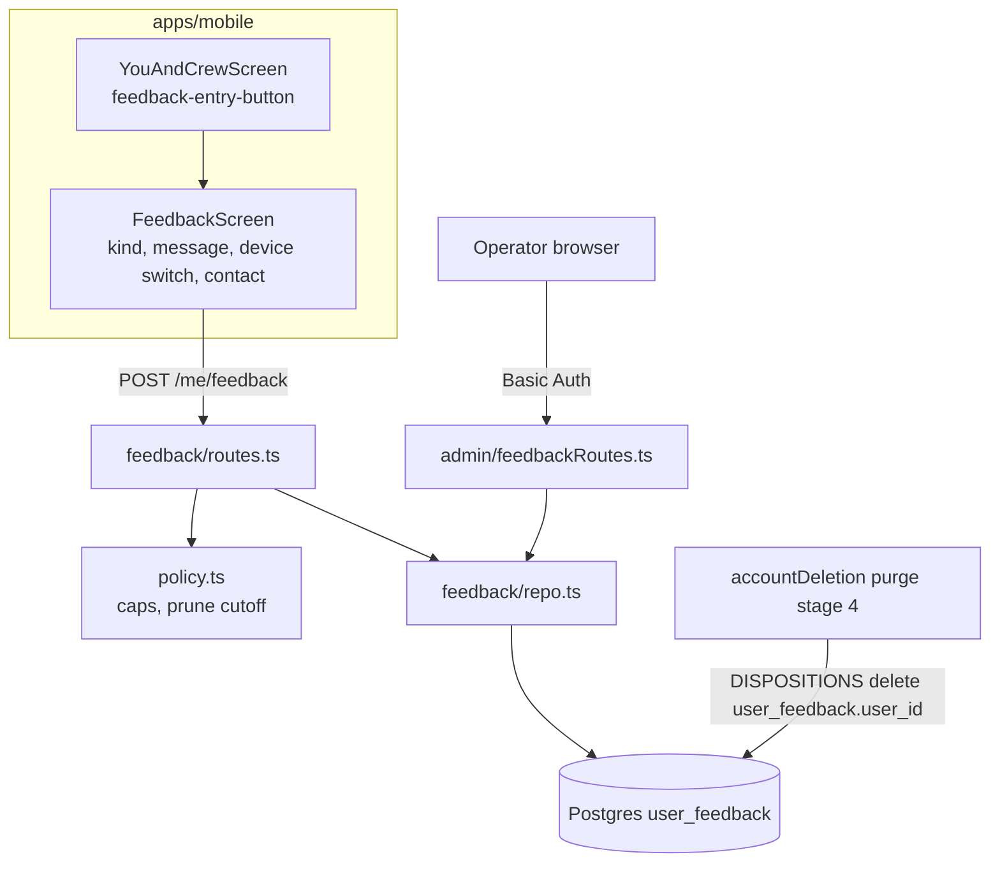

# Design Document

## Overview

A signed-in user opens **You & Crew -> Report a problem or send feedback**, picks Bug / Idea / Other, writes up to 2000 characters, optionally attaches device info and consent to be contacted, and sends it. The API stores one row in a new `user_feedback` table. The operator reads, triages and closes rows in a new `/admin/feedback` section of the Admin_Panel.

Design decisions, each with the alternative that was rejected:

1. **A new small service `apps/api/src/services/feedback/`** (pure `policy.ts`, `repo.ts`, `routes.ts`) wired in `composeServices.ts`. Rejected: putting the route in `auth/` or `admin/`; this is user data with its own lifecycle.
2. **The admin pages are a separate file `services/admin/feedbackRoutes.ts`** registered from `adminRoutes` only when an optional `feedback` port is passed, exactly like `diningPlan?`, `ticketPrices?` and `photos?`. This leaves every existing admin test untouched.
3. **Caps are database counts over a trailing window** (the Hidden Mickeys daily-cap pattern in `mickeys/submissionService.ts`), not the in-memory `@fastify/rate-limit` store. Render restarts and sleeps would reset the in-memory counters, and the DB count is deterministic and testable with pg-mem.
4. **The contact email is snapshotted at insert time, only when consent is given**, in the same SQL statement that checks the account is active (`INSERT ... SELECT ... FROM users u WHERE u.id = $1 AND u.deletion_state = 'active'`). This (a) keeps the email out of every row without consent, (b) avoids a later `JOIN users` in the admin page, and (c) satisfies `apps/api/src/__tests__/visibility.guard.test.ts` without a new allowlist entry, because the literal contains `deletion_state = 'active'`.
5. **Retention is an opportunistic prune on submit**, not a cron endpoint. A new cron job would need its own secret and cron-job.org entry for a table that is capped at 20 rows per user per day. Rejected: a purge cron.
6. **No screen name in the payload.** The entry point is always You & Crew, so the "current route" would be useless. The form asks the user to name the screen in the message instead.

## Architecture



### Submit flow

1. `POST /me/feedback` (session required). Zod-parse the body with `feedbackSubmitInputSchema`.
2. `repo.countRecent(userId, now)` returns `{ lastHour, lastDay }`. `policy.checkCaps` returns `'ok'` or `'limit'`. On `'limit'` throw `AppError('rate_limit_exceeded', ...)` (HTTP 429).
3. `repo.insert(...)` runs one `INSERT ... SELECT` that also checks the account is active. Zero rows inserted means the account is not active: return 401.
4. Best-effort `repo.pruneResolved(cutoff, 200)`; errors are swallowed and logged without any user content.
5. Return `201 { id }`.

The count and the insert are two statements, so two simultaneous requests from one user can both pass the cap check. The overshoot is bounded by the number of parallel requests the session can make and costs a few extra rows, so no lock is taken. This is stated as accepted behavior.

## Components and Interfaces

### Shared (`packages/shared/src/feedback.ts`, exported from `index.ts`)

```ts
export const FEEDBACK_KINDS = ['bug', 'idea', 'other'] as const;
export type FeedbackKind = (typeof FEEDBACK_KINDS)[number];
export const FEEDBACK_STATUSES = ['new', 'triaged', 'resolved'] as const;
export type FeedbackStatus = (typeof FEEDBACK_STATUSES)[number];
export const FEEDBACK_PLATFORMS = ['ios', 'android', 'web'] as const;
export const FEEDBACK_MESSAGE_MAX = 2000;
export const FEEDBACK_DEVICE_FIELD_MAX = 32;

export const feedbackDeviceSchema = z.object({
  appVersion: z.string().trim().min(1).max(FEEDBACK_DEVICE_FIELD_MAX),
  platform: z.enum(FEEDBACK_PLATFORMS),
  osVersion: z.string().trim().min(1).max(FEEDBACK_DEVICE_FIELD_MAX),
}).strict();

export const feedbackSubmitInputSchema = z.object({
  kind: z.enum(FEEDBACK_KINDS),
  message: z.string().trim().min(1).max(FEEDBACK_MESSAGE_MAX),
  contactOk: z.boolean().default(false),
  device: feedbackDeviceSchema.optional(),
}).strict();

export type FeedbackSubmitInput = z.infer<typeof feedbackSubmitInputSchema>;
export interface FeedbackSubmitResponse { id: string }
```

No new `ErrorCode` is added: `validation_failed` (400) and `rate_limit_exceeded` (429) already exist in `packages/shared/src/errors.ts`.

### API (`apps/api/src/services/feedback/`)

| File | Kind | Responsibility |
|---|---|---|
| `policy.ts` | pure | `checkCaps(counts, caps)`, `pruneCutoff(now, retentionDays)`, `previewMessage(message, max)` |
| `repo.ts` | DB | `countRecent`, `insert`, `pruneResolved`, and the admin reads/writes (`list`, `get`, `setStatus`, `remove`) |
| `routes.ts` | Fastify | `POST /me/feedback` |

```ts
// policy.ts
export interface FeedbackCaps { readonly perHour: number; readonly perDay: number }
export interface RecentCounts { readonly lastHour: number; readonly lastDay: number }
/** 'limit' iff lastHour >= perHour || lastDay >= perDay. Exact boundary: cap - 1 is 'ok'. */
export function checkCaps(counts: RecentCounts, caps: FeedbackCaps): 'ok' | 'limit';
/** now - retentionDays * 86_400_000 ms. retentionDays must be an integer 1..3650 or it throws RangeError. */
export function pruneCutoff(now: Date, retentionDays: number): Date;
/** The first `max` characters (by code point), with a trailing '…' only when truncated. */
export function previewMessage(message: string, max: number): string;
```

```ts
// repo.ts (structural port consumed by routes and by admin)
export interface FeedbackRow {
  id: string; userId: string; kind: FeedbackKind; message: string; status: FeedbackStatus;
  contactOk: boolean; contactEmail: string | null;
  appVersion: string | null; platform: string | null; osVersion: string | null;
  createdAt: Date; statusChangedAt: Date;
}
export interface FeedbackRepo {
  countRecent(userId: string, now: Date): Promise<RecentCounts>;
  /** One INSERT ... SELECT ... FROM users u WHERE u.id = $1 AND u.deletion_state = 'active'.
   *  Returns the new id, or null when the account is not active. contact_email is
   *  CASE WHEN $contactOk THEN u.email ELSE NULL END. */
  insert(input: { userId: string; kind: FeedbackKind; message: string; contactOk: boolean;
                  device?: { appVersion: string; platform: string; osVersion: string } }): Promise<string | null>;
  /** DELETE ... WHERE id IN (SELECT id FROM user_feedback WHERE status = 'resolved' AND status_changed_at < $1 LIMIT $2). */
  pruneResolved(cutoff: Date, limit: number): Promise<number>;
  list(filter: { status?: FeedbackStatus; kind?: FeedbackKind; limit: number; offset: number }): Promise<{ rows: FeedbackRow[]; total: number }>;
  get(id: string): Promise<FeedbackRow | null>;
  setStatus(id: string, status: FeedbackStatus, now: Date): Promise<boolean>;
  remove(id: string): Promise<boolean>;
}
export type AdminFeedbackPort = Pick<FeedbackRepo, 'list' | 'get' | 'setStatus' | 'remove'>;
```

`routes.ts` takes `{ repo, caps, retentionDays, clock }` so tests substitute a fake clock and the pg-mem repo. It reads `userId` from the session exactly as the other `/me/*` routes do.

### Admin (`apps/api/src/services/admin/feedbackRoutes.ts`)

`registerFeedbackRoutes(fastify, options)` registers inside `fastify.register(async (scope) => ...)` with its own urlencoded body parser (`Object.fromEntries(new URLSearchParams(body))`), the pattern of `diningPlanRoutes.ts`. Routes:

| Route | Behavior |
|---|---|
| `GET /admin/feedback` | List, `?status=` (default `new`), `?kind=`, `?page=`; 50 per page |
| `GET /admin/feedback/:id` | Detail; contact email shown only when `contactOk && contactEmail` |
| `POST /admin/feedback/:id/status` | Body `status` in `new|triaged|resolved`; redirect to detail with flash |
| `POST /admin/feedback/:id/delete` | Delete; redirect to list with flash |

Every response sets `X-Robots-Tag: noindex, nofollow` and `Cache-Control: private, no-store`. Every `POST` checks `isSameOriginRequest` first. All output goes through `escapeHtml`; times through `localTime`. `adminRoutes` adds a `FEEDBACK_ADMIN_SECTION` entry ("User Feedback", category "User Operations & Security") to `ADMIN_SECTIONS` only when the port is supplied and removes it otherwise, exactly as it does for Dining Plan. The hard-coded "Jump to Section" dropdown in `html.ts` is not changed (Dining Plan is not in it either), so the dashboard card is the way in.

### Mobile (`apps/mobile`)

| File | Change |
|---|---|
| `src/screens/feedback/FeedbackScreen.tsx` | New. Form, mutation, confirmation state |
| `src/screens/feedback/FeedbackScreen.palette.ts` | Only if a one-off literal color is needed |
| `src/screens/youAndCrew/YouAndCrewScreen.tsx` | New row `feedback-entry-button` above the delete entry (line ~516) |
| `src/navigation/YouAndCrewStack.tsx` | `Feedback: undefined` param and `<Stack.Screen name="Feedback">` |

`FeedbackScreen` calls `apiRequest<FeedbackSubmitResponse>('POST', '/me/feedback', body)` through `useMutation`. Device info comes from `expo-constants` (`Constants.expoConfig?.version`) and `react-native` (`Platform.OS`, `Platform.Version` converted with `String()`), built by a small exported pure helper `buildDeviceInfo()` so it can be tested. If any of the three values is missing, the helper returns `undefined` and the switch row shows "Device info unavailable" and is disabled (nothing partial is ever sent).

## Data Models

### Migration `apps/api/migrations/0076_user_feedback.sql`

```sql
BEGIN;
CREATE TABLE IF NOT EXISTS user_feedback (
  id                UUID PRIMARY KEY DEFAULT gen_random_uuid(),
  user_id           UUID NOT NULL REFERENCES users(id) ON DELETE CASCADE,
  kind              TEXT NOT NULL CHECK (kind IN ('bug', 'idea', 'other')),
  message           TEXT NOT NULL CHECK (char_length(message) BETWEEN 1 AND 2000),
  status            TEXT NOT NULL DEFAULT 'new' CHECK (status IN ('new', 'triaged', 'resolved')),
  contact_ok        BOOLEAN NOT NULL DEFAULT FALSE,
  contact_email     TEXT NULL,
  app_version       TEXT NULL CHECK (app_version IS NULL OR char_length(app_version) <= 32),
  platform          TEXT NULL CHECK (platform IS NULL OR platform IN ('ios', 'android', 'web')),
  os_version        TEXT NULL CHECK (os_version IS NULL OR char_length(os_version) <= 32),
  created_at        TIMESTAMPTZ NOT NULL DEFAULT now(),
  status_changed_at TIMESTAMPTZ NOT NULL DEFAULT now(),
  CHECK (contact_ok OR contact_email IS NULL)
);
CREATE INDEX IF NOT EXISTS user_feedback_user_created_idx ON user_feedback (user_id, created_at);
CREATE INDEX IF NOT EXISTS user_feedback_status_created_idx ON user_feedback (status, created_at);
COMMIT;
```

pg-mem constraints respected (stored note `new-migrations-must-survive-pg-mem-build-helper`): only `char_length` is used as a function, no `NULLS LAST`, no non-unique partial index, no backfill.

The CHECK `(contact_ok OR contact_email IS NULL)` makes "email stored without consent" impossible at the database level.

### Disposition registry

`apps/api/src/services/accountDeletion/dispositions.ts` gains one entry in the "per-user content" block:

```ts
e('user_feedback', 'user_id', 'delete', 4, ['id'], 'cascade', false, {
  note: 'In-app feedback. Message, optional device info and optional contact email go with the account.',
}),
```

`dispositions.test.ts` (Property 11) parses every migration and fails if this entry is missing, so the entry and the migration ship in the same task.

## Configuration & Constants

| Name | Where | Default | Meaning |
|---|---|---|---|
| `FEEDBACK_PER_HOUR` | env, `config.ts` | `5` | Max Submissions per user in the trailing hour |
| `FEEDBACK_PER_DAY` | env, `config.ts` | `20` | Max Submissions per user in the trailing 24 hours |
| `FEEDBACK_RETENTION_DAYS` | env, `config.ts` | `90` | Resolved Submissions older than this are pruned |
| `FEEDBACK_MESSAGE_MAX` | `@dwt/shared` | `2000` | Message length cap, shared by client, API and the DB CHECK |
| `FEEDBACK_DEVICE_FIELD_MAX` | `@dwt/shared` | `32` | Length cap of `appVersion` and `osVersion` |
| Prune batch | constant in `routes.ts` | `200` | Max rows deleted per accepted Submission |
| Admin page size | constant in `feedbackRoutes.ts` | `50` | Rows per list page |

The three env vars are read in `config.ts` with `permissivePhotoNumber` and, as `config.mickeys` does, an invalid value (not a positive integer, or retention outside 1 to 3650) falls back to its default instead of failing startup. They are exposed as `config.feedback = { perHour, perDay, retentionDays }` (`FeedbackConfig`, `DEFAULT_FEEDBACK_CONFIG`). No secret is involved, and there is no new cron entry.

## Correctness Properties

### Property 1: Cap boundary is exact
For all non-negative integer counts and positive caps, `checkCaps({ lastHour, lastDay }, { perHour, perDay })` is `'limit'` iff `lastHour >= perHour || lastDay >= perDay`.
**Validates: Requirements 3.1, 3.3**

### Property 2: Cap counts only the caller's trailing window
For any set of Submissions across users and times, `repo.countRecent(userId, now)` counts exactly the rows with that `user_id` and `created_at >= now - 1h` (respectively `now - 24h`).
**Validates: Requirements 3.1, 3.2**

### Property 3: Contact email is stored only with consent
For all inserts, `contact_email` is non-null iff `contactOk` is true, and then equals the user's account email; the database CHECK also rejects a row with `contact_ok = false` and a non-null `contact_email`.
**Validates: Requirements 2.4, 7.2**

### Property 4: Device info is all-or-nothing and never derived
For all inserts, `app_version`, `platform` and `os_version` are either all null (no `device`) or equal to the supplied `device` values; no header or IP value is ever stored.
**Validates: Requirements 2.3, 7.4**

### Property 5: Validation accepts exactly the contract
For all generated bodies, `feedbackSubmitInputSchema` accepts iff `kind` is one of three values, the trimmed message length is 1..2000, and `device`, when present, has a known platform and `appVersion`/`osVersion` of 1..32 characters; unknown extra keys are rejected.
**Validates: Requirements 2.2**

### Property 6: Prune deletes only old resolved rows
For any set of Submissions, `pruneResolved(cutoff, limit)` deletes only rows with status `resolved` and `status_changed_at < cutoff`, deletes at most `limit`, and never deletes a `new` or `triaged` row.
**Validates: Requirements 6.1, 6.2**

### Property 7: Prune cutoff arithmetic
For all valid `retentionDays` and `now`, `pruneCutoff(now, d)` equals `now - d * 86_400_000` ms and is strictly earlier than `now`; out-of-range `d` throws `RangeError`.
**Validates: Requirements 6.1**

### Property 8: The purge removes a user's feedback
After the account-deletion purge of a user, no `user_feedback` row with that `user_id` remains, and other users' rows are unchanged.
**Validates: Requirements 7.1**

### Property 9: Admin output is escaped
For all messages and emails, including strings containing `<`, `>`, `&`, quotes and `<script>`, the rendered list and detail HTML contains no unescaped occurrence of the raw string, and contains its `escapeHtml` form.
**Validates: Requirements 5.5**

### Property 10: Preview truncation
For all messages and `max >= 1`, `previewMessage(m, max)` equals `m` when the code-point length is `<= max`, else the first `max` code points followed by `…`; it never splits a surrogate pair.
**Validates: Requirements 5.2**

### Property 11: Contact email is shown to the operator only with consent
For any stored row, the detail page contains the `contact_email` iff `contact_ok` is true and `contact_email` is non-null.
**Validates: Requirements 5.3**

## Error Handling

| Condition | Response |
|---|---|
| Body fails the schema | `400 validation_failed` with the field path |
| Cap reached | `429 rate_limit_exceeded`, message "You have sent a lot of feedback recently. Please try again later." |
| No session, revoked session, or account not `active` | `401` (session middleware, or the insert returning no row) |
| Database error on insert | `500` through the global error hook; nothing partial is stored because the insert is one statement |
| Prune error | Swallowed; the 201 is still returned; logged as a warning with no user content |
| Admin: unknown id | `404` page |
| Admin: bad `status` value | In-page error, no state change |
| Admin: cross-origin POST | `403`, no state change |

Mobile: any failure shows the message in the form (the API message for 429 and 400, a generic "Could not send. Check your connection and try again." otherwise) and keeps the draft.

## Testing Strategy

Runners: Vitest for `apps/api` and `packages/shared`, Jest (`jest-expo`) for `apps/mobile`. Property tests use `fast-check` with at least 100 runs and the tag `// Feature: in-app-feedback, Property N: <text>`.

| Layer | File | What it asserts |
|---|---|---|
| shared schema | `packages/shared/src/__tests__/feedback.test.ts` | Valid and invalid bodies; Property 5 |
| pure | `feedback/__tests__/policy.prop.test.ts` | Properties 1, 7, 10 |
| migration | `db/__tests__/migration0076.test.ts` | Columns, CHECKs (kind, status, platform, length, `contact_ok`/`contact_email`), indexes, cascade delete when the user is deleted |
| repo (pg-mem, real SQL) | `feedback/__tests__/repo.test.ts` | Properties 2, 3, 4, 6; insert returns null for a `pending_deletion` user; a user's rows are not counted for another user |
| route (`server.inject`) | `feedback/__tests__/routes.test.ts` | 401 without session; 201 happy path with and without device and consent; 400 for empty, over-long, bad kind, bad platform, extra key; 429 at the boundary (hour and day) with nothing stored; a prune runs after accept and never removes `new`/`triaged`; a prune failure still yields 201; the message is absent from captured logs |
| admin routes | `admin/__tests__/feedbackRoutes.test.ts` | Auth required; list filter and paging; detail shows email only with consent (Property 11); `<script>` payload escaped (Property 9); status change and delete via a real `application/x-www-form-urlencoded` `inject`; cross-origin POST returns 403 with no change; security headers; routes absent when the port is not supplied |
| account deletion | `accountDeletion/__tests__/dispositions.test.ts` (existing) plus `feedback/__tests__/purge.test.ts` | Registry completeness passes with the new entry; Property 8 over the real purge harness |
| visibility guard | `src/__tests__/visibility.guard.test.ts` (existing) | Passes with no allowlist change |
| real Postgres | `feedback/__tests__/repo.livedb.test.ts` | The casts in the insert, the `CITEXT` to `TEXT` email copy, the bounded prune and the conditional status update on a real Postgres 16 (skipped when no database answers) |
| config | `src/__tests__/config.feedback.test.ts` | Defaults, overrides, fallback for bad values, retention bound |
| wiring | `src/__tests__/composeServices.feedback.test.ts` | The real composition root: 401 without a session, 201 with one, `FEEDBACK_PER_HOUR` reaches the route (third send is 429), the admin section is registered behind Basic Auth |
| privacy page | `accountDeletion/__tests__/webPages.prop.test.ts` (extend) | The policy text for feedback, and the existing markdown-sync test |
| mobile | `screens/feedback/__tests__/FeedbackScreen.test.tsx` | Each interaction below |
| mobile entry | `screens/youAndCrew/__tests__/YouAndCrewScreen.test.tsx` (extend) | `feedback-entry-button` navigates to `Feedback` |

Mobile interactions each driven with `fireEvent`/`waitFor`, asserting both the request and the on-screen change: pick Idea then send (POST body `kind: 'idea'`); type a message and see the counter update; Send disabled when empty; switch device info off (body has no `device`); tick contact (body `contactOk: true`); success shows the confirmation and Done returns; a failed send keeps the text and re-enables Send; a double press sends one request; a 429 shows the API message. `buildDeviceInfo()` gets its own unit test, including the "missing value returns undefined" case.

The raw-colour literal rule (`themeRetrofit.guard.test.ts`) is satisfied by `makeStyles`, so no allowlist change is part of this feature.
