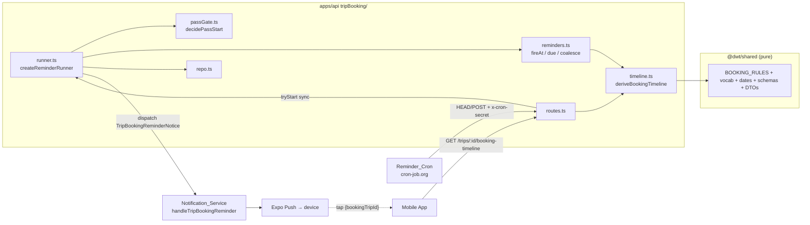

# Design Document

## Overview

Trip Booking Timeline adds three things to the Trip Hub: a **derived** timeline of when Walt Disney World's Advance Dining and Lightning Lane booking windows open for a Trip, **push reminders** tied to those moments, and a collaborative **packing list**. It is a new sibling service to `trips` and `tripExpenses`: a new folder `apps/api/src/services/tripBooking/`, five new tables, one new migration (`0061`), a new `@dwt/shared` module, two new mobile screens, and a new hub section pair on `TripDetailScreen`.

### Key design decisions

1. **The timeline is derived at read time and never stored.** Drop dates are a pure function of `(Trip_Start_Date, Trip_End_Date, resort-stay flag, Booking_Settings)` and a declarative `BOOKING_RULES` table. Nothing about a window's date is persisted, so editing a Trip's dates can never leave a stale timeline behind (R3.8, R4.1). Only user choices are persisted: Booking_Settings, per-window done marks, per-member reminder mutes.

2. **One table-driven window rule, one algorithm.** Every window kind/stay-type/timing combination in R1.4–R1.8 is the same shape: a *head* window anchored at the Arrival_Date covering the first N Stay_Dates, then an optional *tail* (one shared window or one window per remaining date). `BOOKING_RULES` encodes each combination as `{ headOffsetDays, headCoverDays, tail }`, and a single `deriveWindows` function evaluates it. This is what makes the partition (R1.10), shift-invariance (R1.12), and "no literal outside the table" (R1.1) properties cheap to test.

3. **Calendar-date arithmetic is separated from WDW wall-clock conversion.** Offsets are applied to `YYYY-MM-DD` strings with UTC-only `Date.UTC` arithmetic (immune to DST, R1.2). Only the final `Drop_On + Drop_Time → Drop_At` step touches the clock, and it goes through the existing `wdwIsoAtMinutes` in `wdwClock.ts` (R1.3).

4. **Reminders are stateless to schedule and idempotent to send.** There is no scheduled-job table. Each authenticated Reminder_Cron tick recomputes what is due from current Trip data, then *claims* each due reminder with `INSERT … ON CONFLICT DO NOTHING RETURNING` into `trip_booking_reminder_log` **before** dispatching (R9.1, R9.2). A date edit changes `Drop_At`, hence the ledger key, hence a fresh reminder (R4.3) with no reschedule step.

5. **A dedicated Reminder_Cron, not the keep-alive.** The keep-alive (`*/10 0-1,7-23 * * *`) touches no database. Calling the reminder endpoint from it would hit Neon every 10 minutes for ~19 h/day (~580 compute hours against a ~400 CU-hour ceiling, `docs/hosting.md`). Reminders only fire at four wall-clock times (06:00, 07:00, 09:00 if `week` is enabled, 20:00), so the Reminder_Cron fires at minutes 0, 10, and 20 of those hours (crontab `0,10,20 6,7,20 * * *`, ≤ 9 passes/day by default; `0,10,20 6,7,9,20 * * *`, ≤ 12 passes/day WHERE the `week` lead is enabled). The first pass in each hour is the primary; the second and third are retries after a cold start or a failed pass (R8.12, R8.14). The endpoint returns `202` immediately and works asynchronously in-process; no queue, no worker, no Redis command (R8.3, R8.8).

6. **Delivery reuses the Notification_Service.** A new `handleTripBookingReminder` handler is added next to the existing `handleTripInviteCreated`/`handleRodeWithTagCreated`; it reuses the private `notifyRecipient` path (master push preference gate → active tokens → retry/invalidation → `onDelivery` log). Reminders are informational, **not** Attention_Items, so `notification-center` is untouched except that the mobile tap router gains a new, earlier-matched branch (R10.7).

7. **Authorization extends `permissions.ts`, nothing new.** Six `TripAction`s are added; routes call `assertTripMember` (from `trips/authz.ts`) and then `can(role, action)`. The single per-item rule for packing edit/remove ("adder or organizer", R12.4) is a small pure function beside the service.

8. **Capacity is enforced under a Trip row lock.** The 300-item Packing_List cap (R11.3, R14.5) uses `SELECT id FROM trips WHERE id = $1 FOR UPDATE` inside the add transaction — the same pattern `tripExpenses/repo.ts` uses for `EXPENSE_LIMIT`.

### Requirement/code conflicts found while reading the real code

These are called out here (and detailed in **Error Handling → Conflicts**) rather than silently diverged from. `requirements.md` is not edited by this design. C2, C3, C4, and C6 were originally requirement/design mismatches; `requirements.md` has since been amended to agree with the design, so they are marked **Resolved in requirements** and need no further amendment. C1, C5, and C7 remain open design responses to the real code.

| # | Conflict | Design response |
| --- | --- | --- |
| C1 | `push_delivery_log_kind_chk` (migration `0056`) is a closed `IN (…)` list that rejects `trip_booking_reminder`; the `onDelivery` insert in `composeServices.ts` swallows the error with a `warn`, so R9.10 would silently never be met. | Migration `0061` drops and re-adds the constraint with the new kind. |
| C2 | **Resolved in requirements.** The Starter_List was described as holding 19 entries while 21 names are enumerated (3+4+2+3+3+4+2); the requirements now say 21. | Ship the 21 enumerated entries; tests assert against `STARTER_PACKING_LIST.length`, never a literal. |
| C3 | **Resolved in requirements.** R7.7 originally fixed the horizon at `Trip_Start_Date ≤ today + 61`, which excluded the `week` lead for the primary dining window (Drop_On − 7 days = arrival − 67) and any Trip whose `Check_In_Override` precedes its start. R7.7 now defines it as 60 days plus the largest enabled lead offset (minimum 1), measured against the Arrival_Date. | Horizon is derived from `BOOKING_RULES` and the enabled leads (61 by default, 67 with `week`) and is compared against the **Arrival_Date** (start date *or* a valid stored override). Ordering (`start_date, id`) and the 500 cap per R7.7 are unchanged. Property 28 pins soundness. |
| C4 | **Resolved in requirements.** R7.6 said "not earlier than Drop_At" while R9.6 said "later than" for the "Opened at" prefix; R9.6 now also uses "not earlier than". | Use ≥ (R7.6, R9.6); at equality the window has opened. |
| C5 | Existing `useNotificationResponse` sends any unrecognised payload to the Notification_Center (violates R10.7), holds a pending tap indefinitely across auth (violates R10.3), and retries for 3 s (R10.1 says 2 s). | New earlier-matched `bookingReminder` tap kind, a small pending-tap reducer with an `authFailed` event fired by Login/Register, and a navigation-readiness note. |
| C6 | **Resolved in requirements.** R12.3 originally required `trip_forbidden` for a mute on a different member, which has no addressable surface on `/me/…`; it now requires `trip_validation_failed` for any extra `userId`. | The `.strict()` mute schema rejects a smuggled `userId` key as `trip_validation_failed` and creates no row for any user (Property 38). |
| C7 | The mobile `tripStructureRegression` test and snapshots pin `HUB_SECTIONS` at 7 and `TripsStack` at 13 screens. | Updated deliberately as part of this feature (9 sections / 15 screens). |

## Architecture

### Placement

| Concern | Location |
| --- | --- |
| Tables, constraints, indexes, `push_delivery_log` kind extension | `apps/api/migrations/0061_trip_booking_timeline.sql` (next free number: `0060_trip_expenses.sql` is the latest) |
| Vocabularies (`STAY_TYPES`, `LIGHTNING_LANE_TIMINGS`, `WINDOW_KINDS`, `WINDOW_STATUSES`, `REMINDER_LEADS`, `PACKING_CATEGORIES`) | `packages/shared/src/enums.ts` (same place `RESERVATION_KINDS`/`EXPENSE_CATEGORIES` live) |
| `BOOKING_RULES`, `BOOKING_RULES_VERSION`, lead schedule, `STARTER_PACKING_LIST`, calendar-date helpers, check-in-override predicate, date/range formatters, Zod schemas, DTOs | `packages/shared/src/tripBooking.ts` (new sibling of `trips.ts`/`tripExpenses.ts`), re-exported from `packages/shared/src/index.ts` |
| Pure domain modules (no I/O) | `apps/api/src/services/tripBooking/{timeline,reminders,passGate,settings,packing,packingAuth,reminderConfig}.ts` |
| DB access | `apps/api/src/services/tripBooking/repo.ts` — `createTripBookingRepo(pool: DbPool)` |
| Reminder orchestration (clock, repo port, dispatch port) | `apps/api/src/services/tripBooking/runner.ts` — `createReminderRunner(deps)` |
| Fastify routes (incl. `/internal/trip-booking-reminders/run`) | `apps/api/src/services/tripBooking/routes.ts` — `tripBookingRoutes(options)` |
| Notice type handed to the Notification_Service | `apps/api/src/services/tripBooking/events.ts` — `TripBookingReminderNotice` |
| Notification composition (pure) + handler | `apps/api/src/services/notifications/bookingReminderCompose.ts` (pure) and `service.ts` (`handleTripBookingReminder`) |
| Push data union extension | `apps/api/src/services/notifications/expoPushClient.ts` — `ExpoPushData` gains `{ bookingTripId }` |
| Config | `apps/api/src/config.ts` — `TRIP_BOOKING_CRON_SECRET` + `BOOKING_REMINDER_*`, `AppConfig.tripBooking` |
| Permissions | `apps/api/src/services/trips/permissions.ts` — six new `TripAction`s |
| Wiring | `apps/api/src/composeServices.ts` and `apps/api/src/server.ts` (`tripBooking?: TripBookingRoutesOptions`) |
| Hosting/ops | `render.yaml`, `apps/api/.env.example`, `docs/hosting.md`, `README.md` env paragraph |
| Mobile screens | `apps/mobile/src/screens/trips/TripBookingTimelineScreen.tsx`, `TripPackingListScreen.tsx`, `PackingItemFormModal.tsx`, `BookingSettingsModal.tsx` |
| Mobile pure view modules | `apps/mobile/src/screens/trips/{bookingTimelineView,packingListView}.ts` |
| Mobile API client + query keys | `apps/mobile/src/screens/trips/bookingTimelineApi.ts` (shape of `tripExpenseApi.ts`) |
| Mobile navigation + tap routing | `TripsStack.tsx`, `navigationRef.ts`, `hooks/useNotificationResponse.ts`, `navigation/bookingTapState.ts` |

### Service shape and data flow



Request-time read: `routes.ts` → `repo.getTimelineInputs` (≤ 3 queries) → `deriveBookingTimeline` + `annotateWindows(now)` → `BookingTimelineDTO`. Nothing is written by a read (R3.8).

Reminder pass: `routes.ts` → `runner.tryStart()` (synchronous decision; replies `202`) → async `runPass` → candidate Trips (1 query) → done marks + claimed ledger keys (2 queries, bulk by Trip ids) → pure `deriveDueReminders` per Trip → `claimReminder` per due reminder → `listReminderRecipients` per Trip with claims → `dispatch(event)` → prune ledger → one summary log line.

### Cross-spec dependencies and build order

Hard: `trips` (Trip, `trip_memberships`, `trip_resorts`, `permissions.ts`, `authz.ts`, `wdwClock.ts`, `formatCalendarDate`, `TripDetailScreen`, `tripsListNotice`). Read-only: `trip-reservations` (`planned_items.reservation_kind`, `planned_date`). Infrastructure: `notification-center`/`social-sharing-loop` (Notification_Service, `push_delivery_log`, `useNotificationResponse`). Sibling, no dependency: `trip-expenses` — both add hub tiles and a migration number; whichever merges second renumbers (this design assumes `0061`) and must keep the union of `push_delivery_log` kinds if both extend it.

Build order: (a) shared enums/rules/dates/schemas/DTOs → (b) pure API modules + property tests → (c) migration, repo, `permissions.ts` → (d) routes (timeline, settings, done, mute, packing) → (e) config, runner, internal endpoint, Notification_Service handler + compose → (f) composeServices/server wiring → (g) mobile API client, view modules, screens, hub tiles, stack routes, tap routing → (h) docs/ops (`render.yaml`, `.env.example`, `docs/hosting.md`).

## Components and Interfaces

### Shared contracts (`packages/shared/src/enums.ts`, `tripBooking.ts`)

```ts
// enums.ts — vocabularies declared exactly once (R15.1, R15.2)
export const STAY_TYPES = ['resort', 'partner_hotel', 'offsite'] as const;
export type StayType = (typeof STAY_TYPES)[number];

export const LIGHTNING_LANE_TIMINGS = ['seven_day', 'three_day', 'three_day_daily'] as const;
export type LightningLaneTiming = (typeof LIGHTNING_LANE_TIMINGS)[number];

export const WINDOW_KINDS = ['dining', 'lightning_lane'] as const;   // order = tie-break order (R1.11)
export type WindowKind = (typeof WINDOW_KINDS)[number];

export const WINDOW_STATUSES = ['upcoming', 'open', 'past'] as const;
export type WindowStatus = (typeof WINDOW_STATUSES)[number];

export const REMINDER_LEADS = ['eve', 'open', 'week'] as const;
export type ReminderLead = (typeof REMINDER_LEADS)[number];

export const PACKING_CATEGORIES =
  ['documents', 'clothing', 'toiletries', 'health', 'tech', 'park_gear', 'kids', 'other'] as const; // order = display order (R11.5, R13.2)
export type PackingCategory = (typeof PACKING_CATEGORIES)[number];
```

```ts
// tripBooking.ts
export const BOOKING_RULES_VERSION = 1;

/** One evaluated shape for every (kind, stay-type | timing) combination. */
export interface WindowRule {
  /** Days before the Arrival_Date that the head window opens. */
  readonly headOffsetDays: number;
  /** Stay_Dates covered by the head window, counted from the Arrival_Date; null = all of them. */
  readonly headCoverDays: number | null;
  /** What happens to Stay_Dates beyond the head. null only when headCoverDays is null. */
  readonly tail:
    | { readonly offsetDays: number; readonly mode: 'shared' }      // ONE window, Arrival_Date − offset
    | { readonly offsetDays: number; readonly mode: 'per_date' }    // one window per date: date − offset
    | null;
}

export const BOOKING_RULES = {
  dining: {
    /** Drop_Time 06:00 WDW as minutes from midnight. */
    dropMinutes: 360,
    byStayType: {
      resort:        { headOffsetDays: 60, headCoverDays: 10, tail: { offsetDays: 60, mode: 'per_date' } },
      partner_hotel: { headOffsetDays: 60, headCoverDays: 1,  tail: { offsetDays: 60, mode: 'per_date' } },
      offsite:       { headOffsetDays: 60, headCoverDays: 1,  tail: { offsetDays: 60, mode: 'per_date' } },
    },
  },
  lightning_lane: {
    /** Drop_Time 07:00 WDW. */
    dropMinutes: 420,
    byTiming: {
      seven_day:       { headOffsetDays: 7, headCoverDays: 14,   tail: { offsetDays: 3, mode: 'shared' } },
      three_day:       { headOffsetDays: 3, headCoverDays: null, tail: null },
      three_day_daily: { headOffsetDays: 3, headCoverDays: 1,    tail: { offsetDays: 3, mode: 'per_date' } },
    },
    /** Used when Booking_Settings holds no Lightning_Lane_Timing (R1.9, R2.9). */
    defaultTimingByStayType: { resort: 'seven_day', partner_hotel: 'seven_day', offsite: 'three_day' },
  },
} as const;

/** Reminder lead schedule (R7.1). `minutes` = WDW wall-clock minutes from midnight. */
export const REMINDER_LEAD_SCHEDULE = {
  eve:  { kind: 'day_before',  daysBefore: 1, minutes: 20 * 60 },   // Drop_On − 1 day @ 20:00
  open: { kind: 'at_drop' },                                          // Fire_At = Drop_At
  week: { kind: 'day_before',  daysBefore: 7, minutes: 9 * 60 },    // Drop_On − 7 days @ 09:00
} as const;

export const CHECK_IN_OVERRIDE_MAX_DAYS_BEFORE_START = 30;
export const PACKING_LIST_MAX_ITEMS = 300;
export const PACKING_NAME_MAX = 80;
export const PACKING_QUANTITY_MIN = 1;
export const PACKING_QUANTITY_MAX = 99;
export const BOOKING_REMINDER_BODY_MAX = 100;
```

**Calendar-date helpers** (pure, UTC-only so DST can never shift a result — R1.2). All take/return `YYYY-MM-DD`:

```ts
export function addCalendarDays(date: string, days: number): string {
  const [y, m, d] = date.split('-').map(Number) as [number, number, number];
  return new Date(Date.UTC(y, m - 1, d + days)).toISOString().slice(0, 10);
}
export function diffCalendarDays(a: string, b: string): number {   // a − b in whole days
  const ms = (s: string) => { const [y, m, d] = s.split('-').map(Number) as [number, number, number]; return Date.UTC(y, m - 1, d); };
  return Math.round((ms(a) - ms(b)) / 86_400_000);
}
export function listCalendarDates(from: string, to: string): string[]   // inclusive; [] when to < from
export function checkInOverrideRange(tripStart: string): { min: string; max: string } {
  return { min: addCalendarDays(tripStart, -CHECK_IN_OVERRIDE_MAX_DAYS_BEFORE_START), max: tripStart };
}
export function isCheckInOverrideValid(override: string, tripStart: string): boolean {
  const { min, max } = checkInOverrideRange(tripStart);
  return override >= min && override <= max;           // lexicographic == chronological for YYYY-MM-DD
}
export function formatMonthDay(date: string): string  // '2025-06-01' → 'Jun 1' (fixed English month table, no Intl)
export function formatDateRange(first: string, last: string): string  // equal → 'Jun 1'; else 'Jun 1 – Jun 5'
```

**Zod schemas** (every violation carries message `'trip_validation_failed'`, matching `tripCalendarDateSchema`; every object is `.strict()`):

```ts
export const bookingSettingsUpdateSchema = z.object({
  stayType: z.enum(STAY_TYPES).nullable().optional(),
  lightningLaneTiming: z.enum(LIGHTNING_LANE_TIMINGS).nullable().optional(),
  checkInOverride: tripCalendarDateSchema.nullable().optional(),
}).strict().superRefine((v, ctx) => {          // R2.11: at least one key present (null counts as present)
  if (v.stayType === undefined && v.lightningLaneTiming === undefined && v.checkInOverride === undefined)
    ctx.addIssue({ code: z.ZodIssueCode.custom, message: 'trip_validation_failed' });
});
export const windowDoneSchema = z.object({ done: z.boolean() }).strict();
export const reminderMuteSchema = z.object({ muted: z.boolean() }).strict();
export const windowDoneParamsSchema = z.object({ id: uuidSchema, kind: z.enum(WINDOW_KINDS), dropOn: tripCalendarDateSchema }).strict();

const packingNameSchema = z.string().trim().min(1, M).max(PACKING_NAME_MAX, M);     // M = { message: 'trip_validation_failed' }
const packingQuantitySchema = z.number().int().min(PACKING_QUANTITY_MIN, M).max(PACKING_QUANTITY_MAX, M);
export const packingItemCreateSchema = z.object({
  name: packingNameSchema, category: z.enum(PACKING_CATEGORIES),
  quantity: packingQuantitySchema.optional(), assigneeId: uuidSchema.nullable().optional(),
}).strict();
export const packingItemUpdateSchema = z.object({
  name: packingNameSchema.optional(), category: z.enum(PACKING_CATEGORIES).optional(),
  quantity: packingQuantitySchema.optional(), assigneeId: uuidSchema.nullable().optional(),
}).strict().superRefine(/* at least one key !== undefined (R11.7) */);
export const packingItemPackedSchema = z.object({ packed: z.boolean() }).strict();
```

**DTOs** (types only):

```ts
export interface BookingWindowDTO {
  readonly windowKey: string;               // `${kind}:${dropOn}`
  readonly kind: WindowKind;
  readonly dropOn: string;                  // YYYY-MM-DD WDW
  readonly dropAt: string;                  // ISO-8601 UTC
  readonly coveredDates: readonly string[]; // ascending, non-empty
  readonly status: WindowStatus;
  readonly daysUntilDrop: number | null;    // integer ≥ 0 iff status === 'upcoming'
  readonly done: boolean;
  readonly doneAt: string | null;           // ISO UTC, null when !done
  readonly doneByDisplayName: string | null;
  readonly bookedCount: number;             // informational only (R3.6)
}
export interface BookingTimelineDTO {
  readonly tripId: string;
  readonly rulesVersion: number;
  readonly stayType: { readonly value: StayType; readonly source: 'auto' | 'override' };
  readonly lightningLaneTiming: { readonly value: LightningLaneTiming; readonly source: 'auto' | 'override' };
  readonly arrivalDate: { readonly value: string; readonly source: 'trip_start' | 'override' };
  readonly muted: boolean;                  // viewer-specific ONLY (R3.1, R3.11)
  readonly windows: readonly BookingWindowDTO[];
}
export interface BookingSettingsDTO {
  readonly tripId: string;
  readonly stayType: StayType | null;
  readonly lightningLaneTiming: LightningLaneTiming | null;
  readonly checkInOverride: string | null;
}
export interface BookingReminderMuteDTO { readonly tripId: string; readonly muted: boolean }
export interface PackingItemDTO {
  readonly id: string; readonly tripId: string; readonly name: string;
  readonly category: PackingCategory; readonly quantity: number;
  readonly packed: boolean; readonly packedAt: string | null; readonly packedByDisplayName: string | null;
  readonly addedById: string; readonly addedByDisplayName: string;
  readonly assigneeId: string | null; readonly assigneeDisplayName: string | null;
  readonly createdAt: string;
}
export interface PackingListDTO {
  readonly items: readonly PackingItemDTO[];
  readonly totalCount: number;
  readonly packedCount: number;
}
export interface StarterPackingEntry { readonly name: string; readonly category: PackingCategory; readonly quantity: number }
export const STARTER_PACKING_LIST: readonly StarterPackingEntry[] = [ /* 21 entries, see Configuration & Constants */ ];
```

### Pure domain modules (the PBT surface), `apps/api/src/services/tripBooking/`

#### `timeline.ts`

```ts
import { wdwIsoAtMinutes, wdwToday } from '../trips/wdwClock.js';
import { BOOKING_RULES, BOOKING_RULES_VERSION, addCalendarDays, diffCalendarDays,
         isCheckInOverrideValid, listCalendarDates, type StayType, type LightningLaneTiming,
         type WindowKind, type WindowStatus, WINDOW_KINDS } from '@dwt/shared';

export interface StoredBookingSettings {
  readonly stayType: StayType | null;
  readonly lightningLaneTiming: LightningLaneTiming | null;
  readonly checkInOverride: string | null;      // stored value, may be out of range after a Trip date edit
}
export interface TimelineTripInput {
  readonly startDate: string; readonly endDate: string;
  readonly hasResortStay: boolean;              // ≥ 1 trip_resorts row
  readonly settings: StoredBookingSettings | null;
}
export interface DerivedWindow {
  readonly windowKey: string; readonly kind: WindowKind;
  readonly dropOn: string; readonly dropAt: string; readonly coveredDates: readonly string[];
}
export interface DerivedTimeline {
  readonly rulesVersion: number;
  readonly stayType: { value: StayType; source: 'auto' | 'override' };
  readonly lightningLaneTiming: { value: LightningLaneTiming; source: 'auto' | 'override' };
  readonly arrival: { value: string; source: 'trip_start' | 'override' };
  readonly stayDates: readonly string[];
  readonly windows: readonly DerivedWindow[];
}
```

*Resolution (R2.1, R2.2, R2.3, R2.9, R1.9, R3.2).*

```
resolveSettings(trip):
  s = trip.settings
  stayType            = s?.stayType != null ? {s.stayType,'override'} : {trip.hasResortStay ? 'resort' : 'offsite','auto'}
  lightningLaneTiming = s?.lightningLaneTiming != null ? {s.lightningLaneTiming,'override'}
                        : {BOOKING_RULES.lightning_lane.defaultTimingByStayType[stayType.value],'auto'}   // from the EFFECTIVE stay type
  arrival             = s?.checkInOverride != null && isCheckInOverrideValid(s.checkInOverride, trip.startDate)
                        ? {s.checkInOverride,'override'} : {trip.startDate,'trip_start'}
```
An invalid stored override is ignored on read and never modified (R2.3, R4.7).

*Window derivation — the single algorithm (R1.4–R1.8, R1.10).*

```
applyRule(kind, rule, stayDates, arrival):
  head = rule.headCoverDays === null ? stayDates : stayDates.slice(0, rule.headCoverDays)
  out  = [ mk(kind, addCalendarDays(arrival, -rule.headOffsetDays), head) ]
  rest = stayDates.slice(head.length)
  if rest.length > 0:                                   // rule.tail is non-null here
    if rule.tail.mode === 'shared':  out.push( mk(kind, addCalendarDays(arrival, -rule.tail.offsetDays), rest) )
    else for d of rest:              out.push( mk(kind, addCalendarDays(d,       -rule.tail.offsetDays), [d]) )
  return out

mk(kind, dropOn, covered) = { windowKey:`${kind}:${dropOn}`, kind, dropOn,
                              dropAt: wdwIsoAtMinutes(dropOn, BOOKING_RULES[kind].dropMinutes),   // R1.3
                              coveredDates: covered }

deriveBookingTimeline(trip):
  r        = resolveSettings(trip)                                       // { stayType, lightningLaneTiming, arrival }
  arrival  = r.arrival.value
  stay     = listCalendarDates(arrival, trip.endDate)                    // [] when end < arrival (R1.15)
  if stay.length === 0 → { rulesVersion: BOOKING_RULES_VERSION, ...r, stayDates: [], windows: [] }
  dining   = applyRule('dining',         BOOKING_RULES.dining.byStayType[r.stayType.value],                      stay, arrival)
  ll       = applyRule('lightning_lane', BOOKING_RULES.lightning_lane.byTiming[r.lightningLaneTiming.value],     stay, arrival)
  windows  = [...dining, ...ll].sort(compareWindows)

compareWindows(a,b) = a.dropAt.localeCompare(b.dropAt)                       // ISO-8601 UTC, same width ⇒ chronological
                   || WINDOW_KINDS.indexOf(a.kind) - WINDOW_KINDS.indexOf(b.kind)   // dining before lightning_lane
                   || a.coveredDates[0].localeCompare(b.coveredDates[0])             // R1.11
```

Within one kind, every `dropOn` is distinct. A per-date tail date `d` satisfies `d ≥ arrival + headCoverDays` and would collide with the head only if `d = arrival + (tail.offsetDays − headOffsetDays)`; every rule in the table has `tail.offsetDays − headOffsetDays = 0 < headCoverDays` (dining resort `0 < 10`, dining other `0 < 1`, `three_day_daily` `0 < 1`), and the `seven_day` shared tail uses a different offset (3 vs 7) than its head. Hence `windowKey` is unique per Trip, which is what lets `(trip_id, window_kind, drop_at, reminder_lead)` and `(trip_id, window_kind, drop_on)` be primary keys. Property 1 asserts uniqueness over generated inputs rather than relying on this argument, so a future table edit that breaks it fails a test.

*Annotation at read time (R3.3–R3.6).*

```ts
export interface AnnotateContext {
  readonly now: Date;                                   // captured ONCE per request (R3.4)
  readonly doneMarks: ReadonlyMap<string, { markedAt: string; markedByDisplayName: string }>;  // by windowKey
  readonly reservations: readonly { kind: string; plannedDate: string }[];                      // planned_date NOT NULL only
}
export function windowStatus(w: DerivedWindow, now: Date, today: string): WindowStatus {
  if (Date.parse(w.dropAt) > now.getTime()) return 'upcoming';
  return w.coveredDates[w.coveredDates.length - 1]! >= today ? 'open' : 'past';
}
export function daysUntilDrop(w: DerivedWindow, status: WindowStatus, today: string): number | null {
  return status === 'upcoming' ? Math.max(0, diffCalendarDays(w.dropOn, today)) : null;
}
export function bookedCount(w: DerivedWindow, reservations: AnnotateContext['reservations']): number {
  return reservations.filter(r => r.kind === w.kind && w.coveredDates.includes(r.plannedDate)).length;
}
export function annotateWindows(d: DerivedTimeline, ctx: AnnotateContext): BookingWindowDTO[]
// today = wdwToday(ctx.now); done = ctx.doneMarks.has(windowKey); bookedCount NEVER feeds status/done (R3.6).
```

#### `settings.ts` (R2.4, R2.5, R2.11)

```ts
export type BookingSettingsUpdate = z.infer<typeof bookingSettingsUpdateSchema>;
/** Pure merge: supplied keys (including null) overwrite; omitted keys are untouched. Throws AppError('trip_validation_failed')
 *  when checkInOverride is non-null and !isCheckInOverrideValid(override, tripStart). All-or-nothing. */
export function applySettingsUpdate(current: StoredBookingSettings, update: BookingSettingsUpdate, tripStart: string): StoredBookingSettings;
```

#### `reminders.ts` (R7.1–R7.5, R7.7, R9.3, R9.4)

```ts
export interface ReminderEnv {
  readonly nowMs: number;
  readonly today: string;                       // wdwToday(now)
  readonly leads: readonly ReminderLead[];      // already filtered to valid values (R7.2)
  readonly catchupMs: number;                   // BOOKING_REMINDER_CATCHUP_MINUTES * 60_000
}
export interface DueReminder {
  readonly windowKey: string; readonly kind: WindowKind; readonly dropOn: string; readonly dropAt: string;
  readonly lead: ReminderLead; readonly fireAt: string;
  readonly firstCovered: string; readonly lastCovered: string;
}

export function reminderFireAt(w: Pick<DerivedWindow, 'dropOn' | 'dropAt'>, lead: ReminderLead): string {
  const s = REMINDER_LEAD_SCHEDULE[lead];
  return s.kind === 'at_drop' ? w.dropAt
       : wdwIsoAtMinutes(addCalendarDays(w.dropOn, -s.daysBefore), s.minutes);       // R7.1
}
export const ledgerKey = (kind: WindowKind, dropAt: string, lead: ReminderLead) => `${kind}|${dropAt}|${lead}`;

export function isDue(fireAtMs: number, nowMs: number, catchupMs: number): boolean {
  return nowMs >= fireAtMs && nowMs < fireAtMs + catchupMs;                           // R7.3
}

export function deriveDueReminders(
  windows: readonly DerivedWindow[],
  doneKeys: ReadonlySet<string>,                 // windowKeys with a Window_Done_Mark
  claimedKeys: ReadonlySet<string>,              // ledgerKey(...) already in trip_booking_reminder_log
  env: ReminderEnv,
): DueReminder[] {
  // for each window not done and lastCovered >= today, for each enabled lead:
  //   fireAt = reminderFireAt(w, lead); due iff isDue(Date.parse(fireAt), nowMs, catchupMs) and key ∉ claimed (R7.4, R5.9)
  // result ordered by (fireAt, kind order, lead order) for determinism
}

export function inSendWindow(nowMinutes: number, startMinutes: number, endMinutes: number): boolean {
  return nowMinutes >= startMinutes && nowMinutes < endMinutes;                       // 06:00 inclusive, 23:00 exclusive (R7.5)
}
```

*Coalescing (R9.3).* Reminders claimed in one pass for one Trip are grouped by `lead`:

```ts
export interface ReminderGroup {
  readonly lead: ReminderLead;
  readonly windows: readonly { kind: WindowKind; dropAt: string; firstCovered: string; lastCovered: string }[]; // ≤ 2 distinct kinds
  readonly reminderCount: number;                 // claimed reminders folded in (for the summary counter)
}
export function coalesceReminders(claimed: readonly DueReminder[]): ReminderGroup[]
// groups by lead (order of REMINDER_LEADS); within a group, one entry PER KIND: the earliest dropAt, with
// firstCovered = min, lastCovered = max across that kind's windows; entries ordered dining → lightning_lane.
// Σ group.reminderCount === claimed.length; no reminder is dropped or duplicated.
```

*Horizon (R7.7, conflict C3 resolved).* R7.7 defines the evaluation horizon as 60 days plus the largest `daysBefore` offset among the enabled leads (`eve` 1, `week` 7, `open` 0), with that offset taken as at least 1, measured against the **Arrival_Date** (the Trip start date or a valid stored Check_In_Override), not the Trip start date alone. The design derives the 60 from the rules table rather than hard-coding it, so it cannot drift from `BOOKING_RULES` (R1.1): it is the largest head offset (dining: 60). Result: 61 days by default, 67 with `week`.

```ts
const MAX_HEAD_OFFSET_DAYS = Math.max(
  ...Object.values(BOOKING_RULES.dining.byStayType).map(r => r.headOffsetDays),
  ...Object.values(BOOKING_RULES.lightning_lane.byTiming).map(r => r.headOffsetDays));          // 60, read from the table
export function reminderHorizonDays(leads: readonly ReminderLead[]): number {
  const lead = Math.max(0, ...leads.map(l => { const s = REMINDER_LEAD_SCHEDULE[l]; return s.kind === 'day_before' ? s.daysBefore : 0; }));
  return MAX_HEAD_OFFSET_DAYS + Math.max(1, lead);   // default [eve, open] → 61 (== R7.7's literal); with week → 67; floor of 1 keeps ≥ R7.7 for ['open']
}
export function reminderHorizonDate(today: string, leads: readonly ReminderLead[]): string {
  return addCalendarDays(today, reminderHorizonDays(leads));
}
/** Candidate predicate mirrored 1:1 by the SQL in repo.listCandidateTrips. Tests the Arrival_Date (R7.7): the start date, or a
 *  stored override. The override is not range-checked here (the SQL cannot cheaply), so an invalid stored override can admit an
 *  extra Trip; that is a harmless superset because deriveBookingTimeline then ignores the invalid override (R2.3). */
export function isCandidateTrip(t: { startDate: string; endDate: string; checkInOverride: string | null },
                                today: string, horizon: string): boolean {
  return t.endDate >= today && (t.startDate <= horizon || (t.checkInOverride !== null && t.checkInOverride <= horizon));
}
```

*Recipients (R9.4, R9.11).* `selectRecipients(memberIds, mutedIds) = memberIds.filter(id => !mutedSet.has(id))` sorted ascending.

#### `passGate.ts` (R8.5–R8.7, R8.13, R8.15)

```ts
export type PassDecision = 'start' | 'skip_in_flight' | 'skip_debounce';
export function decidePassStart(s: { inFlight: boolean; lastStartMs: number | null; nowMs: number; minIntervalMs: number }): PassDecision {
  if (s.inFlight) return 'skip_in_flight';
  if (s.lastStartMs !== null && s.nowMs - s.lastStartMs < s.minIntervalMs) return 'skip_debounce';
  return 'start';
}
```
Measured **start-to-start** (same rule `samplingService.ts` documents): stamped when a pass starts, never when it ends, so pass duration cannot alias with the 600 s tick spacing.

#### `packing.ts` and `packingAuth.ts` (R11, R12.4)

```ts
export const normalizeName = (s: string) => s.trim();
export const nameKey = (s: string) => s.trim().toLowerCase();         // R11.10 dedupe key

/** Starter entries not already present (case-insensitive after trim). Pure, order-preserving. */
export function selectStarterToAdd(existingNames: readonly string[], starter: readonly StarterPackingEntry[]): StarterPackingEntry[]

export function wouldExceedCap(existingCount: number, addCount: number, cap = PACKING_LIST_MAX_ITEMS): boolean {
  return existingCount + addCount > cap;
}
export function sortPackingItems<T extends { category: PackingCategory; createdAt: string; id: string }>(items: readonly T[]): T[]
// key: PACKING_CATEGORIES.indexOf(category), then createdAt asc, then id asc (deterministic)
export function summarizePacking(items: readonly { packed: boolean }[]): { totalCount: number; packedCount: number }
export function projectAssignee(row: { assigneeId: string | null; assigneeName: string | null; assigneeIsMember: boolean }):
  { assigneeId: string | null; assigneeDisplayName: string | null }     // R11.9: non-member ⇒ both null
export function nextPackedState(prev: { packed: boolean; packedBy: string | null; packedAt: string | null },
                                packed: boolean, userId: string, nowIso: string)
  : { packed: boolean; packedBy: string | null; packedAt: string | null }   // R11.6: same state ⇒ unchanged; true ⇒ (userId, nowIso); false ⇒ nulls

// packingAuth.ts — R12.4. A member who is neither the adder nor an organizer is denied; a departed adder can never be `callerId`.
export function canModifyPackingItem(role: TripRole, callerId: string, addedBy: string): boolean {
  return role === 'organizer' || callerId === addedBy;
}
```

#### `reminderConfig.ts`

```ts
/** R7.2: unknown tokens ignored; empty result ⇒ no reminders. Case-insensitive, de-duplicated, canonical order. */
export function parseReminderLeads(raw: string): ReminderLead[]
/** 'HH:MM' → minutes from midnight; null when malformed (config rejects null). */
export function parseClockMinutes(raw: string): number | null
export interface ReminderConfig {
  readonly leads: readonly ReminderLead[]; readonly catchupMinutes: number;
  readonly minPassIntervalSeconds: number; readonly sendStartMinutes: number;
  readonly sendEndMinutes: number; readonly retentionDays: number;
}
```

### Repo (`repo.ts`) — `createTripBookingRepo(pool: DbPool): TripBookingRepo`

A factory returning a plain object, like `createTripRepo`/`createTripExpenseRepo`. It reuses `formatCalendarDate` (exported from `trips/repo.ts`) for every `DATE` column so `pg` (`Date`) and `pg-mem` (`Date`) both normalise to `YYYY-MM-DD`.

```ts
export interface TimelineReadModel {
  readonly trip: { startDate: string; endDate: string };
  readonly hasResortStay: boolean;
  readonly settings: StoredBookingSettings | null;
  readonly doneMarks: ReadonlyMap<string, { markedAt: string; markedByDisplayName: string }>;
  readonly reservations: readonly { kind: string; plannedDate: string }[];
  readonly viewerMuted: boolean;
}

// ReminderRunnerRepo and CandidateTrip are declared in runner.ts (the consumer owns the port); TripBookingRepo satisfies it structurally.
export interface TripBookingRepo extends ReminderRunnerRepo {
  // Timeline / settings / done / mute
  getTimelineInputs(tripId: string, viewerId: string): Promise<TimelineReadModel | null>;       // null ⇒ Trip vanished (route → trip_forbidden)
  patchBookingSettings(tripId: string, update: BookingSettingsUpdate): Promise<BookingSettingsDTO>;
  setWindowDone(tripId: string, kind: WindowKind, dropOn: string, done: boolean, userId: string): Promise<void>;
  setReminderMute(tripId: string, userId: string, muted: boolean): Promise<boolean>;             // returns resulting `muted`

  // Packing
  listPacking(tripId: string): Promise<PackingListDTO>;
  getPackingItemOwner(tripId: string, itemId: string): Promise<{ addedBy: string } | null>;      // null ⇒ trip_not_found
  addPackingItem(tripId: string, adderId: string, input: z.infer<typeof packingItemCreateSchema>): Promise<PackingItemDTO>;
  updatePackingItem(tripId: string, itemId: string, patch: z.infer<typeof packingItemUpdateSchema>): Promise<PackingItemDTO>;
  removePackingItem(tripId: string, itemId: string): Promise<void>;
  setPacked(tripId: string, itemId: string, userId: string, packed: boolean): Promise<PackingItemDTO>;
  addStarterItems(tripId: string, adderId: string): Promise<number>;
}

/** Structural port the runner depends on (declared in runner.ts; tests substitute fakes — constructor injection). */
export interface ReminderRunnerRepo {
  listCandidateTrips(args: { today: string; horizon: string; limit: number }): Promise<CandidateTrip[]>;
  listDoneKeys(tripIds: readonly string[]): Promise<Map<string, Set<string>>>;                   // tripId → windowKeys
  listClaimedKeys(tripIds: readonly string[], sinceIso: string): Promise<Map<string, Set<string>>>;
  claimReminder(tripId: string, r: DueReminder): Promise<boolean>;                                // true iff THIS call inserted
  listReminderRecipients(tripId: string): Promise<string[]>;                                      // members minus muted
  pruneLedger(cutoffIso: string): Promise<number>;
}
export interface CandidateTrip {
  readonly id: string; readonly name: string; readonly startDate: string; readonly endDate: string;
  readonly hasResortStay: boolean; readonly settings: StoredBookingSettings | null;
}
```

Key SQL (all pg-mem-compatible: no `unnest`, no `jsonb_*`; array params use `= ANY($n)`, which the repo test harness already adapts):

```sql
-- getTimelineInputs: trip + settings + resort flag (1 query)
SELECT t.start_date, t.end_date,
       EXISTS (SELECT 1 FROM trip_resorts r WHERE r.trip_id = t.id) AS has_resort_stay,
       s.stay_type, s.lightning_lane_timing, s.check_in_override,
       EXISTS (SELECT 1 FROM trip_booking_reminder_mutes m WHERE m.trip_id = t.id AND m.user_id = $2) AS viewer_muted
  FROM trips t LEFT JOIN trip_booking_settings s ON s.trip_id = t.id
 WHERE t.id = $1;
-- done marks (1 query)
SELECT d.window_kind, d.drop_on, d.marked_at, COALESCE(p.display_name, 'Someone') AS name
  FROM trip_booking_window_done d LEFT JOIN profiles p ON p.user_id = d.marked_by WHERE d.trip_id = $1;
-- reservations for bookedCount (1 query; uses planned_items_reservation_idx)
SELECT reservation_kind, planned_date FROM planned_items
 WHERE trip_id = $1 AND reservation_kind IN ('dining','lightning_lane') AND planned_date IS NOT NULL;

-- listCandidateTrips (mirrors isCandidateTrip; ORDER/LIMIT per R7.7)
SELECT t.id, t.name, t.start_date, t.end_date,
       EXISTS (SELECT 1 FROM trip_resorts r WHERE r.trip_id = t.id) AS has_resort_stay,
       s.stay_type, s.lightning_lane_timing, s.check_in_override
  FROM trips t LEFT JOIN trip_booking_settings s ON s.trip_id = t.id
 WHERE t.end_date >= $1::date AND (t.start_date <= $2::date OR s.check_in_override <= $2::date)
 ORDER BY t.start_date ASC, t.id ASC LIMIT $3;

-- claimReminder (R9.1): rows.length === 1 ⇔ this call created the row
INSERT INTO trip_booking_reminder_log (trip_id, window_kind, drop_at, reminder_lead)
VALUES ($1, $2, $3, $4) ON CONFLICT DO NOTHING RETURNING trip_id;

-- listReminderRecipients (R9.4)
SELECT m.user_id FROM trip_memberships m
  LEFT JOIN trip_booking_reminder_mutes x ON x.trip_id = m.trip_id AND x.user_id = m.user_id
 WHERE m.trip_id = $1 AND x.user_id IS NULL ORDER BY m.user_id;

-- listDoneKeys / listClaimedKeys: ONE query each for all candidate Trips (skip the query when tripIds is empty).
-- Keys are rebuilt in TS: windowKey = `${window_kind}:${formatCalendarDate(drop_on)}`; ledgerKey = ledgerKey(kind, drop_at.toISOString(), reminder_lead).
SELECT trip_id, window_kind, drop_on FROM trip_booking_window_done WHERE trip_id = ANY($1);
SELECT trip_id, window_kind, drop_at, reminder_lead FROM trip_booking_reminder_log WHERE trip_id = ANY($1) AND drop_at >= $2;

-- pruneLedger (R14.2): strictly older than the cutoff; rows at exactly 30 days are retained
DELETE FROM trip_booking_reminder_log WHERE drop_at < $1;
```

`patchBookingSettings` runs in a transaction: `SELECT start_date FROM trips WHERE id = $1 FOR UPDATE` (absent ⇒ `trip_forbidden`), read the current settings row (absent ⇒ all-null), `applySettingsUpdate(current, update, startDate)` (throws before any write), then a full-row `INSERT … ON CONFLICT (trip_id) DO UPDATE SET stay_type = EXCLUDED.stay_type, lightning_lane_timing = EXCLUDED.lightning_lane_timing, check_in_override = EXCLUDED.check_in_override, updated_at = now() RETURNING …` — a merged full row avoids dynamic `SET` lists and works under pg-mem. Validating the range against the locked Trip row makes the range check atomic with the write (R2.5).

`setWindowDone(true)` is `INSERT … ON CONFLICT (trip_id, window_kind, drop_on) DO NOTHING` (keeps the original marker and instant, R5.6); `false` is `DELETE`. `setReminderMute(true)` is `INSERT … ON CONFLICT DO NOTHING`; `false` is `DELETE` — both idempotent (R9.8, R14.6).

`addPackingItem`, `addStarterItems` open a transaction, lock the Trip row (`SELECT id FROM trips WHERE id = $1 FOR UPDATE`), count existing items, call `wouldExceedCap`, validate `assigneeId` membership (`SELECT 1 FROM trip_memberships WHERE trip_id=$1 AND user_id=$2`, R11.4), then insert (starter: one multi-row `VALUES` insert, no `unnest`). `setPacked` takes a row lock `SELECT … FROM trip_packing_items WHERE id=$1 AND trip_id=$2 FOR UPDATE` so concurrent toggles serialise and the last commit wins with member/instant consistent (R11.11).

### Runner (`runner.ts`) — `createReminderRunner(deps): ReminderRunner`

```ts
export const TRIPS_PER_PASS = 500;                               // R7.7
export interface ReminderRunnerDeps {
  readonly repo: ReminderRunnerRepo;
  readonly dispatch: (event: TripBookingReminderNotice) => Promise<void>;   // wraps notificationService.handleTripBookingReminder
  readonly config: ReminderConfig;
  readonly logger: { info(o: unknown, m?: string): void; warn(o: unknown, m?: string): void; error(o: unknown, m?: string): void };
  readonly now?: () => Date;
  readonly tripsPerPass?: number;                                // tests only; default TRIPS_PER_PASS
}
export type StartResult = { started: true } | { started: false; reason: 'in_flight' | 'debounced' };
export interface ReminderRunner {
  /** Synchronous decision. When started, the pass runs asynchronously in-process; errors are logged, never thrown. */
  tryStart(): StartResult;
  /** Exposed for tests: run exactly one pass now, ignoring the gate. Resolves to the summary. */
  runPass(now?: Date): Promise<PassSummary>;
}
export interface PassSummary { tripsEvaluated: number; remindersClaimed: number; remindersDispatched: number }
```

`runPass(now)`:

```
today   = wdwToday(now);  minutes = wdwMinutesFromMidnight(today, now.toISOString())
summary = {0,0,0}
try {
  if (!inSendWindow(minutes, cfg.sendStartMinutes, cfg.sendEndMinutes) || cfg.leads.length === 0) → skip to finally   // R7.2, R7.9: zero claims
  horizon = reminderHorizonDate(today, cfg.leads)
  trips   = await repo.listCandidateTrips({ today, horizon, limit: tripsPerPass })
  done    = await repo.listDoneKeys(ids);  claimed = await repo.listClaimedKeys(ids, sinceIso = now − retention)
  env     = { nowMs, today, leads: cfg.leads, catchupMs }
  for trip of trips:                                          // per-Trip try/catch: one bad Trip never aborts the pass
    summary.tripsEvaluated++
    windows  = deriveBookingTimeline(trip).windows
    due      = deriveDueReminders(windows, done.get(trip.id) ?? ∅, claimed.get(trip.id) ?? ∅, env)
    won      = []
    for r of due:
      try { if (await repo.claimReminder(trip.id, r)) { won.push(r); summary.remindersClaimed++ } }
      catch (err) { log warn; /* no ledger row exists ⇒ r is derived as due again on the next pass (R9.1) */ }
    groups   = coalesceReminders(won)
    if groups is empty: continue
    recipients = await repo.listReminderRecipients(trip.id)   // as of event-build time (R9.4)
    if recipients is empty: continue                          // R9.11: claim retained, nothing sent
    for g of groups:
      try { await deps.dispatch(buildNotice(trip, g, recipients, now)); summary.remindersDispatched += g.reminderCount }
      catch (err) { log error }                               // R9.12: row retained, never re-dispatched, continue
  log.info(summary, 'trip booking reminder pass complete')    // exactly one summary entry (R8.9)
} catch (err) { log.error({err, summary}) }
finally { try { await repo.pruneLedger(now − retentionDays) } catch (err) { log.warn } }   // R14.2, R14.3
```

`tryStart()` calls `decidePassStart({ inFlight, lastStartMs, nowMs, minIntervalMs: cfg.minPassIntervalSeconds * 1000 })`. On `'start'` it stamps `lastStartMs = nowMs` and `inFlight = true` **synchronously**, then `void runPass(now).catch(log).finally(() => { inFlight = false })`. The in-flight flag is released in `finally`, so an erroring pass never wedges the gate (R8.5); a request ≥ `minInterval` after the failed pass's start can start a new one.

### Routes (`routes.ts`) — `tripBookingRoutes(options): FastifyPluginAsync`

```ts
export interface TripBookingRoutesOptions {
  readonly repo: TripBookingRepo;
  readonly pool: DbPool;                          // assertTripMember's single membership lookup (same as tripRoutes/tripExpenseRoutes)
  readonly requireSession: preHandlerHookHandler;
  readonly reminderRunner: ReminderRunner;
  readonly now?: () => Date;                      // tests
}
```

| Method | Path | Gate | Body → Success | Errors |
| --- | --- | --- | --- | --- |
| GET | `/trips/:id/booking-timeline` | session → `assertTripMember` | → `200 BookingTimelineDTO` | `unauthorized`, `trip_forbidden`, `trip_validation_failed` (malformed id) |
| PATCH | `/trips/:id/booking-settings` | session → member → `can(role,'edit_booking_settings')` | `bookingSettingsUpdateSchema` → `200 BookingSettingsDTO` | `trip_forbidden`, `trip_validation_failed` |
| PUT | `/trips/:id/booking-windows/:kind/:dropOn/done` | session → member → `can(role,'mark_booking_window_done')` | `windowDoneSchema` → `200 BookingWindowDTO` | `trip_forbidden`, `trip_validation_failed` |
| PUT | `/me/trips/:id/booking-reminders` | session → member → `can(role,'set_booking_reminder_mute')` | `reminderMuteSchema` → `200 BookingReminderMuteDTO` | `trip_forbidden`, `trip_validation_failed` |
| GET | `/trips/:id/packing-items` | session → member | → `200 PackingListDTO` | `trip_forbidden` |
| POST | `/trips/:id/packing-items` | member → `can(role,'add_packing_item')` | `packingItemCreateSchema` → `201 PackingItemDTO` | `trip_forbidden`, `trip_validation_failed` (name/qty/category/assignee/cap) |
| POST | `/trips/:id/packing-items/starter` | member → `can(role,'add_packing_item')` | none → `200 { added: number }` | `trip_forbidden`, `trip_validation_failed` (cap) |
| PATCH | `/trips/:id/packing-items/:itemId` | member → `can(role,'edit_packing_item')` → owner rule | `packingItemUpdateSchema` → `200 PackingItemDTO` | `trip_forbidden`, `trip_not_found`, `trip_validation_failed` |
| DELETE | `/trips/:id/packing-items/:itemId` | same as PATCH | → `204` | `trip_forbidden`, `trip_not_found` |
| PUT | `/trips/:id/packing-items/:itemId/packed` | member → `can(role,'toggle_packing_item')` | `packingItemPackedSchema` → `200 PackingItemDTO` | `trip_forbidden`, `trip_not_found`, `trip_validation_failed` |
| POST, HEAD | `/internal/trip-booking-reminders/run` | `x-cron-secret` (no session) | → `202` | `unauthorized` |

Handler order on every `/trips/:id/**` route mirrors `tripRoutes`: `preHandler: requireSession` (so `unauthorized` precedes any lookup, R3.10/R12.7) → parse `:id` with `uuidSchema` → `assertTripMember(pool, userId, id)` (a non-member and an unknown Trip collapse to the identical `trip_forbidden`, R3.9/R12.6) → `can(role, action)` → parse the body → repo call. The helpers `requireUser` and `parseOrAppError` (every Zod failure ⇒ `AppError('trip_validation_failed', …, { field })`) are copied into `routes.ts`, matching the "intentionally duplicated" convention in `trips/routes.ts` and `tripExpenses/routes.ts`.

*Timeline handler:*

```
const now = (options.now ?? (() => new Date()))()                       // single instant per request (R3.4)
const rm  = await repo.getTimelineInputs(id, userId); if (!rm) throw trip_forbidden
const d   = deriveBookingTimeline({ startDate, endDate, hasResortStay, settings })
return { tripId: id, rulesVersion: d.rulesVersion, stayType: d.stayType, lightningLaneTiming: d.lightningLaneTiming,
         arrivalDate: d.arrival, muted: rm.viewerMuted, windows: annotateWindows(d, { now, doneMarks, reservations }) }
```
The done route re-runs the same assembly after `setWindowDone` and returns the single matching `BookingWindowDTO`; a `(kind, dropOn)` that matches no derived window ⇒ `trip_validation_failed` with no write (R5.5). It validates the key **before** calling `setWindowDone`, using `getTimelineInputs` (≤ 3 reads).

*Internal endpoint* (pattern copied from `pins/routes.ts` and `intelligence/routes.ts`, but with a constant-time compare and a synchronous start decision so the body can say `skipped`):

```ts
function secretMatches(provided: unknown, expected: string): boolean {           // exact, case-sensitive (R8.1)
  if (typeof provided !== 'string' || provided.length === 0) return false;
  const a = createHash('sha256').update(provided).digest();
  const b = createHash('sha256').update(expected).digest();                      // equal length ⇒ timingSafeEqual cannot throw
  return timingSafeEqual(a, b);
}
const gate = (req) => { if (!secretMatches(req.headers['x-cron-secret'], app.config.tripBooking.cronSecret))
  throw new AppError('unauthorized', 'Missing or invalid cron secret'); };       // BEFORE tryStart: no pass, no debounce change (R8.2)
app.post(PATH, async (req, reply) => { gate(req); const r = options.reminderRunner.tryStart();
  return reply.code(202).send(r.started ? { status: 'accepted' } : { status: 'skipped', reason: r.reason }); });   // ≤ 1 object, « 1024 B (R8.4)
app.head(PATH, async (req, reply) => { gate(req); options.reminderRunner.tryStart(); return reply.code(202).send(); });
```
Neither handler awaits the pass; both reply well inside 2000 ms (R8.3). `request.headers` is untouched by `requireSession` because these routes carry no `preHandler`.

### Permissions (`trips/permissions.ts`) — R12.1

```ts
export type TripAction =
  | /* existing 15 members of the union, unchanged */
  | 'add_packing_item'           // single add AND starter
  | 'toggle_packing_item'
  | 'edit_packing_item'          // edit, reassign, remove — further narrowed per item by canModifyPackingItem
  | 'mark_booking_window_done'
  | 'set_booking_reminder_mute'
  | 'edit_booking_settings';     // organizer-only

// MEMBER_ACTIONS gains the first five; ORGANIZER_ONLY_ACTIONS gains 'edit_booking_settings'. `can()` is unchanged.
```

The existing matrix test `permissions.matrix.prop.test.ts` keeps its own independently declared `MEMBER_ALLOWED`/`ORGANIZER_ONLY` oracle lists; they are extended with the five and one new actions (R12.9). Note: that oracle already omits two real member actions (`edit_planned_item`, `optimize_day`); the task adds them while it is in the file (harmless, makes the "exactly organizer ⊇ member" claim true again).

### Notification_Service additions (`notifications/service.ts`, `expoPushClient.ts`)

`ExpoPushData` gains one additive variant (R15.4):

```ts
| { /** Trip whose Booking_Timeline_Screen a booking-reminder tap opens. Carries NO other field (R9.7). */
    readonly bookingTripId: string }
```

Event (structurally identical to `tripBooking/events.ts`'s `TripBookingReminderNotice`, per the existing "declare in the producer, mirror in the consumer" convention in `trips/events.ts`):

```ts
export interface TripBookingReminderEvent {
  readonly tripId: string;
  readonly tripName: string;
  readonly lead: ReminderLead;
  /** One entry per distinct Window_Kind (≤ 2), ordered dining → lightning_lane. */
  readonly windows: readonly { kind: WindowKind; dropAt: string; firstCovered: string; lastCovered: string }[];
  /** ISO instant the event was built; the "Opened at" decision compares this to each dropAt. */
  readonly dispatchedAt: string;
  readonly recipientIds: readonly string[];
}
```

`NotificationService` gains `handleTripBookingReminder(event: TripBookingReminderEvent): Promise<void>` (R9.5). It composes once via the pure `composeBookingReminder(event)` and then, for each recipient, calls the existing private `notifyRecipient(recipientId, { title, body }, { deps, ...timing, data: { bookingTripId: event.tripId }, logContext: { tripId, lead }, notificationKind: 'trip_booking_reminder' })` inside its own `.catch` so one recipient's failure never affects another and the handler never rejects. `notifyRecipient` already provides the master-preference gate (default enabled; a read *failure* skips the recipient), active-token targeting, bounded retry, token invalidation, and the `onDelivery` → `push_delivery_log` callback (R9.10, which needs migration C1).

**`bookingReminderCompose.ts`** (pure; shares `formatMonthDay`/`formatDateRange` with the mobile screen so the two cannot drift):

```ts
export const REMINDER_TITLES: Record<ReminderLead, string> = {
  eve: 'Booking window opens tomorrow', open: 'Booking window is open', week: 'Booking window in 7 days',
};
const KIND_LABEL: Record<WindowKind, string> = { dining: 'Dining', lightning_lane: 'Lightning Lane' };
const SEP = ' · ';

export function composeBookingReminder(e: Pick<TripBookingReminderEvent, 'lead'|'tripName'|'windows'|'dispatchedAt'>)
  : { title: string; body: string } {
  const dispatchedMs = Date.parse(e.dispatchedAt);
  const opened = e.windows.filter(w => Date.parse(w.dropAt) <= dispatchedMs);          // ≥ (C4)
  const earliestOpened = opened.length ? opened.reduce((a, b) => (a.dropAt <= b.dropAt ? a : b)) : null;
  const prefix = earliestOpened ? `Opened at ${formatClock12(earliestOpened.dropAt)}: ` : '';
  const kinds  = e.windows.map(w => KIND_LABEL[w.kind]).join(' + ');
  const range  = formatDateRange(minDate(e.windows.map(w => w.firstCovered)), maxDate(e.windows.map(w => w.lastCovered)));
  const core   = `${prefix}${kinds} for ${range}`;
  const name   = e.tripName.trim();
  let body = name ? core + SEP + name : core;
  if (body.length > BOOKING_REMINDER_BODY_MAX) {
    const room = BOOKING_REMINDER_BODY_MAX - core.length - SEP.length;    // units available for name + ellipsis
    body = name && room >= 2 ? core + SEP + sliceSafe(name, room - 1) + '…' : core;   // truncate the NAME first
    if (body.length > BOOKING_REMINDER_BODY_MAX) body = sliceSafe(body, BOOKING_REMINDER_BODY_MAX); // only if still too long without the name
  }
  return { title: REMINDER_TITLES[e.lead], body };
}
// formatClock12(dropAt): wdwMinutesFromMidnight(wdwToday(new Date(dropAt)), dropAt) → "6:00 AM" / "7:00 AM" (12-hour, America/New_York)
// sliceSafe(s, maxUnits): UTF-16 slice that never ends on a high surrogate.
```

### Mobile

**Navigation.** `TripsStackParamList` gains `TripBookingTimeline: { tripId: string }` and `TripPackingList: { tripId: string }`; both registered in `TripsStack.tsx` after `TripBalances`. `navigationRef.ts` gains `navigateToBookingTimeline(params: { tripId: string }): boolean`, written like `navigateToTripSchedule` (seed `TripDetail`, then the target), with one guard: if `navigationRef.getCurrentRoute()` is already `TripBookingTimeline` for the same `tripId`, return `true` without navigating (R10.6; React Navigation 6 would otherwise pop and re-push).

**Hub (`TripDetailScreen.tsx`).** `HubSection['route']` gains `'TripBookingTimeline' | 'TripPackingList'`; `HUB_SECTION_DEFS` gains `booking` (title "Booking timeline", icon `calendar-number-outline`) and `packing` (title "Packing list", icon `bag-check-outline`) inserted after `expenses`; `HUB_SECTION_COLOR` in `TripDetailScreen.palette.ts` gains `booking`/`packing` keys in both schemes (light values copied from existing hues, dark from `darkColor.*`, per the `dark-mode` palette rules); two new tiles join the "Vacation tools" grid with `testID`s `trip-detail-section-booking` and `trip-detail-section-packing`. The packing tile runs `useQuery(bookingKeys.packing(tripId))` and shows `"{packedCount} of {totalCount}"` (`"0 of 0"` when empty; no count text if the read fails) (R13.1). The booking tile shows "Timeline". The pinned structure test and snapshots are updated deliberately (C7).

**API client and keys (`bookingTimelineApi.ts`)** — same shape as `tripExpenseApi.ts`:

```ts
export const bookingKeys = {
  all: ['tripBooking'] as const,
  timeline: (tripId: string) => [...bookingKeys.all, 'timeline', tripId] as const,
  packing:  (tripId: string) => [...bookingKeys.all, 'packing',  tripId] as const,
};
// fetchBookingTimeline, patchBookingSettings, putWindowDone(tripId,kind,dropOn,done), putReminderMute(tripId,muted),
// fetchPackingList, addPackingItem, patchPackingItem, deletePackingItem, putPacked, addStarterItems  — all via apiRequest.
```

**`bookingTimelineView.ts` (pure, PBT surface):**

```ts
export function countdownLabel(w: Pick<BookingWindowDTO, 'status' | 'daysUntilDrop'>): string | null
//  upcoming: n>1 → "Opens in N days", 1 → "Opens tomorrow", 0 → "Opens today"; open → "Open now"; past → null   (R6.4)
export function statusPresentation(status: WindowStatus): { icon: IoniconName; label: 'Upcoming' | 'Open' | 'Past' }
export function donePresentation(done: boolean): { icon: IoniconName; label: 'Done' | 'Not done' }
export function splitWindows(ws: readonly BookingWindowDTO[]): { active: BookingWindowDTO[]; past: BookingWindowDTO[] }  // order preserved (R6.2)
export function formatDropMoment(dropAt: string): string     // "Sat, Jun 1 · 6:00 AM ET" via Intl, timeZone 'America/New_York' (reuse WDW_TIME_ZONE from catalog/live/parkTime)
export function sourceLabel(source: 'auto' | 'trip_start' | 'override'): 'Detected automatically' | 'Set by an Organizer'
export function pickChangedSettings(stored: SettingsFormValues, draft: SettingsFormValues): BookingSettingsUpdate   // only differing fields (R6.8)
export function checkInRangeText(tripStart: string): string  // "Choose a date from Jun 1 to Jul 1" (R6.14), built from checkInOverrideRange
```

**`packingListView.ts` (pure):** `groupByCategory(items)` (vocab order, omit empty groups, oldest first), `applyFilter(items, filter, viewerId)` for `'all' | 'mine' | 'unpacked'`, `togglePackedOptimistic(list, itemId, packed)` (returns the new list + counts), `validatePackingForm(values)` → `{ ok } | { field, message }` using the **shared** `packingItemCreateSchema` so client and server cannot drift (R13.12), `canEditItem(role, viewerId, item)`.

**`TripBookingTimelineScreen.tsx`** (`Props = NativeStackScreenProps<TripsStackParamList, 'TripBookingTimeline'>`)
- Queries: `useQuery(bookingKeys.timeline(tripId))`; trip start for the range via the existing `tripDetailKeys.detail(tripId)` (`GET /trips/:id`); role via `['trips','members',tripId]` and `['me']` exactly as `TripDetailScreen` derives `isOrganizer`.
- Layout: `ScreenContainer` + `GradientHeader` "Booking timeline"; settings summary `Card` (Stay type, Lightning Lane timing, Arrival date, each with `sourceLabel`); organizer-only "Edit" button opening `BookingSettingsModal` (stay-type radios Automatic/Resort/Partner hotel/Off-site; timing radios Automatic/7 days before check-in/3 days before (whole trip)/3 days before (each day); `DatePickerField` with `minimumDate`/`maximumDate` from `checkInOverrideRange`, plus the always-visible `checkInRangeText`; Confirm sends only changed fields, Cancel sends nothing); "Remind me" `Switch` using `themedSwitchProps(t, value)` and `key={t.scheme}`; window list (`active`) then a collapsible **Past windows (N)** header (`accessibilityRole="button"`, `accessibilityState={{ expanded }}`); the rules note "Dates follow Disney's published booking rules (v{rulesVersion}) — confirm in My Disney Experience."
- Window row: kind icon + text label, `formatDropMoment(dropAt)`, `formatDateRange(first, last)`, "{n} booked", countdown text, status chip (icon + label), done control (`Pressable`, `accessibilityRole="checkbox"`, `accessibilityState={{ checked: done, disabled: pending }}`, label `"{Kind} window, {range}: {Done|Not done}"`).
- Mutations: done toggle disables only its own control until settled, then `setQueryData` the returned window; failure restores and shows an inline error "Couldn't update booking status". Settings PATCH success → `invalidateQueries(bookingKeys.timeline)`; failure → modal control values restored, inline "Couldn't save booking settings". Mute toggle: optimistic local value; on failure revert and show "Couldn't update reminders". None of the failure paths mutate the cached timeline (R6.13).
- States: loading `ActivityIndicator` (`testID="booking-timeline-loading"`); error `EmptyState` + retry calling `refetch` (`booking-timeline-retry`); zero windows ⇒ `EmptyState` replacing the list while still rendering settings summary, Remind-me toggle, and rules note (R6.15).
- Unavailable Trip (R10.4): when the timeline query rejects with `ApiError.code === 'trip_forbidden'` or `'trip_not_found'`, call `setTripsListNotice('That booking timeline is no longer available.')` then `navigation.navigate('TripsList')`. The existing store never auto-clears; the banner persists until dismissed or the list loses focus (≥ 5 s in practice).

**`TripPackingListScreen.tsx`** (`'TripPackingList'`): `useQuery(bookingKeys.packing(tripId))` with `refetchOnMount: 'always'` plus `useFocusEffect(() => { void refetch() })`; every mutation's `onSettled` invalidates `bookingKeys.packing(tripId)` (R13.9). Filter chips All/Mine/Unpacked (`accessibilityRole="button"`, `accessibilityState={{ selected }}`) applied client-side only; "No items match this filter" with chips kept visible (R13.5). Grouped `SectionList` (headers = category labels). Row: packed control (`checkbox`, label `"{name}, {Packed|Not packed}"`, icon + text label), name, `×{quantity}`, assignee or "Unassigned", edit/remove for `canEditItem`. Packed toggle is optimistic via `onMutate` → `setQueryData(togglePackedOptimistic(...))`, rolled back in `onError` with an inline error (R13.3). Add/edit via `PackingItemFormModal` (name, quantity text, category chips, assignee chips = members + "No one"); validation via `validatePackingForm` blocks the request, keeps the form open, and names the field (R13.12). Empty list ⇒ `EmptyState` with "Add suggested items" (starter) and "Add item" (R13.8). Initial load shows a loading indicator only while nothing is cached (R13.10); list failure shows error + retry (R13.13).

**Tap routing (`useNotificationResponse.ts`, `navigationRef.ts`, `bookingTapState.ts`, `LoginScreen.tsx`, `RegisterScreen.tsx`):**

```ts
// classifyTap gains an EARLIEST branch (before tripInvite) so no other id can shadow it and it never reaches the 'share' fallback:
export function extractBookingTap(response): { tripId: string | null } | null {
  const data = response?.notification?.request?.content?.data;
  if (data === null || typeof data !== 'object' || !('bookingTripId' in data)) return null;   // key presence, not value
  const v = (data as { bookingTripId?: unknown }).bookingTripId;
  return { tripId: typeof v === 'string' && UUID_RE.test(v) ? v : null };                    // empty/malformed ⇒ null ⇒ unavailable (R10.5)
}
export type PendingTap = /* existing members */ | { readonly kind: 'bookingReminder'; readonly tripId: string | null };
```

`dispatchPendingTap` for `bookingReminder`: `tripId === null` ⇒ `setTripsListNotice('That booking timeline is no longer available.'); return navigateToTripsList();` otherwise `navigateToBookingTimeline({ tripId })`. It never calls `navigateToNotificationCenter` and never touches the Attention state/badge (R10.7).

`bookingTapState.ts` is a tiny pure reducer + module-level store so the Login/Register screens can signal failure without importing the hook:

```ts
export type BookingTapState = { readonly pending: { readonly tripId: string | null } | null };
export type BookingTapEvent =
  | { type: 'tap'; tripId: string | null }   // a booking tap arrived
  | { type: 'otherTap' }                     // any non-booking tap replaces it (newest tap wins)
  | { type: 'authFailed' }                   // Login/Register submit failed, or Login → Forgot password: R10.3 / R10.8 cancel/fail
  | { type: 'delivered' };                   // navigation dispatched
export function bookingTapReducer(s: BookingTapState, e: BookingTapEvent): BookingTapState
export function dispatchBookingTapEvent(e: BookingTapEvent): void      // module store used by hook + auth screens
```

`useNotificationResponse.flush` already defers a pending tap until `hydrated && token !== null` and consumes it once (R10.2); the reducer adds the discard half: `LoginScreen.handleSubmitError`, `RegisterScreen.handleSubmitError`, and the Login "Forgot password" press call `dispatchBookingTapEvent({ type: 'authFailed' })`, so a later successful sign-in in the same session does not navigate (R10.3, R10.8). **Interpretation note (C5):** the auth screens expose no explicit "cancel", so "cancelled or failed" is operationalised as those three events, which R10.8 now names explicitly. The 2-second budget of R10.1 is measured from navigation-container readiness; `dispatchPendingTap` issues the navigate on the first ready attempt (the shared `FOREGROUND_NAV_TIMEOUT_MS = 3000` retry loop is only the cold-start readiness poll).

### Wiring (`composeServices.ts`, `server.ts`)

```ts
const tripBookingRepo = createTripBookingRepo(pool);
const emitTripBookingReminder = (event: TripBookingReminderNotice): Promise<void> =>
  notificationService.handleTripBookingReminder(event);          // never rejects; runner still try/catches
const reminderRunner = createReminderRunner({
  repo: tripBookingRepo, dispatch: emitTripBookingReminder,
  config: config.tripBooking.reminder, logger: notificationLogger,
});
// buildServer(config, { …, tripBooking: { repo: tripBookingRepo, pool, requireSession: sessionMiddleware, reminderRunner } })
```
`server.ts` adds `readonly tripBooking?: TripBookingRoutesOptions;` and `if (services.tripBooking !== undefined) void app.register(tripBookingRoutes(services.tripBooking));` next to `tripExpenses`. The runner is *not* started by any timer or boot hook (R8.8, R8.11); it only runs when the internal endpoint is called. `retirement.smoke.test.ts` is unaffected (no Disney live module is touched).

## Data Models

### Migration `0061_trip_booking_timeline.sql`

Additive, wrapped in `BEGIN`/`COMMIT`, idempotent on reapply (`CREATE TABLE IF NOT EXISTS` with inline `CONSTRAINT … CHECK`, `CREATE INDEX IF NOT EXISTS`, and `DROP CONSTRAINT IF EXISTS` before re-adding the one altered CHECK), `gen_random_uuid()`, `TIMESTAMPTZ`, `ON DELETE CASCADE` to `trips(id)` (R14.9, R14.10).

**`push_delivery_log_kind_chk` change (C1) — required form.** `0061` MUST statement-for-statement do `ALTER TABLE push_delivery_log DROP CONSTRAINT IF EXISTS push_delivery_log_kind_chk;` followed by `ALTER TABLE push_delivery_log ADD CONSTRAINT push_delivery_log_kind_chk CHECK (notification_kind IN (…))`, where the list is the **full existing list from migration `0056_admin_panel.sql`** (`share_delivered`, `friend_request_received`, `trip_invite_created`, `rode_with_tag_created`, `food_list_shared`, `food_list_role_changed`, `experience_list_shared`, `experience_list_role_changed`) **plus** `trip_booking_reminder`. The `DROP … IF EXISTS` then `ADD` pair makes the statement idempotent on reapply (R14.10), and `0056` itself is never edited. If another migration (for example `trip-expenses`, if it adds a push kind) also extends this list, whichever migration runs later MUST re-add the constraint with the **union** of every kind already allowed, including `trip_booking_reminder`, so that neither feature's kind is silently dropped.

```sql
BEGIN;

-- Booking_Settings: at most one row per Trip (R2.7, R14.4). Created lazily by the first PATCH.
CREATE TABLE IF NOT EXISTS trip_booking_settings (
  trip_id               UUID PRIMARY KEY REFERENCES trips(id) ON DELETE CASCADE,
  stay_type             VARCHAR(20),
  lightning_lane_timing VARCHAR(20),
  check_in_override     DATE,
  updated_at            TIMESTAMPTZ NOT NULL DEFAULT now(),
  CONSTRAINT chk_trip_booking_settings_stay_type CHECK (
    stay_type IS NULL OR stay_type IN ('resort', 'partner_hotel', 'offsite')),
  CONSTRAINT chk_trip_booking_settings_ll_timing CHECK (
    lightning_lane_timing IS NULL OR lightning_lane_timing IN ('seven_day', 'three_day', 'three_day_daily'))
);
-- NOTE: no CHECK relates check_in_override to trips.start_date. The range is validated on write (patchBookingSettings, under a Trip row
-- lock) and re-evaluated on every read, because editing the Trip dates later must leave the stored value in place (R2.3, R4.7).

-- Window_Done_Mark: one row per (Trip, Window_Key) (R5, R14.4). Window_Key = window_kind || ':' || drop_on.
CREATE TABLE IF NOT EXISTS trip_booking_window_done (
  trip_id     UUID NOT NULL REFERENCES trips(id) ON DELETE CASCADE,
  window_kind VARCHAR(20) NOT NULL,
  drop_on     DATE NOT NULL,
  marked_by   UUID NOT NULL REFERENCES users(id) ON DELETE CASCADE,
  marked_at   TIMESTAMPTZ NOT NULL DEFAULT now(),
  PRIMARY KEY (trip_id, window_kind, drop_on),
  CONSTRAINT chk_trip_booking_window_done_kind CHECK (window_kind IN ('dining', 'lightning_lane'))
);

-- Reminder_Mute: one row per (Trip, Trip_Member) (R9.8, R14.4). Survives a member leaving; harmless because recipients are
-- selected from trip_memberships, and it simply takes effect again if the user rejoins.
CREATE TABLE IF NOT EXISTS trip_booking_reminder_mutes (
  trip_id    UUID NOT NULL REFERENCES trips(id) ON DELETE CASCADE,
  user_id    UUID NOT NULL REFERENCES users(id) ON DELETE CASCADE,
  created_at TIMESTAMPTZ NOT NULL DEFAULT now(),
  PRIMARY KEY (trip_id, user_id)
);

-- Reminder_Ledger (R9.1, R9.2): the key IS the primary key, so a conflict-ignoring insert is the claim.
CREATE TABLE IF NOT EXISTS trip_booking_reminder_log (
  trip_id       UUID NOT NULL REFERENCES trips(id) ON DELETE CASCADE,
  window_kind   VARCHAR(20) NOT NULL,
  drop_at       TIMESTAMPTZ NOT NULL,
  reminder_lead VARCHAR(10) NOT NULL,
  claimed_at    TIMESTAMPTZ NOT NULL DEFAULT now(),
  PRIMARY KEY (trip_id, window_kind, drop_at, reminder_lead),
  CONSTRAINT chk_trip_booking_reminder_log_kind CHECK (window_kind IN ('dining', 'lightning_lane')),
  CONSTRAINT chk_trip_booking_reminder_log_lead CHECK (reminder_lead IN ('eve', 'open', 'week'))
);
CREATE INDEX IF NOT EXISTS trip_booking_reminder_log_drop_at_idx ON trip_booking_reminder_log (drop_at);

-- Packing_Item (R11). Bounded: ≤ 300 rows per Trip, enforced under a Trip row lock (R11.3).
CREATE TABLE IF NOT EXISTS trip_packing_items (
  id          UUID PRIMARY KEY DEFAULT gen_random_uuid(),
  trip_id     UUID NOT NULL REFERENCES trips(id) ON DELETE CASCADE,
  name        VARCHAR(80) NOT NULL,
  category    VARCHAR(20) NOT NULL,
  quantity    SMALLINT NOT NULL DEFAULT 1,
  assignee_id UUID REFERENCES users(id) ON DELETE SET NULL,   -- a departed member stays stored but is projected as unassigned (R11.9)
  added_by    UUID NOT NULL REFERENCES users(id) ON DELETE CASCADE,
  packed      BOOLEAN NOT NULL DEFAULT false,
  packed_by   UUID REFERENCES users(id) ON DELETE SET NULL,
  packed_at   TIMESTAMPTZ,
  created_at  TIMESTAMPTZ NOT NULL DEFAULT now(),
  CONSTRAINT chk_trip_packing_items_name CHECK (length(trim(name)) > 0),
  CONSTRAINT chk_trip_packing_items_category CHECK (category IN
    ('documents', 'clothing', 'toiletries', 'health', 'tech', 'park_gear', 'kids', 'other')),
  CONSTRAINT chk_trip_packing_items_quantity CHECK (quantity BETWEEN 1 AND 99),
  CONSTRAINT chk_trip_packing_items_packed_state CHECK (
    (packed = true AND packed_at IS NOT NULL) OR (packed = false AND packed_by IS NULL AND packed_at IS NULL))
);
CREATE INDEX IF NOT EXISTS trip_packing_items_trip_idx ON trip_packing_items (trip_id, created_at);

-- C1: let the Notification_Service log booking-reminder deliveries (R9.10). The constraint is replaced, not edited in place.
ALTER TABLE push_delivery_log DROP CONSTRAINT IF EXISTS push_delivery_log_kind_chk;
ALTER TABLE push_delivery_log ADD CONSTRAINT push_delivery_log_kind_chk CHECK (notification_kind IN (
  'share_delivered', 'friend_request_received', 'trip_invite_created',
  'rode_with_tag_created', 'food_list_shared', 'food_list_role_changed',
  'experience_list_shared', 'experience_list_role_changed',
  'trip_booking_reminder'
));

COMMIT;
```

Cascade (R14.1): every new table references `trips(id) ON DELETE CASCADE`, so `DELETE FROM trips WHERE id = $1` removes settings, done marks, mutes, ledger rows, and packing items with no application cleanup and without touching `planned_items`/Reservations or canonical Tracking data.

Size (Neon ~1 GB): per Trip at most 1 settings row, ≤ ~30 done rows (one per window), ≤ members mute rows, ≤ 300 packing items, and ledger rows ≤ (windows × leads) pruned to a 30-day-after-`Drop_At` tail. All bounded; nothing grows with time unboundedly.

### Window identity and derived values

| Concept | Representation | Stored? |
| --- | --- | --- |
| Window_Key | `` `${kind}:${dropOn}` `` (`dining:2025-04-02`) | derived; `(window_kind, drop_on)` columns in `trip_booking_window_done` |
| Drop_At | `wdwIsoAtMinutes(dropOn, dropMinutes)` → ISO-8601 UTC | derived; copied into `trip_booking_reminder_log.drop_at` only as part of a claim |
| Window_Status, `daysUntilDrop`, `bookedCount` | pure functions of one captured `now` and current rows | never |
| Arrival_Date source, effective Stay_Type/timing | `resolveSettings` | never |
| Ledger key | the string `kind`, `dropAt`, `lead` joined with a vertical bar (see `ledgerKey` in `reminders.ts`), per Trip | `trip_booking_reminder_log` PK `(trip_id, window_kind, drop_at, reminder_lead)` |

### Date/time handling (`wdwClock.ts` usage)

| Need | Function used | Notes |
| --- | --- | --- |
| "Today" in WDW | `wdwToday(now)` | status, `daysUntilDrop`, due logic, horizon |
| `Drop_On` + minutes → UTC instant | `wdwIsoAtMinutes(date, minutes)` | `dropMinutes` 360/420; `eve` 1200; `week` 540 |
| Now → WDW minutes-from-midnight (Send_Window) | `wdwMinutesFromMidnight(wdwToday(now), now.toISOString())` | |
| "6:00 AM" in a notification | `wdwMinutesFromMidnight(date, dropAt)` → 12-hour text | |

`wdwIsoAtMinutes` computes local midnight from the offset at noon of that date, so on a DST-transition day it is exact for wall times at or after the 02:00 transition. Every time this feature converts (06:00, 07:00, 09:00, 20:00, and the 06:00/23:00 Send_Window edges) is ≥ 06:00, so it is exact on both transition days (`2025-03-09`, `2025-11-02`); Property 3 pins this with those dates in the generator. Do not reuse the helper for pre-03:00 wall times.

### Reminder timeline example (default config, resort party arriving Sat 2025-06-14, 5-night stay)

| Window | Drop_On | Drop_At (UTC) | `eve` Fire_At | `open` Fire_At |
| --- | --- | --- | --- | --- |
| `dining` shared (6/14–6/19) | 2025-04-15 | 2025-04-15T10:00:00Z | 2025-04-15T00:00:00Z (20:00 EDT on 4/14) | 2025-04-15T10:00:00Z |
| `lightning_lane` shared (6/14–6/19) | 2025-06-07 | 2025-06-07T11:00:00Z | 2025-06-07T00:00:00Z | 2025-06-07T11:00:00Z |

(`Drop_At` 06:00 EDT = 10:00Z; 07:00 EDT = 11:00Z; `eve` 20:00 EDT of the previous day = 00:00Z of the Drop_On.)

## Configuration & Constants

Operational values are environment variables parsed in `apps/api/src/config.ts`; rule values are code constants in `@dwt/shared` (changed only with a Disney policy change plus a `BOOKING_RULES_VERSION` bump).

### Environment variables

| Env var | `AppConfig` path | Default | Validation |
| --- | --- | --- | --- |
| `TRIP_BOOKING_CRON_SECRET` | `tripBooking.cronSecret` | none — **required** | `z.string()` non-empty after `trim()`; and `superRefine` fails if equal to `SAMPLING_CRON_SECRET` or `PIN_RECONCILE_CRON_SECRET`; issue `path: ['TRIP_BOOKING_CRON_SECRET']` so the `ConfigError` line names it (R8.10) |
| `BOOKING_REMINDER_LEADS` | `tripBooking.reminder.leads` | `eve,open` | free string → `parseReminderLeads` (unknown tokens ignored; empty ⇒ no reminders, **not** a startup error, R7.2) |
| `BOOKING_REMINDER_CATCHUP_MINUTES` | `…catchupMinutes` | `180` | `z.coerce.number().int().positive()` |
| `BOOKING_REMINDER_MIN_PASS_INTERVAL_SECONDS` | `…minPassIntervalSeconds` | `300` | `z.coerce.number().int().min(60).max(599)` — R8.15: an integer from 60 through 599, else startup fails with a `ConfigError` naming the variable; the 599 cap guarantees consecutive 600 s Reminder_Cron ticks always clear the debounce (R8.7, R8.13) |
| `BOOKING_REMINDER_SEND_START` | `…sendStartMinutes` | `06:00` | `HH:MM` → minutes, inclusive |
| `BOOKING_REMINDER_SEND_END` | `…sendEndMinutes` | `23:00` | `HH:MM` → minutes, exclusive; `start < end` else `ConfigError` |
| `BOOKING_REMINDER_RETENTION_DAYS` | `…retentionDays` | `30` | `z.coerce.number().int().positive()` |

`envSchema` is a `z.object`; add the new keys, then chain `.superRefine(...)` for the distinct-secret rule. The only other uses of `envSchema` are `z.infer<typeof envSchema>` and `envSchema.safeParse(env)` in `config.ts`, both of which work on the refined schema. `AppConfig` gains a **required** `tripBooking: { cronSecret: string; reminder: ReminderConfig }`. The typed fixture in `services/admin/__tests__/configSecrets.test.ts` (`const sentinelConfig: AppConfig = …`) must gain the field (the other fixtures use `as AppConfig` casts and compile unchanged). `apps/api/src/__tests__/config.prop.test.ts` and `config.disney.prop.test.ts` build full env objects and must gain `TRIP_BOOKING_CRON_SECRET`. Local `apps/api/.env` and `.env.dev` need the variable or the API fails to load config; `apps/api/.env.example` gets a `change-me` row; `render.yaml` gets `- key: TRIP_BOOKING_CRON_SECRET` / `sync: false` with the same "dedicated value" comment as `PIN_RECONCILE_CRON_SECRET`.

### Code constants

| Constant | Value | Where |
| --- | --- | --- |
| `BOOKING_RULES_VERSION` | `1` | shared |
| Dining Drop_Time / offset / Resort_Cover_Days | 06:00 WDW / 60 days / 10 | `BOOKING_RULES.dining` |
| Lightning Lane Drop_Time | 07:00 WDW | `BOOKING_RULES.lightning_lane` |
| `seven_day` | head 7 days before, covers 14 Stay_Dates; remainder in one window 3 days before | `byTiming` |
| `three_day` | one window 3 days before, all Stay_Dates | `byTiming` |
| `three_day_daily` | each Stay_Date its own window 3 days before that date | `byTiming` |
| Default timing | `seven_day` for `resort`/`partner_hotel`, `three_day` for `offsite` | `defaultTimingByStayType` |
| Reminder leads | `eve` = Drop_On − 1 day @ 20:00; `open` = Drop_At; `week` = Drop_On − 7 days @ 09:00 | `REMINDER_LEAD_SCHEDULE` |
| `CHECK_IN_OVERRIDE_MAX_DAYS_BEFORE_START` | `30` | shared |
| `TRIPS_PER_PASS` | `500` | runner |
| Reminder horizon | derived: `60 + max(1, largest enabled lead daysBefore)` → 61 default, 67 with `week` | `reminders.ts` `reminderHorizonDays` (see C3) |
| `PACKING_LIST_MAX_ITEMS` / name / quantity | `300` / 1–80 trimmed chars / 1–99, default 1 | shared |
| `BOOKING_REMINDER_BODY_MAX` | `100` | shared |

### Starter_List (`STARTER_PACKING_LIST`, quantity 1 each)

Documents: "Park tickets or passes", "Photo ID", "Hotel confirmation". Clothing: "Comfortable walking shoes", "Extra socks", "Swimsuit", "Light rain jacket". Toiletries: "Sunscreen", "Toiletry kit". Health: "Medications", "Blister bandages", "Pain reliever". Tech: "Phone charger", "Portable battery", "Headphones". Park gear: "Refillable water bottle", "Ponchos", "Hat and sunglasses", "Small day bag". Kids: "Stroller or wagon", "Snacks". That is **21** entries (C2); the `other` category has none. Tests must reference `STARTER_PACKING_LIST.length`.

### Reminder_Cron (operator setup — documented in `docs/hosting.md`)

| Setting | Value |
| --- | --- |
| Job | separate cron-job.org job from the keep-alive |
| URL | `https://<render-host>/internal/trip-booking-reminders/run` |
| Method | `HEAD` (no body, cannot trip cron-job.org's 8 KB response limit) or `POST` |
| Header | `x-cron-secret: <TRIP_BOOKING_CRON_SECRET>` |
| Timezone | `America/New_York` (so the schedule tracks WDW wall-clock across DST) |
| Schedule, `week` lead disabled (default) | `0,10,20 6,7,20 * * *` — ≤ 9 passes/day |
| Schedule, `week` lead enabled | `0,10,20 6,7,9,20 * * *` — ≤ 12 passes/day |
| Spacing of consecutive ticks | 600 s, which clears the 300 s debounce; the first tick in each hour is the primary pass, the second (+10 min) and third (+20 min) are cold-start/failure retries (R8.12, R8.14) |

The operator steps above (job timezone, method, header, both crontabs, and the retry explanation) are recorded in `docs/hosting.md`, and the `render.yaml` comment next to `TRIP_BOOKING_CRON_SECRET` states the default crontab `0,10,20 6,7,20 * * *` (and `0,10,20 6,7,9,20 * * *` when `week` is enabled) and the 9 / 12 passes-per-day bound.

Hosting impact: ≈ 0.25 extra Render instance-hour/day for the 06:00 wake (~8 h/month on top of ~589 h, inside 750); at most 9 short Neon wake-ups/day (12 with `week`). No Redis commands. The Keep_Alive_Cron is not modified and never calls this endpoint (R8.11).

## External Interfaces

This feature calls **no external API** and fetches nothing at runtime. `BOOKING_RULES` encodes Disney's published, user-facing booking policies as of authoring; they are not a stable contract. When Disney changes a policy, edit the table and bump `BOOKING_RULES_VERSION`.

| Rule | Source (Disney help pages, not fetched at runtime) |
| --- | --- |
| Advance Dining Reservations: resort-hotel guests book the stay (up to 10 days) from 60 days before arrival at 6:00 AM Eastern; others book 60 days ahead one day at a time | `https://www.disneyworld.disney.go.com/en_CA/faq/dining-reservations/advance-reservations/`, `https://plandisney.disney.go.com/question/time-reservations-disney-world-612772/` |
| Lightning Lane Multi Pass / Single Pass / Premier Pass: 7:00 AM Eastern, 7 days before check-in for Disney Resort and select partner-hotel guests, or 3 days before the ticket start date for others | `https://plandisney.disney.go.com/question/schedule-lightning-lane-arrival-entering-park-im-614713/`, `https://plandisney.disney.go.com/question/regarding-new-lightning-lane-multi-pass-single-pass-work-580137/` |

The sources disagree on whether the resort-guest Lightning Lane window covers 14 days or the whole stay, and on 10 nights vs 10 days for dining; the defaults take 14 and 10 Stay_Dates counted from the Arrival_Date. Both are single numbers in `BOOKING_RULES`.

Internal identifiers relied on (all verified against the real code/migrations): `trips.start_date`/`end_date`/`name`; `trip_memberships(trip_id, user_id, role)`; `trip_resorts(trip_id, resort_id)`; `planned_items.reservation_kind` ∈ `dining | lightning_lane | activity | other` and `planned_items.planned_date` (migrations `0019`, `0031`); `profiles.display_name`; `push_registrations` active tokens via the existing `PushTokenTargeter`; `notification_preferences.push_notifications_enabled` via `NotificationPreferenceReader`; `push_delivery_log.notification_kind` (constrained, see C1); Expo push (`https://exp.host/--/api/v2/push/send`) via the existing `ExpoPushClient`.

### Additive Note: Verification of Rules Against Current Published Sources (2026-10-16)

Re-verification of Disney's published policies conducted for Task 13.2 against current published pages:

1. **Advance Dining Reservations**:
   - **Timing & Offset**: Confirmed opening at approximately 6:00 AM Eastern, 60 days before arrival date.
   - **Sources**:
     - Disney World Advance Reservation FAQ: `https://disneyworld.disney.go.com/faq/dining-reservations/advance-reservation-restaurants/`
     - PlanDisney: `https://plandisney.disney.go.com/question/time-reservations-disney-world-612772/`
   - **Open Question / Discrepancy (a)**: Disney's official FAQ states Disney Resort hotel guests may book dining "for their entire length of stay (up to a 10-night stay)". On planDisney, panel advice clarifies that for stays up to 10 nights, the check-out day is included in the initial booking window (which spans 11 calendar dates from check-in to check-out for a 10-night stay). However, other pages phrase the limit simply as "up to 10 days". The current `BOOKING_RULES` constant uses `10` Stay_Dates counted from the Arrival_Date.

2. **Lightning Lane Multi Pass / Single Pass / Premier Pass**:
   - **Timing & Offset**: Confirmed opening at 7:00 AM Eastern, 7 days before check-in for Disney Resort hotel guests and select partner hotels (Walt Disney World Swan, Dolphin, Swan Reserve, Shades of Green), and 3 days before ticket start date for all other guests.
   - **Sources**:
     - PlanDisney: `https://plandisney.disney.go.com/question/schedule-lightning-lane-arrival-entering-park-im-614713/`
     - PlanDisney: `https://plandisney.disney.go.com/question/regarding-new-lightning-lane-multi-pass-single-pass-work-580137/`
   - **Open Question / Discrepancy (b)**: Disney sources describe the window as covering the "entire length of stay (up to 14 days)". For stays longer than 14 days, the subsequent days become bookable rolling day-by-day rather than all at once. The current `BOOKING_RULES` models `seven_day` timing as 14 Stay_Dates at `arrival − 7` days, with remaining dates covered by a second window opening at `arrival − 3` days.

3. **Status**:
   - In accordance with Task 13.2 instructions, no changes have been made to `BOOKING_RULES`, `BOOKING_RULES_VERSION`, test oracles, or `requirements.md` pending operator review and direction. Task 13.2 remains unchecked to surface these findings and discrepancies for decision.

**Decision (2026-10-17):** The operator decided to keep the `BOOKING_RULES` constants exactly as they are (dining resort cover = 10 Stay_Dates; Lightning Lane `seven_day` cover = 14 Stay_Dates with the remainder in a second window at Arrival_Date minus 3 days) and to document two known limitations. No code, constant, test, or `BOOKING_RULES_VERSION` changed.

- (a) Confirmed from Disney's current pages: Advance Dining opens at approximately 06:00 ET, 60 days before arrival; resort guests may book up to a 10-night stay at once; Lightning Lane opens at 07:00 ET, 7 days before check-in for Disney Resort and select partner hotels, and 3 days before the ticket start date for everyone else.
- (b) Known limitation 1: a 10-night stay spans 11 calendar dates including check-out day. The model gives the first 10 Stay_Dates one shared drop and the 11th its own drop at that date minus 60 days. This affects only stays of 10 nights or more. The effect is a redundant later reminder for the check-out day, not a missed one.
- (c) Known limitation 2: for stays longer than 14 dates, Disney's real behavior for days beyond the first 14 is believed to be day-by-day rolling. The model approximates it with a second shared window at Arrival_Date minus 3 days. This affects only trips longer than 14 dates.
- (d) Both constants are single values in `BOOKING_RULES`. They can be changed with a `BOOKING_RULES_VERSION` bump, updating the independent oracle in `timeline.prop.test.ts` and `tripBooking.rules.test.ts`, if Disney publishes clearer rules.

## Correctness Properties

*A property is a characteristic or behavior that should hold true across all valid executions of a system-essentially, a formal statement about what the system should do. Properties serve as the bridge between human-readable specifications and machine-verifiable correctness guarantees.*

Reflection done before writing the properties below: the per-shape criteria 1.4–1.8 collapse into one shape property (2) plus one partition property (1); 2.9, 4.1, 4.2, 4.7, 3.2 fold into resolution (6) and shift invariance (5); 5.7/5.8/3.3 fold into annotation (9); 4.4/4.6 stay separate (10) because they concern keys across a date change; 8.14 folds into the due decision (13); 9.11/9.12/4.5 fold into at-most-once dispatch (23); 11.9/11.4 and 12.x authorization criteria are grouped by the pure function that decides them. Criteria with no meaningful input variation (UI copy, migration shape, structural guards, `tsc`-enforced contracts, operator documentation) are example/smoke tests in the Testing Strategy, not properties.

### Property 1: Covered_Dates partition the Stay_Dates and Window_Keys are unique

For any Trip start/end dates (including `end < arrival`), any Stay_Type, any Lightning_Lane_Timing, and any valid or invalid Check_In_Override, the windows of each Window_Kind have non-empty Covered_Dates whose disjoint union is exactly the Stay_Dates from the Arrival_Date through the Trip_End_Date (no gap, no overlap, ascending within a window), and all `windowKey` values in the timeline are pairwise distinct.

**Validates: Requirements 1.10, 1.4, 1.5, 1.6, 1.7, 1.8, 14.4**

### Property 2: Every window's anchor, offset, and count follow the Booking_Rules table

For any inputs, with `n` Stay_Dates, each Window_Kind's windows match `BOOKING_RULES` exactly: the head window opens `headOffsetDays` before the Arrival_Date and covers `min(n, headCoverDays ?? n)` dates; a `shared` tail yields exactly one extra window at `arrival − tail.offsetDays` iff `n > headCoverDays`; a `per_date` tail yields one window per remaining date at `date − tail.offsetDays`. Concretely: resort dining → one 10-date window at `arrival − 60` plus one window per later date at `date − 60`; partner/offsite dining → one window per date at `date − 60`; `seven_day` → 14-date window at `arrival − 7` plus a second window at `arrival − 3` only when `n > 14`; `three_day` → one window at `arrival − 3`; `three_day_daily` → one window per date at `date − 3`. The expected values are computed by an oracle that hard-codes the numbers independently of the table (so editing the table without the oracle fails).

**Validates: Requirements 1.1, 1.4, 1.5, 1.6, 1.7, 1.8**

### Property 3: Drop_At is the exact WDW wall-clock time and calendar arithmetic is DST-immune

For any calendar date `d` (generator biased toward `2025-03-09`, `2025-11-02`, and the days around them) and any integer `k`, `addCalendarDays(addCalendarDays(d, k), −k) = d` and `diffCalendarDays(addCalendarDays(d, k), d) = k` with no clamping of dates before today; and for any `Drop_On`, `wdwMinutesFromMidnight(dropOn, dropAt)` is exactly `360` for `dining` and `420` for `lightning_lane`, with `dropAt` at 10:00Z/11:00Z when the date is in EDT and 11:00Z/12:00Z when in EST.

**Validates: Requirements 1.2, 1.3**

### Property 4: Derivation is ordered, deterministic, versioned, and total

For any Trip input, deriving twice yields deep-equal results; windows are sorted by `dropAt` ascending, then `dining` before `lightning_lane`, then earliest Covered_Date; `rulesVersion` equals `BOOKING_RULES_VERSION` (a positive integer); when the Trip has no Stay_Dates the result has zero windows and the version and derivation does not throw; the function reads no clock (it never calls `Date.now`/`new Date()` without arguments — verified by running it under a stubbed clock that throws).

**Validates: Requirements 1.11, 1.13, 1.14, 1.15, 7.8**

### Property 5: Shifting a Trip by k days shifts the timeline by k days

For any Trip input and any integer `k`, shifting `startDate`, `endDate`, and any stored `checkInOverride` by `k` days yields the same number of windows with the same kinds and the same coverage sizes, every `dropOn` and every Covered_Date shifted by exactly `k` days, and each `dropAt` equal to the Drop_Time on the shifted `dropOn` (which is not simply `+k·24h` across a DST change).

**Validates: Requirements 1.12, 4.1**

### Property 6: Settings resolution applies stored values, auto rules, and the override range exactly

For any Trip start date, any stored settings (`null` row or any combination of null/non-null `stayType`, `lightningLaneTiming`, `checkInOverride`), and any `hasResortStay`: the effective Stay_Type is the stored value else `resort` iff `hasResortStay` else `offsite`; the effective timing is the stored value else the default for the effective Stay_Type; the Arrival_Date is the stored override iff it lies in `[start − 30, start]` (inclusive), else the start date; each `source` is `override`/`trip_start`/`auto` exactly when it was taken from a stored (and, for the date, valid) value. Resolution never changes the stored settings. `isCheckInOverrideValid` is the single predicate shared by the API and the mobile screen.

**Validates: Requirements 1.9, 2.1, 2.2, 2.3, 2.9, 3.2, 4.2, 4.7, 6.14**

### Property 7: Booking-settings updates are null-aware, merge-only, and atomic

For any current settings, any Trip start date, and any update object: if the update has no key it is rejected; if every supplied field is valid the result equals the current settings overwritten by exactly the supplied keys (an explicit `null` stores `null`, an omitted key is untouched); if any supplied field is invalid (out-of-vocabulary value, malformed date, or a `checkInOverride` outside `[start − 30, start]`) `applySettingsUpdate` throws `trip_validation_failed` and the caller's stored value is unchanged, including fields in the same update that were individually valid.

**Validates: Requirements 2.4, 2.5, 2.11**

### Property 8: Window status is a monotone function of a single instant, and the countdown matches it

For any derived window and any instant `now` with `today = wdwToday(now)`: status is `upcoming` iff `dropAt > now`; otherwise `open` iff the last Covered_Date is `≥ today`; otherwise `past`. `daysUntilDrop` is an integer `≥ 0` equal to `diff(dropOn, today)` iff `upcoming`, and `null` otherwise. As `now` increases the status only ever moves `upcoming → open → past`, and `annotateWindows` returns every window (including `past`).

**Validates: Requirements 3.4, 3.5, 3.7**

### Property 9: Done flag and bookedCount are independent, correct annotations

For any derived windows, set of done marks, and set of Reservations: a window's `done` is true iff its `windowKey` has a mark, with the mark's instant and marker display name present exactly then (and `null` otherwise); `bookedCount` equals the number of Reservations whose kind equals the window kind and whose `plannedDate` is one of its Covered_Dates (Reservations with no `plannedDate` are never supplied/counted); and changing the Reservations or the marks never changes any window's `status`, `daysUntilDrop`, or any other window's fields.

**Validates: Requirements 3.3, 3.6, 5.7, 5.8**

### Property 10: Done marks follow the Window_Key across a date change

For any Trip input, set of done marks, and date shift: after the shift, a window shows `done` iff its **new** `windowKey` is in the marks; a mark recorded under a key that no longer exists applies to no window and is not modified; a window whose key is unchanged by the change still shows `done`.

**Validates: Requirements 4.4, 4.6**

### Property 11: Done and mute writes are idempotent and keep one row per key

For any sequence of `setWindowDone(trip, kind, dropOn, done, user)` and `setReminderMute(trip, user, muted)` operations run against the real repo (pg-mem) and an in-memory model: after every step the table holds at most one row per `(trip, kind, dropOn)` and per `(trip, user)`; `done=true` on an existing mark leaves the original marker and instant unchanged; `done=false` removes the mark; repeating any request leaves the state of the first application; Booking_Settings writes always leave exactly one row per Trip.

**Validates: Requirements 5.1, 5.2, 5.6, 9.8, 14.4, 14.6**

### Property 12: Fire_At matches the lead schedule at the exact WDW wall-clock time

For any derived window and each lead: `eve` Fire_At is 20:00 WDW on `dropOn − 1 day`, `week` is 09:00 WDW on `dropOn − 7 days`, and `open` equals `dropAt` — verified by converting Fire_At back with `wdwMinutesFromMidnight` on the expected WDW date (generator includes DST-transition `dropOn` dates).

**Validates: Requirements 7.1**

### Property 13: A reminder is due exactly when inside its catch-up window and not suppressed

For any windows, lead set, instant, catch-up length, done-key set, and claimed-key set: a reminder is returned by `deriveDueReminders` iff its lead is enabled, `fireAt ≤ now < fireAt + catchup`, its window key is not done, the window's last Covered_Date is `≥ today`, and its ledger key is not claimed. Removing a done key makes exactly the not-yet-claimed reminders due again and never re-introduces a claimed one; a reminder missed at its first opportunity is still returned by any later `now` before `fireAt + catchup` and by none at or after it.

**Validates: Requirements 7.3, 7.4, 5.9, 5.10, 8.14**

### Property 14: Enabled-lead parsing ignores unknown tokens and an empty set derives nothing

For any raw string, `parseReminderLeads` returns only members of `REMINDER_LEADS`, de-duplicated and in canonical order, ignoring unknown tokens, case, and surrounding whitespace; and for an empty result `deriveDueReminders` returns no reminders for any input.

**Validates: Requirements 7.2**

### Property 15: Passes outside the Send_Window do nothing; passes inside dispatch everything due

For any instant and Send_Window `[start, end)`: when the WDW minutes-from-midnight lie outside the window the runner makes zero claim calls, zero dispatch calls, and creates zero ledger entries; when inside, the set of claimed reminders equals the set returned by `deriveDueReminders` for that instant (and every claimed reminder is dispatched when it has recipients).

**Validates: Requirements 7.5, 7.9**

### Property 16: A Trip date change produces fresh reminders and no stale ones

For any Trip input, enabled leads, instant, and non-zero date shift that changes a window's `dropAt`: reminders derived after the shift contain only Fire_At values computed from the shifted Drop_At; the ledger keys for a shifted window differ from the pre-shift keys, so a ledger containing every pre-shift key does not suppress any reminder that is due after the shift; no reminder whose Fire_At was computed from a pre-shift Drop_At appears in the post-shift result unless the Drop_At is unchanged.

**Validates: Requirements 4.3, 4.8**

### Property 17: Coalescing conserves reminders and respects kind and range rules

For any non-empty set of claimed reminders for one Trip: `coalesceReminders` yields at most one group per lead; each group lists each Window_Kind at most once (so ≤ 2), ordered `dining` before `lightning_lane`; each kind's entry covers `min(firstCovered)` to `max(lastCovered)` of that kind's reminders in that lead; and `Σ group.reminderCount` equals the number of input reminders (nothing dropped or duplicated).

**Validates: Requirements 9.3**

### Property 18: Recipients are the Trip's members minus its muted members

For any member id set and muted id set (muted ids may include non-members): `selectRecipients` returns exactly `members \ muted`, sorted, without duplicates; when that set is empty the runner builds no event and sends no notification.

**Validates: Requirements 9.4, 9.11**

### Property 19: The notification body never exceeds 100 characters and shortens the Trip name first

For any lead, 1–2 windows, dispatch instant, and Trip name (empty, whitespace, very long, containing emoji/surrogate pairs): `composeBookingReminder(...).body.length ≤ 100`; the body contains the Window_Kind labels and the Covered_Dates range (a single date when first = last, otherwise `first – last`, abbreviated month and day); when the full body exceeds 100 only the Trip name is shortened (ending in `…`, never splitting a surrogate pair) and the name is dropped entirely only when even one name character plus the ellipsis does not fit; the body is cut as a whole only if it is still over 100 without the name.

**Validates: Requirements 9.6**

### Property 20: The title follows the lead and "Opened at" appears exactly when a window has opened

For any event: the title is `Booking window opens tomorrow` (`eve`), `Booking window is open` (`open`), or `Booking window in 7 days` (`week`); the body starts with `Opened at <h:mm AM|PM>: ` iff some listed window has `dropAt ≤ dispatchedAt` (the time shown is the earliest such window's Drop_Time in `America/New_York`, 12-hour), and does not otherwise; consequently every `open`-lead reminder dispatched by the runner (whose due condition is `now ≥ Drop_At`) carries the prefix and no `eve`/`week` reminder dispatched inside its catch-up window does.

**Validates: Requirements 7.6, 9.6**

### Property 21: The push payload carries only the Trip identifier

For any event and any recipient/token set, every message passed to the Expo client has `data` deep-equal to `{ bookingTripId: event.tripId }` (no other key), `title`/`body` come only from `composeBookingReminder`, and the body never contains a confirmation number, Reservation, or member data; and every payload object that is valid for the pre-existing `ExpoPushData` variants remains valid (the extension is additive).

**Validates: Requirements 9.7, 15.4**

### Property 22: The reminder handler gates correctly, never rejects, and logs every delivery

For any recipient list with arbitrary per-recipient preference outcomes (enabled, disabled, read failure), token sets (none/some), and Expo outcomes (`ok`, `device_unregistered`, `error`, thrown): `handleTripBookingReminder` resolves (never rejects); messages are sent only to recipients with an enabled preference and at least one active token; a failure for one recipient or token never prevents the others from being attempted; and every resolved per-token outcome is reported to `onDelivery` with kind `trip_booking_reminder`.

**Validates: Requirements 9.5, 9.10**

### Property 23: Across any number of passes each ledger key is dispatched at most once

For any sequence of runner passes (with overlapping due sets across ticks), arbitrary injected failures (claim insert throws, dispatch throws, recipients empty, prune throws) and the real `ON CONFLICT DO NOTHING` semantics of the ledger: a reminder whose claim insert threw leaves no ledger row and is due again on the next pass; a reminder whose claim succeeded is never claimed again; each ledger key reaches `dispatch` at most once over the whole sequence, including when a dispatch threw or when the recipient set was empty at claim time (the claimed row is retained and the reminder is never re-derived as due); and a failure for one reminder or Trip never stops the remaining reminders in the same pass.

**Validates: Requirements 9.1, 9.2, 9.11, 9.12, 4.5**

### Property 24: The pass gate admits at most one pass at a time and applies a start-to-start debounce

For any sequence of `(requestTimeMs, passDurationMs)` events and any `minInterval`: no two passes ever overlap; a request while a pass is in flight is skipped; a request while idle starts a pass iff it arrives at least `minInterval` after the previous pass **started** (a pass that errored still counts as started and releases the in-flight flag); and for the default `300 s`, and for any configured `minInterval` that R8.15 permits (an integer from 60 through 599 seconds), any two requests exactly `600 s` apart (with the earlier pass finished or errored) always start a pass for the later request.

**Validates: Requirements 8.5, 8.6, 8.7, 8.13, 8.15**

### Property 25: Only the exact configured secret authorises the reminder endpoint

For any header value (missing, empty, wrong, differing only in case, with extra whitespace, or an array) `secretMatches(value, expected)` is true iff `value` is a string byte-equal to `expected`; and for every non-matching request to `POST` or `HEAD /internal/trip-booking-reminders/run` the response is the `unauthorized` envelope, `tryStart` is never called, and the runner's debounce timestamp is unchanged.

**Validates: Requirements 8.1, 8.2**

### Property 26: Startup rejects an invalid cron secret or pass interval and names the variable

For any environment that is otherwise valid: if `TRIP_BOOKING_CRON_SECRET` is missing, empty, whitespace-only, or equal to `SAMPLING_CRON_SECRET` or `PIN_RECONCILE_CRON_SECRET`, `loadConfig` throws a `ConfigError` whose issues include a line naming `TRIP_BOOKING_CRON_SECRET`; if it is non-blank and distinct from both, `loadConfig` succeeds and exposes it as `tripBooking.cronSecret`. Likewise, for any value of `BOOKING_REMINDER_MIN_PASS_INTERVAL_SECONDS` (generator biased to 0, 59, 60, 300, 599, 600, non-integers, and non-numeric strings), `loadConfig` succeeds and exposes it as `tripBooking.reminder.minPassIntervalSeconds` iff it is an integer from 60 through 599, and otherwise throws a `ConfigError` whose issues include a line naming `BOOKING_REMINDER_MIN_PASS_INTERVAL_SECONDS`; when unset it defaults to `300`.

**Validates: Requirements 8.10, 8.15**

### Property 27: Ledger pruning deletes exactly the rows older than the retention cutoff

For any set of ledger rows with arbitrary `drop_at` and any `now`: after `pruneLedger(now − retentionDays)` against the real SQL, the rows that remain are exactly those with `drop_at ≥ cutoff` (a row at exactly 30 days is retained); the rows removed are exactly those strictly older; and a failing prune leaves all rows and the already-dispatched reminders unchanged while the next pass prunes again.

**Validates: Requirements 14.2, 14.3**

### Property 28: Every due reminder belongs to a Trip the pass evaluates (horizon soundness)

For any Trip input (with or without a valid or invalid stored override), enabled leads, and instant: if `deriveDueReminders` returns at least one reminder, then `isCandidateTrip(trip, today, reminderHorizonDate(today, leads))` is true — in particular for the `week` lead on the primary dining window and for a Trip whose valid `checkInOverride` precedes its start date. The default horizon for `[eve, open]` is exactly 61 days, matching R7.7's literal.

**Validates: Requirements 7.7**

### Property 29: Packing input is accepted exactly when it satisfies the shared schema

For any create/update payload (names with leading/trailing/only whitespace and lengths around 0, 1, 80, 81; quantities including non-integers, 0, 1, 99, 100, strings; categories in and out of the vocabulary; extra keys): `packingItemCreateSchema`/`packingItemUpdateSchema` accept iff the trimmed name has 1–80 characters, the quantity is an integer in 1–99 (default 1 when omitted on create), the category is in `PACKING_CATEGORIES`, and no unknown key is present; an accepted name is stored trimmed; an update with no key is rejected; a rejected payload changes nothing. The mobile form validation uses the same schema so client and server accept the same inputs.

**Validates: Requirements 11.2, 11.7, 13.6, 13.12**

### Property 30: The Packing_List never exceeds 300 items, and batch adds are all-or-nothing

For any current item count `c ∈ [0, 300]` and batch size `k ≥ 1`: `wouldExceedCap(c, k)` is true iff `c + k > 300`; a single add succeeds iff `c < 300`; a starter run that would exceed the cap adds nothing and fails with `trip_validation_failed`; and for any interleaving of add operations applied under the serialising lock model, the stored count never exceeds 300 and the number accepted equals `min(requested, 300 − c)`.

**Validates: Requirements 11.3, 11.10, 14.5**

### Property 31: The starter action adds exactly the missing entries and is idempotent

For any set of existing item names (arbitrary case and surrounding whitespace) and the Starter_List: `selectStarterToAdd` returns exactly the entries whose `trim().toLowerCase()` name matches no existing name, preserving list order, each with its declared category and quantity; running the starter action twice adds `|missing|` the first time and `0` the second; the returned `added` count equals the number of rows inserted; and a starter run against an empty list adds all `STARTER_PACKING_LIST.length` entries.

**Validates: Requirements 11.10**

### Property 32: Packing lists sort, group, count, and filter consistently

For any items: `sortPackingItems` orders by category vocabulary index, then `createdAt`, then `id`; `summarizePacking` returns `totalCount = items.length` and `packedCount = #packed` regardless of any filter; `groupByCategory` omits empty groups and keeps vocabulary order with oldest first inside a group; `applyFilter('mine')` returns exactly items whose assignee is the viewer, `applyFilter('unpacked')` exactly the unpacked items, `applyFilter('all')` all items, and filtering never changes the unfiltered counts or issues a request.

**Validates: Requirements 11.5, 13.1, 13.2, 13.5**

### Property 33: Packed-state transitions record or clear the packing member consistently, and the optimistic toggle is reversible

For any previous state and `packed ∈ {true, false}` with any user and instant: `nextPackedState` returns the previous state unchanged when `packed` equals the stored value; sets `(userId, nowIso)` when switching to packed; clears both fields when switching to unpacked; the result always satisfies the table's CHECK (`packed ⇒ packedAt ≠ null`, `¬packed ⇒ packedBy = packedAt = null`); for two toggles the result equals the one applied last; and `togglePackedOptimistic` followed by the rollback restores the original list and counts exactly.

**Validates: Requirements 11.6, 11.11, 13.3**

### Property 34: A departed or unknown assignee is projected as unassigned without changing the stored row

For any packing row and membership flag: when `assigneeIsMember` is false `projectAssignee` returns `{ assigneeId: null, assigneeDisplayName: null }`; when true it returns the stored id and name; the function never mutates its input, and creating or updating an item with an assignee who is not a Trip_Member is rejected with `trip_validation_failed` without writing.

**Validates: Requirements 11.9, 11.4**

### Property 35: Only the adder or an Organizer may edit, reassign, or remove a Packing_Item

For any role, caller id, and item adder id: `canModifyPackingItem(role, callerId, addedBy)` is true iff `role = 'organizer'` or `callerId = addedBy`; consequently when the adder is no longer a member (so can never be the caller) only an Organizer is permitted; the mobile `canEditItem` uses the same rule, and a denied PATCH/DELETE changes nothing and returns `trip_forbidden`.

**Validates: Requirements 12.4, 13.7**

### Property 36: The role/action matrix gives members the five shared actions and Organizers all six

For any `TripRole` and any of the six new `TripAction`s: `can('organizer', a)` is true for all six; `can('member', a)` is true for `add_packing_item`, `toggle_packing_item`, `edit_packing_item`, `mark_booking_window_done`, `set_booking_reminder_mute` and false for `edit_booking_settings`; and for every endpoint that requires `edit_booking_settings`, a `member` receives `trip_forbidden` and the stored settings are unchanged.

**Validates: Requirements 12.1, 12.2, 12.5, 12.9, 2.6**

### Property 37: Non-members cannot distinguish an existing Trip from an unknown one, and authentication precedes lookup

For any endpoint of this feature (excluding the internal cron endpoint), any random Trip id, and either a Trip the caller is not a member of or no such Trip: the response status, error code, and body are identical (`trip_forbidden`) and no record is created, changed, or deleted; with no or an invalid session the response is `unauthorized` and the recording pool observed zero queries; membership is re-read on every request, so a request made after a membership removal is denied.

**Validates: Requirements 3.9, 3.10, 12.6, 12.7, 12.8, 14.7, 2.10, 5.3, 9.9, 11.12**

### Property 38: Failures use only the four existing error codes and leave data unchanged

For any malformed request to any route of this feature (bad path ids, unknown `:kind`, malformed `:dropOn`, non-boolean `done`/`muted`/`packed`, unknown or extra body keys, oversize or empty names, invalid quantities/categories/assignees, unknown window keys): the response code is one of `unauthorized`, `trip_forbidden`, `trip_validation_failed`, `trip_not_found`, the envelope has the standard shape, and no stored row changes. A smuggled `userId` key in the mute body is rejected as `trip_validation_failed` and creates no row for any user.

**Validates: Requirements 15.3, 15.6, 5.4, 5.5, 9.13, 12.3**

### Property 39: Tap classification routes booking taps and never leaks them to the Notification_Center

For any notification `data` payload: if it has the key `bookingTripId` the tap classifies as `bookingReminder` (with `tripId` set only when the value is a well-formed UUID string, else `null` → "no longer available" handling); otherwise classification equals the pre-existing `classifyTap` result for that payload (every existing payload kind keeps its previous classification); and dispatching a `bookingReminder` tap never calls `navigateToNotificationCenter` or any Attention-state/badge function.

**Validates: Requirements 10.5, 10.7, 15.4, 10.1**

### Property 40: A held booking tap navigates at most once, only after a successful sign-in, and never after an auth failure

For any sequence of events `tap(tripId)`, `otherTap`, `authFailed`, `authenticated`, `delivered` fed to `bookingTapReducer` and the flush rule (navigate iff authenticated and a pending target exists): at most one navigation is issued per `tap`; a `tap` made while unauthenticated navigates after the next `authenticated` event unless an `authFailed` or `otherTap` occurred in between; after `authFailed` no later `authenticated` event navigates to that tap; a later `tap` replaces an earlier pending one. The `authFailed` event is what a failed Login submission, a failed Register submission, or a Forgot-password press dispatches (R10.8); the example tests for those three screens assert the dispatch.

**Validates: Requirements 10.2, 10.3, 10.8**

### Property 41: Presentation helpers map status, countdown, and form changes exactly

For any window: `countdownLabel` returns `Opens in N days` for `upcoming` with `N > 1`, `Opens tomorrow` for `1`, `Opens today` for `0`, `Open now` for `open`, and `null` for `past`; the four `(status × done)` presentation pairs (icon, label) are pairwise distinct in both icon and label (colour is never the only cue); `splitWindows` keeps `upcoming`/`open` windows in input order in `active` and `past` windows in `past`, losing none; and `pickChangedSettings(stored, draft)` contains exactly the fields where `draft ≠ stored` (empty when equal, so Cancel/no-op sends no request).

**Validates: Requirements 6.2, 6.4, 6.5, 6.8**

## Error Handling

All failures use the existing `AppError`/`ErrorCode` envelope; **no new error code is added** (R15.3). The four codes exist in `packages/shared/src/errors.ts` with HTTP statuses `unauthorized` 401, `trip_forbidden` 403, `trip_validation_failed` 400, `trip_not_found` 404 (verified).

| Situation | Code | Behaviour |
| --- | --- | --- |
| No/expired/invalid session | `unauthorized` (401) | `requireSession` pre-handler; no Trip or membership lookup (R3.10, R12.7) |
| Non-member, unknown Trip, former member | `trip_forbidden` (403) | `assertTripMember` — one membership lookup; identical body for all three (R3.9, R12.6) |
| Member lacks the action (`edit_booking_settings`; packing edit/remove by non-adder non-organizer) | `trip_forbidden` | `can(role, action)` / `canModifyPackingItem`; nothing changes |
| Malformed `:id`/`:itemId`/`:kind`/`:dropOn`; bad body; unknown key; empty settings update; invalid override range; unknown Window_Key; assignee not a member; list at 300; starter would exceed 300 | `trip_validation_failed` (400) | `parseOrAppError` (first Zod issue, `field` set) or an `AppError` from the repo; transaction rolled back / no write |
| Packing item missing or belonging to another Trip | `trip_not_found` (404) | `getPackingItemOwner` returns `null`; same code for both so cross-Trip ids cannot be probed (R11.13) |
| Reminder endpoint secret missing/wrong | `unauthorized` | before `tryStart`; no pass, debounce untouched (R8.2) |
| Reminder pass throws | none to caller | logged `error`; per-Trip failures are isolated and logged `warn`; the in-flight flag is released in `finally`; the next eligible tick runs normally (R8.5) |
| Claim insert fails | none | reminder skipped, no ledger row, due again next pass (R9.1) |
| Dispatch throws / recipient set empty | none | claim retained, never re-dispatched, rest of pass continues (R9.11, R9.12) |
| Prune fails | none | logged `warn`; dispatched reminders untouched; retried at the end of the next pass (R14.3) |
| Push preference read fails | none | existing `notifyRecipient` behaviour: recipient skipped (safer than sending) |
| Expo/network failures | none | existing bounded retry/invalidations inside `notifyRecipient`; handler never rejects |

Mobile: query failure shows an `EmptyState` with a retry control; a rejected mutation restores the control, leaves the cached data unchanged, and shows an inline message that names the failed action (R6.13, R13.12). `ApiError.code` of `trip_forbidden`/`trip_not_found` on the timeline query triggers the "no longer available" redirect (R10.4).

### Conflicts between `requirements.md` and the real code (requirements.md is not edited by this design)

C2, C3, C4, and C6 are resolved: `requirements.md` has been amended to match the design's behavior and no further amendment is recommended. C1, C5, and C7 stand. The amended requirements also add R8.15 (pass-interval bounds 60 through 599, covered by Property 24 and Property 26) and R10.8 (failed Login/Register or Forgot password counts as authentication failed or cancelled, covered by Property 40).

- **C1 — `push_delivery_log` rejects the new kind.** Migration `0056_admin_panel.sql` defines `push_delivery_log_kind_chk` as a closed `IN (…)` list of eight kinds. `composeServices.ts`'s `onDelivery` wraps its INSERT in `try/catch` and only logs a `warn`, so without a schema change R9.10 would fail silently in production. Migration `0061` drops and re-adds the constraint with the ninth kind. If `trip-expenses` later adds a push kind it must append to this list (not replace it).
- **C2 — Starter_List count. Resolved in requirements.** The requirements previously said the list "holds 19 entries"; the enumerated names are 3 + 4 + 2 + 3 + 3 + 4 + 2 = **21**, and the requirements now say 21. Names, categories, and quantity 1 are taken as listed; no test hard-codes a count (tests use `STARTER_PACKING_LIST.length`).
- **C3 — R7.7 horizon. Resolved in requirements.** R7.7 previously fixed `Trip_Start_Date ≤ today + 61`, which could not deliver the `week` lead for the primary dining window (`arrival − 67`) and ignored `Check_In_Override`. It now reads 60 days plus the largest enabled lead offset (minimum 1), measured against the Arrival_Date, which is what the design implements: 61 by default, 67 with `week`. Ordering and the 500-Trip cap are unchanged.
- **C4 — "Opened at" boundary. Resolved in requirements.** R9.6 previously said "later than" while R7.6 said "not earlier than"; both now use "not earlier than". At equality the window has opened (and the `open` lead is due exactly at `Drop_At`), so the design uses `≥`.
- **C5 — Existing tap handler.** `useNotificationResponse.classifyTap` falls through to a `share` tap for any unrecognised payload (which opens the Notification_Center — forbidden by R10.7), keeps a pending tap in a ref indefinitely (R10.3 requires discarding it on failed or cancelled authentication), and retries navigation for 3 s (R10.1 says 2 s). The design adds the earlier-matched `bookingReminder` branch, the `bookingTapReducer`, and `authFailed` events from `LoginScreen`/`RegisterScreen` (failed submit) and the Login "Forgot password" press. The auth screens have no explicit "cancel", so those events are the operational meaning of "cancelled or failed". The 2-second budget is measured from navigation-container readiness; the first ready attempt navigates immediately.
- **C6 — R12.3. Resolved in requirements.** The mute endpoint is `/me/trips/:id/booking-reminders` and can only address the caller, so the earlier `trip_forbidden` wording for "mute for a different member" had no addressable surface. R12.3 now requires `trip_validation_failed` for any request that names another user, including a `userId` body key, and leaves every Reminder_Mute unchanged, which is exactly what the `.strict()` schema does (Property 38).
- **C7 — Pinned mobile structure.** `tripStructureRegression.test.tsx` and its snapshots pin `HUB_SECTIONS` (7) and the `TripsStack` screens (13). This feature changes them to 9 and 15 on purpose; the test, its explicit ordered lists, the colour lists, and the `.snap` files are updated in the same task — never `--ci` bypassed.

Verified with **no conflict**: the four error codes exist; `assertTripMember(pool, userId, tripId)` returns the role and collapses non-member/unknown Trip to one `trip_forbidden`; `can()` is role-level, so per-item ownership needs the separate function; `wdwIsoAtMinutes`/`wdwMinutesFromMidnight`/`wdwToday` signatures match this design's use; `notificationPreferenceRepo` defaults to enabled for a never-set preference; `DatePickerField` supports `minimumDate`/`maximumDate`; `tripsListNotice` never auto-clears (it clears on dismiss or screen blur), which meets the ≥ 5 s requirement in practice; `planned_items.reservation_kind` values `dining`/`lightning_lane` match `WINDOW_KINDS`.

Known limits (not conflicts): `wdwIsoAtMinutes` is exact only for wall times at/after the DST transition hour, which holds for every time this feature converts; the in-memory debounce resets on a Render cold start, which is correct because the ledger, not the debounce, guarantees at-most-once; a pass that begins just before the instance sleeps could be cut short, and the retry ticks 10 and 20 minutes later recover it.

## Testing Strategy

**Property-based testing applies.** The core is pure (rule evaluation, drop derivation, due logic, coalescing, composition, packing rules, gate logic, tap classification) with large input spaces and clear universal properties. The I/O edges (Fastify routes, repo SQL, Expo push, React Native rendering) are covered with `server.inject`, `pg-mem`, fakes, and `@testing-library/react-native` example tests, not PBT, per the repo conventions. Both kinds are required.

**Conventions.** `fast-check` ^3.21 (already a devDependency in `apps/api`, `apps/mobile`, and `packages/shared`); every property `numRuns ≥ 100`; each test carries `// Feature: trip-booking-timeline, Property N: <text>`; each property is implemented by **one** `fc.assert`. Runners: Vitest in `apps/api` and `packages/shared` (`npx vitest run <path>`), Jest/`jest-expo` in `apps/mobile` (`npx jest <file>`; never Vitest for React Native). Custom generators: trip date ranges (0–40 nights, start across 2025 incl. DST edge dates), settings (`null` or any mix of null/valid fields), override dates around `start − 31 … start + 1`, instants spanning the day and the catch-up boundaries, Trip names (empty, long, emoji), packing payloads.

### Test inventory

| Layer | File(s) | Covers |
| --- | --- | --- |
| Shared | `packages/shared/src/__tests__/tripBooking.prop.test.ts` | P3 (calendar helpers), P6 predicate (`isCheckInOverrideValid`), P29 (schemas), schema valid/invalid pairs for every request schema, `STARTER_PACKING_LIST` (names ≤ 80, categories valid, unique after `nameKey`) |
| Shared | `packages/shared/src/__tests__/tripBooking.vocab.test.ts` | Vocabulary parity: the `IN (…)` sets parsed from `0061_trip_booking_timeline.sql` equal `STAY_TYPES`, `LIGHTNING_LANE_TIMINGS`, `WINDOW_KINDS`, `REMINDER_LEADS`, `PACKING_CATEGORIES` (same members, no extras; R15.2) |
| API pure | `tripBooking/__tests__/timeline.prop.test.ts` | P1, P2, P3 (Drop_At), P4, P5, P6, P8, P9, P10 |
| API pure | `tripBooking/__tests__/settings.prop.test.ts` | P7 |
| API pure | `tripBooking/__tests__/reminders.prop.test.ts` | P12, P13, P14, P16, P17, P18, P28 |
| API pure | `tripBooking/__tests__/passGate.prop.test.ts` | P24, `secretMatches` (P25 pure half) |
| API pure | `tripBooking/__tests__/packing.prop.test.ts` | P30, P31, P32 (sort/summary), P33 (`nextPackedState`), P34, P35 |
| API pure | `notifications/__tests__/bookingReminderCompose.prop.test.ts` | P19, P20 |
| API service | `notifications/__tests__/bookingReminderHandler.prop.test.ts` | P21, P22 (fake `PushTokenTargeter`, `NotificationPreferenceReader`, `ExpoPushClient`; no real timers via injected `delay`) |
| API runner | `tripBooking/__tests__/runner.prop.test.ts` | P15, P23 (in-memory ledger fake with real `ON CONFLICT DO NOTHING` semantics + failure injection), summary log exactly once (R8.9), prune in `finally` |
| API repo | `tripBooking/__tests__/repo.integration.test.ts` (pg-mem; reuse the `tripExpenses/__tests__/testDb.ts` harness) | P11 (async property, ≥ 100 runs of small op sequences), P27, P30 against real SQL (300 cap via bulk insert), candidate-trip query: ordering `(start_date, id)`, 500 cap, override clause; `addPlannedItem`-style readback of every column; cascade delete of all five tables with Reservations untouched; reads write nothing (R3.8); duplicate-write upserts |
| API routes | `tripBooking/__tests__/routes.test.ts` (`server.inject`) | For **each** route: happy path, auth gate (`unauthorized`, `trip_forbidden` for non-member and unknown Trip), at least one validation error; P25 (POST and HEAD), P37 (fast-check over the route table × random ids × membership states with a recording fake pool), P38, 202-before-pass-completes with a never-resolving pass, POST body ≤ 1024 B / HEAD empty, skipped bodies |
| API perm | extend `trips/__tests__/permissions.matrix.prop.test.ts` | P36 (add the five member actions and `edit_booking_settings` to its independent oracle lists; also add the two existing member actions the oracle currently omits) |
| API config | `__tests__/config.tripBooking.prop.test.ts`; update `config.prop.test.ts`, `config.disney.prop.test.ts`, `services/admin/__tests__/configSecrets.test.ts` | P26; defaults for `BOOKING_REMINDER_*`; `send_start < send_end`; `minPassInterval` accepted only for integers 60–599 (59, 600, and non-integers rejected with a `ConfigError` naming the variable); admin config page never renders the new secret (add a sentinel) |
| Migration | `db/__tests__/migration0061.test.ts` | Tables/columns/types, every CHECK (stay type, timing, kind, lead, category, quantity 0/100, packed-state consistency), PKs, indexes, FKs with `ON DELETE CASCADE`, a dedicated `push_delivery_log` case (inserting a row with `notification_kind = 'trip_booking_reminder'` is accepted; inserting a row with an unknown kind such as `'not_a_kind'` is still rejected by `push_delivery_log_kind_chk`; each of the eight `0056` kinds is still accepted, so the replaced constraint is the full union), idempotent on reapply (rows and constraints unchanged), `BEGIN`/`COMMIT` present |
| Notification service | `notifications/__tests__/bookingReminderNotification.test.ts` | Example: one recipient, tokens, disabled preference, no tokens, `onDelivery` kind; the `Object.keys(service)` guard test in `experienceListSharedNotification.test.ts` is unaffected |
| Mobile pure | `screens/trips/__tests__/bookingTimelineView.prop.test.ts`, `packingListView.prop.test.ts` | P32 (group/filter), P33 (optimistic + rollback), P35 (`canEditItem`), P41, P29 (form validation = shared schema) |
| Mobile tap | `hooks/__tests__/useNotificationResponseBooking.test.tsx`, `navigation/__tests__/bookingTapState.prop.test.ts` | P39, P40; example: foreground/background/cold-start taps call `navigateToBookingTimeline` with the id, held while unauthenticated then consumed once, discarded after `authFailed`, no Notification_Center call, already-displayed screen not pushed again (mock `navigationRef.getCurrentRoute`), `bookingTripId: ''` → Trips list + notice |
| Mobile screens | `TripBookingTimelineScreen.test.tsx`, `TripPackingListScreen.test.tsx`, `BookingSettingsModal.test.tsx` | Render the real components; mock only `apiRequest`/query layer. **Every interaction asserts both the request (endpoint, method, payload) and the on-screen change** — see map below |
| Mobile hub | update `TripDetailScreen.test.tsx`; update `tripStructureRegression.test.tsx` + `__snapshots__` | New tiles navigate to `TripBookingTimeline`/`TripPackingList`; packing tile shows `3 of 7` and `0 of 0`; sections = 9, screens = 15 (regenerate snapshots deliberately) |
| Theme guard | existing `themeRetrofit.guard.test.ts` | Must stay green: all colours from `useAppTheme()`/`makeStyles`; any literal goes in a co-located `*.palette.ts` |

### Interaction coverage required in the mobile screen tests

| Interaction | Request asserted | On-screen change asserted |
| --- | --- | --- |
| Open timeline | `GET /trips/:id/booking-timeline` | upcoming/open rows ascending; collapsed "Past windows (N)" |
| Expand/collapse past group | none | past rows appear/disappear; `accessibilityState.expanded` flips |
| Toggle done | `PUT …/booking-windows/dining/2025-04-15/done {done:true}` | control disabled while pending; row shows "Done" icon+label; failure restores "Not done" and shows "Couldn't update booking status" |
| Organizer edits settings → Confirm | `PATCH /trips/:id/booking-settings` with only changed fields | summary shows "Set by an Organizer"; Cancel sends nothing and discards |
| Out-of-range override | none | range text shown; no PATCH (P6/P41) |
| Member view | none | no Stay type/timing/override controls |
| Remind-me off/on | `PUT /me/trips/:id/booking-reminders` with `{ muted: true }` when switched off, `{ muted: false }` when switched on | switch position; failure reverts and shows "Couldn't update reminders" |
| Loading / error / retry / empty | second `GET` on retry | loading indicator; error + retry; empty state with settings, toggle, and note still present |
| Packing: toggle packed | `PUT …/packed {packed:true}` | row flips before the response; `packedCount` updates; failure rolls both back |
| Packing: add (valid / invalid) | `POST …/packing-items` payload (valid); none (invalid) | form closes and row appears with "Not packed"; invalid keeps form open and names the field |
| Packing: edit / remove | `PATCH` / `DELETE` | updated values; row and `totalCount` removed after success; controls only for adder/organizer |
| Packing: starter | `POST …/packing-items/starter` | grouped rows appear |
| Packing: filters | none (no new request) | chips switch; empty-match message with chips visible |
| Packing: focus refetch / mutation refetch | extra `GET` | list reflects server changes |

### Behavior → test map (to be completed with literal assertions when the work is reported)

Per `execution-discipline.md`, the completion report lists every behavior with its test *and the specific assertion*. The planned rows are the Test inventory above; the highest-risk rows are those where a green suite could still hide an unasserted branch: the `week`-lead horizon (P28 fails if the horizon is 61 with `week` enabled), the `open`-lead "Opened at" prefix (P20 asserts it for every dispatched `open` reminder), the claim-before-dispatch ordering (P23 asserts no dispatch for a key whose insert threw), the Check_In_Override-after-start-edit branch (P6 sets override outside `[start−30,start]`), the done-mark key shift (P10), and the ledger-key-on-date-move (P16).

### Verification gates

- Inner loop: single test file (`npx vitest run <path>` / `npx jest <file>`), `npm run typecheck` after touching shared contracts.
- Area done: `npm run verify:shared`, then `verify:api`, then `verify:mobile`.
- Whole change: `npm run verify` **once** (typecheck + all tests, all workspaces), pasting the literal tail and exit code. `apps/api` coverage thresholds on `src/services/planning/**` are unaffected; if the implementer wants the same protection for the new pure modules they extend the globs rather than weakening any threshold.
- Pin gate (`.kiro/specs/pin-collection/verify/run-all.js`) is **not** relevant: no catalogue/artwork file changes.
- Leave no stray files: no helper scripts at the repo root; edit source directly (no codegen/`sed` edits); only the intended source, test, migration, doc, and snapshot changes remain.
