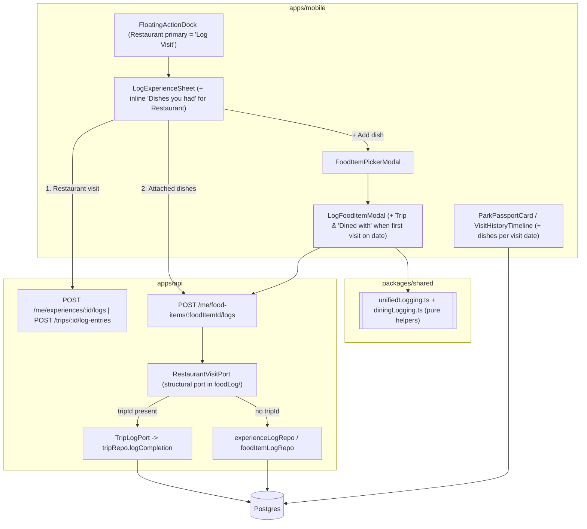

# Design Document

## Overview

Unified Dining & Dish Logging bridges the gap between dish-level logging (`food_item_logs`) and restaurant-level visit logging (`experience_logs`, `completions`, `trip_log_entries`).

Previously, `food-item-logging` Requirement 3.5 prohibited `POST /me/food-items/:foodItemId/logs` from touching `experience_logs` or `completions`, while `FloatingActionDock` on a restaurant's detail screen replaced the primary `"Log Visit"` action with `"Log a Dish"`. As a result, Users who logged dishes at a restaurant ended up in a state where the app knew what they ate at the restaurant, yet showed the restaurant itself as unvisited, incomplete in their Passport, and unlogged on their Trip.

This spec supersedes `food-item-logging` R3.5 (and `experience-detail-redesign` R19.4's primary dock label) with a bidirectional, non-duplicating model:

1. **Dish → Restaurant (Server-enforced, Trip-aware):** Logging a `Food_Item` scoped to a catalog `Restaurant_Experience` (`food_items.experience_id IS NOT NULL`) checks whether an `experience_logs` row already exists for `(user_id, experience_id, visited_on)`.
   - If **none exists**: the server creates one `experience_logs` row (with `rating = null`, `note = null`, keeping dish ratings strictly separate from the restaurant's overall rating) and ensures the canonical `completions` row exists. When `tripId` is provided in the request, it delegates through the existing `TripLogPort` (`tripRepo.logCompletion`) so the restaurant visit is also linked to the Trip (`trip_log_entries`, `completion_logged` `trip_feed_items`, `rode_with_tags`, and tag notices).
   - If **one already exists on `visitedOn`**: the server reuses that visit (`created: false`) without inserting a duplicate `experience_logs` row—so logging an entrée, drink, and dessert on the same day creates **1 restaurant visit** and **3 dish logs**.
2. **Dish Modal UX (`LogFoodItemModal`):** When logging a dish at a restaurant where the User has not yet logged a visit on `visitedOn`, `LogFoodItemModal` displays the same **Trip** chip row (pre-selected via `preselectTripId`) and **"Dined with"** member chips as `LogExperienceSheet`. The User can leave the Trip chip selected, switch Trips, or tap `"No trip"` to opt out of Trip attribution. When a visit already exists for `visitedOn`, `LogFoodItemModal` shows a compact `"✓ Restaurant visit already logged for this date"` badge and hides the redundant Trip/crew controls.
3. **Restaurant → Dishes (`LogExperienceSheet` + `FloatingActionDock`):**
   - On a Restaurant detail screen, `FloatingActionDock`'s primary button becomes **"Log Visit"** (consistent with Rides and Shows), opening `LogExperienceSheet`.
   - Inside `LogExperienceSheet`, when `category === 'Restaurant'`, an inline **"Dishes you had (`+ Add dish`)"** section lets the User optionally pick one or more dishes (and optionally rate each dish 1–10) before tapping **Log** once.
4. **Unified Journal View (`ParkPassportCard` & `VisitHistoryTimeline`) + Historical Backfill (`0071`):**
   - Each restaurant visit row on `visitedOn` displays the dishes the User logged at that restaurant on `visitedOn`.
   - Migration `0071_backfill_restaurant_visits_from_food_logs.sql` backfills missing `experience_logs` and `completions` rows for any historical `food_item_logs` scoped to a catalog restaurant.

## Architecture



## Components and Interfaces

### 1. Shared Contracts & Pure Helpers (`packages/shared`)

#### `packages/shared/src/schemas/FoodItemLog.ts` & `packages/shared/src/dto/FoodItemLog.ts`

Extend `createFoodItemLogInputSchema` (keeping `.strict()`):

```typescript
export const createFoodItemLogInputSchema = z
  .object({
    visitedOn: isoDateSchema,
    userTz: ianaTzSchema,
    rating: ratingValueSchema.nullable().optional(),
    note: noteBodySchema.nullable().optional(),
    tripId: uuidSchema.nullable().optional(),
    rodeWith: z.array(uuidSchema).optional(),
  })
  .strict();
```

Extend `CreateFoodItemLogInputDTO` and add `FoodLogRestaurantVisitDTO`:

```typescript
export interface CreateFoodItemLogInputDTO {
  readonly visitedOn: string; // YYYY-MM-DD
  readonly userTz: string;
  readonly rating?: number | null;
  readonly note?: string | null;
  readonly tripId?: string | null;
  readonly rodeWith?: readonly string[];
}

export interface FoodLogRestaurantVisitDTO {
  readonly experienceId: string;
  readonly logId: string;
  /** `true` when this dish log auto-created a new Experience_Log on `visitedOn`; `false` when one already existed. */
  readonly created: boolean;
  readonly tripLog?: {
    readonly tripId: string;
    readonly logEntryId: string;
    readonly taggedCount: number;
  };
}

export interface CreateFoodItemLogResponseDTO extends FoodItemLogDTO {
  readonly restaurantVisit?: FoodLogRestaurantVisitDTO | null;
  readonly newlyAwardedPinIds?: readonly string[];
}
```

#### Pure helper module: `packages/shared/src/diningLogging.ts`

I/O-free helpers shared by `LogFoodItemModal`, `LogExperienceSheet`, and `ParkPassportCard`:

```typescript
import type { ExperienceLogDTO } from './dto/ExperienceLog.js';
import type { FoodItemLogWithContextDTO } from './dto/FoodItemLog.js';

export interface InlineDishDraft {
  readonly foodItemId: string;
  readonly name: string;
  readonly rating: number | null; // 1..10 or null
  readonly note: string;
}

/**
 * Returns true if `logs` already contains at least one Experience_Log on `visitedOn`.
 */
export function hasVisitOnDate(
  logs: readonly Pick<ExperienceLogDTO, 'visitedOn'>[],
  visitedOn: string,
): boolean;

/**
 * Groups restaurant-scoped food item logs by `visitedOn` (`YYYY-MM-DD`),
 * preserving input order within each date.
 */
export function groupDishesByVisitDate<
  T extends Pick<FoodItemLogWithContextDTO, 'id' | 'foodItemName' | 'visitedOn' | 'rating'>,
>(dishes: readonly T[]): ReadonlyMap<string, readonly T[]>;
```

### 2. Backend: `RestaurantVisitPort` in `apps/api/src/services/foodLog/`

To keep service boundaries clean (`foodLog` does not import `tracking` or `trips` directly), `apps/api/src/services/foodLog/routes.ts` accepts an optional structural port `restaurantVisit?: RestaurantVisitPort` on `FoodItemLogRoutesOptions`:

```typescript
export interface EnsureRestaurantVisitInput {
  readonly userId: string;
  readonly experienceId: string;
  readonly visitedOn: string;
  readonly userTz: string;
  readonly tripId: string | null;
  readonly rodeWith: readonly string[];
}

export interface EnsureRestaurantVisitResult {
  readonly experienceId: string;
  readonly logId: string;
  readonly created: boolean;
  readonly tripLog?: {
    readonly tripId: string;
    readonly logEntryId: string;
    readonly taggedCount: number;
  };
  readonly pendingTags?: readonly {
    readonly tagId: string;
    readonly taggedMemberId: string;
  }[];
}

export interface RestaurantVisitPort {
  ensureVisitForDishLog(
    input: EnsureRestaurantVisitInput,
  ): Promise<EnsureRestaurantVisitResult>;
}
```

#### Execution flow in `POST /me/food-items/:foodItemId/logs`:

1. Validate `foodItemId` and request body via `createFoodItemLogInputSchema`.
2. Validate `visitedOn` is not in the future (`validateNotFutureFoodVisitDate` -> `food_log_future_date`).
3. If `body.rodeWith` is non-empty and `!body.tripId`, throw `AppError('validation_failed', 'rodeWith requires tripId', { field: 'rodeWith' })`.
4. Look up the target `Food_Item` (`food_items.id = $1`) to obtain its `experience_id` (`string | null`). If the `Food_Item` does not exist, throw `AppError('food_item_not_found', ...)`.
5. If `body.rodeWith` is non-empty (or `body.tripId` is non-null) and `experience_id === null` (a `User_Submitted_Location` item), throw `AppError('validation_failed', 'Trip attribution requires a catalog restaurant', { field: 'tripId' })`.
6. When `experience_id !== null` and `options.restaurantVisit` is wired:
   - Call `options.restaurantVisit.ensureVisitForDishLog(...)` **before** inserting the `food_item_logs` row (or inside the coordinated workflow) so that any Trip validation/permission/date-range error (`trip_forbidden`, `trip_validation_failed`, `log_outside_trip_dates`) rejects cleanly without leaving an orphaned `food_item_logs` row (Requirement 1.8).
   - How `ensureVisitForDishLog` works (wired in `composeServices.ts`):
     - Checks `SELECT id FROM experience_logs WHERE user_id = $1 AND experience_id = $2 AND visited_on = $3 ORDER BY logged_at DESC LIMIT 1`.
     - If a row already exists (`existingLogId`):
       - Returns `{ experienceId, logId: existingLogId, created: false }` without creating a duplicate `experience_logs` row.
     - If no row exists:
       - If `tripId !== null`: calls `tripLogPort.logToTrip({ tripId, userId, experienceId, visitedOn, userTz, rating: null, note: null, rodeWith })`, returning `{ experienceId, logId: out.logId, created: true, tripLog: { tripId, logEntryId: out.logEntryId, taggedCount: out.pendingTags.length }, pendingTags: out.pendingTags }`.
       - If `tripId === null`: calls `experienceLogRepo.addLog({ userId, experienceId, visitedOn, userTz, rating: null, note: null, tripId: null })`, returning `{ experienceId, logId: createdLog.id, created: true }`.
7. Insert the `food_item_logs` row via `options.repo.addLog(...)`.
8. If `restaurantVisit?.created` is `true`, dispatch any `pendingTags` via `onRodeWithTagCreated` and evaluate pin awards via `awardPinsSafely`.
9. Return `201` with `{ ...foodItemLog, restaurantVisit: restaurantVisitResult ?? null, ...(newlyAwardedPinIds.length > 0 ? { newlyAwardedPinIds } : {}) }`.

### 3. Mobile Components

#### `LogFoodItemModal.tsx` (`apps/mobile/src/screens/catalog/LogFoodItemModal.tsx`)
- When `foodItem?.experienceId` is non-null:
  - Queries `['experience-logs', foodItem.experienceId]` (`GET /me/experiences/:id/logs`), `['me', 'trips', 'active']` (`GET /me/trips`), `['me']`, and (when a Trip is selected) `['trips', tripId, 'members']`.
  - Computes `alreadyVisitedOnDate = hasVisitOnDate(logs, visitedOn)`.
  - When `!alreadyVisitedOnDate`:
    - Renders an info pill (`testID="log-food-auto-visit-banner"`): *"Also marks this restaurant as visited on {visitedOn}"*.
    - Renders the Trip chips (`testID="log-food-trip-section"`) and `"Dined with"` member chips (`testID="log-food-rode-with-section"`) using `preselectTripId` and `reconcileDraft`.
    - Sends `tripId` and `rodeWith` in the `POST /me/food-items/:foodItemId/logs` payload.
  - When `alreadyVisitedOnDate`:
    - Renders a subtle badge (`testID="log-food-existing-visit-badge"`): *"✓ Restaurant visit already logged for this date"*.
    - Sends `tripId: null` (and omits Trip/member chips).
  - On success: if `created.restaurantVisit` is present, calls `invalidateAfterLog(queryClient, { experienceId: created.restaurantVisit.experienceId, tripId: created.restaurantVisit.tripLog?.tripId ?? null })` in addition to the food-item query invalidations.

#### `LogExperienceSheet.tsx` (`apps/mobile/src/screens/logging/LogExperienceSheet.tsx`)
- When `category === 'Restaurant'`:
  - Renders a `"Dishes you had"` section (`testID={`${testIDPrefix}-dishes-section`}`) with an `"+ Add dish"` button (`testID={`${testIDPrefix}-add-dish-btn`}`).
  - Tapping `"+ Add dish"` opens `FoodItemPickerModal` for `experienceId`. Selecting a dish adds an `InlineDishDraft` row showing the dish's name, compact 1–10 rating pills, and a remove button (`testID={`${testIDPrefix}-remove-dish-${foodItemId}`}`).
  - On submit:
    1. Submits the restaurant visit (`buildLogSubmission`) as today.
    2. For each `InlineDishDraft`, posts to `POST /me/food-items/:foodItemId/logs` with `{ visitedOn: draft.visitedOn, userTz, rating: dish.rating, note: dish.note.trim() || null, tripId: null }`.
    3. Invalidates `['experience-food-items', experienceId]` and `['scoped-food-item-logs', experienceId]` alongside `invalidateAfterLog`.
    4. Enqueues the `Log_Toast` with `offerDishPrompt: inlineDishes.length === 0` (so the user isn't prompted to *"Log what you ate"* when they just logged their dishes inline).

#### `FloatingActionDock.tsx` (`apps/mobile/src/screens/catalog/FloatingActionDock.tsx`)
- For `category === 'Restaurant'`, the primary dock button is `"Log Visit"` (`testID="dock-primary-action"`, calling `onLogVisit`), matching Rides and Shows, while `"Log a food item"` remains directly accessible in `TodayInParkLens` and `RestaurantDishLogCard`.

#### `ParkPassportCard.tsx` & `VisitHistoryTimeline.tsx`
- Accept optional `foodLogs?: readonly FoodItemLogWithContextDTO[]` (or read cached `['scoped-food-item-logs', experienceId]`).
- For each visit row on `log.visitedOn`, render any matching dishes from `groupDishesByVisitDate(foodLogs).get(log.visitedOn)` as compact dish chips beneath the visit metadata (e.g., `🍽️ Cheeseburger Steamed Pods (9/10)`), with `testID={`visit-dishes-${log.id}`}`.

## Data Models

### Migration `0071_backfill_restaurant_visits_from_food_logs.sql`

No DDL schema changes are needed—`experience_logs`, `completions`, and `food_item_logs` already have all required columns. Migration `0071` is a pure, idempotent data repair migration:

```sql
BEGIN;

-- 1. For every distinct (user_id, experience_id, visited_on) present in
--    food_item_logs (via food_items) where no experience_logs row exists on
--    that date, insert one unrated experience_logs row.
INSERT INTO experience_logs (user_id, experience_id, visited_on, user_tz, logged_at, rating, note)
SELECT
    fil.user_id,
    fi.experience_id,
    fil.visited_on,
    MIN(fil.user_tz) AS user_tz,
    MIN(fil.logged_at) AS logged_at,
    NULL AS rating,
    NULL AS note
FROM food_item_logs fil
JOIN food_items fi ON fi.id = fil.food_item_id
LEFT JOIN experience_logs el
  ON el.user_id = fil.user_id
 AND el.experience_id = fi.experience_id
 AND el.visited_on = fil.visited_on
WHERE fi.experience_id IS NOT NULL
  AND el.id IS NULL
GROUP BY fil.user_id, fi.experience_id, fil.visited_on;

-- 2. Ensure a canonical completions row exists for every (user_id, experience_id)
--    that has a food_item_log at a catalog restaurant.
INSERT INTO completions (user_id, experience_id, completed_on, user_tz)
SELECT
    fil.user_id,
    fi.experience_id,
    MIN(fil.visited_on) AS completed_on,
    MIN(fil.user_tz) AS user_tz
FROM food_item_logs fil
JOIN food_items fi ON fi.id = fil.food_item_id
WHERE fi.experience_id IS NOT NULL
GROUP BY fil.user_id, fi.experience_id
ON CONFLICT (user_id, experience_id) DO NOTHING;

COMMIT;
```

## Configuration & Constants

Reuses all existing bounds and constants from `food-item-logging` and `unified-experience-logging` (`MIN_RATING = 1`, `MAX_RATING = 10`, `MAX_NOTE_LENGTH = 2000`, `DEFAULT_LOG_USER_TZ = 'America/New_York'`). No new environment variables are introduced.

## External Interfaces

No external upstream APIs are added or modified. Internal service boundaries use `RestaurantVisitPort` composed in `apps/api/src/composeServices.ts`.

## Correctness Properties

### Property 1: First Dish Log on a Date Ensures Exactly One Restaurant Visit
*For any User, any catalog `Restaurant_Experience`, any valid `visitedOn` date, and any sequence of `N >= 1` `Food_Item_Log` creations for dishes at that restaurant on `visitedOn`, the User ends up with a canonical `Completion` for that restaurant and exactly one `Experience_Log` for `(userId, experienceId, visitedOn)` (creating one if zero existed before, and adding zero duplicates for subsequent dish logs on the same date).*
**Validates: Requirements 1.2, 1.4**

### Property 2: Dish Ratings Never Pollute Restaurant Ratings
*For any `Food_Item_Log` created with any dish `rating` (1..10 or null) and `note`, the auto-created `Experience_Log` always has `rating = null` and `note = null`, and the restaurant's canonical `ratings` table is untouched.*
**Validates: Requirements 1.5**

### Property 3: Trip-Linked Dish Log Produces Full Trip Footprint on First Visit Only
*For any User who is a member of an Active_Trip covering `visitedOn`, logging a dish at a catalog restaurant on `visitedOn` with `tripId` and valid `rodeWith` when no visit exists yet on `visitedOn` creates the `Experience_Log`, `Trip_Log_Entry`, `completion_logged` `Trip_Feed_Item`, and `pending` `Rode_With_Tags` identically to `logCompletion`; if a rejected `tripId`/`rodeWith`/`visitedOn` is supplied, neither the `Food_Item_Log` nor the `Experience_Log` is written.*
**Validates: Requirements 1.3, 1.7, 1.8**

### Property 4: Grouping Dishes by Visit Date Preserves All Dishes Per Date
*For any list of `Experience_Log` entries and `Food_Item_LogWithContextDTO` entries at a restaurant, `groupDishesByVisitDate` maps every dish to its exact `visitedOn` key in input order, and `hasVisitOnDate(logs, date)` is true if and only if at least one `Experience_Log` has `visitedOn === date`.*
**Validates: Requirements 2.1, 4.2, 4.3**

### Property 5: Backfill Migration Completeness and Idempotence
*For any database state containing `food_item_logs` across catalog restaurants and user-submitted locations, running migration `0071` ensures every `(user_id, experience_id, visited_on)` with a catalog dish log has an `experience_logs` row and a `completions` row, touches no user-submitted location logs or existing ratings, and running `0071` a second time inserts zero rows.*
**Validates: Requirements 5.1, 5.2, 5.3, 5.4**

## Error Handling

Reuses existing `ErrorCode` values from `@dwt/shared`:
- `food_log_future_date` (`400`): `visitedOn` is in the future in `userTz`.
- `food_item_not_found` (`404`): `foodItemId` does not exist.
- `validation_failed` (`400`): `rodeWith` supplied without `tripId`, or `tripId`/`rodeWith` supplied for a `User_Submitted_Location` dish (`experienceId === null`).
- `trip_forbidden` (`403`): caller is not a member of `tripId` or Trip does not exist.
- `trip_validation_failed` (`400`): invalid `rodeWith` member ids.
- `log_outside_trip_dates` (`400`): `visitedOn` is outside the selected Trip's `[startDate, endDate]`.

## Testing Strategy

- **Shared unit & property tests (`packages/shared`):**
  - `packages/shared/src/__tests__/diningLogging.prop.test.ts`: Property 4 (`hasVisitOnDate`, `groupDishesByVisitDate`) and schema validation for `createFoodItemLogInputSchema` with `tripId`/`rodeWith`.
- **API integration & property tests (`apps/api`):**
  - `apps/api/src/services/foodLog/__tests__/autoRestaurantVisit.prop.test.ts`: Properties 1, 2, and 3 against `pg-mem` and the real repos (`FoodItemLogRepo`, `ExperienceLogRepo`, `TripRepo`).
  - `apps/api/src/services/foodLog/__tests__/migration0071.test.ts`: Property 5 testing the SQL of `0071_backfill_restaurant_visits_from_food_logs.sql` including idempotence.
- **Mobile component tests (`apps/mobile`):**
  - `LogFoodItemModal.test.tsx`: asserts Trip pre-selection chip when no visit exists on `visitedOn`, opting out via `"No trip"`, hiding Trip chips when a visit already exists on `visitedOn`, and query invalidation on submit.
  - `LogExperienceSheet.test.tsx`: asserts `"Dishes you had"` section for `category === 'Restaurant'`, adding/rating/removing an inline dish, submitting both the restaurant visit and attached dish logs, and suppressing the redundant toast `Dish_Prompt` when dishes were already attached.
  - `ParkPassportCard.test.tsx` / `FloatingActionDock.test.tsx`: asserts `"Log Visit"` primary action on restaurants and rendering of per-visit dishes on matching dates.

