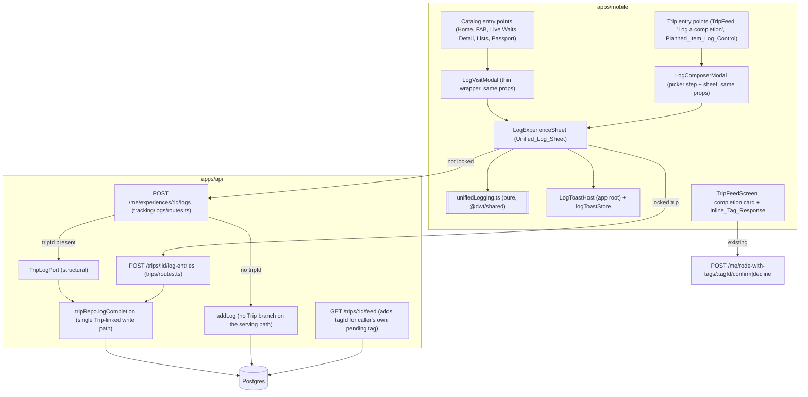
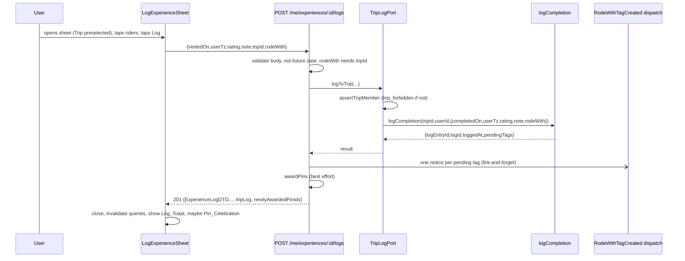

# Design Document

## Overview

Unified Experience Logging replaces two divergent logging forms with one `Unified_Log_Sheet` backed by one server write path. It is deliberately **additive**: no new endpoint, one new migration (a data backfill, no schema change), two optional fields on one existing request body, one optional field on another, and one new error code.

### The problem in code terms

| | `LogVisitModal` → `POST /me/experiences/:id/logs` → `addLog` (`tracking/logs/repo.ts`) | `LogComposerModal` → `POST /trips/:id/log-entries` → `logCompletion` (`trips/repo.ts`) |
|---|---|---|
| Date | yes (`visitedOn`) | no (always `wdwToday()`) |
| Trip membership check | `trip_memberships` | route `assertTripMember` (`active_trip_memberships`) |
| `experience_logs` row | yes | yes |
| `completions` / `ratings` | inline SQL, one transaction | injected `completions.mark` / `ratings.setRating`, separate connections |
| `trip_log_entries` row | yes | yes |
| `trip_feed_items` `completion_logged` | **no** | yes |
| `rode_with_tags` + notices | **no** | yes |
| Pin award | yes (route hook) | yes (route hook) |

The gap is the three bold cells. The fix is not to copy them into `addLog`; it is to route every Trip-linked create to the one function that already does all of it (`logCompletion`), and make the two UIs one component.

### Key design decisions

1. **`logCompletion` is the single Trip-linked write path.** `POST /me/experiences/:id/logs` with a `tripId` delegates to it through a structural `TripLogPort` (injected in `composeServices.ts`), so the Tracking service never imports the Trip service. `addLog` keeps its `tripId` branch for backward compatibility but the serving route no longer reaches it when the port is wired; a structural smoke test pins that (same pattern as `retirement.smoke.test.ts`). Rejected alternative: duplicating feed/tag writes into `addLog`. It would leave two implementations to drift, which is how this gap arose.
2. **Two endpoints stay; one code path behind them.** `planned-list-completion-sync` R1.4 requires Trip entry points to keep posting to `POST /trips/:id/log-entries`. So the sheet picks its endpoint by whether the Trip is *locked* by the entry point (Trips endpoint) or not (personal endpoint). A pure `buildLogSubmission` makes that choice and is property-tested.
3. **`POST /trips/:id/log-entries` gains optional `visitedOn` / `userTz`.** `LogCompletionInput` already carries `completedOn` and `userTz`; the route simply maps them. Without them behavior is byte-for-byte unchanged.
4. **Date-range validation applies only to an explicit `visitedOn`.** The existing Trip composer logs on a *past* Trip with `wdwToday()` (outside the range); applying the check universally would change that behavior. Scoping the check to explicit dates keeps old callers working and gives the new sheet correct attribution.
5. **Trip pre-selection is conservative.** Exactly one Active_Trip containing the Visit_Date → pre-select. Two or more → select nothing and show chips. (Overlapping active trips are rare; guessing wrong silently misattributes a ride, so the User chooses.)
6. **One toast host at the app root**, driven by a small Zustand store, so the eight existing call sites of `LogVisitModal` need no edits and every entry point gets the same feedback, "View in trip" action, and Dish_Prompt.
7. **Inline tag response reuses the existing confirm/decline endpoints.** The only server change is exposing `tagId` for the *caller's own pending tag* in the feed projection.
8. **Dish logging stays personal.** The Dish_Prompt just opens the existing dish picker and dish log modal. No schema change to `food_item_logs`.
9. **Feed_Backfill** fixes pre-existing Linked_Logs so history is consistent; it only inserts feed rows.

## Architecture



### Request flow (Trip-linked, from the catalog)



### Module placement

```
packages/shared/src/
  unifiedLogging.ts            # NEW pure: PBT surface (see Components)
  errors.ts                    # CHANGED: + 'log_outside_trip_dates' (400)
  schemas/ExperienceLog.ts     # CHANGED: createExperienceLogInputSchema + rodeWith
  trips.ts                     # CHANGED: tripLogEntryCreateSchema + visitedOn?, userTz?
  index.ts                     # CHANGED: re-export unifiedLogging

apps/api/
  migrations/0070_backfill_completion_logged_feed_items.sql   # NEW (data only)
  src/services/tracking/logs/
    visitDate.ts               # NEW: validateNotFutureVisitDate moved here unchanged (exported)
    routes.ts                  # CHANGED: tripLog port branch, rodeWith, tripLog in response, delete hook
    tripLogPort.ts             # NEW: TripLogPort interface + types (no imports from trips/)
  src/services/trips/
    repo.ts                    # CHANGED: logCompletion date-range check + returns logId/loggedAt;
                               #          getFeed adds tagId; purgeFeedForLog()
    routes.ts                  # CHANGED: map visitedOn/userTz, future-date guard
  src/composeServices.ts       # CHANGED: build TripLogPort, pass to logs routes

apps/mobile/src/
  screens/logging/
    LogExperienceSheet.tsx     # NEW: the Unified_Log_Sheet
    LogExperienceSheet.palette.ts   # NEW if any literal colour is needed
    LogToastHost.tsx           # NEW: app-root toast + Dish_Prompt hosts
    LogToastHost.palette.ts    # NEW (reuse TOAST bg from foodLists/MarkGottenUndoToast.palette.ts if identical)
    logToastStore.ts           # NEW: Zustand store {current, show(), dismiss()}
    invalidateAfterLog.ts      # NEW: one helper listing every query key to invalidate
  screens/catalog/LogVisitModal.tsx       # CHANGED: thin wrapper over LogExperienceSheet
  screens/trips/TripFeedScreen.tsx        # CHANGED: LogComposerModal = picker step + LogExperienceSheet;
                                          #          completion card gets Inline_Tag_Response
  navigation/navigationRef.ts             # CHANGED: + navigateToTripFeed({tripId})
  navigation/RootNavigator.tsx            # CHANGED: mount <LogToastHost/> once at the root
```

## Components and Interfaces

### Shared pure core: `packages/shared/src/unifiedLogging.ts` (the PBT surface)

I/O-free. Used by the sheet and unit/property-tested directly.

```ts
export interface LogTripRef {
  readonly id: string;
  readonly name: string;
  readonly startDate: string; // YYYY-MM-DD
  readonly endDate: string;   // YYYY-MM-DD, >= startDate
}

export interface LogDraft {
  readonly visitedOn: string;              // YYYY-MM-DD
  readonly rating: number | null;          // 1..10 or null
  readonly note: string;                   // raw; trimmed on submit
  readonly tripId: string | null;
  readonly rodeWith: readonly string[];    // Trip_Member user ids
}

/** Inclusive on both ends. Plain string comparison (zero-padded ISO dates). */
export function isDateWithinTrip(
  date: string,
  trip: Pick<LogTripRef, 'startDate' | 'endDate'>,
): boolean;

/**
 * R2.1/R2.2: the id of the single Active_Trip whose inclusive range contains
 * `visitedOn`; `null` if there are zero or two-or-more such trips.
 */
export function preselectTripId(
  activeTrips: readonly LogTripRef[],
  visitedOn: string,
): string | null;

export type DraftHint = 'date_outside_trip' | null;

/**
 * R2.6-R2.9: apply a change to Visit_Date and/or Trip_Selection.
 *  - tripId changes to a different value -> rodeWith = [].
 *  - visitedOn changes, tripId non-null, NOT locked, date outside that trip's range
 *      -> tripId = null, rodeWith = [], hint = 'date_outside_trip'.
 *  - locked trip and the new date is outside its range -> return prev unchanged (the picker should
 *      prevent this; this is the defensive fallback).
 *  - lockedTripId !== null: a change to tripId is ignored.
 */
export function reconcileDraft(
  prev: LogDraft,
  change: { readonly visitedOn?: string; readonly tripId?: string | null },
  trips: readonly LogTripRef[],
  lockedTripId: string | null,
): { readonly draft: LogDraft; readonly hint: DraftHint };

/** R3.1: members except the caller, input order preserved, ids unique. */
export function ridingWithCandidates<M extends { readonly userId: string }>(
  members: readonly M[],
  callerUserId: string,
): readonly M[];

/** R3.2 / R8.3. `category === 'Restaurant'` (exact, the ExperienceCategory value). */
export function ridingWithLabel(category: string | null | undefined): 'Dined with' | 'Rode with';
export function offersDishPrompt(category: string | null | undefined): boolean;

export interface LogSubmission {
  readonly path: string;
  readonly body: Record<string, unknown>;
}

/**
 * R13.2: lockedTripId !== null -> POST /trips/:tripId/log-entries
 *          body { experienceId, rodeWith, visitedOn, userTz, rating?, note? }  (rating/note omitted when null/empty)
 *        otherwise            -> POST /me/experiences/:id/logs
 *          body { visitedOn, userTz, rating, note, tripId, rodeWith? }  (rodeWith only when tripId != null and non-empty;
 *          rating/note/tripId are null when absent)
 * rodeWith is de-duplicated preserving first occurrence and never contains `callerUserId`.
 * note is trimmed; an empty trimmed note is treated as absent.
 */
export function buildLogSubmission(args: {
  readonly experienceId: string;
  readonly draft: LogDraft;
  readonly userTz: string;
  readonly lockedTripId: string | null;
  readonly callerUserId: string;
}): LogSubmission;

/** R7.2 exact toast text. taggedNames: at most two shown, then "and N more". */
export function formatLogToast(args: {
  readonly experienceName: string;
  readonly tripName: string | null;
  readonly taggedNames: readonly string[];
}): string;
```

`formatLogToast` formats: no trip → `"<name> logged"`; trip → `"<name> logged to <trip>"`; tagged 1 → `" with A"`; 2 → `" with A and B"`; 3+ → `" with A, B and N more"` where N = total − 2.

### Shared contracts

```ts
// schemas/ExperienceLog.ts  (additive; still .strict())
export const createExperienceLogInputSchema = z.object({
  visitedOn: isoDateSchema,
  userTz: ianaTzSchema,
  rating: ratingValueSchema.nullable().optional(),
  note: noteBodySchema.nullable().optional(),
  tripId: uuidSchema.nullable().optional(),
  rodeWith: z.array(uuidSchema).optional(),          // NEW
}).strict();

// trips.ts  (additive; still .strict())
export const tripLogEntryCreateSchema = z.object({
  experienceId: uuidSchema,
  rodeWith: z.array(uuidSchema).default([]),
  rating: ratingValueSchema.optional(),
  note: noteBodySchema.nullable().optional(),
  visitedOn: isoDateSchema.optional(),               // NEW
  userTz: ianaTzSchema.optional(),                   // NEW
}).strict();
```

`rodeWith` without `tripId` is rejected in the **route** (not the schema) so `createExperienceLogInputSchema` stays a plain `ZodObject` for existing consumers.

`errors.ts`: add `'log_outside_trip_dates'` to the `ErrorCode` list with a comment, and `log_outside_trip_dates: 400` to `errorCodeToHttpStatus`.

### API: `TripLogPort` (`tracking/logs/tripLogPort.ts`)

```ts
export interface TripLogPort {
  /**
   * Trip-linked create. Implementation (composeServices) runs assertTripMember, then tripRepo.logCompletion.
   * Throws AppError trip_forbidden | trip_validation_failed | log_outside_trip_dates (see below).
   */
  logToTrip(input: {
    readonly tripId: string;
    readonly userId: string;
    readonly experienceId: string;
    readonly visitedOn: string;
    readonly userTz: string;
    readonly rating: number | null;
    readonly note: string | null;
    readonly rodeWith: readonly string[];
  }): Promise<{
    readonly logId: string;            // experience_logs.id
    readonly loggedAt: string;         // ISO timestamp of the experience_logs row
    readonly logEntryId: string;       // trip_log_entries.id
    readonly pendingTags: readonly { readonly tagId: string; readonly taggedMemberId: string }[];
  }>;

  /**
   * Delete the feed item (+ its reactions + comments) of the Trip_Log_Entry linked to `logId`, if any.
   * Scoped to logs owned by `userId`: a log that does not exist or belongs to someone else is a no-op.
   * Idempotent.
   */
  purgeFeedForLog(logId: string, userId: string): Promise<void>;
}
```

`ExperienceLogRoutesOptions` gains two **optional** members: `tripLog?: TripLogPort` and `onRodeWithTagCreated?: (e: { tagId; tripLogEntryId; taggedMemberId; taggingMemberId }) => void`. Optional so existing route tests (which register only the routes they need) keep compiling.

### API: `POST /me/experiences/:id/logs` (changed handler)

1. Parse params and body (`createExperienceLogInputSchema`).
2. `validateNotFutureVisitDate(body.visitedOn, body.userTz, clock())` (before any I/O; unchanged).
3. If `body.rodeWith?.length` and no `body.tripId` → `AppError('validation_failed', …, {field:'rodeWith'})`.
4. If `body.tripId` and `options.tripLog` present → `tripLog.logToTrip({...})`; build the `ExperienceLogDTO` from the input plus `logId`/`loggedAt` (`userId`, `experienceId`, `visitedOn`, `userTz`, `rating`, `note`); dispatch `onRodeWithTagCreated` per pending tag; `awardPinsSafely`; respond `201 { ...dto, tripLog: { tripId, logEntryId, taggedCount }, newlyAwardedPinIds }`.
5. Else → existing `addLog` path (unchanged), response unchanged.

`DELETE /me/experiences/:id/logs/:logId` (changed): before `repo.deleteLog`, call `options.tripLog?.purgeFeedForLog(logId, userId)`. The Trip_Log_Entry and Rode_With_Tags are removed by the existing `ON DELETE CASCADE` from `experience_logs`; `purgeFeedForLog` removes what cascade cannot (the feed item, and the reactions/comments that target it by `target_id` with no FK). Ownership is enforced inside `purgeFeedForLog` (it joins `experience_logs.user_id = $userId`), so another user's `logId` is a no-op and the existing `deleteLog` then returns `log_not_found` as it does today.

### API: `tripRepo.logCompletion` changes (`trips/repo.ts`)

- New check, inside the existing transaction after the tag-membership check: **only when `input.completedOn !== undefined`**, read `SELECT start_date::text AS s, end_date::text AS e FROM trips WHERE id = $1`; if `completedOn < s || completedOn > e` → `ROLLBACK` and throw `AppError('log_outside_trip_dates', 'The visit date is outside this trip\'s dates.', { field: 'visitedOn' })`.
- `LoggedCompletion` gains `logId: string` (the `experienceLogId` already computed) and `loggedAt: string` (`RETURNING … logged_at`; add it to the existing `experience_logs` INSERT's RETURNING).
- No other behavior change.

### API: `POST /trips/:id/log-entries` route (`trips/routes.ts`)

- After `parseOrAppError(tripLogEntryCreateSchema, …)`: if `body.visitedOn` present, run the same `validateNotFutureVisitDate(body.visitedOn, body.userTz ?? 'America/New_York', clock)` (imported from `tracking/logs/visitDate.ts`; the trips route needs a clock option, default `() => new Date()`).
- Pass `completedOn: body.visitedOn` and `userTz: body.userTz` into `repo.logCompletion`.

### API: feed projection (`trips/repo.ts` `getFeed`)

In the `rode_with` `json_build_object`, add `'tagId', CASE WHEN rwt.tagged_member_id = $2 AND rwt.state = 'pending' THEN rwt.id END`. `$2` is already the caller id param. A `null` `tagId` serializes as JSON `null`; the mobile parser treats `null`/missing as "no controls".

### API: composeServices wiring

```ts
const tripLogPort: TripLogPort = {
  async logToTrip(i) {
    await assertTripMember(pool, i.userId, i.tripId);
    const r = await tripRepo.logCompletion(i.tripId, i.userId, {
      experienceId: i.experienceId,
      rodeWith: [...i.rodeWith],
      ...(i.rating !== null ? { rating: i.rating } : {}),
      note: i.note,
      completedOn: i.visitedOn,
      userTz: i.userTz,
    });
    return { logId: r.logId, loggedAt: r.loggedAt, logEntryId: r.logEntryId, pendingTags: r.pendingTags };
  },
  purgeFeedForLog: (logId, userId) => tripRepo.purgeFeedForLog(logId, userId),
};
```
passed as `tripLog` plus `onRodeWithTagCreated: emitRodeWithTagCreated` in the `experienceLogs` route options (the block at `composeServices.ts` that currently passes `repo: experienceLogRepo, requireSession, awardPins`). The signature of `tripRepo.logCompletion` is `(tripId, loggerId, input, now?)`; confirm against the interface at implementation time.

### API: `tripRepo.purgeFeedForLog(logId, userId)`

One transaction: find `le.id` for `le.log_id = $1` joined to `experience_logs el ON el.id = le.log_id AND el.user_id = $2` (no row → return, idempotent); `DELETE FROM trip_reactions WHERE target_type='feed_item' AND target_id IN (SELECT id FROM trip_feed_items WHERE type='completion_logged' AND metadata->>'logEntryId' = le.id::text)`; same for `trip_comments`; then `DELETE FROM trip_feed_items` for those ids. Does **not** delete `trip_log_entries` or the log; the caller's subsequent `deleteLog` does that through the existing cascade.

### Migration `0070_backfill_completion_logged_feed_items.sql`

```sql
BEGIN;
INSERT INTO trip_feed_items (trip_id, type, actor_id, metadata, created_at)
SELECT tle.trip_id,
       'completion_logged',
       tle.member_id,
       jsonb_build_object('experienceId', tle.experience_id::text, 'logEntryId', tle.id::text),
       tle.created_at
  FROM trip_log_entries tle
 WHERE NOT EXISTS (
         SELECT 1 FROM trip_feed_items fi
          WHERE fi.type = 'completion_logged'
            AND fi.metadata->>'logEntryId' = tle.id::text);
COMMIT;
```
Idempotent by the `NOT EXISTS`. Data only; no DDL; the `trip_feed_items_type_chk` already allows `completion_logged` (migration 0063). The `getFeed` projection reads `metadata->>'experienceId'` and `metadata->>'logEntryId'` as text and casts, so string UUIDs in `jsonb_build_object` match what `logCompletion` writes via `JSON.stringify`.

### Mobile: `LogExperienceSheet` (the Unified_Log_Sheet)

```ts
export interface LogExperienceSheetProps {
  readonly experienceId: string;
  /** Optional hint; when absent the sheet reads it from the ['experience', id] query (EXISTING catalog read used by ExperienceDetailScreen). */
  readonly experience?: { readonly name: string; readonly category: string | null; readonly park?: string | null };
  readonly visible: boolean;
  readonly lockedTripId?: string;        // set by Trip entry points
  readonly testIDPrefix?: 'log-visit' | 'activity-log';  // default 'log-visit'; Trip entry points pass 'activity-log'
  readonly onClose: () => void;
  readonly onLogged?: () => void;        // kept so LogVisitModal's onLogged contract is unchanged
}
```

Reads: `GET /me/trips` (key `['me','trips','active']`, as today) for Active_Trips; `GET /trips/:tripId/members` (key `tripFeedKeys.members(tripId)` = `['trips','members',tripId]`) for the Riding_With_Row when a Trip is selected; `GET /me` (key `['me']`, `user.id`) for the caller id; the experience read for name/category when the `experience` hint is absent. Trip chips come from the `active` group; for a locked Trip, name/dates come from `GET /trips/:id` (key `['trips', tripId]`, as `TripBudgetScreen` uses) so a Trip that is not in the `active` group (past trips) still resolves.

State: `LogDraft` plus `busy`, `error`, `hint`. All transitions go through `reconcileDraft`. Submission: `const { path, body } = buildLogSubmission(...)`, then `apiRequest('POST', path, body)`, then on success: `onLogged?.()`, `invalidateAfterLog(queryClient, { experienceId, tripId })`, `useLogToastStore.getState().show({...})`, and, if `newlyAwardedPinIds.length > 0`, open `PinCelebrationModal` (props `visible`, `onClose`, `pinIds`).

Layout (top to bottom): title, experience name; **Today** row (tap expands `DatePickerField` with `maximumDate` = today and, if a Trip is selected, `minimumDate` = Trip `startDate` and `maximumDate` = min(today, Trip `endDate`)); **Rating** tiles; **Add a note** row; **Trip** chips (omitted if no Active_Trip and not locked; a single label row if locked); **Rode with / Dined with** chips when a Trip is selected; error text; **Cancel** and **Log** buttons.

### Mobile: `LogVisitModal` wrapper

```tsx
export default function LogVisitModal(props: LogVisitModalProps) {
  return <LogExperienceSheet experienceId={props.experienceId} visible={props.visible}
           onClose={props.onClose} onLogged={props.onLogged} />;
}
```
Props identical to today. Existing testIDs (`log-visit-modal`, `log-visit-note-input`, `log-visit-rating-N`, `log-visit-trip-none`, `log-visit-trip-<id>`, `log-visit-submit`, `log-visit-cancel`, `log-visit-error`, `log-visit-busy`, `log-visit-keyboard-avoiding-view`, `log-visit-scroll`, `log-visit-date`) are kept for the controls that survive; the **Today** row and **Add a note** row use `log-visit-date-row` and `log-visit-note-row`.

### Mobile: `LogComposerModal` (in `TripFeedScreen.tsx`)

Keeps its props (`visible, tripId, candidates, initialExperience, onClose, onLogged`). Internally: if `experience === null` it shows the existing `ExperiencePicker` inside a small modal; once chosen (or when `initialExperience` is given) it renders `<LogExperienceSheet lockedTripId={tripId} testIDPrefix="activity-log" experience={…} />`. The `candidates` prop is accepted for compatibility but the sheet loads members itself (it needs them when not locked); a follow-up may remove the prop.

### Mobile: Log_Toast

`logToastStore` (Zustand): `{ current: { message, tripId: string|null, experienceId, offerDishPrompt, nonce } | null; show(t); dismiss() }`. `show` replaces any current toast and resets the timer (6000 ms; 8000 ms when `offerDishPrompt`). `LogToastHost` renders the toast near the bottom above the tab bar with `accessibilityLiveRegion="polite"` / `accessibilityRole="alert"`, a **View in trip** button when `tripId !== null` (calls `navigateToTripFeed({ tripId })`), and a **Log what you ate** button when `offerDishPrompt` (opens `FoodItemPickerModal experienceId=…`, then `LogFoodItemModal` for the chosen dish, both hosted inside `LogToastHost`).

### Mobile: Inline_Tag_Response (in `TripFeedScreen.tsx`)

`FeedRodeWith` gains `readonly tagId?: string | null`; the parser (`isFeedRodeWith`-style guard near line 2047) accepts `string | null | undefined`. In the completion card, for each rode-with entry with `state === 'pending'` and a non-empty `tagId`, render **Confirm** and **Decline** buttons (testIDs `feed-tag-confirm-<tagId>`, `feed-tag-decline-<tagId>`). Mutations call `POST /me/rode-with-tags/:tagId/confirm` (body `{}`) and `/decline`; on success invalidate `tripFeedKeys.feed(tripId)`, `['trips', tripId, 'summary']`, `['me-stats']`; on error show an inline message on the card.

### Mobile: navigation helper

`navigateToTripFeed({ tripId })` in `navigationRef.ts`, following `navigateToTripMembers`: navigates to `Trips` ▸ `TripFeed` with `{ tripId }`, seeding `TripDetail` first so Back returns to the hub.

### Mobile: `invalidateAfterLog.ts`

```ts
export function invalidateAfterLog(qc: QueryClient, a: { experienceId: string; tripId: string | null }): void
```
Invalidates: `['experience-logs', experienceId]` (the key `ExperienceDetailScreen.invalidateAfterLogChange` already uses; the executor opens that function and invalidates every key it invalidates, adding none), `['me-stats']`, `['me','trips','active']`, the Trips list key (`tripsListKeys.list()`), and when `tripId !== null`: `tripFeedKeys.feed(tripId)`, `['trips', tripId, 'summary']`, `['trips', tripId, 'planned-items']`.

## Data Models

- **No schema change.** No new table or column. Migration 0070 inserts rows only.
- **`ExperienceLogDTO`** unchanged. **Response of `POST /me/experiences/:id/logs`** gains optional `tripLog: { tripId: string; logEntryId: string; taggedCount: number }` (present only for Trip-linked creates).
- **`LoggedCompletion`** (`trips/repo.ts`) gains `logId`, `loggedAt`.
- **Feed `rodeWith` entries** gain `tagId: string | null` (metadata is already `Record<string, unknown>`; no shared DTO type changes).
- **Derived/ephemeral (mobile only):** `LogDraft`, `LogSubmission`, toast record. Never persisted.

## Configuration & Constants

No environment variables, secrets, base URLs, or cron changes.

| Constant | Value | Where |
|---|---|---|
| Rating range | 1 to 10 integer | existing `ratingValueSchema` |
| Note length | 1 to 2000 chars | existing `noteBodySchema`; sheet `MAX_NOTE_LENGTH = 2000` |
| Default Visit_Date | today in device time zone (`Intl.DateTimeFormat().resolvedOptions().timeZone`, fallback `UTC`) | sheet |
| Max Visit_Date | today in device time zone | sheet picker, server `validateNotFutureVisitDate` |
| `LOG_TOAST_MS` | 6000 | `logToastStore.ts` |
| `LOG_TOAST_WITH_DISH_PROMPT_MS` | 8000 | `logToastStore.ts` |
| Toast tagged-name limit | 2 shown, then "and N more" | `formatLogToast` |
| Active_Trip | `status === 'active'` group of `GET /me/trips` | sheet |
| Default Trip `userTz` when `POST /trips/:id/log-entries` omits it | `DEFAULT_LOG_USER_TZ` (existing constant in `trips/repo.ts`) | unchanged |
| New error code | `log_outside_trip_dates`, HTTP 400, field `visitedOn` | `errors.ts` |
| Migration | `0070_backfill_completion_logged_feed_items.sql` | `apps/api/migrations/` |
| Query keys | feed `['trips','feed',tripId]`; summary `['trips',tripId,'summary']`; planned `['trips',tripId,'planned-items']`; members `['trips','members',tripId]`; me `['me']`; trips for chips `['me','trips','active']`; stats `['me-stats']` | existing |

Hosting constraints: no new background work, polling, or Redis use. The tag notification dispatch is the existing fire-and-forget path. The backfill is one-shot SQL in the deploy migration step; row volume is bounded by existing `trip_log_entries` rows.

## External Interfaces

No external API. Internal contracts relied on, verified against the code at spec time:

- `POST /me/experiences/:id/logs` body `{ visitedOn, userTz, rating?, note?, tripId? }`, response `ExperienceLogDTO & { newlyAwardedPinIds }` (`tracking/logs/routes.ts`).
- `POST /trips/:id/log-entries` body `{ experienceId, rodeWith[], rating?, note? }`, response `201 { logEntryId, newlyAwardedPinIds }` (`trips/routes.ts`).
- `tripRepo.logCompletion(tripId, loggerId, input, now?)` with `input: LogCompletionInput = TripLogEntryCreateInput & { completedOn?: string; userTz?: string }`, returning `{ logEntryId, pendingTags: { tagId, taggedMemberId }[] }`.
- `assertTripMember(pool, userId, tripId)` (`trips/authz.ts`): throws `trip_forbidden` for non-member or non-existent Trip.
- `emitRodeWithTagCreated(RodeWithTagCreatedNotice)` in `composeServices.ts`, where the notice is `{ tagId, tripLogEntryId, taggingMemberId, taggedMemberId }`.
- `GET /me/trips` → `readonly { status: TripStatus; trips: readonly TripDTO[] }[]`; `TripDTO` has `id, name, startDate, endDate, status`.
- `GET /trips/:id/members` → `TripMemberDTO[]` (`userId, displayName, avatarPreset, role`). `GET /me` → `{ user: { id } }`. `GET /trips/:id` → `TripDTO`.
- `POST /me/rode-with-tags/:tagId/confirm` (body `{ rating? }`, `{}` allowed) and `/decline`.
- Tables: `trip_log_entries(id, trip_id, member_id, experience_id, created_at, log_id)`, `trip_feed_items(id, trip_id, type, actor_id, metadata jsonb, created_at)`, `rode_with_tags(id, log_entry_id, tagged_member_id, state, …)`, `experience_logs`, `trips(start_date DATE, end_date DATE, …)`, `trip_reactions`/`trip_comments(target_type, target_id, …)`.
- Mobile: `PinCelebrationModal({ visible, onClose, pinIds })`, `FoodItemPickerModal({ experienceId, visible, … })`, `LogFoodItemModal({ foodItem, visible, onClose, onLogged })`, `DatePickerField`, `ExperiencePicker`, `navigationRef` helpers.

## Correctness Properties

*A property is a characteristic or behavior that should hold true across all valid executions of a system. Properties bridge human-readable requirements and machine-verifiable guarantees.*

The pure core (`unifiedLogging.ts`) is universally quantified over drafts, trips, and members, so it is property-tested. The server properties run against an in-memory Postgres (pg-mem) with the real repo SQL. UI interactions, toast/Pin presentation, and structural constraints are covered by example and structural tests (see Testing Strategy).

### Property 1: Trip date range is inclusive and decides attribution

*For any* trip with `startDate <= endDate` and any date string, `isDateWithinTrip` is true exactly when `startDate <= date <= endDate` (both boundaries included). *For any* draft with a non-locked selected Trip, `reconcileDraft` applying a `visitedOn` change retains `tripId` and `rodeWith` exactly when the new date is within that Trip's range, and otherwise sets `tripId = null`, `rodeWith = []`, and `hint = 'date_outside_trip'`; for a locked Trip an out-of-range date leaves the draft unchanged.

**Validates: Requirements 2.6, 2.7, 2.8**

### Property 2: Pre-selection is unambiguous or absent

*For any* list of Active_Trips and Visit_Date, `preselectTripId` returns a trip id if and only if exactly one trip in the list contains the date within its inclusive range, and that id is that trip's; with zero or two-or-more containing trips it returns `null`.

**Validates: Requirements 2.1, 2.2, 2.3**

### Property 3: Changing the Trip clears riders

*For any* draft and any change to `tripId` to a different value (including `null`), `reconcileDraft` returns `rodeWith = []`; a change to the same value leaves `rodeWith` unchanged; and when a Trip is locked a requested `tripId` change is ignored entirely.

**Validates: Requirements 2.4, 2.9, 3.5**

### Property 4: The submission targets the right endpoint with a well-formed, safe body

*For any* experience id, draft, time zone, locked-trip value, and caller id, `buildLogSubmission` returns `path = /trips/<lockedTripId>/log-entries` when a Trip is locked and `path = /me/experiences/<encoded id>/logs` otherwise; the body never contains `callerUserId` in `rodeWith`, `rodeWith` has no duplicates and preserves first-occurrence order, `rodeWith` is absent from the personal-endpoint body unless `tripId` is non-null and `rodeWith` is non-empty, a whitespace-only note is treated as absent, and the body validates against `tripLogEntryCreateSchema` (locked) or `createExperienceLogInputSchema` (otherwise).

**Validates: Requirements 1.3, 3.5, 4.4, 5.1, 13.2**

### Property 5: Candidates, labels, and toast text are derived consistently

*For any* member list and caller, `ridingWithCandidates` returns exactly the members whose `userId` differs from the caller's, in input order. *For any* category string, `ridingWithLabel` returns `Dined with` and `offersDishPrompt` returns true exactly when the category equals `Restaurant`. *For any* experience name, optional trip name, and list of tagged names, `formatLogToast` always begins with the experience name followed by `logged`, includes `to <trip>` exactly when a trip name is given, lists at most two names, and reports the remainder as `and N more` with `N = total - 2` when three or more were tagged.

**Validates: Requirements 3.1, 3.2, 7.2, 8.1, 8.3**

### Property 6: Trip-linked creates are identical from either endpoint

*For any* valid input (experience, date within the Trip's range and not future, optional Rating, optional note, distinct non-caller Trip_Member `rodeWith`), creating through `POST /me/experiences/:id/logs` with a `tripId` and through `POST /trips/:id/log-entries` with the same fields produces the same set of persisted rows: one `experience_logs` row with equal `visited_on`, `user_tz`, `rating`, `note`; the caller's `completions` row (not duplicated if one already existed); the `ratings` row when a Rating was given; one `trip_log_entries` row; one `completion_logged` `trip_feed_items` row whose `metadata` has the same `experienceId` and a `logEntryId` equal to the entry id; one `pending` `rode_with_tags` row per tagged Member; and one tag notice per tag.

**Validates: Requirements 5.2, 5.3, 5.4, 5.7**

### Property 7: Rejected Trip-linked requests write nothing, and denials do not disclose

*For any* Trip-linked create that violates a rule (a `rodeWith` containing the caller, a duplicate, or a non-member; a future `visitedOn`; an explicit `visitedOn` outside the Trip's range; a caller who is not a member), the call is rejected with the specific code (`trip_validation_failed`, `log_future_date`, `log_outside_trip_dates`, `trip_forbidden`) and the row counts of `experience_logs`, `completions`, `ratings`, `trip_log_entries`, `trip_feed_items`, and `rode_with_tags` are unchanged. *For any* caller who is not a member of an existing Trip and any non-existent Trip id, the responses (status, code, message) are identical. An unauthenticated request is rejected `unauthorized` before either check. A `POST /trips/:id/log-entries` without `visitedOn` never raises `log_outside_trip_dates` regardless of the Trip's dates.

**Validates: Requirements 5.11, 6.1, 6.2, 6.3, 6.4, 6.5, 6.6, 6.7**

### Property 8: Deleting a Linked_Log removes exactly its trip footprint

*For any* set of Linked_Logs across Trips and Members, deleting one through `DELETE /me/experiences/:id/logs/:logId` leaves no `trip_log_entries`, `rode_with_tags`, `completion_logged` `trip_feed_items`, or `trip_reactions`/`trip_comments` targeting that feed item for that log, and leaves every row belonging to other logs unchanged; the canonical Completion is removed only when it was the last log for that Experience and the Rating is never removed. Deleting a log with no Trip link behaves as before.

**Validates: Requirements 11.1, 11.2, 11.3, 11.5**

### Property 9: The feed exposes a tag id only to its own pending Tagged_Member

*For any* feed with `completion_logged` items having Rode_With_Tags in any states, reading as caller C yields a non-null `tagId` on a `rodeWith` entry exactly when that tag's Tagged_Member is C and its state is `pending`; every other entry's `tagId` is `null`.

**Validates: Requirements 9.1, 9.2**

### Property 10: The backfill is complete, minimal, and idempotent

*For any* set of Trip_Log_Entries, some with an existing `completion_logged` feed item and some without, after running migration 0070 every Trip_Log_Entry has exactly one `completion_logged` feed item referencing it with `actor_id` = its `member_id`, `trip_id` = its trip, and `created_at` = the entry's `created_at`; pre-existing feed items, tags, and entries are unchanged; and running the migration again inserts no rows.

**Validates: Requirements 12.1, 12.2, 12.3**

### Property 11: A Trip-linked log completes a matching planned item and counts in the summary

*For any* Trip with Planned_Items and a Trip-linked create for an Experience that is (or is not) a Planned_Item, `completedExperienceIdsFromFeed(feed)` after the create contains that Experience and `derivePlannedListPresentation` marks the matching Planned_Item `done` (and no other item changes), and `deriveTripSummary` reports a `plannedCompletedCount` that increases by exactly one when the Experience newly completes a previously not-done Planned_Item and is otherwise unchanged.

**Validates: Requirements 10.1, 10.2, 10.3**

## Error Handling

| Condition | Code / HTTP | Notes |
|---|---|---|
| No session | `unauthorized` 401 | before membership/existence checks |
| Not a member / Trip missing | `trip_forbidden` 403 | identical for both |
| Bad `rodeWith` (self, dup, non-member) | `trip_validation_failed` 400 | field `rodeWith` |
| `rodeWith` without `tripId` | `validation_failed` 400 | field `rodeWith` |
| Future `visitedOn` | `log_future_date` 400 | now also on `POST /trips/:id/log-entries` when `visitedOn` supplied |
| `visitedOn` outside Trip range (explicit only) | `log_outside_trip_dates` 400 | new; field `visitedOn` |
| Rating / note out of range | `rating_out_of_range`, `note_length_invalid` 400 | existing |

- **Sheet:** all of the above map to inline messages and the sheet stays open with the draft intact (R6.8, R6.9). `log_outside_trip_dates` message: "That date is outside this trip's dates." Network failure message: "Could not log this visit. Please try again."
- **Members fail to load:** inline retry in the Riding_With row; submit still allowed (R3.7).
- **Notification failure:** swallowed by the existing dispatcher; never fails the 201.
- **Pin award failure:** best effort; `newlyAwardedPinIds` is `[]` (existing `awardPinsSafely`).
- **Purge failure on delete:** if `purgeFeedForLog` throws, the delete route returns the error and does not call `deleteLog`, so no log is orphaned from its feed item; a retry is safe because both steps are idempotent.
- **Partial-write caveat (existing, unchanged):** `logCompletion` writes the canonical Completion and Rating through injected repos on their own connections before its own transaction commits. All validation happens before those writes, so a rejected request writes nothing (Property 7); only an infrastructure fault between the two steps can leave a Completion without a Trip entry, exactly as today.

## Testing Strategy

Per `execution-discipline`, tests ship with each task. Runners: `packages/shared` and `apps/api` use Vitest; `apps/mobile` uses Jest (`jest-expo`) with `@testing-library/react-native`. Property tests use `fast-check` (min 100 runs) tagged `// Feature: unified-experience-logging, Property N: <text>`.

- **Shared:** `unifiedLogging.prop.test.ts` (Properties 1 to 5), `unifiedLogging.test.ts` (examples: boundary dates, 0/1/2+ active trips, toast strings for 0/1/2/3/5 tagged), schema tests for the two extended schemas (valid and invalid), `errors` test for `log_outside_trip_dates`.
- **API (pg-mem, real SQL):** `unifiedLogging.equivalence.prop.test.ts` (Property 6), `unifiedLogging.rejections.prop.test.ts` (Property 7), `unifiedLogging.delete.prop.test.ts` (Property 8), `feedTagId.prop.test.ts` (Property 9), `migration0070.test.ts` (Property 10 plus a concrete before/after fixture), `unifiedLogging.plannedSummary.test.ts` (Property 11 against real repo reads feeding the shared derivation functions).
- **API routes (`server.inject`):** auth gate (401), happy path with tags and a recording notice dispatcher, `rodeWith` without `tripId` 400, trip_forbidden for a non-member, `log_outside_trip_dates`, response contains `tripLog` and `newlyAwardedPinIds`, delete hook calls the port, `POST /trips/:id/log-entries` with and without `visitedOn`.
- **Structural:** `unifiedLogging.retirement.smoke.test.ts` asserts `composeServices.ts` passes `tripLog` to the experience log routes and that the route's Trip-linked branch never calls `repo.addLog` with a `tripId` when the port is present.
- **Regression for the reported bug:** a pg-mem repo/route test that creates a log through `POST /me/experiences/:id/logs` with a `tripId` and asserts a `completion_logged` `trip_feed_items` row exists and appears in `getFeed`. It fails against the pre-change code (no feed row), at the layer where the bug lived.
- **Mobile (Jest, mock only the network layer):**
  - `LogExperienceSheet.test.tsx`: pre-selects the single active trip; shows chips and selects none with two; omits Trip section with none; locked mode shows label only and posts to `/trips/:id/log-entries`; changing the date out of range clears the Trip and tags and shows the hint; riders chips toggle and appear only with a Trip; "Dined with" label for a `Restaurant`; one-tap submit posts the expected body; busy state disables inputs; each error code renders its message and keeps the sheet open; success closes, calls `onLogged`, invalidates the listed keys (spy on `invalidateQueries`), and enqueues the toast; `newlyAwardedPinIds` opens the celebration.
  - `LogToastHost.test.tsx`: message text, "View in trip" navigates, Dish_Prompt only for restaurants and opens the picker, auto-dismiss at 6 s / 8 s (fake timers), replacement not stacking.
  - `LogVisitModal` wrapper: existing keyboard and dark tests keep passing (`LogVisitModal.keyboard.test.tsx`, `LogVisitModal.dark.test.tsx`), updated only where they assert removed markup.
  - `TripFeedScreen` tests: `LogComposerModal` picker step then sheet; Planned_Item pre-fill path; Inline_Tag_Response: controls only for a `tagId` entry, Confirm posts `{}` to `/me/rode-with-tags/:tagId/confirm`, Decline posts to `/decline`, success refetches feed/summary/me-stats, failure shows inline error and keeps controls.
  - The repository theme guard test (`themeRetrofit.guard.test.ts`) must stay green.
- **Gate:** `npm run verify` once at the end of the whole change (typecheck all workspaces plus every suite), with the literal tail pasted.
